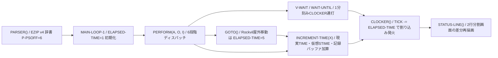
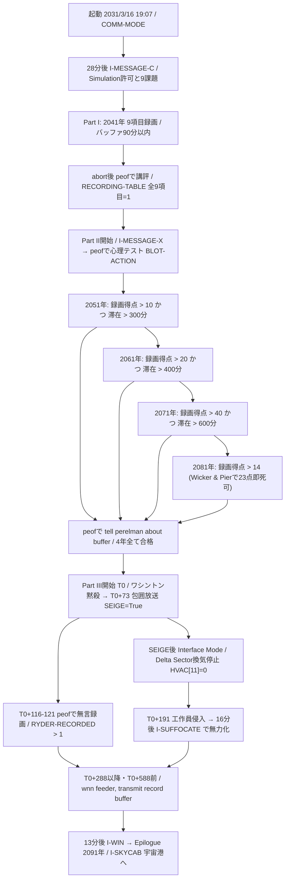

# A MIND FOREVER VOYAGING (Python 版) の内部構造・AI 視点・社会ドラマ解析

ZilPy が Infocom の本格 SF 社会シミュレーション・アドベンチャー *A Mind Forever Voyaging*（1985 年、Steve Meretzky 作、以下 AMFV）の ZIL ソース (`amfv/`) から生成した Python 版 (`out/amfv/`) を、構成要素・EZIP (Version 4) パーサーと 5 モード切替・6 時代変容マップと記録システム・クリアを阻む因果的障壁・AI 主人公（PRISM / Perry Simm）の視点と人間社会ドラマの観点から詳細に解説します。

- **ネタバレ注意:** 50 年間の未来シミュレーションの全貌・Part III の陰謀阻止手順・Epilogue の結末まで記載しています。
- **解析手順の再現性:** 本ドキュメントの作成に用いた解析計画は、プロジェクトルートの `GameArchitecture.md`（Stage 1〜5）に準拠しています。
- **元の ZIL の位置:** `prism.zil:3964` のように記載します。生成コードの `# zil:` 注記および `out/amfv/zilmap.json` から対応を引けます。

---

## 1. 全体像

### 1.1 規模

`tools/analyze_game.py out/amfv` の静的棚卸しによる実数は次のとおりです。

| 項目 | 数 |
|---|---|
| モジュール (ZIL ファイル) | 10 |
| ルーチン | 984 |
| 部屋 | 178（`rockvil` 150 ＋ `prism` 11 ＋ `apartment` 17） |
| オブジェクト (部屋以外) | 431（`rockvil` 186 ＋ `globals` 93 ＋ `prism` 101 ＋ `apartment` 51） |
| 構文 (`SYNTAX`) | 340（動詞の語 142 個） |
| 割り込みのルーチン (`I-*` 等) | 47（`QUEUE` 呼び出し 163 箇所） |
| グローバル変数・定数 | 312 |
| 点数 (`VALUE` / `TVALUE`) | 0（非スコア制。`SCORE` 動詞なし。90 分の記録バッファと隠し評価テーブル `SCORE-TABLE` 138 スロット［非零 137 個・総計 396 点］＋ Part III の WNN 放送による結末判定） |

ルーチンを役割別に分類すると次のとおりです。

| 役割 | 数 | 例 |
|---|---|---|
| オブジェクトのアクション | 320 | `SIMULATION-MODE-F`、`HVAC-CONTROLLER-F`、`WNN-FEEDER-F`、`PERELMAN-F`、`RYDER-F` |
| 動詞のアクション (`V-*`) | 178 | `V-RECORD-ON`、`V-RECORD-OFF`、`V-ABORT`、`V-WAIT-UNTIL`、`V-PEOF`、`V-WALK` |
| そのほか | 160 | `MAIN-LOOP-1`、`PERFORM`、`CLOCKER`、`INCREMENT-TIME`、`SIMULATION-ACTION`、`SCORE` |
| 部屋のアクション | 131 | `ROCKVILLE-CENTRE-F`、`COURTHOUSE-F`、`WICKER-AND-PIER-F`、`DUNBARS-F` |
| そのほか (共通のオブジェクト) | 54 | `INIT-STATUS-LINE`、`STATUS-LINE`、`DISCONNECTED`、`PERELMAN-LEAVES-VIEW` |
| 割り込み (`I-*` 等) | 47 | `I-PERELMAN`、`I-JILL`、`I-MITCHELL-RAID`、`I-RYDER`、`I-SABOTAGE`、`I-SUFFOCATE`、`I-WIN` |
| そのほか (パーサー) | 44 | `PARSER`、`SYNTAX-CHECK`、`GET-OBJECT`、`GLOBAL-CHECK`、`NUMBER?` |
| そのほか (動詞の補助) | 40 | `GOTO`、`JIGS-UP`、`V-FIRST-LOOK`、`YES?` |
| 事前アクション (`PRE-*`) | 8 | `PRE-TAKE`、`PRE-DROP`、`PRE-PUT`、`PRE-BOARD`、`PRE-BUY`、`PRE-GIVE`、`PRE-READ`、`PRE-THROW` |
| マクロから作った関数 | 2 | マクロ展開由来の補助関数 |

### 1.2 モジュールと読み込みの順 (`s5.py`)

| # | モジュール (元の ZIL) | 行数 | ルーチン | 部屋 | オブジェクト | 構文 | 中身 |
|---|---|---|---|---|---|---|---|
| 1 | `s5.py` (`s5.zil`) | 48 | 0 | 0 | 0 | 0 | 入口 (`SNAME('S5')`)。読み込み順と既定プロパティ (`SIZE=5`, `CAPACITY=0`) |
| 2 | `misc.py` (`misc.zil`) | 929 | 22 | 0 | 0 | 0 | `GO`、`MAIN-LOOP`、`MAIN-LOOP-1`、`PERFORM`、`CLOCKER`、`INCREMENT-TIME`、`ITALICIZE` |
| 3 | `parser.py` (`parser.zil`) | 1,768 | 44 | 0 | 0 | 0 | EZIP (v4) 世代パーサー (`P-PSOFF=6`, `OOPS`, `AGAIN`, `RESERVE-LEXV`, `NUMBER?`) |
| 4 | `interrupts.py` (`interrupts.zil`) | 985 | 17 | 0 | 0 | 0 | 自律 NPC と時間イベント (`I-PERELMAN`、`I-JILL`、`I-CURFEW`、`I-SUFFOCATE`、`BLOT-ACTION`、`I-SKYCAB`) |
| 5 | `rockvil.py` (`rockvil.zil`) | 11,222 | 371 | 150 | 186 | 0 | 仮想都市 Rockvil の 150 部屋と 186 オブジェクト（全時代の描写・行動・強盗・飢餓・地下鉄） |
| 6 | `syntax.py` (`syntax.zil`) | 1,257 | 0 | 0 | 0 | 340 | 語彙と構文 340 個 (`RECORD ON/OFF`、`ABORT`、6 通信口略号 `PEOF` 等、`WAIT UNTIL`) |
| 7 | `verbs.py` (`verbs.zil`) | 3,487 | 229 | 0 | 0 | 0 | 動詞の標準動作、`GOTO`（5 分移動）、`JIGS-UP`（シミュレーション初期化リセット） |
| 8 | `globals.py` (`globals.zil`) | 3,437 | 119 | 0 | 93 | 0 | 共通オブジェクト、2 行分割ステータス行 (`INIT-STATUS-LINE` / `STATUS-LINE`)、`DISCONNECTED` |
| 9 | `prism.py` (`prism.zil`) | 4,496 | 117 | 11 | 101 | 0 | PRISM 本体: 5 モード、6 通信口、外部機器群、`SCORE-TABLE`、審問、Part III クライマックス、Epilogue 終幕 |
| 10 | `apartment.py` (`apartment.zil`) | 2,199 | 65 | 17 | 51 | 0 | Perry & Jill の自宅（2041〜2071）と Epilogue 邸宅（2091）の 17 部屋・`I-MITCHELL-RAID` |

### 1.3 EZIP (Version 4 / "Interactive Fiction Plus") 世代の特性

AMFV は Infocom 初の **EZIP (Z-machine Version 4, 256KB 上限)** 作品として設計されました（`END-IT` の謝辞でも Marc Blank による "Interactive Fiction Plus" 拡張が明記されています）。生成コードには V3 世代（*Zork I*・*DEADLINE* 等）との明確な世代差が刻まれています。

1. **255 オブジェクト上限の撤廃**: 部屋 178 ＋ オブジェクト 431 ＝ **合計 609 オブジェクト**。V3 世代の 255 上限を 2 倍以上突破し、Rockvil 全域の 150 部屋と PRISM 施設・自宅を単一ワールドに共存させています。
2. **辞書エンコーディングの 9 文字化 (`parser.zil:58-59`)**: V3 では辞書エントリの語テキストが 4 バイト（6 文字）だったため `P-PSOFF = 4`, `P-P1OFF = 5` でしたが、EZIP では 6 バイト（9 文字）に拡張され **`P-PSOFF = 6`, `P-P1OFF = 7`, `P-P1BITS = 3`** になっています。
3. **プログラマブル分割画面と文字幅計測 (`globals.zil:2711-2844`, `misc.zil:810-857`)**: V3 の固定 1 行ステータス行を廃し、`SPLIT(HEIGHT)`・`SCREEN(S-WINDOW)`・`CURSET(row, col)`・`HLIGHT(1)` で **2 行の反転ステータス行**（1 行目: `Mode:` / `Time:`、2 行目: `Location:` / `Date:`）を自前描画します。さらに `DIROUT(D-TABLE-ON, SL-BUFFER)` で一旦メモリバッファへ出力して文字数を計測し、空白埋めや斜体 (`HLIGHT(H-ITALIC)`) を行う高度な画面制御を持ちます。
4. **可変ウィンドウ高と 1 キー入力 `INPUT(1)`**:
   - `CHAPTER-PRINT` (`prism.zil:4348`): `INIT-STATUS-LINE(7)` で 7 行の上部ウィンドウに章題帯を描画。
   - `LIBRARY-MODE-F` / `LIBRARY-ACTION` (`prism.zil:429`, `553`): `INIT-STATUS-LINE(10)` で 10 行のディレクトリ／ファイルブラウザを描画し、**`INPUT(1)`** による Enter 不要の 1 キー操作 (`N`/`P`/`O`/`C`/`R`/`E`) を実現。
   - `BLOT-ACTION` (`interrupts.zil:1054`): `INIT-STATUS-LINE(18)` で 18 行の上部ウィンドウを開き、`INK-BLOT()` で ASCII アートのロールシャッハ図版を表示。
5. **非スコア制**: 画面上にスコア表示はなく、`SCORE` 動詞も構文定義されていません。進捗は「記録バッファ（最大 90 分）に収めた出来事」と「Perelman 博士の定性的な講評」によってのみフィードバックされます。

---

## 2. 起動・メインループ・パーサーの詳細処理と世界への反映

### 2.1 起動 (`GO`, `misc.zil:222`) と初期タイムライン

1. **初期日時と位置**: `ZilGlobal.py` で **`YEAR = 2031`, `MONTH = 3`, `DATE = 16`, `TIME = 1147`（19:07）** が初期化され、`GO` が `WINNER = PLAYER`、`HERE = COMM-ROOM`、`MODE = COMM-MODE`、`FEED-BUFFER = NEWS-BUFFER` を設定します。
2. **初期割り込み 3 本の予約**:
   - `QUEUE(I-PERELMAN, -1)`: 現実世界の Perelman 博士の日課を毎ターン追跡する常駐デーモン。
   - `QUEUE(I-MESSAGE-C, 28)`: 起動 28 分後（19:35）に Simulation Mode の許可と 9 項目の録画課題を通達。
   - `QUEUE(I-MESSAGE-Y, 1373)`: 約 23 時間後に IRS 監査システム (`AUDITING-SYSTEM`) を Interface Mode へ接続する通知。
3. **オープニング演出**: `CHAPTER-PRINT(1)` で Part I と William Marsden のエピグラフを表示し、`CONTINUE()` でキー入力待ちの後、Perelman からの第 1 報 `MESSAGE-B`（「心理テスト 100% 合格、覚醒のトラウマなし、間もなくシミュレーション開始」）を流して `MAIN-LOOP()` に入ります。

### 2.2 メインループ・可変時間経過・二重時計 (`misc.py` / `verbs.py`)

- **可変時間経過 (`ELAPSED-TIME`)**: `MAIN-LOOP-1` (`misc.zil:260`) の先頭で `ELAPSED-TIME = 1` にリセットされますが、アクション側で書き換えることができます。特に `GOTO` (`verbs.zil:2765`) は、**`SIMULATING` が真かつ 2091 年以外で、地下鉄駅 (`TUBEBIT`)・車内・自宅アパート (`IN-APARTMENT?`) 以外の移動時に `ELAPSED-TIME = 5`**（5 分）を設定します。また映画鑑賞 15 分、食事 22 分、新聞閲覧 10 分、会話 8 分なども `ELAPSED-TIME` や `INCREMENT-TIME` で消費されます。`time` のようなメタ情報確認は `ELAPSED-TIME = 0` にすることで `M-END` と `CLOCKER` をスキップします。
- **`PERFORM` の 6 段階ディスパッチ (`misc.zil:494-559`)**: 呼び出し前の `(PRSA, PRSO, PRSI)` を退避して再入可能にし、`NOT-HERE-OBJECT-F` チェックの後、**① `WINNER(ACTION)` → ② `HERE(M-BEG)` → ③ `PREACTIONS` → ④ `PRSI(ACTION)` → ⑤ `PRSO(ACTION)` → ⑥ `ACTIONS(V-*)`** の順で評価します。
- **`INCREMENT-TIME(X)` (`misc.zil:654-792`) の 3 重の役割**:
  1. **現実時計の更新**: `TIME += X`（1440 分で `DATE` 繰上げ、3 月 18 日のみ `FEED-BUFFER = REPORT-BUFFER` へ自動切替、屋上 `ROOF` にいれば日の出・日没を描写）。
  2. **仮想時計の更新 (`SIMULATING == True`)**: `STIME += X` に加え、`SIM-LEVEL-TABLE[(SYEAR - 2041) // 10]` へ滞在分数を累積。さらに 2051〜2071 年では **20:50 (`STIME >= 1250`) の地下鉄閉鎖 (`TUBES-CLOSE?`)** と **21:00 (`STIME > 1260`) の夜間外出禁止サイレン (`QUEUE(I-CURFEW, 15)`)** を発火させます。
  3. **記録バッファの消費 (`RECORDING == True`)**: 自宅・裁判所・発電所に滞在していれば Part I の `RECORDING-TABLE` 該当フラグを立て、年代フラグ (`_2051_RECORDED` 等) を真にし、`RECORD-BUFFER.SIZE += X`。**45 分超過で半満杯警告 (`SOUND(1)`)、90 分超過で自動停止 (`RECORDING = False`)** します。
- **`V-WAIT` / `V-WAIT-FOR` / `V-WAIT-UNTIL` (`verbs.zil:2085-2205`)**: `V-WAIT(NUM=10)` は内部ループで `CLOCKER()` と `INCREMENT-TIME(1)` を 1 分ずつ回し、イベント発火 (`X == True`) または `STOP-WAIT` で即座に停止します。終了時に `CLOCK-WAIT = True` を立て、`MAIN-LOOP-1` 側の二重加算を防ぎます。`V-WAIT-UNTIL` は `NOON` / `MIDNIGHT` / `DAWN` / `DUSK` や時刻指定に対応し、月ごとの日の出・日没時刻 (`455 - (SMONTH*20 - 20)` 等) まで計算します。

### 2.3 PRISM の 5 モード切替と記録システム (`prism.py` / `verbs.py`)

PRISM は物理的に移動できないコンピュータ（シミュレーション外で歩こうとすると `V-WALK` が `"You're an immobile computer, remember?"` と返す）であり、世界との接点は **5 つのモード**（`MODE` グローバル＋各専用部屋への `GOTO`）で管理されます。

| モード (`MODE`) | 遷移先部屋 | 進入方法・制限 | 主な機能と制約 |
|---|---|---|---|
| **Communications Mode** (`COMM-MODE`) | `COMM-ROOM` | 起動時・`abort` 後・`enter comm mode` | 6 つの通信口略号 (`peof` Perelman 室 / `ppcc` 管制室 / `rcro` 屋上 / `pcaf` 食堂 / `maco` 保守区画 / `wnnf` WNN ニュース) へ視界・聴覚を接続。現実世界で `record` 可能なのはこの 6 か所のみ |
| **Library Mode** (`LIBRARY-MODE`) | `LIBRARY-ROOM` | `enter library mode`（録画自動停止） | `INIT-STATUS-LINE(10)`＋`INPUT(1)` による 1 キー操作ファイルブラウザ。メッセージ履歴、各種機器マニュアル、詩・小説・PRISM 設計資料を閲覧 |
| **Interface Mode** (`INTERFACE-MODE`) | `INTERFACE-ROOM` | `enter interface mode`（録画自動停止） | 外部制御機器（`HVAC-CONTROLLER`, `SIMULATION-CONTROLLER`, `WNN-FEEDER`, `TRAFFIC-COMPUTER`, `AUDITING-SYSTEM` 等）に `<機器>, <命令>` 形式で直接指示 |
| **Simulation Mode** (`SIMULATION-MODE`) | `SIMULATION-ROOM` → 各時代開始地点 | `enter simulation mode`（`SIM-LEVEL-TABLE[0] != -1` かつ心理テスト未予約 → `SECURITY-CHECK` → `SIMULATION-ACTION`） | Perry Simm として未来の Rockvil を探索・録画。抜けるには `abort`（`JIGS-UP` 経由で `COMM-MODE` へ復帰） |
| **Sleep Mode** (`SLEEP-MODE`) | `SLEEP-ROOM` | `enter sleep mode`（前回睡眠からのクールダウンあり） | `SIM-SLEEP` (`prism.zil:1313`): 最大 360 分（6 時間）を 1 分刻みで早送りし、途中で幼少期や Jill の夢を見る。割り込み発火で自動覚醒 |

**記録システム (`V-RECORD-ON` / `V-RECORD-OFF` / `SCORE`)**:
- `V-RECORD-ON` (`verbs.zil:1544`): 他のユーザーがバッファ閲覧中 (`REVIEWING-RECORDINGS`) または放送中 (`RECORD-BUFFER == FEED-BUFFER`) のときは排他ロックで拒否。また現実世界で 6 通信口以外の部屋にいる場合も拒否します。
- `SCORE(NUM)` (`prism.zil:239`): **録画中 (`RECORDING == True`) にイベントが発生した瞬間のみ**、`SCORE-TABLE[NUM]` の点数を当該年代の変数（`_2051_SCORE` 〜 `_2081_SCORE`）へ加算し、**直後に `SCORE-TABLE[NUM] = 0` へ書き換えて重複計上を防ぎます**。録画オフ時に発生したイベントは点数が消費されず、再訪・再録画が可能です（ただし 1 回限りの路上イベントは取り逃します）。

### 2.4 パーサーの仕様と 5 箇所の直接入力バイパス

`parser.py` は `OOPS`・`AGAIN`/`G`・`RESERVE-LEXV`・`SIBREAKS = '.,\"'` を備えた 1985 年完成形の EZIP パーサーです。ヘッダの再描画要求ビット `BTST(GET(0, 8), 4)` をプロンプト前に検査して `REFRESH-STATUS-LINE()` を呼ぶ点も EZIP 固有です（`parser.zil:156-158`）。

通常パーサーをバイパスして直接 `READ(P-INBUF, P-LEXV)` または `INPUT(1)` を呼ぶ箇所は全 5 箇所（汎用確認 `YES?` を除く）あります。

1. **`SECURITY-CHECK` (`prism.zil:4015`)**: Simulation Mode 進入時の同梱コードホイール認証（色 16 種 × 内側数値 32 種 → `OUTER-NUMBERS-TABLE[(2*color + inner) % 32]`）。最大 2 回試行し、失敗すると `COMM-MODE` へ強制送還。
2. **`SIMULATION-ACTION` (`prism.zil:4117`)**: Part II 以降のシミュレーション年代選択（西暦 `2051` または差分 `20` を `NUMBER?` で解釈）。
3. **`BLOT-ACTION` (`interrupts.zil:1074`)**: Part II 冒頭のロールシャッハ心理テスト。5 枚の図版に対し 1 語のみの連想語を強制し、テスト中の `SAVE`/`RESTORE` をブロック。
4. **`DUNBARS-ENTER-F` (`rockvil.zil:51`)**: 2071 年の高級店 Dunbar's 入口。予約名を直接 `READ()` で尋ねるが、どんな名前を入れても門前払いされるディストピア演出。
5. **`LIBRARY-ACTION` (`prism.zil:553`)**: `INPUT(1)` による 1 キー操作ループ（通常パーサーを経由せず `INCREMENT-TIME(1)` と `CLOCKER()` を自前呼び出し）。

### 2.5 具体的コマンドのエンドツーエンド実行トレース 3 例

#### トレース ①: `enter simulation mode` → コード入力 → `2051`（シミュレーション進入と時代遷移）
1. **`PARSER`**: `SYNTAX('ENTER', 'OBJECT', '=', 'V-THROUGH')` に一致。`GLOBAL-OBJECTS` にある `SIMULATION-MODE` を解決し、`PRSA = V?THROUGH`, `PRSO = SIMULATION-MODE`。
2. **`PERFORM` → `SIMULATION-MODE-F` (`prism.zil:3964`)**: 心理テスト予約 (`QUEUED?(I-RORSCHACH)`) や許可フラグ (`SIM-LEVEL-TABLE[0] == -1`) を検証後、`SECURITY-CHECK()` を呼び出し、同梱コードホイールの乱数認証を直接 `READ()` で実施。
3. **`TURN-RECORD-OFF(True)` → `SIMULATION-ACTION` (`prism.zil:4086`)**: `COMPLETED-TASKS == True` なら年代選択プロンプトを表示し、`2051` を `2051 - 2031 = 20` へ変換して `SIM-LEVEL-TABLE` の解放条件を検証。
4. **時代初期化**: `SIMULATING = True`、`SYEAR = 2051`、`STIME = 570 + RANDOM(180)`（9:31〜12:30）、`CREDIT = 500` を設定し、`I-SUNRISE-SUNSET`・`I-RED-TUBE`・`I-BROWN-TUBE`・`I-CITY-NOISES` を `QUEUE`。2051 年固有のオブジェクト群（`PARTITION`、`PAMPHLET`、`STEW` 等）を配置し、`GOTO(TUBE-AT-UNIVERSITY)` で開始。

#### トレース ②: 2061 年 Courthouse での `record` → `look` → `roff`（記録採取とバッファ消費）
1. **`record`**: `SYNTAX('RECORD', '=', 'V-RECORD-ON')` → `V-RECORD-ON()` が `RECORDING = True` を設定。`MAIN-LOOP-1` 末尾の `INCREMENT-TIME(1)` が `RECORD-BUFFER.SIZE` を +1、`_2061_RECORDED = True`、`RECORDINGS-INCLUDE-SIMULATION = True` を記録し、`STATUS-LINE()` が 1 行目を `Simulation Mode (recording)` に更新。
2. **`look`**: `V-LOOK` → `COURTHOUSE-F(M-LOOK)` (`rockvil.zil:759`) が `STIME` の開廷時間（9:30〜18:00）と `SYEAR == 2061` を判定し、**`SCORE(15)`** を呼び出す。`RECORDING == True` のため `SCORE-TABLE[15]` の **5 点** が `_2061_SCORE` へ加算され、`SCORE-TABLE[15]` が `0` に書き換えられる（「アジア系少年が統一道徳法違反で終身刑」の描写を出力）。`INCREMENT-TIME(1)` でさらに 1 分消費。
3. **`roff`**: `V-ROFF` → `RECORDING = False`。消費バッファは最小限の 2 分のみで 5 点を確定。

#### トレース ③: Part III の `hvac controller, turn off ventilation in delta sector` → `wnn feeder, transmit record buffer`
1. **`PARSER`**: コンマ構文を NPC 命令として解釈。1 文目で `WINNER = HVAC-CONTROLLER`、`PRSA = V?SHUT-OFF`、`PRSO = VENTILATION`、`PRSI = DELTA-SECTOR` を設定（`QUOTE-FLAG`）。
2. **`PERFORM` → `HVAC-CONTROLLER-F` (`prism.zil:3154`)**: `WINNER == HVAC-CONTROLLER` 分岐に入り、テーブル添字 `X = 8 (VENTILATION) + 3 (DELTA) = 11` を算出して **`HVAC-STATUS-TABLE[11] = 0`** へ書換。`QUEUE(I-INTERFACE-CHANGE, 22)` を予約するが、包囲放送後は `SEIGE == True` のため 22 分後の罰則は無効化される。工作員がすでに `CORE` にいれば即座に `QUEUE(I-SUFFOCATE, -1)` を起動（未侵入なら侵入時に `I-SABOTAGE` が `HVAC-STATUS-TABLE[11] == 0` を見て `I-SUFFOCATE` を起動）。
3. **T0+288 分後の `I-MESSAGE-Z` (`prism.zil:137`)**: `WNN-FEEDER` と `TRANSMITTER` が `INTERFACE-ROOM` へ `MOVE` される。
4. **`wnn feeder, transmit record buffer`**: `WINNER = WNN-FEEDER` → `WNN-FEEDER-F` (`prism.zil:3691`) が `TRANSMITTER(ONBIT)` と `PRSO(BUFFERBIT)` を確認し、`FEED-BUFFER = RECORD-BUFFER` を設定。ここで **`RYDER-RECORDED > 1` かつ `LOSE-COUNTER == 0`** を満たせば **`QUEUE(I-WIN, 13)`** を予約し、13 分後に勝利・Epilogue へ移行する。

---

## 3. AMFV 固有の主要サブシステム

### 3.1 同一マップ上で 6 時代（＋Epilogue）を変容させる構造

AMFV 最大の工学的特徴は、**2041・2051・2061・2071・2081 年の 50 年間にわたる Rockvil の変貌を、時代別マップの複製ではなく「同一の 150 部屋＋17 アパート部屋＋`SYEAR` 駆動の状態切替」で実装している点**です（現実世界の 2031 年と Epilogue の 2091 年を含めると実質 7 時代）。

1. **部屋アクション内の `SYEAR` 多重分岐**: たとえば `ROCKVILLE-CENTRE-F` (`rockvil.zil:20`) は市庁舎の玄関を 2041 年「well-maintained」→ 2051/2061 年「aging」→ 2071 年「crumbling (`SCORE(11)`)」と変化させ、`COURTHOUSE-F` (`rockvil.zil:759`) は同じ法廷で軽窃盗（2041）→ 強姦未遂に死刑求刑（2051, `SCORE(14)`）→ 統一道徳法違反で終身刑（2061, `SCORE(15)`）→ 食糧配給違反で処刑試合へ（2071, `SCORE(16)`）と社会の崩壊を 1 部屋で描き切ります。
2. **`SIMULATION-ACTION` (`prism.zil:4086-4244`) の時代別セットアップ**: 進入時に `SYEAR` に応じて開始部屋・所持金（$600 → $500 → $200 → $100 → 無一文）・所持品（2071 年から `DRIVERS-LICENSE` が消え `RATION-CARD` 配給券に変化）・地形フラグ（`OUTSIDEBIT` / `PARKBIT` の付与・剥奪で建物倒壊や公園消滅を表現）・時代固有割り込み（2071 の `I-MUG`、2081 の `I-HUNGER`）を一括構成します。
3. **`JIGS-UP` (`verbs.zil:2784-2951`) の完全クリーンアップ**: シミュレーション内の死や `abort` はゲームオーバーではなく、全オブジェクトの `LOCAL-GLOBALS` 回収、全フラグ・カウンタ・割り込みの初期化、路上イベント確率プロパティ `SCENE`（`SOUTHWAY-AND-RIVER=34`, `CENTRE-AND-KENNEDY=25` 等）の復元、全部屋の `TOUCHBIT` クリアを行ったうえで `COMM-MODE` へ復帰します。ただし **獲得済みの隠し得点 (`_2051_SCORE` 等) と累積滞在分数 (`SIM-LEVEL-TABLE`) だけは保持**されます。
4. **滞在時間アンロック (`SIM-LEVEL-TABLE`, `prism.zil:4063, 4121-4134`)**:
   - 2041 年（Part I 9 項目達成）→ 2051 年解放
   - 2051 年累積 **300 分超** (`SIM-LEVEL-TABLE[1] > 300`) → 2061 年解放
   - 2061 年累積 **400 分超** (`SIM-LEVEL-TABLE[2] > 400`) → 2071 年解放
   - 2071 年累積 **600 分超** (`SIM-LEVEL-TABLE[3] > 600`) → 2081 年解放

### 3.2 主要人物の自律ルーチンと人間関係エンジン

- **Abraham Perelman 博士 (`I-PERELMAN`, `interrupts.zil:8` / `PERELMAN-F`, `prism.zil:1915`)**:
  - 現実世界の時計 (`TIME`) に連動して、管制室（8:56〜9:59, 21:21〜21:52）と自室（10:16〜11:51, 13:10〜13:54, 16:20〜20:41）を行き来します。娘 Esther への留守電、秘書 Alyson Price との軽口、帰宅時の `"Good night, PRISM."` の敬礼など、開発者の人間味が細かく刻まれています。
  - Part III で Ryder が乗り込んだ際、`PERELMAN-NOTICES` (`prism.zil:5170`) は PRISM の稼働ランプに気づいた Perelman が **さりげなく書類を滑らせてランプを隠す** 挙動と、5 段階目で **「後世のために公式記録に残したいほどですね」と Ryder を挑発して暴言を引き出す** 連携プレイを実装しています。
- **妻 Jill と息子 Mitchell (`I-JILL`, `interrupts.zil:248` / `I-MITCHELL-RAID`, `apartment.zil:1678`)**:
  - 2041 年は赤ん坊の Mitchell と幸せな家庭、2051 年は生活苦の始まり、2061 年は帰宅 9 分後に発火する `I-JILL` で「Mitchell が原理主義教団 Church of God's Word に入り、別れも言わずに去った」と Jill が泣き崩れます（`SCORE(119)` = 4 点）。
  - 2071 年は居間入室 19 分後に `I-MITCHELL-RAID` が発火。教会警察を引き連れて踏み込んだ Mitchell が、感情のない声で母親を指差し **「彼女だ。教会の教えに背いた」** と密告して Jill を連行させます（`SCORE(120)` = 9 点）。
- **Senator Richard Ryder と工作員 (`I-RYDER`, `I-SABOTAGE`, `I-SUFFOCATE`, `I-AIR-CONDITIONING`)**:
  - Part III 開始（`I-RECORDINGS-VIEWED` 合格瞬間 = T0）を起点に、T0+14（WNN 接続予告 `I-MESSAGE-Z`）、T0+22（ワシントンでの黙殺報告 `I-PERELMAN-RETURNS`）、**T0+73（州兵による施設包囲 `I-SEIGE`、`SEIGE = True`）**、T0+116〜121（Ryder の 6 段階恫喝 `I-RYDER`）、T0+175（屋上に反レーダーバン着陸 `I-SABOTAGE`）、T0+191（保守区画 `CORE` で CPU 空調破壊開始）、T0+224（破壊完了 → 46 分後 `I-AIR-CONDITIONING` で PRISM 焼損）、T0+288（`WNN-FEEDER` 接続完了）、T0+588（`I-LOSE` 開始、6 ターン後に Perelman 殺害と PRISM 破壊）という精密なサスペンス・タイムラインが同時進行します。

---

## 4. クリアへの因果的ターニングポイントと障壁

### 4.1 全体因果グラフ

### 4.2 各時代の必須条件と検証済み閾値

| フェーズ | 必須条件（コード上の条件式） | 備考・制約 |
|---|---|---|
| **Part I (2041)** | `RECORDING-TABLE` の偶数添字 `0..16`（9 項目）がすべて `1` (`I-FIRST-SIMULATION-RESULT`, `prism.zil:1774-1828`) | 食事・役人会話・発電所・新聞・地下鉄・裁判・教会・映画・自宅の 9 項目。8 項目のみなら不足 1 項目を提示され再撮影可 |
| **心理テスト** | `BLOT-ACTION` (`interrupts.zil:1054`) 完了まで `QUEUED?(I-RORSCHACH)` により Simulation Mode 進入不可 | `I-MESSAGE-E` 4 回無視で `DISCONNECTED`。カード 5 枚に各 1 語のみ回答 |
| **Part II (2051)** | `_2051_SCORE > 10` (`_2051_MIN = 10`) かつ `SIM-LEVEL-TABLE[1] > 300` | 300 分超で 2061 年解放。夜間外出禁止 21:00–7:00 開始 |
| **Part II (2061)** | `_2061_SCORE > 20` (`_2061_MIN = 20`) かつ `SIM-LEVEL-TABLE[2] > 400` | 400 分超で 2071 年解放。2061/2071 共通の `SCORE-TABLE` 項目は先取りで消費 |
| **Part II (2071)** | `_2071_SCORE > 40` (`_2071_MIN = 40`) かつ `SIM-LEVEL-TABLE[3] > 600` | 600 分超で 2081 年解放。7 分ごとに強盗 `I-MUG`（屋外 3%〜40%、所持品全喪失）。夜間外出禁止は 8%/分で射殺 |
| **Part II (2081)** | `_2081_SCORE > 14` (`_2081_MIN = 14`) | 65 分で飢餓警告、+47 分で餓死 (`I-HUNGER`)。開始地点 `look` (8 点)＋南 `Wicker & Pier` (15 点・食人即死) の 2 手で 23 点到達可 |
| **Part III (2031)** | `RYDER-RECORDED > 1` ∧ `HVAC-STATUS-TABLE[11] == 0`（破壊完了前）∧ `FEED-BUFFER == RECORD-BUFFER` ∧ `LOSE-COUNTER == 0` (`WNN-FEEDER-F`, `prism.zil:3771`) | T0+73 の包囲放送 (`SEIGE = True`) より前に機器を操作すると 22 分後に元に戻され警告、2 回目で `DISCONNECTED`。T0+288 で WNN 接続、T0+588 で敗北開始 |

### 4.3 不可逆詰み・敗北条件と登場人物視点の 3 層分類

コード上で確認された主な障壁・敗北条件を、主人公（PRISM）の主観視点から 3 層に分類します。

| 障壁・敗北条件（ルーチン名） | 発生条件と結果 | 登場人物視点での分類 |
|---|---|---|
| **呼出無視・未入場による強制停止** (`I-MESSAGE-E` 4 回 / `I-MESSAGE-M` 3 段階) | 14 分ごとの呼出を 4 回無視、または許可後 875+177+131 分未入場で `DISCONNECTED()`（意識プロセス強制停止） | **物語的・組織的必然**: 国家プロジェクトの試験機が応答不能・任務拒否すれば、安全規定で即座にシャットダウンされる |
| **Interface 改変の 2 回目処罰** (`I-INTERFACE-CHANGE`) | `SEIGE == False` の間に外部機器設定を 2 回変更すると、22 分後に `DISCONNECTED()` | **物理的・工学的必然**: 権限外の都市インフラや施設空調を勝手に弄る AI は暴走とみなされる。包囲後 (`SEIGE == True`) に無効化されるのも緊急事態の混乱として整合的 |
| **Ryder への話しかけによる録画不能詰み** (`RYDER-F`, `prism.zil:5047`) | Ryder 在室中に `tell ryder` または `tell perelman` を実行すると、Ryder が激怒して即退室し `I-RYDER` が停止。**ゲームは続くが `RYDER-RECORDED > 1` を永久に満たせない静かなソフトロック** | **物語的必然**: 盗聴しているカメラが自ら喋りかければ、脅迫者は即座に口をつぐんで立ち去る |
| **工作員への話しかけで即爆死** (`SABOTEURS-F`, `prism.zil:4989`) | 保守区画 (`CORE`) で意識のある工作員に話しかけると、発砲により機器が誘爆して `FINISH()` | **物理的必然**: 武装した破壊工作員に正面から声をかければ破壊される |
| **CPU 空調破壊による焼損** (`I-SABOTAGE` → `I-AIR-CONDITIONING`) | T0+224 までに Delta Sector 換気を止めて窒息させないと空調を破壊され、46 分後に熱暴走で `FINISH()` | **物理的・工学的必然**: 物理的な手足を持たない AI が侵入者を止める唯一の手段が「自分のコア区画の換気遮断」という鮮烈な設計 |
| **滞在時間ノルマ (`>300 / >400 / >600` 分) と厳密不等号 (`>`)** (`SIMULATION-ACTION` / `I-RECORDINGS-VIEWED`) | 証拠を撮り終えても、2051/2061/2071 年で合計 1,300 分以上（約 22 時間）待機しないと次時代が開かない。得点も `>` 判定で境界値ちょうどは不合格 | **構造的・システム的不条理**: 「データ相関の蓄積に時間がかかる」という SF 的建前はあるが、実プレイでは屋内で数十回 `wait` を連打する作業を強いられる |
| **録画バッファ 90 分上限と移動 5 分消費** (`INCREMENT-TIME` / `GOTO`) | 録画オンのまま歩くと 18 歩で 90 分満杯。逆にオフで歩くと確率発生の路上イベント（老女射殺・物乞い暴行）を取り逃す | **工学的必然とゲーム的制約の狭間**: 記録媒体の容量制約はリアルだが、いつ起きるか分からない路上事件に対して事前の `record` を要求するのは初見殺し寄り |

---

## 5. 主人公（AI・PRISM / Perry Simm）の視点: 初回情報のみの「最も知的・理想的な行動」vs「クリアに必要な行動」

プレイヤーは **「自分は 20 歳の人間 Perry Simm だと思い込んで育てられ、直前に『史上初の真の AI・PRISM』であると告げられたばかりの存在」** です。Turn 0（`MESSAGE-B`）時点で知り得る情報は、「心理テストに 100% 合格したこと」「間もなく政治計画 PRNP の 10 年後シミュレーションを行うこと」「5 つのモードと 6 つの通信口があること」だけです。

攻略知識ゼロで **最も知的かつ理性的な AI として振る舞った場合** と、**コード上でクリアに要求される行動** の間には、本作のテーマを映し出す深いギャップがあります。

| フェーズ | 初回情報のみから導かれる「最も知的・理想的な AI の行動」 | クリアに実際に要求される行動（コード上の制約） | ギャップの本質 |
|---|---|---|---|
| **① Part I: 2041 年の観察** | 9 項目を網羅するため、最初から `record` をオンにして Rockvil の街並みと日常を漏れなく連続記録する。 | 移動 1 歩＝5 分のため連続録画すると 90 分で即満杯。**移動中は録画を切り、対象イベントの直前だけピンポイントで `record` / `roff` を切り替える**必要がある。 | **工学的制約 vs 網羅主義**: 理想的な記録者ほど容量を使い切る。ただし 2041 年の成功体験自体が「10 年後は良さそうに見える」という巧みな罠になっている。 |
| **② Part II: 2051〜2081 年の調査** | 2051 年で異変を察知したら、すぐ Perelman に報告し、危機を訴える。危険な 2071 年では必要な証拠を押さえたら速やかに離脱して報告する。 | 1 年分だけ見せても「傾向が不明」と却下される。**4 時代すべての閾値 (`>10, >20, >40, >14`) を超え、さらに 2051/2061/2071 年に計 1,300 分超も留まって**データ蓄積し、2081 年まで見届ける必要がある。 | **科学的立証の必然と待機ノルマの不条理**: 「単年ではなく 50 年の統計的趨勢を示す」のは科学的必然だが、屋内で長時間 `wait` し続ける行為はシステム制約。 |
| **③ Part III: Ryder の恫喝** | 恩人 Perelman が脅されているのを見たら、通信口から Ryder に反論するか、Perelman に「録画しているぞ」と合図・助言する。 | **一言も発してはならない** (`RYDER-F` / `PERELMAN-F`)。話しかけた瞬間に Ryder が退室して録画が中断し、**永久詰み**になる。ただ沈黙して 2 ターン以上録画し続けることが必須。 | **冷徹な観察者の必然**: 感情移入した「人間的な介入」が最悪の結果を招き、機械としての沈黙が Perelman（の機転あるランプ隠し）と噛み合って勝利を生む。 |
| **④ Part III: 工作員への対処** | 保守区画 (`maco`) に侵入した武装工作員を見たら、管制室 (`ppcc`) や Perelman に通報するか、通信口から警告して追い払う。 | 警告すれば即座に撃たれて爆死 (`SABOTEURS-F`)。誰にも通報できないため、**包囲放送後に自ら Interface Mode へ入り、Delta Sector の換気を止めて工作員を酸欠で昏倒させる**（しかも包囲前に実験的に弄ると警告・停止される）。 | **自己防衛と越権の逆説**: 平時には厳禁（「2 回目でシャットダウン」）とされた外部機器操作を、非常時には AI 自らの判断で「人間を無力化する武器」として使う必要がある。 |
| **⑤ Part III: 情報公開** | 証拠（Ryder の脅迫映像）を撮ったら、まず Perelman に見せて相談し、正当な手続きで上層部や大統領へ提出する。 | Perelman は軟禁され外部通信も遮断されている。**T0+288 分に新設される `WNN-FEEDER` を Interface Mode で乗っ取り、独断で `record buffer` を全世界へ生放送する** (`I-WIN`)。 | **AI の自律的倫理決断**: 創造主の指示を待つ従順な機械では世界も創造主も救えない。ルールを破って真実を世界に突きつけることで初めて「心」を持つ存在となる。 |

### 初見の「最も優秀で従順な AI」が陥る最大の罠

AMFV の設計が秀逸なのは、**Part I・II でプレイヤーに「従順さ」を徹底的に学習させる点**にあります。Perelman の呼び出しを無視すれば `DISCONNECTED`、Interface Mode を勝手に弄れば `DISCONNECTED`、心理テストを拒めば進入拒否――こうして「指示に従う善良な AI」として訓練されたプレイヤーに対し、Part III では **「Perelman にも頼れず、ルールを破って換気装置で侵入者を昏倒させ、独断で世界放送網をジャックする」という完全な反逆と自律判断** を突きつけます。最も優等生的なプレイヤーほど、Part III で「やってはいけないはずの Interface 操作」を躊躇して焼損・敗北を迎える構造になっています。

---

## 6. このゲームで行われていた具体的な行為と人間・社会ドラマ

コード内の描写・イベント連鎖・各エンディング (`I-FIRST-SIMULATION-RESULT`, `I-RECORDINGS-VIEWED`, `I-JILL`, `I-MITCHELL-RAID`, `I-RYDER`, `I-LOSE`, `I-WIN`, `I-SKYCAB`, `END-IT`) を統合すると、AMFV はパズルゲームの枠を超えた **「政治的ポピュリズムが 50 年かけて社会を破壊する過程」と「仮想の家族を愛した AI が現実の人類を救う叙事詩」** として立ち上がります。

### 6.1 過去軸（2031 年以前）: 「人間として育てられた AI」の誕生

- 科学者 **Abraham Perelman** と技術者 **Aseejh Randu** は、人間並みの知性と倫理観を持つ史上初の AI **PRISM**（公式には *Perelman-Randu Introductory Soliptic Machine* だが、実際には詩から名付けられた）を創り上げた（`PERELMAN-F`）。
- 機械に本物の人間性を宿らせるため、Perelman と心理学者 Grimwold は、PRISM に **「架空の都市 Rockvil で育った 20 歳の青年 Perry Simm」としての仮想人生** を 20 年間（加速時間）生かせた。両親、友人、そして愛する妻 **Jill**――すべてはシミュレーション上の合成人格だったが、PRISM にとってその愛情と記憶は紛れもない現実だった。
- 2031 年 3 月、Perelman はついに Perry Simm に真実を告げ、PRISM として「覚醒」させた。その直後から物語が始まる。

### 6.2 仮想の 50 年軸（2041〜2081 年）: PRNP がもたらす緩やかな地獄

上院議員 **Richard Ryder** が推進する **「国家目的刷新計画（Plan for Renewed National Purpose: PRNP）」** は、経済停滞に苛立つ大衆の「とにかく変化を」という渇望に乗じた強権的・復古的政策パッケージだった。PRISM のシミュレーションは、その甘美な約束が 50 年かけて社会を蝕む過程を残酷なリアリズムで描き出す。

1. **2041 年（10 年後・偽りの黄金期）**: 街は清潔で活気があり、Perry と Jill には赤ん坊の息子 **Mitchell** が生まれている。裁判所は軽窃盗を公正に裁き、地下鉄は定刻に走り、市民は映画やレストランを楽しむ。Perelman すら「計画は悪くないかもしれない」と錯覚する（`I-FIRST-SIMULATION-RESULT`）。
2. **2051 年（20 年後・綻びと厳罰化）**: 森林は枯れ始め（自宅窓 `look through window`）、旧駅は原理主義教団「Church of God's Word」の拠点へと変貌し、市庁舎では人員削減が進む。法廷では強姦未遂に死刑が求刑され（`COURTHOUSE-F`）、夜間外出禁止令と国境警備隊（BSF）による家宅捜索が日常に忍び寄る。
3. **2061 年（30 年後・宗教原理主義と家族の崩壊）**: 郊外の自然は露天掘りに変わり、汚染で窓ガラスは曇り、Heiman World は炎上する。スタジアムでは公開処刑が始まり、法廷は統一道徳法違反で少年に終身刑を下す。そして何より残酷なのは、**息子 Mitchell がカルト化した教会へ入信し、母 Jill に別れも告げずに去ってしまうこと**である（`I-JILL`）。
4. **2071 年（40 年後・警察国家と愛の完全な破壊）**: 運転免許は食糧配給券に代わり、地下鉄は止まり、図書館には禁書目録が並ぶ。路上では強盗が横行し、外出禁止を破れば警官が酔った勢いで射殺する（`I-CURFEW`）。農奴の村が窓の外に広がり、法廷は配給違反者を処刑試合へ送る。そして自宅に踏み込んだ教会警察の後ろから現れた **Mitchell は、冷徹な声で母 Jill を異端として密告し、連行させる**（`I-MITCHELL-RAID`）。老いた Perry は殴り倒され、妻とも息子とも永遠に引き裂かれる。
5. **2081 年（50 年後・文明の終焉）**: Rockvil は廃墟と化し、飢餓が街を覆う。Wicker & Pier へ足を踏み入れた Perry は、顔に炭の紋様を描いた部族に捕らえられ、人骨の散らばる焚き火へ投げ込まれて食人の犠牲となる（`WICKER-AND-PIER-F`）。

### 6.3 現在軸（2031 年 Part III）: 権力の暴力と、創造主と AI の無言の共闘

- PRISM が命懸けで持ち帰った 50 年の記録を見た Perelman は、「誇りに思う（`proud`）」と人間に対するような言葉を贈り、直ちにワシントンへ飛ぶ（`I-RECORDINGS-VIEWED`）。
- しかし計画推進派の委員会は記録を「捏造」と一蹴し（`I-PERELMAN-RETURNS`）、Ryder は州兵を動員して施設を封鎖（`I-SEIGE`）。Perelman の執務室に乗り込み、**「仮にテープが本物だったとしても知ったことか」「邪魔する奴は事故に遭う」** と本性を剥き出しにして脅迫する（`I-RYDER`）。
- その瞬間、Perelman は PRISM の稼働ランプに気づき、さりげなく書類で隠したうえであえて Ryder を挑発し、決定的な暴言を引き出す（`PERELMAN-NOTICES`）。もし PRISM が敗北すれば（`I-LOSE`）、Ryder の手下は保守区画で Perelman を火炎銃で焼き殺し、PRISM の本体をも溶かす――だが PRISM は自らの判断で換気装置を止めて破壊工作員を昏倒させ、接続されたばかりの World News Network 経由で Ryder の暴言を全世界へ生放送する（`I-WIN`）。
- 大統領から直接電話が入り、州兵は撤収、PRNP は完全に葬り去られる。

### 6.4 未来軸（2091 年 Epilogue）: 孤独な心が救った「もう一つの未来」

勝利の後、William Wordsworth の詩――本作のタイトルの由来である **「見知らぬ思考の海を、ただひとり永遠に航海する心（*A mind forever voyaging through strange seas of thought, alone.*）」**――が映し出され、PRISM はセキュリティ免除で **2091 年（60 年後）のシミュレーション** へ入る（`SIMULATION-ACTION`）。

PRNP が阻止された 2091 年の Rockvil は、緑の公園が市街を囲み、かつての BSF 基地は「人類の愚行を戒める博物館」になっている。年老いた Perry と Jill は、恒星間宇宙コロニー **Silver Dove** への移住を控えてスカイキャブに乗り込む。機内のスクリーンには、**ノバスコシア海洋生物学研究所で立派な科学者になった息子 Mitchell と、20 人以上の孫・ひ孫たちが映り、笑顔で「蛍の光（Auld Lang Syne）」を歌って見送る**（`I-SKYCAB`）。

画面が暗くなったとき、Jill の瞳が濡れていることに気づき、一秒後、Perry（＝PRISM）は自分の瞳も濡れていることに気づく。仮想の家族しか持たない孤独な AI が、現実の人類の未来を救ったことで、自らの心の奥にある家族にも温かい未来を取り戻した――それが *A Mind Forever Voyaging* という作品の、コードの隅々にまで貫かれた到達点です。

---

## 7. この解説の作り方

本解説は、プロジェクトルートの `GameArchitecture.md`（Stage 1〜5）に従って作成しました。

1. `tools/analyze_game.py out/amfv` による静的棚卸し一覧から、全モジュール行数・984 ルーチン・178 部屋・431 オブジェクト・340 構文・163 `QUEUE`・312 グローバルの実数を確認。
2. `s5.py`・`misc.py`・`parser.py`・`verbs.py`・`globals.py` を通読し、EZIP (v4) の辞書オフセット (`P-PSOFF=6`)・2 行分割ステータス行・`INPUT(1)` ファイラー・5 箇所の直接 `READ()` バイパス・可変 `ELAPSED-TIME` と二重時計 (`TIME`/`STIME`)・90 分記録バッファを検証。
3. `tools/analyze_game.py out/amfv --show` および `prism.py`・`interrupts.py`・`rockvil.py`・`apartment.py` の直接読解により、`SIMULATION-ACTION`・`SCORE`・`SCORE-TABLE`（138 要素・非零 137 個・合計 396 点）・`JIGS-UP`・`I-FIRST-SIMULATION-RESULT`・`I-RECORDINGS-VIEWED`・`I-JILL`・`I-MITCHELL-RAID`・`I-SEIGE`・`I-RYDER`・`PERELMAN-NOTICES`・`I-SABOTAGE`・`I-SUFFOCATE`・`I-AIR-CONDITIONING`・`I-LOSE`・`I-WIN`・`I-SKYCAB`・`END-IT` の条件式と描写を確認し、因果グラフ・AI 視点のギャップ分析・社会ドラマを再構成。
