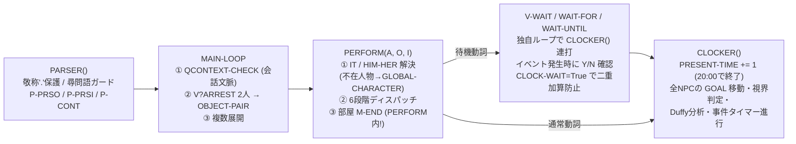
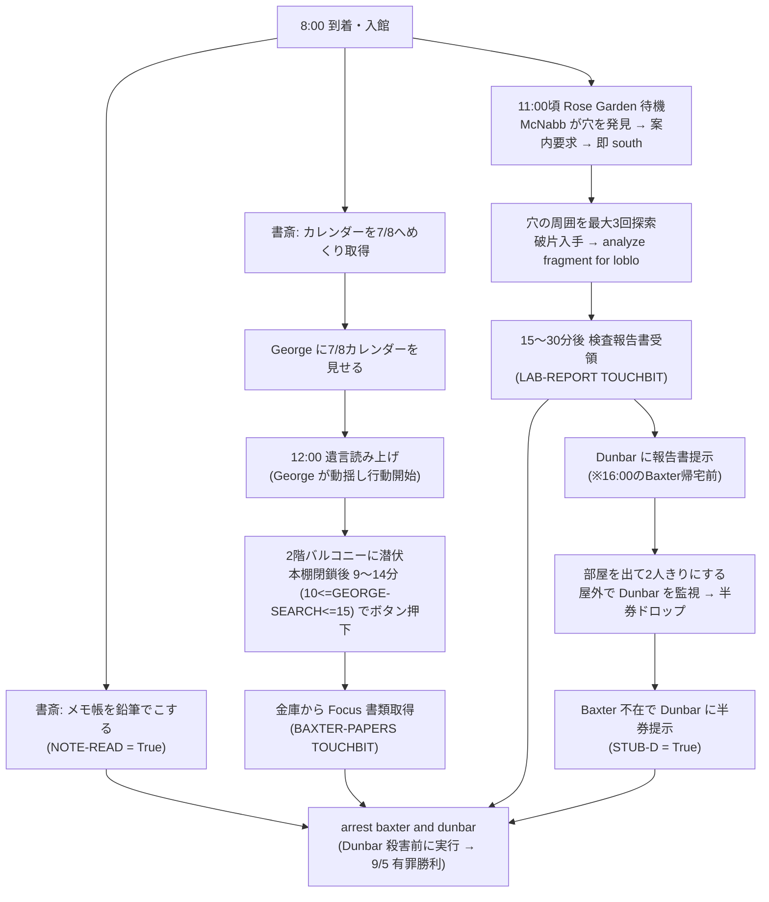

# DEADLINE (Python 版) の内部構造・探偵視点・人間ドラマ解析

ZilPy が Infocom の本格推理アドベンチャー *DEADLINE* (1982) の ZIL ソース (`deadline/`) から生成した Python 版 (`out/deadline/`) を、構成要素・パーサーとリアルタイム時間制御・自律 NPC 移動エンジン (`goal.py`)・探偵視点の因果構造と人間ドラマの観点から詳細に解説します。

- **ネタバレ注意:** 真犯人・犯行の全貌・全勝利条件・分岐エンディングまで記載しています。
- **解析手順の再現性:** 本ドキュメントの作成に用いた解析計画は、プロジェクトルートの `GameArchitecture.md`（および基礎棚卸し手順の `infocomGame.md`）にまとめています。
- **元の ZIL の位置:** `parser.zil:126` のように記載します。生成コードの `# zil:` 注記および `out/deadline/zilmap.json` から対応を引けます。

---

## 1. 全体像

### 1.1 規模

| 項目 | 数 |
|---|---|
| モジュール (ZIL ファイル) | 11 |
| ルーチン | 466 |
| 部屋 | 51 |
| オブジェクト (部屋以外) | 204 |
| 構文 (`SYNTAX`) | 249 (動詞の語 115 個) |
| 割り込みのルーチン (`I-*` 等) | 41 (`QUEUE` 呼び出し 84 箇所) |
| グローバル変数・定数 | 300 |
| 点数 (`VALUE` / `TVALUE`) | 0 (点数制ではなく **時刻 8:00〜20:00 と立証フラグによる結末分岐**) |

ルーチンを役割で分類すると次のとおりです (`tools/analyze_game.py` の自動分類)。

| 役割 | 数 | 例 |
|---|---|---|
| 動詞のアクション (`V-*`) | 146 | `V-ARREST`、`V-ANALYZE`、`V-WAIT-FOR`、`V-ASK-ABOUT` |
| オブジェクトのアクション | 108 | `OBJECT-PAIR-F`、`DUNBAR-F`、`BAXTER-F`、`HOLE-F` |
| 割り込み (`I-*` 等) | 41 | `I-FINGERPRINT`、`I-GEORGE-HACK-3`、`I-DUNBAR-SEQ-D` |
| パーサー | 37 | `PARSER`、`SYNTAX-CHECK`、`GET-OBJECT`、`GLOBAL-CHECK` |
| 場面の処理・NPC 移動補助 | 36 | `EPILOGUE`、`ESTABLISH-GOAL`、`MOVE-PERSON` |
| 動詞の補助 | 28 | `V-WAIT`、`DO-ANALYZE`、`QCONTEXT-CHECK` |
| 部屋のアクション | 24 | `IN-ROSES-F`、`LIBRARY-F`、`LIVING-ROOM-F` |
| 事前アクション (`PRE-*`) | 20 | `PRE-ACCUSE`、`PRE-READ`、`PRE-PUT` |
| 時計・メインループ・マクロ・その他 | 26 | `CLOCKER`、`MAIN-LOOP`、`PERFORM`、`DEMON` |

### 1.2 モジュールと読み込みの順

| # | モジュール (元の ZIL) | 行数 | 中身 |
|---|---|---|---|
| 1 | `deadline.py` (`deadline.zil`) | 49 | 入口。プロパティ既定値と読み込み順 |
| 2 | `dungeon.py` (`dungeon.zil`) | 2,801 | 世界: 部屋 51 個 (Robner 邸 1・2 階＋屋外)、オブジェクト 204 個 (人物・証拠品・家具・グローバル人物プロキシ) |
| 3 | `syntax.py` (`syntax.zil`) | 923 | 語彙と構文 249 個 (`ACCUSE`・`ARREST`・`ANALYZE`・`ASK ABOUT/FOR`・`FOLLOW`・`WAIT FOR/UNTIL` 等) |
| 4 | `macros.py` (`macros.zil`) | 163 | マクロ定義と補助関数 |
| 5 | `clock.py` (`clock.zil`) | 116 | 時計 (`SCORE`=時、`MOVES`=分、`PRESENT-TIME`=0時からの分数) と割り込み (`DEMON`・`QUEUE`・`INT`・`CLOCKER`) |
| 6 | `main.py` (`main.zil`) | 276 | `GO`、`I-START-INTERRUPTS`、`MAIN-LOOP`、`QCONTEXT-CHECK`、`PERFORM` |
| 7 | `parser.py` (`parser.zil`) | 1,377 | パーサー (ルーチン 37 個。1982 年世代の Z-machine パーサー) |
| 8 | `crufty.py` (`crufty.zil`) | 22 | 補助ルーチン 1 個 |
| 9 | `verbs.py` (`verbs.zil`) | 2,435 | 動詞の標準動作 (194 ルーチン。待機・質問・分析・逮捕の基底処理を含む) |
| 10 | `actions.py` (`actions.zil`) | 4,125 | 事件固有のイベント・人物応答・証拠処理・結末分岐 (198 ルーチン) |
| 11 | `goal.py` (`goal.zil`) | 785 | **自律 NPC 移動・視界 (`CORRIDOR`)・目撃記憶 (`WHERE-TABLES`) エンジン** (23 ルーチン) |

Zork I (`g*` 共通基盤) と比べた最大の特徴は、**`goal.py` という独立した NPC 行動・視界シミュレーター** を持ち、ゲーム全体が「部屋探索」ではなく **「12 時間リアルタイムに進行する人間社会の監視と介入」** として設計されている点にあります。

---

## 2. 起動・時間管理・メインループ (`main.py` / `clock.py`)

### 2.1 起動 (`GO`、`main.zil:29`) と初期イベント (`I-START-INTERRUPTS`)

1. `SCORE = 8`（8 時）、`MOVES = 0`（0 分）、`PRESENT-TIME = 480`（8:00 AM）、`LIT = True`、`HERE = SOUTH-LAWN` を設定する。
2. 代名詞の人物参照 `P-HIM-HER = MRS-ROBNER`、`P-HIM-HER-LOC = FOYER` を初期化する。
3. 初回起動時に `I-START-INTERRUPTS` を 1 分後に予約し、`START-MOVEMENT()` で全登場人物の自律移動スケジュールを開始する。
4. 1 分後に発火する `I-START-INTERRUPTS` (`main.zil:49`) が、屋敷の一日のタイムラインを確定させる:
   - `I-CALL` (`60 + RANDOM(10)` 分後 = 9:00〜9:10 頃): 愛人 Steven からの電話
   - `I-MAIL` (`70 + RANDOM(60)` 分後 = 9:10〜10:10 頃): Steven からの手紙の配達
   - `I-BAXTER-ARRIVE` (`115` 分後 = **9:55 固定**): Baxter 到着
   - `I-NEWSPAPER` (`175 + RANDOM(40)` 分後 = 10:55〜11:35 頃): 合併記事の載った新聞配達
   - `I-COATES-ARRIVE` (`230 + RANDOM(5)` 分後 = **11:50〜11:55 頃**): 弁護士 Coates 到着（12:00 の遺言読み上げへ）

### 2.2 時間とデッドライン (`clock.py`)

- Z-machine のステータス行仕様を活用し、**`SCORE` に「時 (8〜19)」、`MOVES` に「分 (0〜59)」** をそのまま格納しています（`clock.zil:54-69`）。
- 内部計算用の `PRESENT-TIME` は毎ターン 1 ずつ加算され、**`PRESENT-TIME > 1199` (20:00)** になると Klutz 警視正が現れて捜査打ち切り・強制終了 (`QUIT()`) となります。
- `C-TABLE` は 300 バイト（最大 50 スロット。Zork I の 180 バイトより大幅に拡張）で、`DEMON`（失敗ターンでも動く常駐処理）と `QUEUE`（通常割り込み）を `C-DEMONS` / `C-INTS` の境界ポインタで区別します。

---

## 3. パーサーの詳細処理 (`parser.py`) と Zork I との構造差

*DEADLINE* (1982) の `parser.py` は Zork I (1983/84 改訂版 `gparser.py`) より一世代前のパーサーであり、**推理・尋問ゲーム特有の拡張**と**世代差**が明確に表れています。

### 3.1 `PARSER` (`parser.zil:126`) の処理パイプラインと推理向け拡張

基本的な流れ（`READ(P-INBUF, P-LEXV)` → 字句走査＋`CLAUSE`・`NUMBER?` → `ORPHAN-MERGE` → `SYNTAX-CHECK`・`GWIM`・`ORPHAN` → `SNARF-OBJECTS`・`GET-OBJECT`・`GLOBAL-CHECK` → `MANY-CHECK`・`TAKE-CHECK`）は Zork 系と共通ですが、以下の固有処理が組み込まれています。

1. **尋問構文のガイド (`parser.zil:157-165`)**:
   先頭語が `WHY`・`HOW`・`WHEN`・`IS`・`DID`・`ARE` の場合、即座に尋問ガイドメッセージ（`ASK <人> ABOUT <話題>` を使うよう促し、付属の事件資料を参照せよと告げる）を出して弾きます。
2. **敬称ピリオドの保護 (`parser.zil:182-185`)**:
   直前語 (`LW`) が `MRS`・`MR`・`MS` の直後の `.` は文区切りにせず無視します。これにより `ask mrs. robner about steven` が 2 文に分割されません。
3. **`ASK ... TO ...` と会話構文 (`parser.zil:173-272`)**:
   `ACT?TELL` だけでなく `ACT?ASK` の後ろの `TO` も `quote` に変換し、NPC への命令 (`mcnabb, show me the holes`) を `P-CONT` + `QUOTE-FLAG` で連鎖させます。
4. **`AGAIN` と `OOPS` の世代差**:
   1982 年版には `OOPS` 機構がなく、`AGAIN` もパーサーレベルの `AGAIN-LEXV` 再生ではなく、動詞 `V-AGAIN` が `PERFORM` 内に保存された直前の `(L-PRSA, L-PRSO, L-PRSI)` を再実行する仕組みです。
5. **パーサー乗っ取りなし**:
   Zork I の `LOUD-ROOM-FCN` のような通常パーサー乗っ取りは存在せず、パーサー以外の `READ()` 呼び出しは `YES?` (`verbs.zil:220`, 待機継続確認やエピローグ確認) のみです。

---

## 4. パーサーからゲーム世界への反映とリアルタイム待機

### 4.1 探偵ゲームならではの反映機構 (`main.zil:61-195`)

1. **会話文脈 `QCONTEXT-CHECK` (`main.zil:128-138`)**:
   同じ部屋で直前まで会話していた相手を `QCONTEXT` に記憶します。プレイヤーが主語を省いて `WHAT ABOUT THE WILL?` や `WHERE IS BAXTER?` と打つと、自動的に `WINNER = QCONTEXT` に切り替えて `(said to Mrs. Robner)` と補完します。
2. **不在人物の代名詞 `HIM-HER` と `GLOBAL-CHARACTER-TABLE` (`main.zil:157-174`)**:
   `PRSO` が `PERSON` フラグを持つと `P-HIM-HER` に記録されます。その人物が別の部屋へ去った後に `ask dunbar about him` と打つと、`PERFORM` が自動的にその人物の **グローバル代理オブジェクト (`GLOBAL-BAXTER` 等)** へ差し替えるため、部屋にいない人物を話題にし続けることができます。
3. **共犯者の同時逮捕 `OBJECT-PAIR` (`main.zil:98-99`)**:
   通常、目的語が 2 つあるコマンドは 1 つずつループ実行されますが、`PRSA == V?ARREST` かつ `NUM == 2` の場合だけ特別に **`PERFORM(V?ARREST, OBJECT-PAIR)`** へ単発ディスパッチします。これにより `arrest baxter and dunbar` が「共犯の同時逮捕」として `OBJECT-PAIR-F` で一括判定されます。
4. **`PERFORM` の 6 段階ディスパッチ＋内蔵 `M-END` (`main.zil:181-191`)**:
   `WINNER(ACTION)` → `HERE(M-BEG)` → `PREACTIONS` → `PRSI(ACTION)` → `PRSO(ACTION)` → `ACTIONS(V-*)` の順に呼び、`M-FATAL` でなければ **`PERFORM` の末尾で `HERE(M-END)`** を実行します（Zork I では `MAIN-LOOP-1` 側にあります）。
5. **待機コマンド (`V-WAIT` / `V-WAIT-FOR` / `V-WAIT-UNTIL`, `verbs.zil:662-751`)**:
   探偵は「待つ」ことが仕事です。`wait for dunbar`・`wait for duffy`・`wait until noon` は内部で `CLOCKER()` を 1 分ずつ回し、ステータス行の時刻 (`USL()`) を更新します。いずれかの割り込み（NPC の通過・到着・イベント発生）が `True` を返すと即座に停止し、「Do you want to keep waiting? (Y/N)」と確認します。終了時は `CLOCK-WAIT = True` を立てて `MAIN-LOOP` 側の `CLOCKER()` による 1 分余計な進行を防ぎます。

### 4.2 具体的な実行トレース 2 例

#### トレース 1: `analyze fragment for loblo`（科学捜査の非同期依頼）
1. **`PARSER`**: `SYNTAX('ANALYZE', 'OBJECT', 'FOR', 'OBJECT', '=', 'V-ANALYZE')` に一致。`PRSO = FRAGMENT`, `PRSI = LOBLO`（または `GLOBAL-LOBLO`）。
2. **`PERFORM` → `V-ANALYZE` → `DO-ANALYZE` → `DO-FINGERPRINT(True)`**: Duffy が不在でなければ `FINGERPRINT-OBJ = FRAGMENT`, `ANALYSIS-OBJ = True`, `ANALYSIS-GOAL = LOBLO` を設定し、`FRAGMENT` を Duffy へ預け、`QUEUE(I-FINGERPRINT, 15 + RANDOM(15))` を予約。
3. **15〜30 分後の `CLOCKER` → `I-FINGERPRINT` (`actions.zil:2727`)**: `FINGERPRINT-OBJ == FRAGMENT` かつ `ANALYSIS-GOAL` が LoBlo 系であることを確認し、プレイヤーの所持品へ **`LAB-REPORT` を `MOVE` して `FSET(LAB-REPORT, TOUCHBIT)`**（勝利条件 1 達成）。

#### トレース 2: `arrest baxter and dunbar`（同時逮捕 → 法廷結末判定）
1. **`PARSER`**: `P-PRSO = [2, BAXTER/GLOBAL-BAXTER, DUNBAR/GLOBAL-DUNBAR]`, `PRSA = V?ARREST`。
2. **`MAIN-LOOP` (`main.zil:98`)**: `NUM == 2` かつ `V?ARREST` を検知し、ループ展開せず `PERFORM(V?ARREST, OBJECT-PAIR)` を呼ぶ。
3. **`PERFORM` → `OBJECT-PAIR-F` (`actions.zil:3899`)**:
   - `PRESENT-TIME < 600` (10:00 未満) → 時期尚早で却下（ゲーム続行）。
   - `DUNBAR-DEAD` → 死亡通知で最良結末不可。
   - **`BAXTER-PAPERS(TOUCHBIT)` ∧ `LAB-REPORT(TOUCHBIT)` ∧ `NOTE-READ` ∧ `STUB-D`** → **9 月 5 日付の有罪判決の手紙** → `EPILOGUE()` で真相解説を表示し勝利終了。
   - いずれか 1 つでも欠けていれば、欠けた法的要件に応じた不起訴／無罪の手紙（8/19・9/2・10/4・10/6）を出して `CASE-OVER()` で即終了。

---

## 5. 自律 NPC 移動・視界・目撃記憶エンジン (`goal.py`)

*DEADLINE* のリアリティを支える中核が `goal.py` です。屋敷の 51 部屋と 8 名（プレイヤー含む）が以下の仕組みで連動します。

1. **4 本のトランジット路線 ("Local T System")**:
   全部屋が `LINE` プロパティで 4 路線（`TOP-OF-THE-LINE` 2 階、`BOTTOM-LINE` 1 階、`FOOD-LINE` 台所・食堂、`OUTSIDE-LINE` 屋外）に所属し、路線を跨ぐ移動は `ESTABLISH-GOAL` が自動で乗換駅 (`GOAL-I`: 階段・玄関・角部屋) を経由させます。
2. **注意持続時間 (`ATTN`)**:
   `GOAL-TABLES` の各人物エントリには `ATTN`（McNabb 3・Baxter 4・Dunbar 3・George 2・Mrs. Robner 4・Rourke 6・Coates 2 分）があり、話しかけられるとその分数だけ移動を止めて応対します。
3. **視界ビットマスク (`CORRIDOR`, `goal.zil:188-243`)**:
   廊下や芝生には 12 ビットの視線ライン (`COR-1`〜`COR-2048`) が割り当てられています。NPC が移動したとき、プレイヤーの現在地 `HERE` と NPC の移動前/後の部屋の `CORRIDOR` の論理積が非 0 なら、離れた場所からでも「東のほうで Ms. Dunbar が物置へ駆け込んだ」と視認メッセージが出ます。階段では足音 (`TRANSFER`) が聞こえます。
4. **NPC 相互の目撃記憶 (`WHERE-TABLES`, `goal.zil:244-257`)**:
   NPC が誰かと同じ部屋を通過するたびに、双方の `WHERE-TABLES` に「最後にすれ違った時刻 (`PRESENT-TIME`)」が記録されます。これにより、他の住人に「George はどこ？」と尋ねたとき、実際にすれ違った記憶に基づく証言が返ります。

---

## 6. クリア条件のコード構造と因果的ターニングポイント

`OBJECT-PAIR-F` (`actions.zil:3899`) の条件式は、**刑事裁判の立証構造そのもの** になっています。

| # | コード上のフラグ | 法的立証要素 | 欠落時の結末 (手紙の日付と理由) |
|---|---|---|---|
| 1 | `FSET?(LAB-REPORT, TOUCHBIT)` | **犯行手段・他殺の証明** (破片から LoBlo 検出) | 8/19 検事不起訴: 他殺であること自体が未証明 |
| 2 | `FSET?(BAXTER-PAPERS, TOUCHBIT)` | **動機の基盤** (Focus 社横領の証拠書類) | 9/2 大陪審不起訴: 動機の欠如 |
| 3 | `NOTE-READ` | **動機と殺人の直接因果** (Robner の脅迫メモ筆圧) | 10/4 陪審無罪: Focus 事件と殺人の結びつきが未証明 |
| 4 | `STUB-D` | **機会・共犯とアリバイ崩し** (Dunbar の「送ってくれた」証言) | 10/6 陪審無罪: Baxter の演奏会アリバイに合理的疑い |
| 5 | `not DUNBAR-DEAD` | **第二の殺人の阻止** (Dunbar 生存) | 殺害後は Baxter 単独逮捕の次善エンドのみ |

---

## 7. 探偵の視点: 「初回情報のみの最も知的・理想的な行動」vs「クリアに必要な行動」

プレイヤーはプロの探偵です。攻略知識なしに**ゲーム内（および初期の捜査前提）から得られる情報だけ**で推論した場合に取る「最も知的で理想的な探偵行動」と、Python コード上で「クリアのために実際に要求される行動」の間には、極めて示唆的なギャップが存在します。

| 捜査フェーズ | 初回情報のみでの「最も知的・理想的な探偵行動」 | クリアに実際に必要な行動（コード上の制約） | ギャップの本質（必然 vs 不条理） |
|---|---|---|---|
| **① バラ園の現場検証** | 書斎で絨毯の泥・手すりの塗装剥げを見つけ、即座に真下のバラ園 (`In Roses`) へ降りてはしご痕とカップ片を探す。 | 11:00 頃に McNabb が自力で穴に気づくまで `HOLE` は `INVISIBLE` (`HOLE-F`)。先に入ると McNabb に 90 分無視される (`IN-ROSES-F`)。案内後も `search around holes` を空振りにめげず **最大 3 回 (`RST > 2`)** 繰り返す必要がある。 | **時間トリガーと反復探索の壁**: 「素人には見つけにくいが庭師なら気づく」というリアリティはある一方、優秀な探偵が朝一で現場の真下を調べても物理的に発見不能なのはゲーム的制約（不条理寄り）。 |
| **② 破片の科学分析** | 破片を Duffy に渡し「含まれる毒物・薬物を網羅的に分析してくれ (`analyze fragment`)」と依頼する。 | 一般分析では「特定に数週間かかる」と返され `LAB-REPORT` は発行されない。屋敷内で `LoBlo` を見つけたうえで **`analyze fragment for loblo`** と標的薬品を指定する必要がある (`I-FINGERPRINT`)。 | **現実的・工学的必然**: 1982 年の鑑識において「未知物質の網羅同定は数週間、特定試薬による照合なら 30 分」は極めて説得力が高い。ただし初見プレイヤーは「薬品名を指定できる構文」に気づく知性を試される。 |
| **③ 隠し金庫と George** | 7/8 カレンダーで新遺言の存在を知ったら、弁護士や遺族に正面から尋問し、書斎の本棚を徹底調査する。George が隠し部屋に入ったら即座に踏み込んで確保する。 | 金庫の暗証番号はプレイヤーには解けない。あえて George にカレンダーを見せて泳がせ、12:00 後に 2 階廊下から姿を消してバルコニーに潜み、**本棚閉鎖後 9〜14 分 (`10 <= GEORGE-SEARCH <= 15`)** の 6 分間だけを狙って踏み込む (`I-GEORGE-HACK-3`)。 | **心理的必然と精密タイミングの不条理**: 「犯行（遺言破棄）に及ぶよう泳がせて金庫を開けさせる」のは名探偵的な罠（知的必然）だが、8 分目以前なら逃げられ 15 分目以降なら閉められる 1 分刻みの判定は、初見一発突破をほぼ拒む苛烈なゲーム設計。 |
| **④ Dunbar と Baxter の分断** | 証拠が揃ったら二人を並べて対質尋問するか、物置での密談現場に踏み込んで自白を引き出す。半券はまずアリバイの当事者 Baxter に突きつける。 | 報告書を Dunbar に見せた後、**あえて退室して二人きりにし**、屋外で尾行して半券を落とさせ (`I-DUNBAR-SEQ-D`)、**必ず Baxter より先に・Baxter 不在で Dunbar 単独に半券を見せる**。先に Baxter に見せると口裏を合わせられて永久詰み。 | **尋問心理の必然と偶然依存の危うさ**: 「共犯者を分断し、弱い側から崩す」のは捜査の鉄則（必然）。しかし「尾行中に煙草を出そうとして偶然半券を落とす」という決定的物証の入手経路は、探偵の計画というより演出上の偶然（ご都合）に依存している。 |
| **⑤ 逮捕の決断** | 真相（犯人・手口・動機）を確信した時点で逮捕に踏み切る。 | 頭の中で真相が分かっていても、4 つの法廷フラグすべてを満たさない限り一発勝負の不起訴／無罪で即ゲーム終了。 | **法治国家の必然**: 「探偵の確信」と「陪審員を説得できる証拠能力」は別物である、という *DEADLINE* 最大のテーマの体現。 |

### 初見の「理想的な探偵」が陥る最大の罠
初回プレイで最も知的に振る舞う探偵ほど、**「朝 8 時台に書斎と庭を自力で完璧に調べ上げ（→ 穴が見えず McNabb を怒らせる）、容疑者全員に礼儀正しく正面から聞き込みをし（→ 誰も決定的なボロを出さない）、怪しい行動を見たら即座に踏み込む（→ George の金庫が開く前に逃げられる）」** という行動を取り、真相に迫りながらも決定打を欠いて 20:00 のタイムアップか無罪判決を迎えます。

*DEADLINE* がプレイヤーに要求するのは、単なる「観察者」ではなく **「容疑者の弱みに餌を撒き（カレンダー・検査報告書）、あえて距離を取って泳がせ（退室・バルコニー潜伏）、綻びが生じた数分間だけを刈り取る冷徹な演出家」** としての探偵像なのです。

---

## 8. このゲームで行われていた行為と、そこに潜む人間ドラマ

コード内の事実 (`EPILOGUE`, `actions.py`, `dungeon.py`) を時系列に並べ直すと、*DEADLINE* は単なるパズルではなく、**「孤独な創業者の最後の抵抗」「野心と背信の共犯関係」「屋敷の住人それぞれの小さな後ろめたさ」** が交錯する濃密な人間ドラマとして立ち上がります。

### 8.1 事件当夜（7 月 7 日）に行われていた行為のタイムライン

1. **孤立した創業者の切り札**:
   Marshall Robner にとって会社は人生そのものだった。しかし共同経営者 Mr. Baxter は会社を多国籍企業 Omnidyne に売却しようと画策し、Robner は実権を奪われつつあった。家庭でも妻は愛人 Steven と密通し、息子 George は放蕩の末に廃嫡される運命にあった。抑うつ薬 `Ebullion` を手放せない孤独のなかで、Robner は最後の手段として **「Baxter の Focus 社資金横領の証拠書類」** を書斎の隠し金庫に握り、「合併を止めなければ公表する」と脅すメモを Baxter に渡した。
2. **冷徹な共犯計画**:
   Baxter は Robner の「抑うつ・自殺願望」という周囲の認識を利用し、自殺偽装殺人を立案する。協力者に選んだのは、秘密の愛人であり Robner の秘書でもある Ms. Dunbar だった。彼女の常用するカナダ製降圧剤 `LoBlo` が、`Ebullion` と併用すると致死的になることを知っていたからである。
3. **交響楽団と毒殺**:
   7 月 7 日 20:00、二人は Hartford Philharmonic の演奏会へ同行する（Baxter は後に「一人で行った」と偽証）。終演後、Baxter は Dunbar を Robner 邸まで車で送った。屋敷に戻った Dunbar は、書斎で Robner の紅茶に `LoBlo` を混ぜた。Robner は誰にも看取られず、自殺と見せかけられた死を遂げる。
4. **カップのすり替えとたった一つのミス**:
   Robner の絶命後、Baxter は物置のはしごをバラ園に立てかけ、書斎のバルコニーから侵入した（手すりの塗装剥げ・絨毯の乾いた泥・バラ園の 2 つの穴）。毒の残るカップを台所のきれいなカップとすり替え、証拠を消したはずだった――だが、はしごを降りる際に毒入りカップを落として割ってしまい、暗闇で拾い集めたつもりで **たった 1 片の磁器片** をバラの土に残してしまった。台所の食器棚には、ソーサー 7 枚に対してカップが 6 個しか残っていなかった。

### 8.2 翌朝（7 月 8 日 8:00〜20:00）に展開する「第二のドラマ」

探偵が屋敷に足を踏み入れた瞬間から、過去の殺人だけでなく **「現在進行形の人間ドラマ」** が動き出します。

- **罪なき者たちの後ろめたさ（ミスリードの群像劇）**:
  - **Mrs. Robner** は夫を殺してはいないが、愛人 Steven との電話や手紙を必死に隠す。
  - **George** は父を殺してはいないが、自分が廃嫡される新遺言の存在を知った瞬間、恐怖と欲に駆られて隠し金庫を開け、遺言を湖に沈めようとする。**皮肉にも、父を裏切ろうとした息子の「小さな罪」が、父を殺した Baxter の「巨悪の証拠（Focus 書類）」を探偵の前に引きずり出す** ことになる。
  - **Mr. McNabb** は屋敷の陰謀などどこ吹く風で、荒らされたバラ園への職人としての怒りから、結果的に唯一の物的証拠（穴と破片）へ探偵を導く。
- **共犯関係の崩壊と「愛人の切り捨て」**:
  探偵が `LoBlo` の検査報告書を Dunbar に突きつけた瞬間、完璧だったはずの共犯関係は脆くも崩れる。物置で泣きつき口論する Dunbar に対し、Baxter が選んだのは「愛人を守ること」ではなく、**「再び物置のはしごを使って主寝室バルコニーから侵入し、Dunbar を射殺して『私が Robner 氏を殺した』という偽造遺書を残し、自殺に見せかけて口を封じる」** ことだった。
  しかも、もし探偵がそれを止められなければ、Baxter は偽造遺書を書いた青いインクのペンを自分の上着に入れたまま、遺体の前で芝居じみた涙を流す。

*DEADLINE* の本当の恐ろしさと美しさは、**「探偵が真実に近づき、証拠を突きつけるという正義の行為そのものが、冷酷な犯人を追い詰め、共犯者である愛人の殺害という第二の悲劇の引き金を引いてしまう」** という動的な因果構造にあります。だからこそ、真の勝利条件には「4 つの法的証拠の完備」だけでなく、**「第 5 の条件: Dunbar が生きているうちに逮捕すること」** が静かに組み込まれているのです。

---

## 9. この解説の作り方

本解説は、プロジェクトルートの `GameArchitecture.md`（Stage 1〜5）および `infocomGame.md` に従って作成しました。

1. `python tools/analyze_game.py out/deadline -o <作業ファイル>` で全構成要素の棚卸しを実施。
2. `main.py`・`clock.py`・`parser.py`・`goal.py` を通読し、1982 年世代パーサーの仕様・`QCONTEXT`・`HIM-HER`・`OBJECT-PAIR`・`V-WAIT`・4 路線トランジットと `CORRIDOR` 視界システムを検証。
3. `tools/analyze_game.py out/deadline --show` で `OBJECT-PAIR-F`・`I-FINGERPRINT`・`IN-ROSES-F`・`HOLE-F`・`I-GEORGE-HACK-3`・`I-DUNBAR-SEQ-D`・`I-DUNBAR-SEQ-4`・`EPILOGUE` の条件式と分岐を直接確認し、初見の理想的探偵行動とのギャップおよび人間ドラマを再構成。
