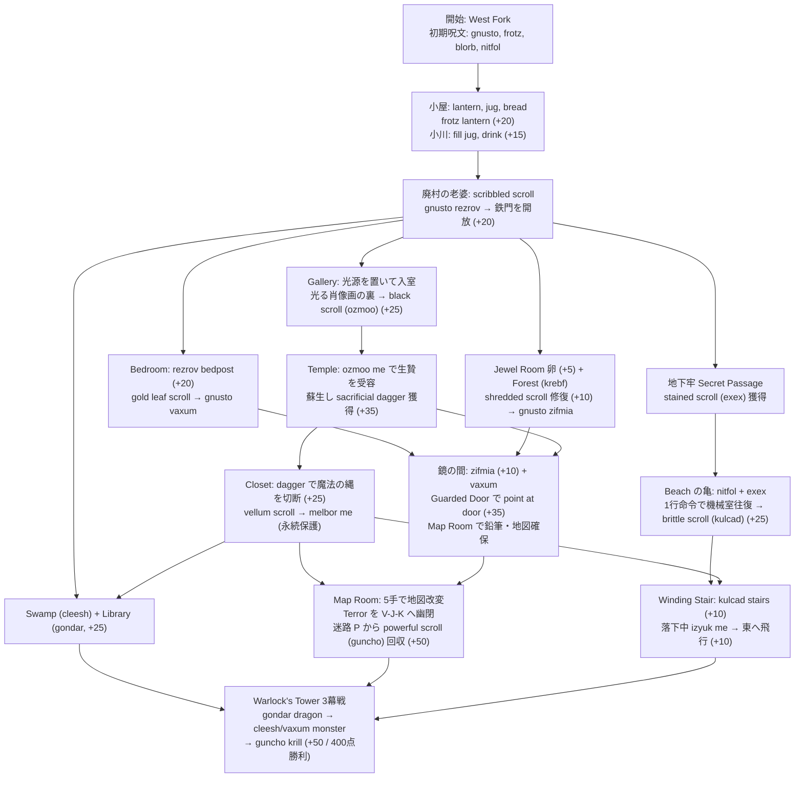

# Enchanter (Python 版) の内部構造・呪文パーサー・因果解析

ZilPy が Infocom のファンタジー名作 *Enchanter*（1983 年、Marc Blank & Dave Lebling、`ZORK_NUMBER = 4`）の ZIL ソース (`enchanter/`) から生成した Python 版 (`out/enchanter/`) を、構成要素・呪文パーサー拡張・主要サブシステム・クリアへの因果的ターニングポイントとソフトロック・見習い魔術師視点のギャップ・叙事詩ドラマの観点から詳細に解説します。

- **ネタバレ注意:** すべての呪文の入手経路・パズルの解法・不可逆な詰み条件・最終決戦とエンディングまで記載しています。
- **解析手順の再現性:** 本ドキュメントの作成手順は、プロジェクトルートの `GameArchitecture.md` に準拠しています。
- **元の ZIL の位置:** `magic.zil:478` のように記載します。生成コードの `# zil:` 注記および `out/enchanter/zilmap.json` から対応を引けます。

---

## 1. 全体像

### 1.1 規模

| 項目 | 数 |
|---|---|
| モジュール (ZIL ファイル) | 21 |
| ルーチン | 522 |
| 部屋 | 74 |
| オブジェクト (部屋以外) | 181 |
| 構文 (`SYNTAX`) | 313 (動詞の語 157 個) |
| 割り込みのルーチン (`I-*`) | 25 (`QUEUE` 呼び出し 77 箇所) |
| グローバル変数・定数 (`ZilGlobal.py`) | 329 (ゲーム状態 `state` 170、定数 `const` 99、パーサー作業用 `scratch` 60) |
| `VALUE` / `TVALUE` の合計 | 0 / 0 (宝物収集点ではなく 18 個のイベント変数 `*_POINT` による加点) |
| 満点 (`SCORE_MAX`) | **400 点** (`magic.py` / `V-SCORE` で `SCORE // 50` により称号を算出) |

ルーチンを役割で分類すると次のとおりです (`tools/analyze_game.py` の自動分類と完全一致)。

| 役割 | 数 | 例 |
|---|---|---|
| 動詞のアクション (`V-*`) | 176 | `V-CAST`、`V-GNUSTO`、`V-FROTZ`、`V-SLEEP`、`V-MAKE-LINE` |
| オブジェクトのアクション | 110 | `SPELL-F`、`SCROLL-F`、`TURTLE-F`、`ADVENTURER-F`、`KRILL-F` |
| そのほか (場面の処理・固有ロジック) | 78 | `SPELL-CHECK`、`FORGET-SPELL`、`CONNECT`、`STAIR-DISPEL`、`NO-ILLUSIONS` |
| そのほか (パーサー) | 45 | `PARSER`、`SYNTAX-CHECK`、`GET-OBJECT`、`GLOBAL-CHECK` |
| そのほか (動詞の補助) | 34 | `JIGS-UP`、`GOTO`、`ITAKE`、`ROB`、`2OBJS?` |
| 割り込み (`I-*`) | 25 | `I-TIME`、`I-THIRST`、`I-HUNGER`、`I-TIRED`、`I-TERROR`、`I-ADVENTURER` |
| 部屋のアクション | 21 | `TMAZE-F`、`MIRROR-HALL-F`、`GALLERY-F`、`WARLOCK-TOWER-F` |
| 事前アクション (`PRE-*`) | 16 | `PRE-QUICK-CAST`、`PRE-TAKE`、`PRE-PUT`、`PRE-FLY` |
| そのほか (メインループ) | 5 | `GO`、`MAIN-LOOP`、`MAIN-LOOP-1`、`PERFORM`、`D-APPLY` |
| そのほか (共通のオブジェクト) | 4 | `NULL-F`、`FIND-NOT-HERE`、`GLOBAL-NOT-HERE-PRINT`、`NOT-HERE-PRINT` |
| そのほか (マクロ) | 3 | `PRINTA`、`RANDOM-ELEMENT`、`PICK-ONE` |
| そのほか (時計) | 3 | `QUEUE`、`INT`、`CLOCKER` |
| マクロから作った関数 | 2 | `PROB`、`DISABLE` |

### 1.2 モジュールと読み込みの順

入口の `enchanter.py` (`enchanter.zil`) が以下の順で全 21 モジュールを `from ... import *` で読み込み、プロパティ既定値 (`SIZE = 5`, `CAPACITY = 0`) を設定後、`ZG._link()` → `ZG.GO()` で起動します。

| # | モジュール | 行数 | ルーチン | 部屋 | オブジェクト | 構文 | 主な中身 |
|---|---|---|---|---|---|---|---|
| 1 | `enchanter` | 67 | 0 | 0 | 0 | 0 | 入口。`ZORK_NUMBER = 4`、読み込み順、プロパティ既定値 |
| 2 | `syntax` | 1,163 | 0 | 0 | 0 | 309 | 語彙と構文。17 呪文の直接詠唱構文・地図描画構文を含む |
| 3 | `macros` | 280 | 5 | 0 | 0 | 0 | マクロ補助 (`PROB`, `PICK-ONE`, `DISABLE` 等) |
| 4 | `clock` | 94 | 3 | 0 | 0 | 0 | 180 バイトの `C-TABLE` と `QUEUE`/`INT`/`CLOCKER` |
| 5 | `main` | 380 | 6 | 0 | 0 | 0 | `GO`・`MAIN-LOOP-1`・`PERFORM`・日没短縮デーモン `I-TIME` |
| 6 | `gparser` | 1,816 | 45 | 0 | 0 | 0 | Zork 系共通パーサー＋`SPELL-CHECK`・`TRY-FLY` 拡張 |
| 7 | `verbs` | 2,283 | 197 | 0 | 0 | 0 | 標準動詞群、`JIGS-UP` 蘇生処理、地図線描画・削除動詞 |
| 8 | `record` | 54 | 4 | 0 | 0 | 4 | デバッグ・記録コマンド (`#RANDOM`, `#RECORD` 等) |
| 9 | `globals` | 731 | 22 | 0 | 32 | 0 | 共通オブジェクト (`WATER`, `JUG`, `BELBOZ`, `SKY` 等) |
| 10 | `terror` | 913 | 22 | 9 | 16 | 0 | 9 部屋迷路 (`T-A`〜`T-I`)、地図・鉛筆、`I-TERROR`、伝説の本 |
| 11 | `stair` | 580 | 30 | 5 | 5 | 0 | 無限階段、底なしの穴、Krill の塔での 3 幕最終決戦、`I-MUNG-ROOM` |
| 12 | `magic` | 1,249 | 37 | 0 | 32 | 0 | 魔法書・17 呪文・巻物・記憶上限・忘却・`MORE-PROBE`・18 得点定数 |
| 13 | `knot` | 162 | 5 | 1 | 3 | 0 | Closet の宝石箱、解けない魔法の縄、生贄の短剣 (`MAGIC-KNIFE`) |
| 14 | `purloined` | 1,043 | 32 | 6 | 18 | 0 | 鏡の間 4 部屋、自律 NPC「冒険者」、幻影の扉 (`DOOR-ILLUSION`)、Map Room |
| 15 | `castle` | 1,379 | 39 | 27 | 30 | 0 | 城本体・中庭 7 区画・寝室・地下牢・図書館・森・沼・巡回怪物 |
| 16 | `temple` | 333 | 11 | 4 | 5 | 0 | 神殿・祭壇・南北独房・生贄儀式 (`TAKE-TO-TOWER`, `I-TAKE-TO-ALTAR`) |
| 17 | `gallery` | 225 | 9 | 1 | 6 | 0 | 肖像画の回廊、暗闇で光る肖像画と壁龕 (`PORTRAIT-NICHE`) |
| 18 | `egg` | 278 | 6 | 1 | 9 | 0 | 宝物室の宝石の卵と 5 つのつまみ、`SCRAMBLED-EGG` |
| 19 | `sleep` | 249 | 7 | 0 | 1 | 0 | 渇き (`I-THIRST`)・空腹 (`I-HUNGER`)・疲労 (`I-TIRED`)・睡眠と予知夢 (`V-SLEEP`) |
| 20 | `gears` | 618 | 16 | 4 | 7 | 0 | 機械室・制御室・浜辺と亀 AI (`TURTLE-F`, `I-TURTLE`) |
| 21 | `outside` | 751 | 26 | 16 | 17 | 0 | 城外 16 部屋、小屋・小川・廃村の老婆 (`HOVEL-KLUDGE`)、無限の西街道 |

Zork I の「巨大ファイル 2 本 (`1dungeon` + `1actions`)」から一転し、**パズル・システム単位で 12 個のテーマ別モジュールに分割**されている点が設計上の大きな進化です。

---

## 2. 起動・メインループ・パーサーの詳細処理と世界への反映

### 2.1 起動 (`GO`, `main.zil:30`) とメインループ (`MAIN-LOOP-1`, `main.zil:87`)

`GO` (`main.zil:30-80`) はゲーム開始時に以下の 8 つの割り込みを `C-TABLE` に登録して有効化します。

1. `I-TIRED` (`MOVES_PER_DAY = 86` ターン後)
2. `I-THIRST` (`41` ターン後)
3. `I-HUNGER` (`67` ターン後)
4. `I-TIME` (`-1` = 毎ターン)
5. `I-SCURRY` (`5` ターン後: 城内の気配描写)
6. `I-MUNG-ROOM` (`50` ターン後: 城の部屋の腐敗)
7. `I-GUARDS-ARRIVE` (`0` = 待機枠。冒険者より先に発火させるため順序固定)
8. `I-ADVENTURER` (`0` = 待機枠)

初期状態は `LIT = True`, `WINNER = PLAYER`, `HERE = WEST_FORK`。導入テキスト（Belboz と Circle による派遣宣言）を表示したあと `MAIN_LOOP` に入ります。

`MAIN-LOOP-1` (`main.zil:87-227`) と `PERFORM` (`main.zil:291-345`) の 1 ターン処理パイプラインは次のとおりです。

1. `P-WON = PARSER()` で 1 コマンドを解析。失敗なら `P-CONT = False` で終了し、時計は進まない。
2. `P-IT-OBJECT` が接触可能なら `P-PRSI` / `P-PRSO` 内の `IT` を置換。
3. 複数目的語を展開して `PERFORM(PRSA, PRSO, PRSI)` を呼ぶ。ただし **`VERB_p('MAKE-LINE', 'ERASE-LINE')` の場合だけは展開時の `<obj>:` 見出し出力をスキップ**する（`main.zil:174`。`connect p and f` のように 2 点をまとめて `P-PRSO` に入れる独自構文のため）。
4. `PERFORM` は以下の **7 段階ディスパッチ** を行う:
   - `NOT-HERE-OBJECT-F`（不在オブジェクト処理）
   - `Actor` (`GETP(WINNER, 'ACTION')` — 亀や冒険者への命令はここで横取りされる)
   - `Room (M-BEG)` (`GETP(LOC(WINNER), 'ACTION'), M-BEG`)
   - `Preaction` (`PREACTIONS[A]` — **17 呪文の `PRE-QUICK-CAST` はここ**)
   - `PRSI` (`GETP(I, 'ACTION')`)
   - `Container` (`GETP(LOC(O), 'CONTFCN')`)
   - `PRSO` (`GETP(O, 'ACTION')`)
   - `Default` (`ACTIONS[A]` — `V-*` ルーチン)
5. `PERFORM` が `M-FATAL (2)` を返さなければ `LOC(WINNER)` の部屋アクションを `M-END` で呼ぶ。
6. `TELL`, `BRIEF`, `SUPER-BRIEF`, `VERBOSE`, `SAVE`, `VERSION`, `TIME`, `QUIT`, `RESTART`, `SCORE`, `SCRIPT`, `UNSCRIPT`, `RESTORE` 以外の成功ターンなら `CLOCKER()` を実行する。

### 2.2 Enchanter 固有の呪文パーサー拡張

*Enchanter* 最大のパーサー革新は、**「呪文名をそのまま動詞として唱える (`frotz lantern`)」「`cast` の目的語として唱える (`cast frotz on lantern`)」「学習・書写の対象名詞として扱う (`learn frotz`, `gnusto rezrov`)」の 3 構文を、違和感なく両立させた点**にあります。実コードでは 4 つの仕組みが連携しています。

1. **17 呪文の二重登録 (`syntax.py` + `magic.py`)**:
   - `syntax.py` に全 17 呪文が **動詞構文** として登録され、すべての事前アクションが **`PRE-QUICK-CAST`** に統一されています（例: `SYNTAX('FROTZ', 'OBJECT', '=', 'V-FROTZ', 'PRE-QUICK-CAST')`）。`KREBF` と `FILFRE` のみ目的語なし構文も許容します。
   - 同時に `magic.py` に全 17 呪文が `SPELLBIT` を持つ **ゲーム内オブジェクト** (`LIGHT-SPELL`, `OPEN-SPELL` 等) として宣言され、初期状態では `SPELL-BOOK` 内または各巻物オブジェクト (`SCROLLBIT`) の中に格納されています。
2. **`GET-OBJECT` 内の `SPELL-CHECK` フック (`gparser.zil:1102-1106`, `magic.zil:439`)**:
   - `GET-OBJECT` が部屋 (`HERE`) と所持品 (`PLAYER`) を探索しても対象が見つからなかった (`GET(TBL, 0) == TLEN`) とき、以下を実行します。
     ```python
     if (GET(TBL, 0) == TLEN):
         if (ZG.P_ADJ and (ZG.P_NAM in (WORD('spell'), False))):
             ZG.P_NAM = ZG.P_ADJN
         ZG.SPELL_CHECK(TBL, ZG.P_NAM)
     ```
   - `frotz spell` のような形容詞＋`spell` 表現を `P_NAM = WORD('frotz')` に正規化し、`SPELL-CHECK` が 17 呪文名と照合して対応する呪文オブジェクトを `OBJ-FOUND(OBJ_l, TBL)` で強制登録します。これにより、**呪文が本の中・巻物の中・あるいはまだ見つけていない場所にあっても**、`learn frotz` / `gnusto rezrov` / `cast frotz on lantern` がパーサーエラーにならず、`SPELL-F` や `V-GNUSTO` 側の親切なメッセージへ到達します。
3. **2 系統の詠唱パスの合流 (`V-CAST` → `PERFORM` → `PRE-QUICK-CAST`)**:
   - `cast frotz on lantern` は `V-CAST` (`magic.zil:665`) に渡り、`PRSO` (`LIGHT-SPELL`) を `VRB = SYMBOL('V?FROTZ')` へ変換し、`PERFORM(VRB, PRSI)` を再帰呼び出しします。
   - これにより、直接詠唱 (`frotz lantern`) も `cast` 詠唱 (`cast frotz on lantern`) も、**必ず `PRE-QUICK-CAST` (`magic.zil:478-533`) を通る単一パイプライン** に合流します。
   - `PRE-QUICK-CAST` は (a) `RMUNGBIT`（破れた巻物）の拒否、(b) `LOC(SPELL)` が `SCROLLBIT` かつ所持中なら `REMOVE(SCROLL)` で巻物を消滅させて一時的に `COUNT = 1` を付与、(c) `WRITE-MAGIC-SPELL` (`gnusto`) 以外は `COUNT > 0` を検証して `COUNT -= 1`・`SPELL-ROOM += 1`、(d) `KULCAD` / `GUNCHO` なら `MORE-PROBE` を 1 ターン後に予約、のすべてを一元実行します。
4. **飛行意図フラグ `TRY-FLY` (`gparser.zil:375-378`)**:
   - `FLY` は `SYNTAX('FLY', 'OBJECT', '=', 'V-WALK')` で移動動詞として扱われ、`PARSER` が方向移動を確定する際 `VERB == SYMBOL('ACT?FLY')` なら `TRY_FLY = True` を立てます（底なしの穴で `fly east` と打った場合の判定などに利用）。

### 2.3 具体的なコマンドのエンドツーエンド実行トレース 3 例

#### トレース 1: 呪文の書写・記憶・直接詠唱 (`gnusto rezrov` → `learn rezrov` → `rezrov gate`)
1. **`gnusto rezrov`**:
   - `PARSER`: 動詞 `GNUSTO` → `SYNTAX('GNUSTO', 'OBJECT', '=', 'V-GNUSTO', 'PRE-QUICK-CAST')`。目的語 `rezrov` は `GET-OBJECT` → `SPELL-CHECK` により `OPEN-SPELL`（`OPEN-SCROLL` の中）に解決。
   - `PERFORM`: `PRE-QUICK-CAST` が `SPELL = WRITE-MAGIC-SPELL` を判定。`WRITE-MAGIC-SPELL` は例外的に `COUNT` を消費せず `False` を返して通過 → `V-GNUSTO` (`magic.zil:706`) が `HELD?(OPEN-SCROLL)` を確認し、`REMOVE(OPEN-SCROLL)`、`MOVE(OPEN-SPELL, SPELL-BOOK)`、`PUTP(OPEN-SPELL, 'COUNT', 0)` を実行。
2. **`learn rezrov`**:
   - `PARSER`: `V-LEARN`、`PRSO = OPEN-SPELL`（`SPELL-CHECK` で解決）。
   - `PERFORM`: `PRSO` アクション `SPELL-F` (`magic.zil:566`) が `IN?(OPEN-SPELL, SPELL-BOOK)`・`IN?(SPELL-BOOK, WINNER)`・`LIT` を確認。`SPELL-ROOM > 0` なので `SPELL-ROOM -= 1`、`COUNT += 1` として記憶完了。
3. **`rezrov gate`**:
   - `PARSER`: `V-REZROV` (`PRE-QUICK-CAST`)、`PRSO = IRON-GATE`。
   - `PERFORM`: `PRE-QUICK-CAST` が `OPEN-SPELL` の `COUNT` を `1 → 0` に減らし `SPELL-ROOM += 1` を実行して `False`（続行）を返す → `PRSO` アクション `IRON-GATE-F` (`castle.zil:50`) が `VERB? REZROV` を処理し、`OPENBIT` を立てて `ENTRY-POINT (20)` を加算。

#### トレース 2: `cast` 構文経由の二重ディスパッチ (`cast frotz on lantern`)
1. **`PARSER`**: `SYNTAX('CAST', 'OBJECT', 'ON', 'OBJECT', '=', 'V-CAST')` に一致。`PRSO = LIGHT-SPELL`（`SPELL-CHECK` 経由）、`PRSI = BATTERED-LANTERN`。
2. **`PERFORM` (1 回目)**: `V-CAST` (`magic.zil:665`) が `PRSO == LIGHT-SPELL` から `VRB = V?FROTZ` を引き、**`PERFORM(V?FROTZ, BATTERED-LANTERN)`** を内部呼び出し。
3. **`PERFORM` (2 回目)**: `PRE-QUICK-CAST` が `LIGHT-SPELL` の `COUNT` を消費 → `BATTERED-LANTERN-F` は `FROTZ` を処理せず `False` → `V-FROTZ` (`magic.zil:803`) が `LIGHTBIT` と `ONBIT` を立て、`LIGHT-POINT (20)` を加算し、`LIT = LIT?(HERE)` を更新。

#### トレース 3: 亀への 1 行連鎖命令 (`turtle, go se. take scroll. go nw`)
1. **1 文目 (`turtle,`)**: `PARSER` が `ACT?TELL` として処理し、残りの語列位置を `P-CONT` に保存。`V-TELL` (`verbs.zil:1459`) が `PRSO == TURTLE` かつ `P-CONT != False` を確認し、**`WINNER = TURTLE`, `HERE = LOC(TURTLE)`** に切り替える。`V-TELL` はメタ動詞扱いのため `CLOCKER()` は進まない。
2. **2 文目 (`go se`)**: `P-CONT` から再開。`PERFORM(V?WALK, SE)` が `Actor` 段階の `TURTLE-F` (`gears.zil:315`) を経由して `CROSS-ENGINE-ROOM()` (`gears.zil:127`) を呼ぶ。`HASTED? == TURTLE` なので亀はハンマーをかわして `CLOSET` へ移動（`FAST? = True`）。
3. **3 文目 (`take scroll`)**: 依然 `WINNER = TURTLE`, `HERE = CLOSET` のまま `P-CONT` から連続実行される。`TURTLE-F` (`gears.zil:401`) が `ITAKE(False)` で `DISPEL-SCROLL` をくわえさせる。もし 1 行にまとめず別ターンで話しかけると、`TURTLE` は `CLOSET`・`PLAYER` は `ENGINE-ROOM` に分断され、機械室の騒音判定 (`OPPOSITE-SIDES?`, `gears.zil:557`) で命令が届かない。
4. **4 文目 (`go nw`)**: `RECROSS-ENGINE-ROOM()` (`gears.zil:177`) が発火。槍トラップが発動するが亀の甲羅が弾き返し、`ENGINE-ROOM` へ帰還。ターン末尾の `CLOCKER()` → `I-TURTLE` (`gears.zil:626`) が `DISPEL-SCROLL` をプレイヤーの足元へ落とし `TURTLE-POINT (25)` を加算する。

---

## 3. Enchanter 固有の主要サブシステム

### 3.1 魔法書・記憶スロット・忘却・Krill の探知 (`magic.py`)

*Enchanter* の魔法は「Vancian Magic（記憶して唱えると忘れる）」を厳密なデータ構造で実装しています。

- **記憶容量の成長と圧迫**:
  - 初期容量は `REAL-SPELL-MAX = 4`、`SPELL-MAX = 4`、残スロット `SPELL-ROOM = 1`（開始時点で `frotz` と `blorb` を 1 回ずつ記憶しているため）。
  - 眠る (`V-SLEEP`) たびに `REAL-SPELL-MAX` が `+1` され、見習いとしての成長が記憶スロット数に直接反映されます（`sleep.zil:189`）。
  - 逆に `I-TIRED` で疲労するたびに `SPELL-MAX` と `SPELL-ROOM` が `-1` され、`SPELL-ROOM == 0` になると `FORGET-SPELL` (`magic.zil:621`) が記憶済み呪文のリスト (`FORGET-TBL`) からランダムに 1 回分を忘却させます。
- **書写 (`GNUSTO`) と 3 大写経不可呪文**:
  - `V-GNUSTO` (`magic.zil:706`) は巻物を消滅させて呪文を `SPELL-BOOK` へ移します。ただし **`DISPEL-SPELL` (`kulcad`), `BANISH-SPELL` (`guncho`), `CREDITS-SPELL` (`filfre`)** の 3 つは長大・強力すぎて書写できません（巻物は無傷で残る）。
- **Krill の心探知 (`MORE-PROBE`, `magic.zil:754`)**:
  - `kulcad` または `guncho` を迷路外・塔外（`PIT`, `REAL-STAIR`, `ENDLESS-STAIR`, `WARLOCK-TOWER` 以外）で唱える（`PRE-QUICK-CAST` から 1 ターン後予約）か、`gnusto` で書写を試みるたびに `PROBE` が `+1` され、Belboz が警告を発します。**`PROBE > 3`（4 回目）で Krill 本人が出現して毒殺・即ゲーム終了 (`FINISH()`)** となります。

### 3.2 生理・時間・睡眠と予知夢 (`sleep.py` / `main.py`)

プレイヤーは生身の人間であり、4 本の独立した時計が同時に進行します。

| サブシステム | ルーチン | 発火間隔・進行 | 悪化時の効果・致死条件 |
|---|---|---|---|
| **渇き** | `I-THIRST` (`sleep.zil:48`) | 初回 41 ターン（飲水後 `S + 39`）、以後 10 ターン毎 | `THIRST-COUNT` 1〜5 で警告、**6 で脱水死 (`JIGS-UP(..., False)`)**。水補給は `SHADY-BROOK` のみ |
| **空腹** | `I-HUNGER` (`sleep.zil:69`) | 初回 67 ターン（食事後 `S + 47`）、以後 10 ターン毎 | `HUNGER-COUNT` 1〜5 で警告、**6 で餓死 (`JIGS-UP(..., False)`)**。食料は小屋のパン 8 回分のみ |
| **疲労** | `I-TIRED` (`sleep.zil:88`) | 起床後 86 ターン、以後 10 ターン毎 | 段階毎に `LOAD-ALLOWED -= 10`, `FUMBLE-NUMBER -= 1`, `FUMBLE-PROB += 1`, `SPELL-MAX -= 1`（記憶忘却）。`AWAKE > 10` で強制気絶睡眠 |
| **日没短縮** | `I-TIME` (`main.zil:374`) | 毎ターン `TOD += 1`（128 ターン = 1 日、睡眠で +42） | 日付変更毎に **`NIGHTFALL -= 20`, `DUSK -= 20`**（毎日 20 ターン早く夜が来る）。**5 回目の日付変更 (`NIGHTFALL < 0`) で「永遠の夜」となり強制敗北 (`FINISH()`)** |

**睡眠 (`V-SLEEP`, `sleep.zil:166`) の多機能性**:
- 起床後 `TILL-TIRED <= 10`（初回は 76 ターン以降）で睡眠可能。`REAL-SPELL-MAX += 1`、疲労・積載量・取り落とし率を全回復し、`FORGET-ALL()` で記憶呪文をすべて忘れます。
- 同時に `I-MUNG-ROOM(False)` を 3 回呼び出して城の腐敗を進行させます。
- **予知夢システム**: 未達成の重要謎に応じて、優先順位順にヒントの夢を見せます。
  1. 寝室のベッドで `CHARM-POINT > 0` なら、貴婦人がベッドの柱に巻物を隠す夢を見て **`BEDPOST-BUTTON` が初めて出現**する（`rezrov` で開けていない場合の正規ルート）。
  2. `GALLERY-POINT > 0` なら、暗闇で 1 枚だけ光る肖像画の夢 (`GALLERY-DREAM`)。
  3. 幻影扉が未解読なら、漫画的な冒険者がただの木扉を開ける夢 (`DOOR-DREAM`)。
  4. もし誤って `kulcad` を扉に使ってしまった (`DOOR-KULCAD == True`) なら、**無限階段を登り続けて必要な呪文がないことに気づき冷や汗で目覚める悪夢 (`DOOR-DREAM-2`)** を見せてソフトロックを警告する。
- **睡眠中の危険**: `PROTECTED-FROM-EVIL` (`melbor`) が未取得だと、屋外では `PROB(MOLESTED)`（初期 20%、日毎に +5%）で襲撃（さらに `PROB(MUNCHED)` 45% で死亡）、屋内外問わず他の夢が出ない夜は **50% の確率で持ち物（魔法書を含む）を Krill の塔へ盗まれる**（`ROB(..., WARLOCK-TOWER)`）。

### 3.3 仲間 AI（亀 `TURTLE` と冒険者 `ADVENTURER`）

- **亀 (`gears.py`)**: `NITFOL`（20 ターン有効）で会話可能になり、`FOLLOW ME` で追従 (`I-TURTLE`)。機械室 (`ENGINE-ROOM` ↔ `CLOSET`) は人間が `EXEX` や `OZMOO` を使っても帰路の槍トラップ＋ハンマーで確実に死亡する（`RECROSS-ENGINE-ROOM` で `JIGS-UP(False, False)`）。**槍を弾く甲羅を持つ亀に `EXEX`（15 ターン）をかけて 1 行命令で往復させること**だけが唯一の突破口です。
- **冒険者 (`purloined.py`)**: 真鍮のランタンとエルフの剣を持ち、`Hello, Sailor?` と話しかける、*Zork* 主人公のセルフオマージュ的存在です。
  - 鏡の間 (`MIRROR-HALL-1`〜`4`) で `I-LG-ADVENTURER` が毎ターン 15% で出現・25% で退出を繰り返します。
  - 視認中に `ZIFMIA` で現実世界へ召喚し、`VAXUM`（20 ターン）で魅了します。
  - 召喚後の `I-ADVENTURER` は自律的に城を徘徊し、宝物 (`TREASURE` フラグを持つ `MAGIC-KNIFE` 等) があると追従・収集します。
  - **幻影の扉 (`DOOR-ILLUSION-F`, `NO-ILLUSIONS`, `purloined.zil:162, 1037`)**: 魔術師であるプレイヤーには「触手と炎とナイフと溶けた鉛を浴びせる恐ろしい扉」に見えますが、実は強力な幻影です。魔法の素養がない冒険者に `point at door` で示すと、彼は幻影に一切気づかず「ドアノブ試した？」と言いながら無傷で開けてしまい、プレイヤーの目にもただの木扉 (`DOOR-REALITY`) に戻ります。

### 3.4 悪魔 Krill の城の仕掛け (`terror.py` / `stair.py` / `temple.py` / `gallery.py`)

- **Terror の迷路と連動地図 (`terror.py`)**:
  - 9 部屋 (`T-A`〜`T-I`) の接続グラフは各部屋の `TMAZE` プロパティに格納され、Map Room の地図 (`TMAP`) に対する `draw line` (`CONNECT`) / `erase line` (`DISCONNECT`) が**物理的な通路をリアルタイムに書き換えます**。
  - 鉛筆は 2 本 (`PENCIL-COUNT = 2`)、消しゴムも 2 回 (`ERASER-COUNT = 2`) しか使えません。
  - Terror (`P` = `T-I` 部屋) が入口 (`B` = `T-A`) へ到達可能な経路が生まれた瞬間、`I-TERROR` が毎ターン `TWALK` / `PATH-OUT?`（深さ最大 5 の経路探索）で最短路を進み、`T-A` に着くと即座に **`END-OF-WORLD()` (`SCORE = -10`, `FINISH()`)** となります。
- **無限階段と 3 幕最終決戦 (`stair.py`)**:
  - `ENDLESS-STAIR` は `STAIR-LOC = 10000` から上下移動を記録するだけの無限ループ空間です。ここで `kulcad stairs` を唱えると `STAIR-DISPEL` (`stair.zil:67`) が発火し、飢渇・疲労・亀のタイマーをすべて停止させ、重い荷物を落下させ、`FLY-SCROLL` (`izyuk`) を握らせます。
  - 落下開始から 5 ターン以内に `izyuk me`（`I-FALL-FOREVER` 回避）、飛行開始から 4 ターン以内に東へ移動（`I-FLY` 回避）して `WARLOCK-TOWER` へ突入します。
  - 塔では **各 2 ターン制限** の 3 連戦が展開します: 第 1 幕 `DRAGON`（正解 `gondar dragon`）→ 第 2 幕 `SHAPE`（正解 `cleesh monster` または `vaxum monster`）→ 第 3 幕 `KRILL`（`KRILL-KILL = True` 後に `guncho krill` で 400 点勝利）。

---

## 4. クリアへの因果的ターニングポイントと障壁

### 4.1 攻略の依存関係グラフ



### 4.2 不可逆ソフトロック・即死障壁のコード根拠一覧

| 障壁・ソフトロック | 発生条件・実コードの根拠 | 結果 |
|---|---|---|
| **自分に `frotz` をかける** | `V-FROTZ` (`magic.zil:803`) で `ME` に `LIGHTBIT`/`ONBIT` が永続付与される → `GALLERY-F` (`gallery.zil:29`) の `LIT?(HERE, False)` が常に真になり `LIGHTED-PORTRAIT` が消去される | `ozmoo` 入手不可 → 生贄で死亡 → `MAGIC-KNIFE` 入手不可（詰み） |
| **`melbor` を生贄より先に唱える** | `PROTECTED-FROM-EVIL = True` だと神殿や Junction で捕まらなくなり、`I-TAKE-TO-ALTAR` が発動しない | `MAGIC-KNIFE` と 35 点が獲得できず、宝石箱が開かない（詰み） |
| **重要巻物の没収・消滅** | `TAKE-TO-TOWER` (`temple.zil:306-307`) および `JIGS-UP` (`verbs.zil:390-417`) が所持中の `DISPEL-SCROLL` (`kulcad`) と `BANISH-SCROLL` (`guncho`) を `REMOVE` する | 階段または Krill が突破不能（詰み） |
| **幻影の扉に `kulcad` を使う** | `DOOR-ILLUSION-F` (`purloined.zil:164`) が `DOOR-KULCAD = True` にして扉を消すが、唯一の `DISPEL-SCROLL` を消費 | 35 点喪失＋無限階段を消せず詰み（後に悪夢 `DOOR-DREAM-2` で警告） |
| **Krill の心探知 4 回目** | 塔・階段外での `kulcad`/`guncho` 詠唱や `gnusto` 試行で `MORE-PROBE` (`magic.zil:754`) の `PROBE > 3` | Krill が出現して即死 (`FINISH()`) |
| **巻物から `zifmia` 等を空撃ち** | `PRE-QUICK-CAST` (`magic.zil:499`) が効果判定より先に `REMOVE(SCROLL)` で巻物を消す | `gnusto` せずに誤爆すると呪文を永久喪失（詰み） |
| **亀の死亡・消失** | `exex` なしで機械室を渡らせる (`CROSS-ENGINE-ROOM`, `gears.zil:143`)、または `blorb turtle` (`V-BLORB`)、または無限階段へ連れて行く (`I-TURTLE`) | `DISPEL-SCROLL` 回収不可（詰み） |
| **冒険者や地図の喪失** | 冒険者が地図・鉛筆を所持中に `blorb adventurer` / `guncho adventurer`、あるいは地図・鉛筆に `kulcad` | 迷路解読不可、または `END-OF-WORLD()` (`SCORE = -10`) |
| **地図編集ミス / Terror 脱走** | `PENCIL-COUNT = 2`・`ERASER-COUNT = 2` を誤消費、または 5 手の間に `wait` や食事を挟んで `I-TERROR` が `T-A` 到達 | 封鎖不能、または `END-OF-WORLD()` (`SCORE = -10`, `FINISH()`) |
| **資源枯渇・永遠の夜・4 回死** | `THIRST-COUNT > 5` / `HUNGER-COUNT > 5`（`OZMOO` 無効）、`NIGHTFALL < 0` (`I-TIME`)、`DEATHS > 3` (`JIGS-UP`) | 強制ゲーム終了（4 回目の死は皿洗い降格エンド） |
| **最終決戦の 2 ターン制限** | `I-FALL-FOREVER` (5T)、`I-FLY` (4T)、`I-DRAGON` (2T)、`I-SHAPE` (2T)、`I-BYE` (2T)、塔での誤詠唱 (`DRAGON-F`/`SHAPE-F`/`KRILL-F`) | 蘇生なしの即 `FINISH()` |

---

## 5. 見習い魔術師の視点: 初回情報のみの「最も知的・理想的な行動」vs「クリアに必要な行動」

プレイヤーは「魔法書に 4 つの初級呪文しか持たない弱小な見習いエンチャンター」として、強大な邪悪魔術師 Krill の城へ送り込まれます。攻略知識なしにゲーム内の情報だけで推論する「最も知的で慎重な見習いの行動」と、Python コード上でクリアに要求される行動の間には、鮮烈なギャップが設計されています。

| 局面 | 初回情報のみでの「最も知的・理想的な行動」 | クリアに実際に必要な行動（コード上の制約） | ギャップの本質 |
|---|---|---|---|
| **① 永続光源の確保** | ランタンは落としたり盗まれたりする恐れがある。自分自身に `frotz me` をかければ両手が空き、暗闇で食われる心配もない。 | 必ず持ち運べる物 (`lantern`) に `frotz` をかけ、**Gallery に入る前だけ床に置いて暗闇に飛び込む** (`GALLERY-F`)。 | **魔術師の盲点**: 便利な自己発光が「暗闇でしか見えない微かな光」をかき消す罠。知的な最適化がそのまま不可逆ソフトロックになる。 |
| **② 邪悪な神殿と怪物への対処** | 怪物に捕まれば生贄にされるのは明白。まずは安全を最優先し、身を守る手段を探してから、神殿や祭壇には一切近づかない。 | あえて `ozmoo me` を唱えて**無防備のまま神殿へ飛び込み、捕縛され、Krill の手によって心臓を貫かれて一度死ぬ** (`I-TAKE-TO-ALTAR`)。 | **逆転の戦術**: 弱者が強者の武器 (`MAGIC-KNIFE`) を奪うには、敵の儀式を逆手に取って懐へ飛び込む狂気じみた胆力が要る。 |
| **③ 強力な巻物の管理** | 貴重な巻物を見つけたら、使い捨てにせずまず `gnusto` で自分の魔法書に書き写して永続化するのが魔術師の基本。 | `kulcad` と `guncho` は写せないうえ、**写そうとしただけで Krill に心を探知され、累計 4 回目で即死する** (`MORE-PROBE`)。逆に `zifmia` は必ず写さねばならない。 | **力の身の丈**: 見習いの本には収まらない禁忌の魔法がある。何でも書写しようとする優等生ほど Krill の注意を引いて破滅する。 |
| **④ 幻影の扉 (`Guarded Door`)** | 怪物と炎とナイフに守られた扉には、苦労して手に入れた解呪の切り札 `kulcad` を使うのが正攻法に思える。 | `kulcad` を温存し、**魔法を一切知らない異界の冒険者を呼び出して魅了し、彼に扉を開けさせる** (`NO-ILLUSIONS`)。 | **専門家の陥穽**: 魔術師は魔法を知っているからこそ高度な幻影に騙される。最強の解呪ではなく「魔法を信じない素人の無頓着さ」が正解という痛烈な皮肉。 |
| **⑤ 機械室の突破** | 危険な機械室の向こうに巻物があるなら、無関係な亀を巻き込まず、自分で `exex`（加速）や `ozmoo`（不死）を使って取りに行く。 | 人間は `exex` でも `ozmoo` でも帰路の槍とハンマーで確実に死ぬ。**浜辺の亀と話し (`nitfol`)、加速 (`exex`) させ、甲羅を盾にして取ってこさせる** (`RECROSS-ENGINE-ROOM`)。 | **種族の特性と協力**: 見習いの肉体は脆く、魔法だけでは物理的な罠に勝てない。小さな隣人の長所（甲羅）に頼る謙虚さが生存条件になる。 |
| **⑥ 封印された Terror の地図** | 伝説の本 (`LEGEND-ONE`) には「いにしえの Terror は大魔術師たちが総力を挙げて岩に封じた」とある。絶対に線を引いて封印を破ってはならない。 | あえて `P-F` に線を引いて **Terror の封印を解き、1 ターンだけおびき出して別区画 (`V-J-K`) へ誘導した瞬間に出口を消し、空になった部屋から `guncho` を奪う** (`CONNECT`/`DISCONNECT`)。 | **破壊と再封印の綱渡り**: 世界の破滅 (`END-OF-WORLD`) を招く禁忌の封印を、わずか 5 手の精密なグラフ操作で「入れ替え」に利用する、本作最大の知的飛躍。 |

### 初見の「優等生な見習い」が陥る最大の罠
初回プレイで最も慎重かつ優等生的に振る舞う見習いほど、**「自分に明かりを灯し、神殿を避けて回り、強い巻物を本に写そうとし、幻影の扉を解呪し、Terror の封印には指一本触れない」** という判断を下し、そのすべてがコード上で詰みまたは即死へと直結します。*Enchanter* が試しているのは、**「正面からの魔力勝負を諦め、自分の弱さを前提に敵の儀式・他者の無知・小動物の甲羅・古代の封印構造を巧みに組み合わせる、したたかな知恵者としての資質」** です。

---

## 6. このゲームで行われていた具体的な行為と人間・叙事詩ドラマ

コード内の描写（`GO`, `JIGS-UP`, `I-TIME`, `I-MUNG-ROOM`, `HOVEL-KLUDGE`, `V-SLEEP`, `KRILL-F`）を繋ぎ合わせると、*Enchanter* は単なるパズル集ではなく、**「滅びゆく世界で無名の見習いが大魔術師たちの懐疑を覆し、知恵と仲間によって巨悪を退ける成長叙事詩」** として緻密に組み上げられていることが分かります。

### 6.1 なぜ評議会 (Circle of Enchanters) は「無名の見習い」を派遣したのか

- 導入 (`GO`, `main.zil:50`) で、Circle の長老 **Belboz** は古代の予言書を掲げて宣言します。
  > *"Krill's evil must be unmade, but to send a powerful Enchanter is ill-omened. It would be ruinous to reveal oversoon our full powers."*
- 強大な魔術師を送れば、Krill に即座に察知され、Circle の全戦力を晒して破滅する。だからこそ、魔法書に 4 つしか呪文を持たない**「無名の見習い」**が選ばれたのです。
- しかし、評議会の全員が Belboz を信じているわけではありません。プレイヤーが死んで蘇生されるたびに (`JIGS-UP`, `verbs.zil:375-431`)、Circle 内部の不協和音が露わになります。
  - 1〜3 回目の死: 疲弊した Belboz の傍らで、他の魔術師たちは「Krill は強大すぎる、こんな未熟な見習いに勝てるはずがない」と不満を囁き合います。それでも Belboz だけは古代の文書を何度も見返し、プレイヤーを再び戦場へ送り出します。
  - 4 回目の死: ついに反発派が押し切り、「もっと実力のある者を送るべきだ」と決議され、プレイヤーは**厨房の皿洗いとジャガイモの皮むきへ降格**されて物語が終わります。
- 廃村の老婆 (`HOVEL-KLUDGE`, `outside.zil:486`) までもがプレイヤーを一瞥して「もっとマシな者を寄越すかと思ったのに」と嘲笑います。誰からも期待されていない孤独な出発点です。

### 6.2 Krill の侵食と「死にゆく世界」のタイムリミット

- 城はかつて賢王 **Entharion the Wise** のものだった（`ENTHARION-F`, `purloined.zil:74`）が、Krill に簒奪され、村人たちは「東に迫る大嵐」から逃げ出しました。
- プレイヤーが城を探索している間も、世界の滅びは 2 つのデーモンによってリアルタイムに進行しています。
  - **`I-TIME` (`main.zil:378-392`)**: 日が経つごとに日没が 20 ターンずつ早まり、5 日目に「永遠の夜 (Universal night)」が訪れて Circle が崩壊します。
  - **`I-MUNG-ROOM` (`stair.zil:562`)**: 20 ターンごとに城の部屋が 1 つずつ邪悪な風 (`RMUNGBIT`) に蝕まれ、灰色で生命のない姿へ変貌していきます。
- さらに、プレイヤーが神殿で生贄にされる瞬間 (`I-TAKE-TO-ALTAR`)、心臓に短剣を突き立てた黒衣の男こそが Krill 本人であったことが、塔の最終決戦 (`WARLOCK-TOWER-F`, `stair.zil:340`) で明かされます。見習いはすでに一度、Krill に殺されていたのです。

### 6.3 夢の導き手、小さな仲間たち、そして逆転の結末

- 孤独な探索の中で、見習いを支えるのは **「夢」と「思いがけない仲間」** です。
  - 眠るたびに訪れる予知夢 (`V-SLEEP`) は、かつてこの城に住んだ貴婦人の秘密や、幻影の本質をそっと示します。
  - 浜辺の亀は「美味しい海藻」を気にするマイペースな性格ですが、言葉を交わせば (`nitfol`) 急な階段を息を切らして登り、命がけで機械室を渡って「悪くないだろ？ (`Not bad, huh?`)」と巻物を届けてくれます。
  - 鏡の向こうから呼び出した冒険者（Zork の英雄）は、見習いを怪しみながらも、最後には恐ろしい幻影の扉を「開いてるみたいだぞ！」と笑い飛ばして突き破ります。
- 最終決戦 (`WARLOCK-TOWER`, `stair.zil:327-560`) で、Krill はプレイヤーを「虫けら (wizard-worm)」「手品師 (parlor magician)」「大道芸人 (carnival-clown)」と徹底的に見下します。しかし見習いは、図書館の鼠穴から拾った火消し呪文 (`gondar`)、沼の蓮の葉の下から拾った変身呪文 (`cleesh`)、そして Terror を知恵で出し抜いて奪った追放呪文 (`guncho`) を立て続けに叩き込み、ついに Krill の詠唱を狂わせて異界へ追放します。
- 崩れ落ちる塔から光の奔流に包まれて帰還した見習いを、Belboz は立ち上がって迎え、**自らの右隣に現れた椅子**へ招きます (`KRILL-F`, `stair.zil:517`)。
  > *"The evil of Krill is ended this day. From beyond hope, you have proved yourself great and worthy... Join with us, and tell us of your quest!"*
- 皿洗いに落とされかけた無名の見習いが、評議会の長老の右隣に座る **Member of the Circle of Enchanters** へと至る――それが、*Enchanter* というコード全体が織り上げていた叙事詩の正体です。

---

## 7. この解説の作り方

1. `python tools/analyze_game.py out/enchanter -o <作業ファイル>` により全 21 モジュール・522 ルーチン・74 部屋・181 オブジェクト・313 構文・329 グローバル変数の棚卸しを実施。
2. `enchanter.py`・`main.py`・`gparser.py`・`sleep.py` を直接精読し、呪文パーサー拡張 (`SPELL-CHECK`, `PRE-QUICK-CAST`, `V-CAST`, `TRY-FLY`)、7 段階 `PERFORM`、日没短縮 (`I-TIME`)、生理・予知夢 (`V-SLEEP`) を検証。
3. `tools/analyze_game.py out/enchanter --show` により `V-GNUSTO`, `FORGET-SPELL`, `MORE-PROBE`, `V-SCORE`, `JIGS-UP`, `CONNECT`, `DISCONNECT`, `I-TERROR`, `END-OF-WORLD`, `TMAZE-F`, `STAIR-DISPEL`, `WARLOCK-TOWER-F`, `DRAGON-F`, `SHAPE-F`, `KRILL-F`, `DOOR-ILLUSION-F`, `NO-ILLUSIONS`, `ADVENTURER-F`, `I-ADVENTURER`, `CROSS-ENGINE-ROOM`, `RECROSS-ENGINE-ROOM`, `TURTLE-F`, `I-TURTLE`, `TAKE-TO-TOWER`, `I-TAKE-TO-ALTAR`, `GALLERY-F`, `LIGHTED-PORTRAIT-F`, `HOVEL-KLUDGE` の条件式と分岐テキストを直接確認し、因果グラフ・ソフトロック表・見習い視点考察・叙事詩ドラマを再構成。
