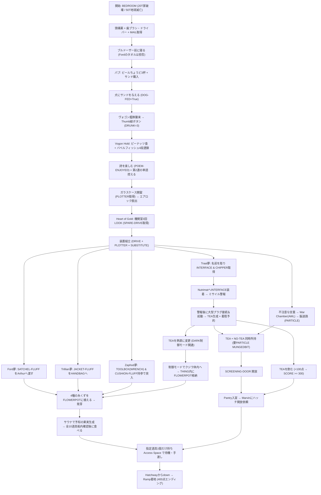

# The Hitchhiker's Guide to the Galaxy (Python 版) の内部構造と因果解析

ZilPy が *The Hitchhiker's Guide to the Galaxy* (1984 年, Douglas Adams & Steve Meretzky) の ZIL ソース (`hitchhikersguide/`) から生成した Python 版 (`out/hitchhikersguide/`) を、構成要素・パーサーの内部処理・ゲーム世界への反映パイプライン・固有サブシステム・クリアを阻む因果的ターニングポイントと遅延ソフトロック・主人公視点のギャップと風刺ドラマの観点から詳細に解説します。

- **ネタバレ注意:** 仕掛けの解き方、遅延ソフトロック条件、エンディングのオチまで記載しています。
- **権利・引用方針:** 本ドキュメントは `out/hitchhikersguide/` の静的・動的構造を日本語で技術解析したものであり、原作・ゲームの文章や公式ヒント集の転載は行っていません（構造確認に必要な短い識別子・キーワードのみ英語のまま記載しています）。
- **元の ZIL の位置:** `parser.zil:112` のように記載します。生成コードの各定義直前の `# zil:` 注記と `out/hitchhikersguide/zilmap.json` から対応を引けます。

---

## 1. 全体像

### 1.1 規模

`tools/analyze_game.py out/hitchhikersguide` による静的棚卸しの実数は以下のとおりです。

| 項目 | 数 |
|---|---|
| モジュール (ZIL ファイル) | 10 |
| ルーチン | 551 |
| 部屋 | 31 |
| オブジェクト (部屋以外) | 189 |
| 構文 (`SYNTAX`) | 333 (動詞の語 141 個) |
| 割り込みのルーチン (`I-*`) | 28 (`QUEUE` 登録箇所 110 箇所) |
| グローバル変数・定数 | 308 (`state` 179、`const` 73、`scratch` 56) |
| 満点 | 400 点 (`VALUE` = 0、`TVALUE` = 0。すべてイベント直接加算) |

ルーチン 551 個の役割別内訳は次のとおりです。

| 役割 | 数 | 例 |
|---|---|---|
| 動詞のアクション (`V-*`) | 183 | `V-TAKE`、`V-TYPE`、`V-FOOTNOTE`、`V-ENJOY` |
| オブジェクトのアクション | 144 | `DISPENSER-BUTTON-F`、`NUTRIMAT-F`、`NO-TEA-F`、`GUIDE-F` |
| そのほか | 51 | `GO`、`MAIN-LOOP`、`PERFORM`、`CLOCKER`、`LEAVE-EARTH` |
| そのほか (パーサー) | 43 | `PARSER`、`SYNTAX-CHECK`、`GET-OBJECT`、`MOBY-FIND` |
| そのほか (動詞の補助) | 34 | `JIGS-UP`、`ITAKE`、`GOTO`、`ROB` |
| そのほか (共通のオブジェクト) | 30 | `DARK-FUNCTION`、`LEAVE-DARK`、`FIND-NOT-HERE` |
| 部屋のアクション | 28 | `DARK-F`、`HOLD-F`、`ENGINE-ROOM-F`、`PANTRY-F`、`RAMP-F` |
| 割り込み (`I-*`) | 28 | `I-VOGONS`、`I-THING`、`I-CARELESS-WORDS`、`I-MARVIN`、`I-DOG` |
| 事前アクション (`PRE-*`) | 8 | `PRE-TAKE`、`PRE-PUT`、`PRE-READ`、`PRE-GIVE` |
| マクロから作った関数 | 2 | `PROB`、`DISABLE` |

部屋 31 個＋オブジェクト 189 個＝計 220 個であり、Z-machine Version 3 (ZIP) の 255 オブジェクト上限に肉薄しています。そのため後述のとおり、**部屋オブジェクトに百科事典 (`GUIDE`) の検索用同義語を相乗りさせる**という大胆な節約設計が採用されています。

### 1.2 モジュールと読み込みの順

メインの `s4.py`（開発コード名 `S4`）が `INSERT-FILE` の順に 9 モジュールを読み込み、プロパティ既定値 (`SIZE` = 5、`CAPACITY` = 0) を定義したうえで `ZG._link()` → `ZG.GO()` で起動します。

| # | モジュール (元の ZIL) | 行数 | ルーチン | 部屋 | オブジェクト | 構文 | 主な役割 |
|---|---|---:|---:|---:|---:|---:|---|
| 1 | `s4.py` (`s4.zil`) | 43 | 0 | 0 | 0 | 0 | 入口・モジュール読込・既定プロパティ |
| 2 | `misc.py` (`misc.zil`) | 733 | 14 | 0 | 0 | 0 | `GO`、`MAIN-LOOP`、`PERFORM`、`CLOCKER`、`SAVE-INPUT` |
| 3 | `heart.py` (`heart.zil`) | 1,915 | 57 | 10 | 31 | 0 | 宇宙船 Heart of Gold 全区画・Nutrimat・Marvin・植物・Ramp |
| 4 | `parser.py` (`parser.zil`) | 1,625 | 43 | 0 | 0 | 0 | 自然言語パーサー (`PARSER`、`GET-OBJECT`、`MOBY-FIND` 等) |
| 5 | `syntax.py` (`syntax.zil`) | 1,223 | 0 | 0 | 0 | 333 | 語彙 (`BUZZ` / `SYNONYM`) と構文定義 333 個 |
| 6 | `verbs.py` (`verbs.zil`) | 3,224 | 226 | 0 | 0 | 0 | 標準動詞 183 個・補助関数・`JIGS-UP`（夢ロールバック込み） |
| 7 | `earth.py` (`earth.zil`) | 2,242 | 62 | 6 | 41 | 0 | 地球編（寝室・家前・パブ・ブルドーザー・犬・ヴォゴン艦隊） |
| 8 | `vogon.py` (`vogon.zil`) | 919 | 26 | 3 | 20 | 0 | ヴォゴン船（船倉・バベルフィッシュ連鎖・詩朗読・エアロック） |
| 9 | `unearth.py` (`unearth.zil`) | 1,616 | 57 | 11 | 42 | 0 | 異星・記憶空間（Traal・War Chamber・脳迷路・パーティー・ボート・クジラ） |
| 10 | `globals.py` (`globals.zil`) | 2,187 | 66 | 1 | 55 | 0 | `DARK` 部屋と五感エンジン、`GUIDE`、`TEA`/`NO-TEA`、`THUMB`、道具 10 種 |
| — | **合計** | **15,727** | **551** | **31** | **189** | **333** | |

### 1.3 満点 (400 点) の内訳と減点

本作には `VALUE`/`TVALUE` による自動加点がなく、すべて各イベントのコード内で `ZG.SCORE = (ZG.SCORE + N)` と直接加算されます。

| 獲得イベント | 点数 | 実装箇所 (ZIL) |
|---|---:|---|
| 頭痛薬 (`TABLET`) を飲む | +10 | `TABLET-F` (`earth.zil:429`) |
| パブでビールを飲む（1〜3 杯目、各 +5） | +15 | `BEER-F` (`earth.zil:1860`) |
| ヴォゴン船倉 (`HOLD`) に到達する | +8 | `HOLD-F` (`vogon.zil:40`) |
| バベルフィッシュを耳に入れる | +12 | `DISPENSER-BUTTON-F` (`vogon.zil:176`) |
| ヴォゴン詩を楽しむ (`enjoy poetry`) | +15 | `POETRY-F` (`vogon.zil:760`) |
| ガラスケースを開ける (`type "<単語>"`) | +25 | `GLASS-CASE-OPENS` (`vogon.zil:469`) |
| 機関室で 3 回目の `LOOK` を実行する | +25 | `ENGINE-ROOM-F` (`heart.zil:1474`) |
| Ford 視点で Arthur と最初のビールを飲む (`FORD-POINT`) | +15 | `BEER-F` (`earth.zil:1860`) |
| Trillian 視点で Phil (Zaphod) に連れ出される | +25 | `I-ZAPHOD` (`heart.zil:1201`) |
| Zaphod 視点で Heart of Gold へ突入する | +25 | `DAIS-EXIT-F` (`unearth.zil:1315`) |
| Traal の奥で `NUT-COM-INTERFACE` を拾う | +25 | `NUT-COM-INTERFACE-F` (`unearth.zil:435`) |
| 脳の迷路で常識粒子 (`PARTICLE`) を拾う | +25 | `PARTICLE-F` (`unearth.zil:714`) |
| 芽の出た鉢植えをサウナに持ち込む | +25 | `SAUNA-ENTER-F` (`heart.zil:978`) |
| 本物のお茶 (`TEA`) を飲む | +100 | `TEA-F` (`globals.zil:1373`) |
| Marvin のパントリー (`PANTRY`) に初めて入る | +25 | `PANTRY-F` (`heart.zil:51`) |
| Marvin に正しい道具を渡す | +25 | `MARVIN-F` (`heart.zil:172`) |
| **合計** | **400** | `V-SCORE` (`verbs.zil:116`) の上限 400 と一致 |

一方、**減点 (-30)** が 3 箇所存在します（サンドイッチを食べる `SANDWICH-F`、お茶代用品を飲む `SUBSTITUTE-F`、ミサイル警報前に大型プラグ接続のままドライブを起動する `SWITCH-F`）。特に `SWITCH-F` の誤起動は `-30` 点だけでなく大型プラグと差込口が焼失してクリア不能になります。

---

## 2. 起動・メインループ・`PERFORM` のパイプライン

### 2.1 起動 (`GO`, `misc.zil:179`)

`GO` は起動時に以下の初期化を行い、`MAIN-LOOP` に突入します。

1. `PUTB(P_LEXV, 0, 59)` で字句バッファの最大語数を設定。
2. 3 本の初期タイマーを有効化（`ENABLE(QUEUE(...))`）：
   - `I-HOUSEWRECK` (20 ターン): 寝室・玄関ポーチに居座るとブルドーザーで家ごと潰される。
   - `I-THING` (21 ターン): 叔母からもらった謎の品 (`THING`) の自動帰還デーモン。
   - `I-VOGONS` (50 ターン): ヴォゴン建設艦隊の地球飛来タイマー。
3. `WINNER = PLAYER = PROTAGONIST`、`HERE = BEDROOM`、`IDENTITY-FLAG = ARTHUR`、`LYING-DOWN = True` に設定し、`PROTAGONIST` を `BED` の中（上）へ配置。`ARTHUR` オブジェクト自体は `GLOBAL-OBJECTS` へ退避する（他者視点シーンで NPC として実体化するため）。
4. `V-VERSION()`、目覚めの二日酔い描写、`V-LOOK()` の順に実行し、`MAIN-LOOP()` へ移行する。

### 2.2 メインループ (`MAIN-LOOP`, `misc.zil:202`)

Zork 系 (`MAIN-LOOP` + `MAIN-LOOP-1`) と異なり、本作は `MAIN-LOOP` 単一ルーチン（183 行）で 1 ターンを完結させます。特徴的な処理は次の 5 点です。

1. **代名詞 `IT` の展開**: `P-IT-OBJECT` が `ACCESSIBLE?` であれば、`P-PRSI` → `P-PRSO` の順で `IT` を置換する。
2. **複数目的語ループと `TEA-PRINT` 制御**: `NUM > 1` または `ALL` のときオブジェクト名を前置表示するが、`TEA-PRINT(OBJ1)` を通すことで `no tea` の特殊表示（`drop all` 等で誤って `no tea` が落ちたように見せない処理）を制御する。
3. **直前コマンドの記憶 (`AGAIN` 用)**: `P-OFLAG` が立っておらずメタ動詞でなければ、`L-PRSA` / `L-PRSO` / `L-PRSI` および `L-DONT-FLAG` / `L-FRONT-FLAG` を保存する。
4. **`CLOCKER()` スキップ条件**: メタ動詞 (`TELL`, `BRIEF`, `SUPER-BRIEF`, `VERBOSE`, `VERSION`, `QUIT`, `SCORE`, `SAVE`, `RESTORE`, `SCRIPT`, `UNSCRIPT`, `FOOTNOTE`, `HELP`, `RESTART`) に加え、**`don't wait` (`VERB? WAIT` かつ `DONT-FLAG`)** および禁止対象動詞直後の `AGAIN` でも時計を進めない。
5. **パーサー失敗フックによる「不注意な言葉」(`I-CARELESS-WORDS`)**:
   `PARSER()` が `False` を返した（＝入力を解釈できなかった）分岐の末尾に、次の極めてユニークなフックが仕込まれています (`misc.zil:404-409`)。
   ```python
   elif ((GETB(ZG.P_LEXV, ZG.P_LEXWORDS) > 3)
         and (not ZG.CARELESS_WORDS_FLAG)
         and ZG.EARTH_DEMOLISHED
         and ZG.SAVE_INPUT(ZG.FIRST_BUFFER)):
       ZG.CARELESS_WORDS_FLAG = True
       ENABLE(ZG.QUEUE(ZG.I_CARELESS_WORDS, 3))
   ```
   地球破壊後にプレイヤーが **4 語以上の解釈不能コマンド** を打つと、生の入力文字列を `FIRST-BUFFER` (100 バイト) へ退避し、3 ターン後に `I-CARELESS-WORDS` を発火させます。あなたの打ち間違えた文言がワームホールを通って数光年先の和平会議へ飛び、Vl'Hurg 語で最悪の侮辱となって数世紀の星間戦争を引き起こし、結果として **`FLEET-PROB = 60`（War Chamber へのルート）が開通**します。

### 2.3 `PERFORM` のディスパッチ優先順位 (`misc.zil:471`)

`PERFORM(A, O, I)` は呼び出し前の `(PRSA, PRSO, PRSI)` を退避・復元する再入可能設計です。ディスパッチ優先順位は以下の 8 段階です。

1. **`NOT-HERE-OBJECT-F`**: `PRSA != V?WALK` かつ `NOT-HERE-OBJECT` が `PRSO` または `PRSI` に含まれる場合。ここで `FIND-NOT-HERE` → `MOBY-FIND` が成功すると `PRSO`/`PRSI` が実オブジェクトに差し替わり、処理は継続する。
2. **`Actor` (`GETP(WINNER, 'ACTION')`)**: 最も強力なコマンド横取り層。通常時は `PROTAGONIST-F`（`NO-TEA` 関連を横取り）、暗闇にいる間は **`DARK-FUNCTION`** に差し替えられ、ほぼすべての入力を五感パズルとして乗っ取る。
3. **`DONT-F` (`ZG.DONT_FLAG`)**: 本作固有の層。`don't ...` 入力を部屋・動詞処理より前に横取りする。
4. **`M-BEG` (`GETP(LOC(WINNER), 'ACTION')`)**: 現在部屋の事前アクション。
5. **`Preaction` (`GET(PREACTIONS, A)`)**: 事前アクション (`PRE-TAKE`, `PRE-PUT`, `PRE-READ` 等 8 個)。
6. **`PRSI` (`GETP(I, 'ACTION')`)**: 間接目的語のアクション。
7. **`PRSO` (`GETP(O, 'ACTION')`)**: 直接目的語のアクション (`V?WALK` 以外)。
8. **デフォルト動詞 (`GET(ACTIONS, A)`)**: `V-*` ルーチン。

---

## 3. パーサーの詳細処理 (`parser.py`) と不条理パーサー機構

### 3.1 内部データ構造とメモリ配置

`parser.py` は 43 ルーチン・1,625 行からなる Z-machine Version 3 世代の標準パーサーをベースに、本作特有の拡張を施しています。

| テーブル / 定数 | サイズ・値 | 役割 |
|---|---|---|
| `P-INBUF` | `ITABLE('BYTE', 60)` | `READ` が書き込む生入力バッファ（Zork I の 120B より省メモリな 60B） |
| `P-LEXV` | `ITABLE('BYTE', 120)` | 字句テーブル。`P-LEXWORDS=1`、`P-LEXSTART=1`、`P-LEXELEN=2`、`P-WORDLEN=4` |
| `SIBREAKS` | `'.,"'` | トークン境界として独立語化される記号文字 |
| `P-ITBL` / `P-OTBL` | 10 ワード (`P-ITBLLEN=9`) | 文構造スロット (`P-VERB=0`, `P-VERBN=1`, `P-PREP1=2`, `P-PREP1N=3`, `P-PREP2=4`, `P-NC1=6`, `P-NC1L=7`, `P-NC2=8`, `P-NC2L=9`) |
| `P-PSOFF` / `P-P1OFF` / `P-P1BITS` | `4` / `5` / `3` | 辞書エントリの品詞バイト・第 1 品詞値オフセット・マスク (`WT?`, `parser.zil:318`) |
| `OOPS` / `AGAIN` | `OOPS` なし、`V-AGAIN` 動詞 | `OOPS-INBUF` や `AGAIN-LEXV` を持たず、`V-AGAIN` (`verbs.zil:292`) が `L-PRSA`/`L-PRSO`/`L-PRSI` を再実行する方式 |

### 3.2 Hitchhiker's Guide 固有のパーサー・世界連動機構

#### (1) `DON'T` 否定命令 (`DONT-FLAG` & `DONT-F`)
`PARSER` (`parser.zil:112`, Python `parser.zil:273-275`) は動詞がまだ見つかっていない状態で `don't` / `dont` を検出するとローカル変数 `DONT = True` を立て、解析完了時に `ZG.DONT_FLAG` へ転写します。`PERFORM` では `Actor` の直後に `DONT-F()` (`globals.zil:730`) が呼ばれ、以下の皮肉な応答を返します。

- `don't panic`: 50% で「賢いな、パニックになるべき理由は山ほどあるのに」、50% で「なぜしない？君の状況は完全に絶望的だぞ」。
- `don't look`: `DONT-FLAG` を下ろして `PERFORM(V?CLOSE, EYES)`（目を閉じる）に転送。
- `don't wait`: `"Time doesn't pass..."` と出力し、`MAIN-LOOP` 側で `CLOCKER()` をスキップ（本当に時間が進まない）。
- `don't take X`: `"Not taken."`、その他は `"Not done."`。

#### (2) `IN-FRONT-FLAG` と引用符の特殊扱い
`PARSER` (`parser.zil:255-267`) は `in front` や `down in front` という語列を検出すると `IN-FRONT-FLAG = True` をセットします。これにより `lie down in front of bulldozer` や `put satchel in front of panel` を専用前置詞なしで正しく識別します。また `CARVE` / `MY` の後続に引用符 `"` が来た場合は `WORD('the')` に書き換えて読み飛ばす (`parser.zil:182-185`) 一方、`V-TYPE` (`verbs.zil:2031`) では引用符直後の `P-CONT` 位置にある生トークン `GET(P_LEXV, P_CONT)` を直接照合してガラスケースの暗号語（`fripping` / `lyshus` / `wimbgunts` 等 9 語）を判定します。

#### (3) `CONSULT GUIDE ABOUT ...` と部屋オブジェクトへのトピック相乗り
`CONSUL` は `ASK` の同義語 (`syntax.zil`) であり、`GUIDE` には `ACTORBIT` が付与されています。`consult guide about <主題>` を入力すると以下の経路で処理されます。

1. `<主題>` が現在部屋に存在しないため、`GET-OBJECT` は `NOT-HERE-OBJECT` を `P-PRSI` に格納し、検索語を `P-XNAM`/`P-XADJ` に残す。
2. `PERFORM` 最優先の `NOT-HERE-OBJECT-F` (`globals.zil:69`) が `PRSA == V?ASK-ABOUT`（かつ `PRSI == NOT-HERE-OBJECT`）を検知し、`FIND-NOT-HERE` → `MOBY-FIND` (`parser.zil:1104`) を起動する。
3. `MOBY-FIND` はゲーム内の全部屋の中身・`LOCAL-GLOBALS` に加え、**`ROOMS` 自体 (`SEARCH_LIST(ROOMS, TBL, P_SRCTOP)`)** まで全走査する。
4. 255 オブジェクト制限を節約するため、百科事典専用オブジェクトを増やさず **部屋オブジェクトに無関係なトピックの `SYNONYM`/`ADJECTIVE` を相乗り** させている。
   - `DARK` 部屋 → `SUNGLA`/`GLASSE`/`JANTA`（危険感知サングラス）
   - `FRONT-PORCH` → 物質転送ビーム (`Matter Transference Beams`)
   - `FRONT-OF-HOUSE` → ガラクシア・ウーンビーム (`Galaxia Woonbeam`)
   - `ENTRY-BAY` → 汎銀河ガグルブラスター (`Pan Galactic Gargle Blaster`)
   - `COUNTRY-LANE` → 宇宙 (`Space`)
   - `THIRD-PLANET` / `MAZE` → 地球 (`Mostly harmless.`)
5. 複数一致してしまう `fluff`（4 種）や `tool`/`tools`（10 種）は、`FIND-NOT-HERE` (`globals.zil:128`) が強制的に代表オブジェクト (`POCKET-FLUFF` / `TWEEZERS`) へフォールバックさせることで曖昧エラーを回避し、`GUIDE-F` の解説へ到達させる。

#### (4) `NO-TEA` / `TEA` の二律背反 (`NO-TEA-F` / `TEA-F`)
プレイヤーはゲーム開始時から状態変数 `HOLDING-NO-TEA = True`（「お茶を持っていない」状態）を所持品として持っています（`inventory` に `no tea` と表示される）。

- `TEA-F` (`globals.zil:1373`): 本物の `TEA` を `take` すると `HOLDING-NO-TEA = False` になり `"no tea: Dropped."` と表示。逆に `drop tea` すると `HOLDING-NO-TEA = True` になり `"no tea: Taken."` と表示される。
- `NO-TEA-F` (`globals.zil:1424`): `PARTICLE`（脳内の常識粒子）に `MUNGEDBIT` が立っていない限り、`take no tea` / `drop no tea` は `"Your common sense tells you that you can't do that."` と拒絶される。脳の迷路で常識粒子を抜き取った (`FSET(PARTICLE, MUNGEDBIT)`) 後だけ `take no tea` が成功し、**`HELD?(TEA) == True` かつ `HOLDING-NO-TEA == True` という論理矛盾状態**が成立する。

#### (5) `THING`（叔母の贈り物）の自動帰還デーモン (`I-THING`, `earth.zil:391`)
捨てても必ず戻ってくる `THING`（"thing your aunt gave you which you don't know what it is"）は、`GO` で 21 ターン目に登録され、以後 `4 + RANDOM(4)`（5〜8）ターンごとに再スケジュールされる永久デーモンです。

- Arthur 本人であり、視界内・所持品内になく、`DARK` / `ACCESS-SPACE` / `MAZE` / 艦隊襲来中 / 未視認の機関室でなければ発火。
- 40% (`PROB(40)`) で現在部屋の床 (`HERE`) へ、そうでなくガウン着用＆ポケット開放中なら 65% (`PROB(65)`) で `GOWN` のポケット内へ、それ以外は `PROTAGONIST` の手元へ無言で移動する。
- この「捨てても・奪われても必ず戻る」性質と `CAPACITY = 90` を逆用し、クジラ墜落時の全アイテム没収 (`ROB(PROTAGONIST, BULLDOZER)`) から鉢植え (`FLOWERPOT`) を救出するのが後半の核心パズルとなる。

#### (6) 嘘をつくナレーターと不条理なパーサー応答
本作ではナレーター自身が信頼できない語り手としてコードレベルで実装されています。

- **暗闇の出口の嘘 (`DARK-FUNCTION`, `globals.zil:879`)**: `listen` 後に `"There is an exit to port."` と嘘をつく。素直に `west` (`port`) へ進もうとすると失敗し、`LYING-COUNTER` が 4 に達した時点で初めて `LYING-ABOUT-EXIT` (`"(We were lying about the exit to port.) There is an exit aft..."`) と白状する。正解は最初から `south` (`aft`)。
- **機関室の押し問答 (`ENGINE-ROOM-ENTER-F`, `heart.zil:1368`)**: 南へ入ろうとすると `ARGUMENT-COUNTER` 1〜4 にわたり「本当に危険だぞ」「絶対にか？」「やっぱり行く気ないよね（勝手に引き返したことにする）」「冗談だろ、考え直せ」と 4 ターン連続で阻止し、`yes → yes → aft → no` を返して初めて入場できる。
- **機関室の視界の嘘 (`ENGINE-ROOM-F`, `heart.zil:1474`)**: 入室後 1〜2 回目の `LOOK` (`LOOK-COUNTER == 1, 2`) では `"there is nothing to see"` と嘘をつき、3 回目でようやく `"Okay, okay, there are a FEW things to see here."` と認めて `MAIN-DRIVE` / `SPARE-DRIVE` / `PLIERS` / `RASP` を実体化 (+25 点) する。
- **歯ブラシと倒木 (`TOOTHBRUSH-F`, `globals.zil:1226` ⇔ `RAMP-F`, `heart.zil:1961`)**: 序盤に歯ブラシを拾うと「窓の外で木が倒れた。この 2 つに因果関係はない」と断言するが、エンディング (`RAMP-F`) の最後に「実は因果関係がありました。この些細な不正確さをお詫びします」と謝罪する。

### 3.3 パーサーをバイパスする直接 `READ()` 例外

`out/hitchhikersguide/*.py` 全体で `READ(` を検索すると、`parser.zil:144` 以外に **5 箇所** の直接入力バイパスが存在します。

| ルーチン | 位置 (ZIL) | 役割と挙動 |
|---|---|---|
| `BRICK-DEATH` | `earth.zil:623` | ブルドーザーで崩れた家のレンガに当たって死亡後、3 回連続で `READ()` を回し、プレイヤーが何を打っても「死人は黙ってろ」と説教してから `FINISH()` を呼ぶ |
| `IDIOT?` | `earth.zil:2367` | Ford 視点で Arthur にタオルを渡す場面。直接 `READ()` し、先頭トークンが `WORD('idiot')` かどうかだけを判定する |
| `ENGINEER-F` | `globals.zil:1660` | 修理ロボットが「誰がこんなものを売ったんだ？」と質問して `READ()` を呼ぶが、**入力内容を一切参照せず完全に無視する** |
| `V-SCORE` | `verbs.zil:116` | `SCORE < 400` のとき「危険感知サングラスをかけてから Enter を押せ」と促し、ダミーの `READ()` を挟んでから点数を表示する |
| `FINISH` / `YES?` | `verbs.zil:71, 96` | ゲーム終了時の RESTART/RESTORE/QUIT 選択および標準 Yes/No 確認 |

---

## 4. パーサー出力から世界反映までのエンドツーエンド・トレース

### トレース①: バベルフィッシュ・ディスペンサー多段物理連鎖 (`push dispenser button`)

準備状態（`GOWN_HUNG = True`, `FSET?(TOWEL, SURFACEBIT) = True`, `PANEL_BLOCKER = SATCHEL`, `ITEM_ON_SATCHEL = MAIL`, `FISH_COUNTER = 5`）での実行トレースです。

1. **`PARSER`**: `push` → `ACT?PUSH`、`dispenser button` → `P-PRSO = [DISPENSER-BUTTON]`、`SYNTAX-CHECK` で `PRSA = V?PUSH` に確定。
2. **`MAIN-LOOP`**: 単一目的語なので `PERFORM(V?PUSH, DISPENSER-BUTTON, False)` を実行。
3. **`PERFORM`**: `NOT-HERE` なし → `PROTAGONIST-F` (`False`) → `DONT-FLAG` (`False`) → `HOLD-F(M-BEG)` (`False`) → `PREACTIONS` なし → `PRSO` として **`DISPENSER-BUTTON-F()` (`vogon.zil:176`)** を呼び出す。
4. **`DISPENSER-BUTTON-F`**:
   - `FISH_COUNTER` をデクリメント (`5 → 4`)。
   - 4 段分岐をすべて通過: `GOWN_HUNG`（壁穴を塞ぐ）→ `FSET?(TOWEL, SURFACEBIT)`（排水溝を塞ぐ）→ `PANEL_BLOCKER == SATCHEL`（床掃除ロボット衝突で魚が宙へ）→ `ITEM_ON_SATCHEL == MAIL`（上部掃除ロボットが舞い上がったジャンクメール回収に気を取られる）。
   - 副作用: `MOVE(MAIL, LOCAL_GLOBALS)`、`SCORE += 12`、`MOVE(BABEL_FISH, PROTAGONIST)`、`FISH_COUNTER = 0`、`ITEM_ON_SATCHEL = False`。さらに衛兵到来を早めるため `ENABLE(QUEUE(I_ANNOUNCEMENT, 4))` と `ENABLE(QUEUE(I_GUARDS, 7))` を登録して `True` を返す。
5. **`MAIN-LOOP` 後段**: `HOLD-F(M-END)` 実行後、`CLOCKER()` が `I-ANNOUNCEMENT` 等のカウンタを 1 減算し、`MOVES += 1` でターン完了。

### トレース②: 暗闇 (`DARK`) の五感チェックとナレーターの嘘 (`listen` → `aft`)

Entry Bay 行き (`DARK-FLAG = ENTRY-BAY`, `DARK-COUNTER = 4`) で `listen` と入力し、続けて `aft` と入力する場合です。

1. **1 手目 (`listen`)**:
   - `SYNTAX`: `LISTEN TO OBJECT FIND DARKBIT` により、`GWIM` が `DARKBIT` を持つ `DARK-OBJECT` を自動補完 (`PRSA = V?LISTEN`, `PRSO = DARK-OBJECT`)。
   - `PERFORM` の第 2 段階 (`Actor`) で、`DARK-F(M-ENTER)` が差し替えた **`DARK-FUNCTION()` (`globals.zil:879`)** が最優先で発火。
   - `MISSING?()` (`DARK-CONTROLLED` または `DARK-COUNTER > 3`) が真のため、`MOVE(STAR-DRIVE, HERE)`、`P-IT-OBJECT = STAR-DRIVE` を実行し、`"far above"` の音と共に **嘘のヒント `"There is an exit to port."`** を出力して `True` を返す。
2. **2 手目 (`aft`)**:
   - `SYNONYM: SOUTH, S, AFT` により `PARSER` は方向ショートカットで `PRSA = V?WALK`, `PRSO = 'SOUTH'` を返す。
   - `PERFORM` → `DARK-FUNCTION()` が `VERB?(WALK)`・`MISSING?()`・`IN?(STAR-DRIVE, HERE)`・`PRSO?('SOUTH')` を検知。
   - `LYING-COUNTER < 4` のため `LYING-ABOUT-EXIT` (`"(We were lying about the exit to port.) "`) を吐きつつ **`LEAVE-DARK()` (`globals.zil:1083`)** を呼ぶ。
   - `LEAVE-DARK()` が `PUTP(PROTAGONIST, 'ACTION', PROTAGONIST-F)` で横取りを解除し、`DARK-OBJECT` と `MEMORIAL` に退避していた所持品を `ROB` で返却、`GOTO(ENTRY-BAY)` で現実世界へ復帰する。

### トレース③: 無限不可能性ドライブ起動とミサイル→クジラ変換 (`turn on drive`)

Bridge で `DRIVE-TO-PLOTTER = True`, `BROWNIAN-SOURCE = SUBSTITUTE`, `DRIVE-TO-CONTROLS = True`（大型プラグを `LARGE-RECEPTACLE` へ接続済み）、かつミサイル警報後 (`RUNNING?(I-TEA)` かつ `TEA-COUNTER > 6`) の実行トレースです。

1. **`PARSER` → `PERFORM`**: `turn on drive` → `PRSA = V?LAMP-ON`, `PRSO = SPARE-DRIVE`。`SPARE-DRIVE-F` は `SWITCH-F` へ転送（または直接 `turn on switch`）。
2. **`SWITCH-F` (`heart.zil:1654`)**:
   - `DRIVE-TO-CONTROLS` が真のため、`LARGE-PLUG` と `LARGE-RECEPTACLE` を `LOCAL-GLOBALS` へ永久消去（焼失）。
   - `RUNNING?(I-TEA)` かつ `TEA-COUNTER > 6` を満たすため、**`MOVE(TEA, SLOT)`**（本物のお茶完成）、`DISABLE(INT(I-TEA))`（ミサイル着弾中止）、`ENABLE(QUEUE(I-LANDING, 24))`（24 ターン後に Magrathea 着陸）を実行。
   - Eddie が「ミサイルはマッコウクジラに変わり、Magrathea へ落下中」とアナウンスして `True` を返す。
   - （※もし `TEA-COUNTER <= 6` すなわち警報前に同じ操作をすると、`else` 節に入り **`SCORE -= 30`・`I-TEA` 停止・大型プラグ焼失** となり、本物のお茶が二度と作れず即座にソフトロックする。）

---

## 5. Hitchhiker's Guide 固有の主要サブシステム

### 5.1 地球破壊タイマーと 3 段進行 (`earth.py`)

地球編は複数の独立タイマーが重なり合う厳格なリアルタイム進行です。

| 割り込み | 起点・間隔 | 役割 |
|---|---|---|
| `I-HOUSEWRECK` (`earth.zil:69`) | `GO` で 20 ターン | 20T 経過時に `BEDROOM` / `FRONT-PORCH` にいると家ごと圧死 |
| `I-BULLDOZER` (`earth.zil:606`) | 家前へ出て寝ない間、毎ターン | `BULLDOZER-COUNTER > 4` で家破壊＋`BRICK-DEATH()` |
| `I-PROSSER` (`earth.zil:729`) | ブルドーザー前に寝てから 3 ターン | 3T 目にブルドーザー停止、Ford 出現、`I-FORD` 起動 |
| `I-FORD` (`earth.zil:1136`) | Ford 出現後、毎ターン | タオルを**受け取らなければ** Prosser を説得して身代わりに寝かせ、パブへ案内。ビール 3 杯目 (`BEER-F`) で再起動し家破壊を告げる |
| `I-DOG` (`earth.zil:1565`) | ビール 3 杯後に `COUNTRY-LANE` へ出る | 2 ターン猶予で犬が出現。直後に `SANDWICH` を与えると `DOG-FED = True` |
| `I-VOGONS` (`earth.zil:2042`) | `GO` で 50 ターン（家破壊後の家前で加速） | 5 段階でヴォゴン艦隊が地球を解体。`VOGON-COUNTER == 2` で Ford が `THUMB` を落とし、`VOGON-COUNTER == 5` で地球消滅 |

脱出時の `GREEN-BUTTON-F` (`globals.zil:1544`) は **`DRUNK-LEVEL == 3`** を厳密に要求します。2 杯以下だと物質転送のショックで即死、4 杯目は `BEER-F` 内で泥酔死 (`V-GET-DRUNK`) となります。

### 5.2 バベルフィッシュ・ディスペンサーの 4 段物理連鎖 (`vogon.py`)

`DISPENSER-BUTTON-F` (`vogon.zil:176`) は、ボタンを押すたびに `FISH-COUNTER`（初期値 **5**、`vogon.zil:140`）を 1 減らし、以下の 4 つの条件を順に評価します。1 つでも欠けると魚が失われ、失敗理由がヒントとして描写されます。

1. `GOWN-HUNG`: ガウンをフックに掛けて壁の穴 (`FISH-HOLE`) を塞ぐ（袖を結んでも `SLEEVE-TIED` で「内側を滑り落ちた（いい線だが残念）」と嘲笑される）。
2. `FSET?(TOWEL, SURFACEBIT)`: タオルで床の排水溝 (`DRAIN`) を覆う。
3. `PANEL-BLOCKER == SATCHEL`: 床掃除ロボットの通り道 (`ROBOT-PANEL`) を Ford の鞄で塞ぐ（他の物だと避けられる）。
4. `ITEM-ON-SATCHEL == MAIL`: 鞄の上に玄関のジャンクメールを置き、飛来する上部掃除ロボットの注意を逸らす（他の物を置くと魚ごと没収される）。

### 5.3 暗闇 (`DARK`) と 4 つの他者視点への人格切替 (`globals.py` / `unearth.py`)

`DARK` は単なる転送空間ではなく、**全 8 つの現実・記憶空間を結ぶハブ**です。`DARK-F(M-ENTER)` は確率テーブル（初期値: `VOGON-PROB=100`, `TRAAL-PROB=60`, `TRILLIAN-PROB=15`, `FORD-PROB=15`, `HEART/ZAPHOD/FLEET/WHALE-PROB=0`）をループ抽選して `DARK-FLAG` を決定します。Traal に初回到達すると `TRILLIAN`/`FORD`/`ZAPHOD` が各 25% へ引き上げられます。

熱源が `SUBSTITUTE` の間はランダムモード（4 ターン経過で抜けた感覚が 1 つ現れる）ですが、本物の `TEA` を熱源にすると `SWITCH-F` が **`DARK-CONTROLLED = True`** を立て、1 コマンドごとに `DARK-EXIT-TABLE` の 8 出口（`HOLD → COUNTRY-LANE → LIVING-ROOM → ENTRY-BAY → LAIR → SPEEDBOAT → INSIDE-WHALE → WAR-CHAMBER`）を循環する**制御モード**になります。

| 抜ける感覚 | 1 手目 | 手がかり | 2 手目 | 行き先 | 切替後の人格 (`IDENTITY-FLAG`) |
|---|---|---|---|---|---|
| hear | `listen` | `far above` | `aft` | `ENTRY-BAY` | Arthur（現実） |
| hear | `listen` | `far below` | `aft` | `WAR-CHAMBER` | Arthur（夢・微小艦隊） |
| smell | `smell` | `being waved` | `examine shadow` | `HOLD` | Arthur（現実／再訪時は即射殺） |
| smell | `smell` | `waving` | `examine shadow` | `LAIR` | Arthur（夢・Traal） |
| see | `examine darkness` | `front` | `examine light` | `COUNTRY-LANE` | **Ford Prefect**（夢・回想） |
| see | `examine darkness` | `back` | `examine light` | `SPEEDBOAT` | **Zaphod Beeblebrox**（夢・回想） |
| feel | `feel darkness` | `cold` | `taste liquid` | `LIVING-ROOM` | **Trillian**（夢・回想） |
| feel | `feel darkness` | `warm` | `taste liquid` | `INSIDE-WHALE` | Arthur（夢・クジラ体内） |

他者視点へ入る際、Arthur の持ち物は `MEMORIAL` へ一時退避され、Ford 視点の持ち物位置は `FORD-TABLE`、Trillian 視点のハンドバッグ状態は `PARTY-TABLE` に記録されます。夢空間内で死ぬと **`JIGS-UP` (`verbs.zil:2644`) の `if ZG.DREAMING:` 分岐**が発火し、ゲームオーバーにならず状態をクリーンにロールバックして `HEART-PROB = 100` で `DARK` → `ENTRY-BAY` へ戻します。ただし、獲得した特定の成果物（Ford が Arthur へ渡した `SATCHEL-FLUFF` → `FLUFF-TO-GOWN`、Trillian がバッグに入れた `JACKET-FLUFF`、Zaphod が船内へ持ち込んだ `TOOLBOX`/`CUSHION-FLUFF` → `ROB(PROTAGONIST, HATCHWAY)`）だけは**現実の Heart of Gold へ持ち越されます**。

### 5.4 お茶・`SCREENING-DOOR`・`PANTRY` の致死性憂鬱 (`heart.py`)

- **Nutrimat 改造 (`NUTRIMAT-F` & `I-TEA`, `heart.zil:532, 895`)**: Traal で入手した `NUT-COM-INTERFACE` を `BOARD` の代わりに装着して `PAD` を押すと `I-TEA` が起動。Nutrimat が本物のお茶のレシピを解析するために船載コンピュータ Eddie の全リソースを占有し、6 ターン目に全メモリ過負荷、7 ターン目に Magrathea からの核ミサイル警報（8 ターン後に船体蒸発）と `THUMB` の故障 (`MUNGEDBIT`) が同時発生する。
- **知性テスト (`SCREENING-DOOR-F`, `heart.zil:81`)**: `HELD?(TEA)` かつ `HOLDING-NO-TEA` の状態で `open door` / `knock` すると「同時にお茶とお茶なしを持つとは大哲学者だ」と感服して開く。
- **致死性憂鬱 (`PANTRY-F`, `heart.zil:51`)**: Pantry 入室時に **`SCORE < 300`** だと Marvin の憂鬱に耐えられず即死 (`JIGS-UP`)。本物のお茶を飲んで +100 点（計 350 点以上）を得て初めて生存できる。

### 5.5 微小宇宙艦隊とチーズサンドの伏線 (`earth.py` / `unearth.py`)

1. 地球のパブで買った `SANDWICH` を `COUNTRY-LANE` の犬に与えておく (`DOG-FED = True`)。
2. 地球破壊後の不注意な言葉 (`I-CARELESS-WORDS`) で `FLEET-PROB = 60` が開通。
3. `WAR-CHAMBER` で `I-DOG` (`earth.zil:1565`) が 13 ターン目に到達したとき、`DOG-FED == True` なら艦隊はサンドイッチを幸せそうに食べる巨大な犬を見て和解し、Arthur を転送装置で `MAZE`（Arthur 自身の脳内シナプス迷路）へ送り届ける。`DOG-FED == False` なら「縮尺の致命的な計算ミス」により艦隊ごと犬に飲み込まれて終わる。
4. `MAZE` (`MAZE-EXIT-F`, `unearth.zil:675`) では移動のたびに 40% (`PROB(40)`) で電気インパルスに阻まれ、成功時のみ `MAZE-COUNTER` が加算される。**`MAZE-COUNTER` が `3`, `17`, `36` のときだけ** 常識粒子 (`PARTICLE`) が出現する。これを拾うと `FSET(PARTICLE, MUNGEDBIT)`（+25 点）かつ `FSET(WAR-CHAMBER, REVISITBIT)` となり、感電して現実へ戻る。

### 5.6 予知の果実と Marvin のツール要求 (`heart.py`)

4 種の糸くず（`POCKET-FLUFF`, `SATCHEL-FLUFF`, `JACKET-FLUFF`, `CUSHION-FLUFF`）をクジラ体内から持ち帰った `FLOWERPOT` に植えると 10 ターン後に芽 (`I-PLANT`) が出、サウナ (`SAUNA-ENTER-F`) へ持ち込むと「予知の木」の果実 (`FRUIT`, +25 点) が実ります。

ここには Infocom 屈指の意地悪な二重アルゴリズムが仕込まれています。

1. **`FRUIT-F` (`heart.zil:458`)**: 果実を食べると、道具リスト `TOOL-LIST`（全 10 種）から最大 50 回抽選を繰り返し、**`not IN-HEART?(TOOL-REQUIRED)`（＝船内に存在しない道具）を見つけ次第ループを抜けてそれを要求道具に確定**する。全 10 種が Heart of Gold 船内に揃っている場合のみ 50 回を完走してランダムな 1 種に決まる。
2. **`I-MARVIN` (`heart.zil:268`)**: 果実を食べずに (`not TOOL-REQUIRED`) Marvin と Access Space で待ち合わせると、`while True` で **`not HELD?(TOOL-REQUIRED, PROTAGONIST)`（＝プレイヤーが今持っていない道具）が出るまで引き直す**ため、100% 失敗が確定する。
3. **`ACCESS-SPACE-ENTER-F` / `ACCESS-SPACE-LOOP` (`heart.zil:1859-1869`)**: Access Space へは、着用物 (`WORNBIT`)・一体部品 (`INTEGRALBIT`)・`BABEL-FISH` を除く所持品（コンテナ内も再帰カウント）が **1 個以下** でなければ入れない。さらに `I-MARVIN` の待ち合わせウィンドウは狭く、到着後 1 ターン以内に正しい道具を渡さないと `MARVIN-COUNTER = 3` となって二度と協力してくれない。

---

## 6. クリアへの因果的ターニングポイントと遅延ソフトロック群

### 6.1 因果依存グラフ



### 6.2 Infocom 史上最悪級の遅延ソフトロック・不可逆詰み一覧

本作が悪名高い理由は、**ゲーム開始 10 ターン以内の些細な見落としが、ゲーム終盤（300 ターン以上後）になって初めて「詰み」として顕在化する遅延ソフトロック**が何重にも張り巡らされている点にあります。

| 詰み・即死の要因 | 発生箇所・実コード条件式 | 顕在化タイミングと結果 |
|---|---|---|
| **歯ブラシ・ドライバー置き忘れ** | `FRUIT-F` (`heart.zil:458`): `not IN_HEART_p(TOOL_REQUIRED)` を 50 回優先抽選 | 終盤に予知の果実を食べた瞬間、地球と共に消滅した道具を指名されクリア不能 |
| **ジャンクメール取り忘れ** | `DISPENSER-BUTTON-F` (`vogon.zil:176`): `ITEM_ON_SATCHEL == MAIL` 必須 | ヴォゴン船倉で上部掃除ロボットを逸らせずバベルフィッシュ入手不能 |
| **Ford のタオルを受け取る** | `TOWEL-F` (`earth.zil:1376`): `FORD_GONE = True`, `DISABLE(I_FORD)` | Ford が去ってしまい Thumb を得られず、50 ターン目に地球ごと消滅 |
| **ビール 2 杯以下 / 4 杯目** | `GREEN-BUTTON-F` (`globals.zil:1544`): `DRUNK_LEVEL == 3` / `BEER-F`: `== 4` で泥酔死 | 2 杯以下は脱出時に転送ショック死、4 杯目はパブで即ゲームオーバー |
| **犬にサンドイッチを与えない** | `I-DOG` (`earth.zil:1565`): `elif ZG.DOG_FED:` → `GOTO(MAZE)` | 中盤の War Chamber で艦隊が犬に呑まれて終了。脳迷路に行けず `NO-TEA` 取得不能 |
| **バベルフィッシュ 5 匹消費** | `DISPENSER-BUTTON-F`: `FISH_COUNTER` 初期値 5、`== 0` で `"Click."` | 5 回失敗すると魚が尽き、詩も録音も理解不能でガラスケースが開かない |
| **大型プラグの早計起動** | `SWITCH-F` (`heart.zil:1654`): `DRIVE_TO_CONTROLS` かつ `not (RUNNING?(I_TEA) and TEA_COUNTER > 6)` | `-30` 点かつ `LARGE-PLUG`/`LARGE-RECEPTACLE` 永久消去。ミサイル回避＆本物のお茶生成が永久不能 |
| **脳迷路での粒子見逃し** | `MAZE-EXIT-F` (`unearth.zil:675`): `MAZE_COUNTER in (3, 17, 36)` | 36 回目の移動を素通りすると `PARTICLE` が二度と出現せず `NO-TEA` 取得不能 |
| **War Chamber への再訪** | `LEAVE-DARK` (`globals.zil:1083`): `DARK_FLAG == WAR_CHAMBER` かつ `REVISITBIT` | 自分の脳内に実体化し、`I-BRAIN-DEATH` (6T) で 5 ターン後に本当に頭が爆発して死亡 |
| **ドア開放前のお茶飲用・紛失** | `TEA-F` (`globals.zil:1373`): `MOVE(TEA, LOCAL_GLOBALS)`（Nutrimat は 1 回限り） | `TEA` と `NO-TEA` の同時所持が不能になり `SCREENING-DOOR` が永遠に開かない |
| **300 点未満で Pantry 突入** | `PANTRY-F` (`heart.zil:51`): `if SCORE < 300: JIGS_UP(...)` | 致死量の憂鬱で即死（お茶を飲んで +100 点を得てから入る必要がある） |
| **クジラ体内への重要物持込** | `JIGS-UP` (`verbs.zil:2644`): `ROB(PROTAGONIST, BULLDOZER)` | 着用中 `GOWN`・`BABEL-FISH`・`THING` の中身以外すべて永久消去される |
| **Access Space の所持数超過** | `ACCESS-SPACE-LOOP` (`heart.zil:1869`): 再帰カウント `> 1` で入室拒否 | ガウンポケットに `THING` が自然帰還していると入室できず、Marvin の期限 (`MARVIN-COUNTER == 3`) 切れで詰む |

### 6.3 登場人物視点での障壁 3 層分類

1. **物理的・工学的必然**: 頭痛薬を飲まないと真っ直ぐ歩けない (`BEDROOM-EXIT-F`)、パジャマのまま外に出ると公然わいせつ (`CLOTHES-EXIT-F`)、ブルドーザーの前に寝れば工事が止まる、狭い Access Space には道具を 1 つしか持ち込めない。
2. **SF・物語的約束事**: 物質転送ビームのショックを和らげるビール 3 杯とピーナッツ、視界を遮れば敵からも見えないと思い込む Bugblatter Beast の愚かさ、ミサイルをマッコウクジラとペチュニアの鉢植えに変える無限不可能性ドライブ、他者の記憶へ跳ぶ夢空間。
3. **ダグラス・アダムス流の構造的不条理**:
   - **悪意の動的目標設定**: 「船内に無い道具」を狙い撃ちする予知の果実 (`FRUIT-F`) と、「今持っていない道具」を必ず選ぶ Marvin (`I-MARVIN`)。
   - **パーサーエラーの物語化**: プレイヤーの打ち間違いが星間戦争を起こす (`I-CARELESS-WORDS`)。
   - **哲学パズルの物理実装**: 脳のシナプスから「常識」を物理的に引っこ抜いて「お茶」と「お茶なし」を両手に持つ。
   - **語り手の裏切り**: 暗闇の出口 (`port`) も機関室の視界もナレーターが平然と嘘をつく。

---

## 7. 主人公（平凡な地球人 Arthur Dent）の視点：初回情報のみの「知的・理想的な行動」vs「クリア必須行動」

### 7.1 初期情報（Turn 0〜1）

起動直後の Arthur Dent が知り得る事実は、「ひどい二日酔いで暗い寝室 (`BEDROOM`) のベッドに横たわっている」ことだけです。明かりを点け、ガウンのポケットから頭痛薬を飲んで初めて、窓の外の黄色いブルドーザーと自宅取り壊しの危機を知ります。彼はヒーローでも宇宙飛行士でもなく、**「ただ静かにお茶を飲みたかった平凡な英国人」**です。

### 7.2 フェーズ別ギャップ分析表

| フェーズ | 初回情報のみから導かれる最も知的・理想的な行動 | コード上でクリアに実際に要求される行動 | ギャップの本質 |
|---|---|---|---|
| **1. 自宅脱出** | 自宅が潰されそうなので、最低限ガウンを着てすぐ外へ飛び出し、ブルドーザーを止めに行く | 緊急時にもかかわらず**歯ブラシ・ドライバー・玄関のジャンクメール**を几帳面に回収して持ち歩く | **超長期の遅延フラグ**。地球滅亡後に「歯ブラシが無くて詰む」とは誰にも予見不能 |
| **2. Ford の来訪** | 親切な友人が泥まみれの自分にタオルを差し出してくれたので、礼儀正しく受け取る | **タオルを無視し続ける**（受け取ると `FORD-GONE = True` で Ford が立ち去り地球と共に死亡） | **礼儀正しさが死を招く逆説**。原作を知らない限り「拒否して待つ」合理性がない |
| **3. パブと犬** | 地球が 12 分で滅ぶと聞いてパニックになるか、買ったサンドイッチを空腹しのぎに自分で食べる | ビールを**過不足なくちょうど 3 杯**飲み、まずいチーズサンドを買い、外に出た瞬間の 2 ターン以内に野良犬へ与える | 2 杯以下・4 杯目の即死境界と、数光年先の艦隊戦を左右する**バタフライ効果** |
| **4. ヴォゴン船** | 恐ろしい拷問詩を聞かされたら耳を塞ぐか抗議し、脱出を優先してさっさと逃げる | 拷問詩を歯を食いしばって **`enjoy poetry`** し、第 2 連の無意味な造語を暗記して船倉のキーボードに引用符付きで打ち込む | 英国人らしい「諦めと皮肉」を動詞 `ENJOY` に落とし込んだ不条理パズル |
| **5. 機関室と暗闇** | ナレーターが「危険だから入るな」「何もない」「出口は port だ」と言えば素直に従う | ナレーターと 4 回口論し、何もない部屋を 3 回見回し、`port` の嘘を無視して `aft` へ進む | **信頼できない語り手とのメタ対決**。通常のテキストアドベンチャーの文法を意図的に破壊 |
| **6. お茶と Marvin** | 苦労して淹れた本物のお茶をすぐ飲む／Marvin の頼みは親切に手持ちの道具を全部持って駆けつける | お茶は飲まずに脳から「常識」を抜いて `no tea` と同時所持し、4 つの他者記憶から糸くずを集めて予知の果実を食べ、**ガウンごと脱いで道具 1 個だけ**で待つ | 常識（文字通り `PARTICLE`）を捨てること自体がゲームクリアの条件という構造的皮肉 |

本作では**「常識的で礼儀正しく、説明を素直に信じる知的なプレイヤー」ほど序盤で静かにソフトロックを踏む**ように設計されています。クリアに求められるのは、論理的合理性ではなく「すべてを疑い、ゴミまで拾い、常識を捨て、不条理を面白がる」という銀河ヒッチハイカーの資質そのものです。

---

## 8. このゲームで行われていた具体的な行為と風刺・宇宙ドラマ

### 8.1 2 つの時間軸で再構成する壮大な宇宙的偶然のドラマ

コード内のイベント連鎖とエンディング (`RAMP-F`) を繋ぎ合わせると、本作は「一人の英国人が美味しい紅茶を 1 杯飲むために、銀河規模の偶然と過去の因縁をすべて踏破する」という壮大なコメディ叙事詩として浮かび上がります。

- **過去軸（ゲーム開始前にすでに動いていた因果）**:
  1. **官僚主義の二重奏**: 地球では地方自治体がバイパス建設のために Arthur の家を解体しようとし（計画書は「地下室の鍵のかかったトイレの『猛豹に注意』の看板の裏」に掲示されていた）、まったく同じ構図で、銀河超空間計画評議会は超空間バイパス建設のために**地球そのもの**を解体しようとしていた。
  2. **パーティーのすれ違いと船の強奪**: 地球の退屈なパーティー (`LIVING-ROOM`) で、Arthur が話しかけていた女性 Trillian は、二日酔いの宇宙大統領 Zaphod（偽名 Phil）に連れ出された。そして Zaphod は Damogran の式典 (`SPEEDBOAT` / `DAIS`) で自ら最新鋭宇宙船 Heart of Gold を強奪し、偶然にも宇宙へ放り出された Arthur と Ford を 29 秒後に拾い上げることになる。
  3. **不注意な言葉の星間戦争**: 地球消滅後、Arthur が何気なく口にした（プレイヤーが打ち間違えた）4 語以上の言葉が時空を超えて遠い過去へ飛び、Vl'Hurg 族と G'Gugvunt 族の数世紀にわたる大戦争を勃発させていた。

- **現在軸（ゲーム進行中に絡み合う奇跡の連鎖）**:
  - 自宅が壊された直後の絶望の中で、Arthur が見知らぬ野良犬に与えた 1 枚のチーズサンド (`DOG-FED = True`)。この小さな善意が、時空を超えて地球へ襲来した微小宇宙艦隊（Arthur の不用意な言葉のせいで戦争していた 2 種族の連合軍！）の心を動かし、和解をもたらす。
  - 感謝した艦隊は Arthur を Heart of Gold へ送ろうとして誤って彼自身の脳内シナプス (`MAZE`) へ転送し、結果として Arthur は「常識」(`PARTICLE`) を手放すことで「お茶」と「お茶なし」を同時に持つ大哲学者へと覚醒する。
  - 一方、本物の紅茶を淹れようとした Nutrimat が船載コンピュータ Eddie の全計算能力を食い潰した結果、Magrathea の核ミサイルを回避できなくなり、Arthur が即興で繋いだ予備の無限不可能性ドライブがミサイルをマッコウクジラとペチュニアの鉢植えへと変貌させる。
  - その鉢植えを叔母の謎の贈り物 (`THING`) に隠してクジラの墜落から救い出し、4 人の登場人物（Arthur・Ford・Trillian・Zaphod）の人生の断片である「4 つの糸くず」を植えて育てた「予知の木」の力で、ついに憂鬱なロボット Marvin を動かし、伝説の惑星 Magrathea の大地 (`RAMP`) へ最初の一歩を踏み出す――そしてその瞬間、物語は「続きは次作で」と打ち切られ、400 点満点の栄誉と共に「実は歯ブラシと倒木には因果関係がありました」という最後のジョークで幕を閉じる。

### 8.2 ダグラス・アダムス流の官僚主義風刺とメタ・コメディ

本作のコード全体に貫かれているのは、**「巨大で無意味なシステム（官僚主義・企業・コンピュータ・ゲームエンジン自身）と、それに振り回される矮小な個人」**の対比です。

- **ヴォゴン人の官僚主義と最悪の詩**: 地球を解体するのも、乗客を宇宙へ放り出すのも、すべて手続きと悪趣味な詩の朗読を伴う。
- **シリアス・サイバネティクス社の製品群**: 勝手に扉がプライドを持って開かない `SCREENING-DOOR`、紅茶の代わりに「ほぼ完全に紅茶とは似ても似つかない液体 (`SUBSTITUTE`)」を出す `NUTRIMAT`、質問しておいて `READ()` の返答を完全に無視する修理ロボット (`ENGINEER-F`)、そして「危険が迫ると真っ黒になって何も見えなくなる」危険感知サングラス (`V-SCORE`)。
- **ゲームシステム自体の自己風刺**: 死んだ後に 3 回も説教する `BRICK-DEATH`、スコア表示でプレイヤーにサングラスを要求する `V-SCORE`、プレイヤーのタイプミスで 25 万の星系を滅ぼす `I-CARELESS-WORDS`、そしてプレイヤーの持ち物をカンニングして意地悪をする `FRUIT-F` と `I-MARVIN`。

*The Hitchhiker's Guide to the Galaxy* の Python 生成コードは、単なる原作の忠実な移植ではなく、**「テキストアドベンチャーのパーサーと割り込みエンジンそのものをギャグと風刺の装置に作り替えた」**、Infocom 史上最も実験的で毒気に満ちた傑作アーキテクチャであることを明確に示しています。
