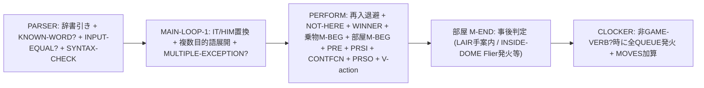
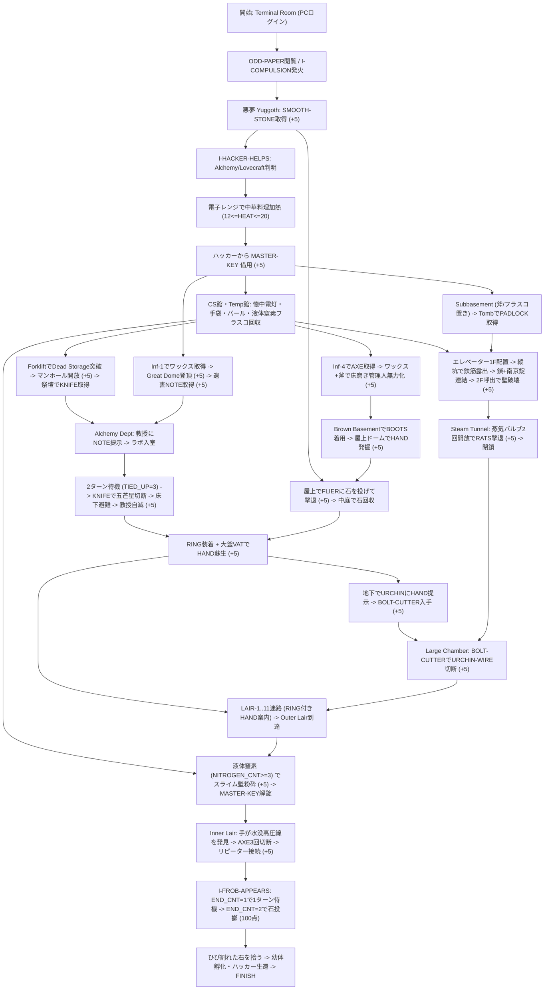

# The Lurking Horror (Python 版) の内部構造・学生視点・ラヴクラフト的ホラー解析

ZilPy が Infocom のホラーアドベンチャー *The Lurking Horror* (1987、Dave Lebling 作) の ZIL ソース (`lurkinghorror/`) から生成した Python 版 (`out/lurkinghorror/`) を、構成要素の静的棚卸し、パーサーとメインループの内部処理、G.U.E. Tech キャンパス固有のサブシステム、因果的ターニングポイントとソフトロック、初回プレイの大学生視点のギャップ、そしてラヴクラフト的ホラー・ドラマの観点から詳細に解説します。

- **ネタバレ・ライセンス注意:** 真相・全パズル手順・ソフトロック・エンディングまで記載しています。本作は MIT ライセンス対象作品ではないため、長い本文の転載は避け、構造解析に必要な短い引用とコード上のシンボル・条件式の解説にとどめます。
- **解析手順の再現性:** 本ドキュメントはプロジェクトルートの `GameArchitecture.md` の 5 ステージ解析計画に従って作成し、すべての数値・条件式・フラグ名を `out/lurkinghorror/` の生成 Python コードから直接検証しています。
- **元の ZIL の位置:** `parser.zil:428` のように記載します。生成コード内の `# zil:` 注記および `out/lurkinghorror/zilmap.json` から対応を引けます。

---

## 1. 全体像

### 1.1 規模

`tools/analyze_game.py out/lurkinghorror` による静的棚卸しの実数です。

| 項目 | 数 |
|---|---|
| モジュール (ZIL ファイル) | 16 |
| ルーチン | 748 |
| 部屋 | 70 |
| オブジェクト (部屋以外) | 182 |
| 構文 (`SYNTAX`) | 381 (動詞の語 146 個) |
| 割り込みの `QUEUE` 呼び出し | 74 (割り込みルーチン 35 個) |
| グローバル変数・定数 | 359 |
| `VALUE` の合計 (拾う・入る・達成点) | 70 (14 個 × 5 点) |
| `TVALUE` の合計 (置く点) | 0 (0 個) |
| 満点 (`V-SCORE`) | **100 点** (11 階級: `Freshman` 〜 `President of the Institute`) |

ルーチン 748 個の役割別内訳は次のとおりです。

| 役割 | 数 | 代表例 |
|---|---|---|
| 動詞のアクション (`V-*`) | 180 | `V-LOGIN`、`V-PASSWORD`、`V-CLICK`、`V-WEDGE`、`V-PRY` |
| そのほか (場面処理・メインループ・時計等) | 178 | `GO`、`MAIN-LOOP-1`、`PERFORM`、`CLOCKER`、`HEAT-CONTENTS` |
| オブジェクトのアクション | 162 | `PC-F`、`HACKER-F`、`MICROWAVE-F`、`PROFESSOR-F`、`FROB-F` |
| そのほか (動詞の補助) | 65 | `SCORE-OBJECT`、`IN-DARK?`、`JIGS-UP`、`FINISH` |
| パーサー | 52 | `PARSER`、`KNOWN-WORD?`、`INPUT-EQUAL?`、`NUMBER?`、`WT?` |
| 部屋のアクション | 42 | `TERMINAL-ROOM-F`、`ELEVATOR-PIT-F`、`ALCHEMY-LAB-F`、`INNER-LAIR-F` |
| 割り込み (`I-*`) | 35 | `I-TIRED`、`I-COMPULSION`、`I-ELEVATOR-MOVES`、`I-PROFESSOR`、`I-FROB-APPEARS` |
| 事前アクション (`PRE-*`) | 19 | `PRE-PUT`、`PRE-PRY`、`PRE-SWEDGE`、`PRE-POUR`、`PRE-GIVE` |
| マクロから作った関数 | 8 | `WINNER?`、`HERE?-1` 〜 `HERE?-6` |
| そのほか (共通のオブジェクト) | 7 | `RANDOM-PSEUDO`、`GENERIC-DOOR-F`、`GENERIC-KEY-F` |

### 1.2 モジュールと読み込みの順

エントリファイル `h1.py` が読み込む全 16 モジュールの順序・行数・構成です。

| # | モジュール | 行数 | ルーチン | 部屋 | オブジェクト | 構文 | 主な役割 |
|---|---|---:|---:|---:|---:|---:|---|
| 1 | `h1` | 80 | 0 | 0 | 0 | 0 | 入口 (`VERSION('ZIP')`、`NEW-VOC? = True`、`SOUND-EFFECTS? = True`、読込順) |
| 2 | `misc` | 1,175 | 44 | 0 | 0 | 0 | `GO`、`MAIN-LOOP`、`PERFORM`、`CLOCKER`、`OBJECT-SUBSTITUTE`、出力補助 |
| 3 | `parser` | 2,174 | 52 | 0 | 0 | 0 | 1986/87 年世代の ZIP パーサー (`OOPS`/`AGAIN`、`KNOWN-WORD?`、`INPUT-EQUAL?`) |
| 4 | `syntax` | 1,417 | 0 | 0 | 0 | 372 | 語彙と標準構文 (`CLICK`/`TYPE`/`WEDGE`/`PRY`/`COOK`/`HACK` 等を含む) |
| 5 | `debug` | 8 | 0 | 0 | 0 | 0 | デバッグ用スタブ (`ZDEBUGGING? = False`) |
| 6 | `record` | 54 | 4 | 0 | 0 | 4 | テスト記録・乱数固定コマンド (`#RANDOM`/`#RECORD`/`#UNRECORD`/`#COMMAND`) |
| 7 | `interrupts` | 38 | 1 | 0 | 0 | 0 | 疲労割り込み `I-TIRED` と所持重量・ファンブル減衰 |
| 8 | `desc` | 316 | 9 | 0 | 0 | 0 | 部屋・オブジェクト描写エンジン (`DESCRIBE-ROOM`、`DESCRIBE-OBJECTS` 等) |
| 9 | `verbs` | 2,760 | 257 | 0 | 0 | 0 | 動詞の標準実装、`V-SCORE`、`GOTO`、`IN-DARK?`、`JIGS-UP`、`FINISH` |
| 10 | `globals` | 920 | 23 | 0 | 31 | 1 | 効果音定数 (`S-*`)・`$SOUND` 構文、共通オブジェクト (`IT`/`HIM`/`INTNUM` 等) |
| 11 | `cs` | 7,494 | 239 | 43 | 89 | 0 | **世界の中核**: CS 館・Temp 館・エレベーター・地下祭壇・Infinite Corridor・Great Dome・Steam Tunnel・Alchemy 部門 |
| 12 | `hacker` | 943 | 26 | 1 | 16 | 0 | ハッカー (`HACKER`)、鍵束 (`KEYRING`)、キッチン、電子レンジと加熱・冷却シミュレーター |
| 13 | `pc` | 542 | 18 | 0 | 12 | 4 | 学内端末 `PC`、`LOGIN`/`PASSWORD` 構文、GUI オブジェクト群、`I-COMPULSION` |
| 14 | `yuggoth` | 335 | 11 | 3 | 4 | 0 | 悪夢の世界 (`YUGGOTH`・`BOWL-ROOM`・`PLATFORM-ROOM`)、`SMOOTH-STONE`、エンディング孵化 |
| 15 | `green` | 670 | 22 | 7 | 11 | 0 | Brown Building (18 階高層棟)・屋上気象ドーム・`FLIER`・ミイラの手 (`HAND`)・中庭 |
| 16 | `frob` | 1,586 | 42 | 16 | 19 | 0 | `URCHIN` 徘徊・`LARGE-CHAMBER`・11 部屋迷路 (`LAIR-1`〜`LAIR-11`)・スライム壁・`INNER-LAIR` 最終決戦 |

### 1.3 満点 100 点の完全内訳

`V-SCORE` (`verbs.zil:279-286`) は `SCORE` を 100 点満点で表示し、`SCORE // 10` で `RANKINGS` (`Freshman` 〜 `President of the Institute` の 11 階級) を引きます。得点はすべて 5 点刻みの 20 項目で構成されます。

1. **`VALUE: 5` を `SCORE-OBJECT` 経由で獲得する 13 項目 (65 点)**
   - アイテム/イベント (9): `SMOOTH-STONE` (石取得)、`MASTER-KEY` (ハッカーから借用)、`NOTE` (遺書取得)、`HAND` (土鉢から発掘)、`FLIER` (石で撃退)、`PROFESSOR` (儀式逆流で撃破)、`BOLT-CUTTER` (浮浪児から入手)、`PRESSURE-VALVE` (蒸気でネズミ撃退)、`URCHIN-WIRE` (触手線切断)
   - 部屋初到達 (4): `STORAGE-ROOM` (`Ancient Storage`)、`TOP-OF-DOME` (`Top of Dome`)、`ELEVATOR-PIT` (`Concrete Box`)、`TUNNEL` (`Steam Tunnel`)
2. **専用スコア変数・直接加算の 6 項目 (30 点)**
   - `MANHOLE-SCORE` (+5、`cs.zil:621`: マンホール開放)、`MAINT-SCORE` (+5、`cs.zil:6251`: 床磨き管理人の無力化)、`HAND-ANIMATED-SCORE` (+5、`cs.zil:5485`: 大釜で手を蘇生)、`BRICK-WALL-SCORE` (+5、`cs.zil:1765`: エレベーターでレンガ壁破壊)、`CURTAIN-F` (+5、`frob.zil:763`: 液体窒素でスライム壁粉砕。なお `CURTAIN` 自体にも `VALUE: 5` が定義されているが `SCORE-OBJECT` は呼ばれず直接 `+5` のみ加算)、`I-FROB-APPEARS` (+5、`frob.zil:1616`: 高圧電流で `FROB` 実体化)
3. **最終撃破による満点確定 (+5 点 → 100 点)**
   - `FROB-F` (`frob.zil:1582-1598`) で赤熱した `SMOOTH-STONE` を `FROB` に命中させると `ZG.SCORE = 100` が直接代入され、それまでの累計 95 点（あるいは任意イベントを 1 つ飛ばしていても）が 100 点に到達します。

### 1.4 サウンド効果アーキテクチャ (`globals.py`)

*The Lurking Horror* は **Infocom 史上初めてデジタル録音効果音 (`SOUND` 命令) を搭載した作品** であり、`VERSION('ZIP')` (Z-machine Version 3) 上で `SOUND-EFFECTS? = True` (`h1.zil:11-16`) を有効にしています。

- **操作インターフェース (`globals.zil:7-57`)**: `SOUNDS(N, OP=S-START, VOL=8)`、`KILL-SOUNDS()`、プレイヤー向けトグルコマンド `$SOUND` (`V-$SOUND`) を備えます。Python 変換版では `SILENT_ROUTINES` により `SOUNDS` が無音スタブ (`return True`) になりますが、元の発火ポイントと音量制御 (`VOL = 2..8`) はすべてコードに残っています。
- **登録された 14 種の効果音定数 (`globals.zil:60-85`)**:
  - システム音: `S-BEEP` (1)、`S-BOOP` (2)
  - 単発効果音: `S-BLOOD` (3: 斧が管理人に刺さる音)、`S-HATCH` (6: 錆びたハッチ開放)、`S-ELCRSH` (7: エレベーターでレンガ壁破壊)、`S-CRACK` (8: エンディングの石の亀裂)、`S-GHIDRA` (9: 羽化した幼体の羽ばたき)、`S-SPARKY` (11: 高圧電撃)、`S-DIE` (12: `FLIER` の断末魔)
  - ループ効果音 (音量 2→4→6→8 の段階的演出付き): `S-ATTACK` (4: ネズミ襲撃接近)、`S-DRONE` (10: 悪夢 `YUGGOTH` の詠唱)、`S-PSYCHO` (13: 教授の召喚儀式)、`S-VOICE` (15: `LARGE-CHAMBER` の浮浪児たちの電子音声)、`S-CRETIN` (16: 高圧電撃で悶える `FROB`)、`S-ZOMBIE` (17: `INNER-LAIR` のうごめく肉塊)、`S-MONSTR` (18: 地下祭壇の鉄板下の蠢き)
  - 容量削減でコメントアウトされた 2 種: `S-SQUEAL` (5: ネズミ単体 23K)、`S-STORMY` (14: 吹雪 54K)。コメントに `60K`・`50K` などのサンプル容量メモが残っており、当時のフロッピー容量制約の生々しい設計跡が確認できます。

---

## 2. 起動・メインループ・パーサーの詳細処理と世界への反映

### 2.1 起動 (`GO`, `misc.zil:314`)

`misc.zil:314-339` の `GO` は次を実行して `MAIN-LOOP` へ入ります。

1. `PUT-GLOBAL(TOMB, 0, 0)` / `PUT-GLOBAL(TOMB, 1, 0)` で `TOMB` の初期グローバル参照を初期化。
2. 割り込みテーブルの走査ポインタ `CLOCK-HAND` を `C-TABLE` 末尾に設定し、2 本の長期タイマーを予約:
   - `QUEUE(I-URCHIN, 10)`: 10 ターン周期で地下の浮浪児 (`URCHIN`) を徘徊させる。
   - `QUEUE(I-TIRED, 200)`: 200 ターン後に最初の疲労警告を発火させる。
3. 初期状態を設定: `P-HIM-OBJECT = HACKER`、`P-IT-OBJECT = PC`、`WINNER = PLAYER`、`HERE = TERMINAL-ROOM`、`LIT = LIT?(HERE)`。
4. 導入文（締切直前の 20 枚レポート、吹雪の夜、相次ぐ学生失踪事件）を表示し、`V-VERSION` → `V-LOOK` → `MAIN-LOOP`。

### 2.2 パーサー (`parser.py`) の構造と本作固有の拡張

本作のパーサーは 1986/87 年世代の成熟した ZIP パーサーであり、`P-INBUF` / `OOPS-INBUF` は 120 バイト、`P-LEXV` / `AGAIN-LEXV` / `RESERVE-LEXV` は最大 59 語 (`P-WORDLEN = 4` バイト/語)、`SIBREAKS = '.,\"'`、`P-ITBL` / `P-OTBL` は 10 ワード (`P-VERB` 〜 `P-NC2L`) 構造です。さらに `NEW-VOC? = True` (`h1.zil:15`) により 1 語が形容詞・名詞・動詞を兼任できます。

通常パーサーに対する **パーサー乗っ取り (`READ()` の直接呼び出し)** は存在せず、`parser.zil:156` 以外の `READ()` は `FINISH` (`verbs.zil:234`) と `YES?` (`verbs.zil:249`) のみです。その代わり、`parser.py` 自体に本作特有の 3 つの精巧なフックが組み込まれています。

1. **非辞書文字列の生バッファ照合 (`KNOWN-WORD?` + `INPUT-EQUAL?`, `parser.zil:428, 450`)**
   - Z-machine Version 3 の辞書語長は 6 文字上限であるため、9 桁の学生 ID `872325412` や 9 文字のパスワード `uhlersoth` は辞書に登録できません。
   - そこで `KNOWN-WORD?` (`parser.zil:428-448`) は辞書引きが 0 を返した未登録語に対し、`INPUT-EQUAL?` (`parser.zil:450-460`) で生入力バッファ `P-INBUF` をバイト単位で `LOGIN-ID` (`"872325412"`) および `PASSWORD-STRING` (`"uhlersoth"`) と完全一致比較します。
   - 一致すると `P-NAME` にそれぞれ `WORD('xyzzy')` / `WORD('plugh')` を格納し、`P-LEXV` のトークンを仮オブジェクト **`INTNAME`** に書き換えます。
   - 一致しなくても直前動詞が `ACT?TYPE` / `ACT?LOGIN` / `ACT?PASSWORD` なら `P-NAME = False` のまま `INTNAME` へ書き換えるため、誤 ID/PW を打ってもパーサーエラーにならず PC が `"INVALID LOGIN"` と応答できます。
2. **時刻形式 `HH:MM` 対応の数値パーサー (`NUMBER?`, `parser.zil:625`)**
   - `parser.zil:625-648` の `NUMBER?` は数字列の途中に `:` を検出すると `P-TIME? = True` を立て、`分 × 60 + 秒` を `P-NUMBER` に格納します。電子レンジの `turn timer to 4:00` などを直接解釈するための機能です。
3. **エレベーター呼び出しボタンの聞き返し・品詞補正 (`PARSER` 424 行・`WT?` 644 行)**
   - 部屋に上ボタン (`UP-BUTTON`) と下ボタン (`DOWN-BUTTON`) の両方がある状態で `push button` と打つと聞き返し (`P-OFLAG = True`) が発生します。プレイヤーが `up` / `down` と答えた際、方向語として誤解釈されないよう `PARSER` (`parser.zil:297-308`) が `up-arrow` / `down-arrow` に書き換え、`WT?` (`parser.zil:527-533`) でも形容詞問い合わせ時に `up`/`u` → `up-arrow`、`down`/`d` → `down-arrow` へ自動委譲します。

### 2.3 `MAIN-LOOP-1`・`PERFORM`・`CLOCKER` の世界反映パイプライン

- **代名詞置換 (`OBJECT-SUBSTITUTE`, `misc.zil:469`)**: `MAIN-LOOP-1` は `IT` (`P-IT-OBJECT`) と `HIM` (`P-HIM-OBJECT`) の 2 系統を、`ACCESSIBLE?` な場合に限り `P-PRSO`/`P-PRSI` 内で一括置換します。
- **`PERFORM` の 9 段階ディスパッチ (`misc.zil:617-759`)**: 呼び出し前の `(PRSA, PRSO, PRSI)` を退避・復元する再入可能設計で、優先順は ① `NOT-HERE-OBJECT-F` → ② `WINNER` の `ACTION`（`TELL-ABOUT`/`SGIVE`/`SSHOW`/`SRUB`/`SPUT-ON` を除く）→ ③ 乗物 `LOC(WINNER)` の `M-BEG`（フォークリフト・五芒星・椅子など）→ ④ 部屋 `HERE` の `M-BEG`（`I-COMPULSION` の行動乗っ取り等）→ ⑤ `PRE-*` → ⑥ `PRSI` の `ACTION` → ⑦ `LOC(PRSO)` の `CONTFCN`（ハッカーの鍵束や蘇生した手など）→ ⑧ `PRSO` の `ACTION` → ⑨ `V-*`。
- **`GAME-VERB?` (`misc.zil:494`)**: `CLOCKER` と `M-END` をスキップするメタ動詞は、`TELL`（`P-CONT` 継続時）、PC 部屋以外での単独 `HELP`、および `QUIT`/`VERSION`/`BRIEF`/`SUPER-BRIEF`/`VERBOSE`/`$VERIFY`/`RESTART`/`SAVE`/`RESTORE`/`SCRIPT`/`UNSCRIPT`/`$SOUND`/`$RANDOM`/`$COMMAND`/`$RECORD`/`$UNRECORD`/`SCORE`/`TIME` の 18 種です。

### 2.4 具体的コマンドのエンドツーエンド実行トレース (3 例)

#### トレース①: 学内端末へのログインと悪夢転送 (`login 872325412` → `password uhlersoth` → `read paper`)
1. `login 872325412` 入力 → `PARSER` 内の `KNOWN-WORD?` が `"872325412"` を未登録語として `INPUT-EQUAL?` に渡し、`LOGIN-ID` とバイト完全一致 → `P-NAME = WORD('xyzzy')`、トークンを `INTNAME` へ置換。
2. `V-LOGIN` (`pc.zil:311-319`) が `PRSO == INTNAME` かつ `P-NAME == WORD('xyzzy')` を確認し `USERNAME? = WORD('xyzzy')` を設定。
3. 続く `password uhlersoth` で同様に `P-NAME = WORD('plugh')` → `V-PASSWORD` (`pc.zil:329-347`) が `LOGGED-IN? = True` とし、GUI 部品オブジェクト `MENU-BOX` を `MOVE(MENU-BOX, PC)` で PC の中へ移動させる（以後の GUI 操作も `YAK-WINDOW`・`MORE-BOX`・`ODD-PAPER` の `MOVE`/`REMOVE` で状態遷移を表現）。
4. `ODD-PAPER` を読むと `ODD-PAPER-F` が `QUEUE(I-COMPULSION, 2, True)` を登録。以降 `TERMINAL-ROOM-F(M-BEG)` (`cs.zil:266-283`) が `MORE-BOX` クリックと `ODD-PAPER` 閲覧以外の **ほぼすべての行動を横取りして強制的に `MORE-BOX` を押させる**。
5. 4 ページ目を終えた `I-COMPULSION` (`pc.zil:471-485`) が `ROB(PLAYER, FROB)` でプレイヤーの所持品を一時退避し、`GOTO(YUGGOTH)` で悪夢世界へ転送する。

#### トレース②: 電子レンジ加熱とハッカーとの取引 (`push high` / `push 4` / `0` / `0` / `start` → `give carton to hacker`)
1. `push 4` / `push 0` / `push 0` → `CONTROLS-F` (`hacker.zil:736-754`) が 4 桁シフトレジスタ `MICROWAVE-TBL` をシフトし、`MICROWAVE-TIMER = 4 × 60 = 240` 秒を算出。
2. `push start` → `MICROWAVE` が閉じていれば `QUEUE(I-MICROWAVE, -1)` を毎ターン実行のデーモンとして登録。
3. `CLOCKER` が毎ターン `I-MICROWAVE` (`hacker.zil:863-874`) を呼び、`MICROWAVE-TIMER -= 60` と同時に `HEAT-CONTENTS` が `CHINESE-FOOD` の `HEAT` を `+MICROWAVE-TEMP` (`+4`) ずつ加算し、冷却デーモン `I-COOL` (4 ターンごとに `HEAT -= 1`) を予約する。4 分＝4 ターンで `HEAT = 16` (`volcanic`) に到達し停止。
4. `give carton to hacker` → `HACKER-F` (`hacker.zil:259-288`) が `CHINESE-FOOD` の `RMUNGBIT` (`HEAT > 20` の焼きすぎ) を検査し、セーフかつ `HEAT >= 12` なら `MOVE(CARTON, HACKER)`。続く `ask hacker for master key`（または取引予約 `HACKER-TRADE?`）で `HACKER-LOANS-KEY` が `MOVE(MASTER-KEY, PLAYER)` と `SCORE-OBJECT(MASTER-KEY)` (+5 点) を実行する。

#### トレース③: 最終決戦 (`cut line with axe` × 3 → `put line in socket` → `wait` → `throw stone at creature`)
1. `INNER-LAIR` 入室時、`INNER-LAIR-F(M-ENTER)` (`frob.zil:958-965`) が扉を施錠し、`I-HAND-DIVES` と `I-HACKER-RETURNS` を予約。蘇生した `HAND` が水溜まりに潜ることで `POOL-F` の `reach in pool` が `HIGH-VOLTAGE` を出現させる。
2. `cut line with axe` を 3 回実行すると `HV-CNT > 2` で `FSET(HIGH-VOLTAGE, RMUNGBIT)`、同時に `QUEUE(I-LINE-IN-WATER, 2)` が起動（2 ターン放置すると水没して感電、`BOOTS` 未着用なら即死）。
3. `take line` で `I-LINE-IN-WATER` を解除し、`put line in socket` → `HIGH-VOLTAGE-F` (`frob.zil:1436-1480`) が `GLOVES`・`BOOTS` 着用と `OUTPUT-CABLE` 未切断を検証した上で、`DEQUEUE(I-HACKER-RETURNS)`・`QUEUE(I-FROB-APPEARS, -1)` を実行。
4. 同ターンの `CLOCKER` で `I-FROB-APPEARS` (`END-CNT = 1`) が発火し、`MASS` と `HACKER` を除去して本体 `FROB` を出現させ (+5 点)、`SMOOTH-STONE` が温まり始める。
5. プレイヤーが **`wait` を 1 回** 行うと `END-CNT = 2` で石が赤熱。ここで `throw stone at creature` → `FROB-F` (`frob.zil:1582-1598`) が `REMOVE(FROB)`・`SCORE = 100` を実行し、ひび割れた石が地面に落ちる。最後に `take stone` で `SMOOTH-STONE-F` (`yuggoth.zil:156-176`) がエンディング演出と `FINISH()` を呼ぶ。

---

## 3. Lurking Horror 固有の主要サブシステム

### 3.1 G.U.E. Tech キャンパスと地下トンネル網 (70 部屋)

MIT（マサチューセッツ工科大学）をモデルにしたキャンパスと地下構造は、大きく 6 区画に分かれています。

- **CS 館・Temp 館・地下倉庫群 (16 部屋)**: `SMITH-ST`、`COMP-CENTER` (1F)〜`CS-ROOF`、`TERMINAL-ROOM`、`KITCHEN`、`CS-ELEVATOR-ROOM`、`CS-BASEMENT`、`TEMPORARY-LAB`/`BASEMENT`、`DEAD-STORAGE`、`STORAGE-ROOM` (`Ancient Storage`)、地下の `BRICK-TUNNEL`・`CAVE-ROOM`・`CAVE-ALTAR`・`UNDER-ALCHEMY-LAB`。
- **Infinite Corridor と Great Dome (11 部屋)**: `AERO-LOBBY`、`AERO-STAIRS`、`AERO-BASEMENT`、`SUB-BASEMENT`、`ENGINEERING-BLDG`、`INF-1` 〜 `INF-5`、`GREAT-DOME`〜`ON-DOME`。
- **Brown Building (8 部屋)**: `NUTRITION-BLDG`、`BROWN-TUNNEL`、`BROWN-BASEMENT`、`BROWN-BUILDING` (18 階高層棟)、`COURTYARD`、`GREAT-COURT`（一方通行の凍死トラップ）、`BROWN-TOP-FLOOR`、`BROWN-ROOF`、`INSIDE-DOME`。
- **錬金術部門 (3 部屋)**: `CHEMISTRY-BLDG`、`ALCHEMY-DEPT`、`ALCHEMY-LAB`。
- **蒸気トンネルと怪物巣窟 (29 部屋)**: `TOMB`、`ELEVATOR-PIT`、`TUNNEL`〜`STEAM-TUNNEL-EAST`・`TUNNEL-WEST`・`TUNNEL-ENTRANCE`・`MUDDY-TUNNEL`・`LARGE-CHAMBER`、11 部屋の泥トンネル迷路 `LAIR-1`〜`LAIR-11`、`OUTER-LAIR`、`INNER-LAIR`。
- **悪夢の世界 (3 部屋)**: `YUGGOTH`、`BOWL-ROOM`、`PLATFORM-ROOM`。

### 3.2 ハッカー (`HACKER`) の自律行動と協力

ハッカーは序盤のガイド兼鍵提供者であり、終盤の危機を体現する相棒でもあります。

- **悪夢からの帰還 (`I-HACKER-HELPS`, `cs.zil:295`)**: 悪夢から目覚めると 4 ターンにわたり主人公の端末を解析し、ファイルが `Department of Alchemy` のノード `Lovecraft` と混線していたことを突き止める。
- **鍵束の隠蔽と取引 (`HACKER-F` / `I-FOOD-HINT`, `hacker.zil:69, 331`)**: `MASTER-KEY` は初期状態で `GLOBAL-OBJECTS` に隠されており、`ask hacker about keyring` で鍵束の話を聞くまで `MOVE(MASTER-KEY, KEYRING)` されない。食事を催促する `I-FOOD-HINT` は 4 段階で中華料理を示唆し、温かい Szechuan shrimp (`12 <= HEAT <= 20`) と引き換えにマスターキーを貸してくれる。
- **終盤の再登場と同化カウントダウン (`I-HACKER-RETURNS`, `frob.zil:985`)**: `INNER-LAIR` 入室 2 ターン後に、独自に不正な同軸ケーブルとリピーターを追跡してきたハッカーが現れる。しかし `LAIR-CNT = 3` でワイヤストリッパーを手に肉塊へ近づいた際に飲み込まれ、`LAIR-CNT = 7` で触手とネズミ状の小生物を纏って再出現、`LAIR-CNT = 9` で主人公を肉塊へ引きずり込み **`JIGS-UP(..., True)`（死亡ではなく「変容: You have changed」）** を引き起こす。

### 3.3 怪物・敵対 NPC 群

| 存在 | 制御ルーチン | 挙動と攻略メカニズム |
|---|---|---|
| **浮浪児 (`URCHIN`)** | `I-URCHIN` (`frob.zil:346`) | 10 ターンごとに地下を徘徊。同室時に `PROB(80)` で留まる。蘇生した `HAND` を見せると怯えて `BOLT-CUTTER` を落とす。無防備に刺激するとナイフで刺殺 (`frob.zil:322`)。 |
| **床磨き管理人 (`MAINTENANCE-MAN`)** | `I-WAXER-MOVES` / `I-MAINT-DISSOLVES` (`cs.zil:5916, 6360`) | 5 ターンごとに `INF-1`〜`INF-5` を往復し、同室で東進を塞ぐ。`POWER-CORD` を斧で切ると襲いかかり絞殺 (`cs.zil:6330`) するが、事前に `FLOOR-WAX` を撒いておくと滑って **小生物の群れに崩壊・霧散** する。 |
| **翼獣 (`FLIER`)** | `I-FLIER` / `FLIER-EATS-HAND?` (`green.zil:340, 400`) | `INSIDE-DOME` に `SMOOTH-STONE` 持ちで入るか `HAND` を拾うと起動。5 ターンで接近し、6 ターン目に `HAND` を丸呑みして飛び去る（不可逆ソフトロック）。`BROWN-ROOF` で `SMOOTH-STONE` を投げると石を追って中庭へ落下・消滅 (+5 点)。 |
| **錬金術教授 (`PROFESSOR`)** | `I-PROFESSOR` / `PROF-REACTS` (`cs.zil:4739, 4991`) | 大学院生の遺書 (`NOTE`) を見せると研究室へ招き入れ、1 ターン目に主人公を五芒星へ閉じ込める。3 ターン目に教授が自身の五芒星へ入って詠唱を始めた後で `KNIFE` で五芒星を切り、7 ターン目までに床下 (`UNDER-ALCHEMY-LAB`) へ逃げれば 8 ターン目に召喚が教授自身へ逆流して自滅 (+5 点)。 |
| **蘇生した手 (`HAND`)** | `I-ANIMATE-HAND` / `HAND-POINTS` / `I-HAND-DIVES` | 教授の大釜 (`VAT`) の「生命のエリクサー」に 3 ターン浸すと `PERSON` フラグが立ち自律化 (+5 点)。教授の `RING` を嵌めると `LAIR-1`〜`LAIR-11` の各部屋の `POINT` 属性を毎ターン指し示して迷路を案内し、`INNER-LAIR` では水溜まりに潜って高圧線の位置を教える。 |
| **ネズミの群れ (`RATS`)** | `I-RATS` / `PRESSURE-VALVE-F` (`cs.zil:3925, 4120`) | 蒸気トンネル西進時に `S-ATTACK` 音量 `2→3→4→6→8` で接近し、4 ターン目に頸動脈を噛み切る（首に例の神話的シンボルが焼き印されている）。`TUNNEL-EAST` の錆びた `PRESSURE-VALVE` を武器で 2 回開けて生蒸気で一掃 (+5 点) し、直後に閉める。 |
| **潜む恐怖本体 (`MASS` / `FROB`)** | `MASS-F` / `I-FROB-APPEARS` / `FROB-F` (`frob.zil:1065, 1569, 1609`) | キャンパス LAN に直結された白濁肉塊 (`MASS`)。高圧線接続で本体 `FROB` が実体化し、3 ターン構成 (`END-CNT = 1` 出現、`2` 石赤熱、`3` 飛びかかり即死) の最終決戦へ移行。 |

### 3.4 物理・工学パズルと生存タイマー

- **エレベーター縦坑とレンガ壁破壊 (`I-ELEVATOR-MOVES`, `cs.zil:1697`)**:
  エレベーター本体は `ELEVATOR-LOC` (0=B, 1=1F, 2=2F, 3=3F) を移動し、扉が開いている間は安全装置で停止する。1 階に籠を置いて地下の扉を斧で楔止め (`wedge door with axe`) して縦坑 (`ELEVATOR-PIT`) へ降り、バールで 2 回こじってレンガ壁内の鉄筋 (`ROD`) を露出させ、`CHAIN` + `PADLOCK` + 籠底の `HOOK` を連結した状態で 2 階へ呼ぶと、籠の上昇力で壁が粉砕される (`BRICK-WALL-FLAG = True`、+5 点)。なお縦坑に居残ったまま引っ張ると飛来した鉄筋に串刺し即死する (`cs.zil:1780`)。
- **懐中電灯 (`FLASHLIGHT-TABLE`, `cs.zil:1426`) と暗闇即死 (`GOTO` / `IN-DARK?`)**:
  電池寿命は `200 + 100 + 50 + 25 + 5 + 1 = 381` ターン。消灯時に残りティックを `FLASHLIGHT-TABLE[0]` へ保存するため、明るい部屋でこまめに消せば十分足りる。一方、暗闇の部屋で消灯すると `IN-DARK?(True)` が **即座に 100% 即死** を呼び、暗闇から暗闇へ移動しても `GOTO` (`verbs.zil:1828-1835`) が **`PROB(80)` で即死** させる。
- **疲労 (`I-TIRED`, `interrupts.zil:12`) とコーラ (`COKE-F`, `hacker.zil:536`)**:
  初期 200 ターン＋以後 25 ターンごとに `AWAKE` が `-1` から `+1` され、`LOAD-ALLOWED -= 10`・`FUMBLE-NUMBER -= 1` で所持力も低下。`AWAKE > 8`（無補給なら **425 ターン**）で強制睡眠→即死 (`V-SLEEP(True)`)。キッチンの 2L コーラ (`SIZE = 5` → `1` の 4 回分) を 1 口飲むごとに `I-TIRED` の残り時間が **`+200` ターン延長** され、`AWAKE`・`LOAD-ALLOWED` も 1 段階回復する。
- **吹雪の極寒 (`EXIT-TO-COLD` / `I-FREEZE-TO-DEATH`, `cs.zil:83, 6988`)**:
  `OUTSIDE` 属性の部屋へ出ると 2 ターン後に初回、以後 4 ターンごとに `FREEZE-COUNT` が増加し、`> 5`（累計 **22 ターン**）で凍死する。

---

## 4. クリアへの因果的ターニングポイントと障壁

### 4.1 因果依存グラフ

### 4.2 不可逆ソフトロックと即死障壁のコード検証一覧

| 障壁・ソフトロック | 検証済みコード条件・フラグ | 結果 | なぜ致命的か |
|---|---|---|---|
| **中華料理の過加熱・自作食い逃げ** | `HEAT-CONTENTS`: `H > 20` → `FSET(CHINESE-FOOD, RMUNGBIT)` → `HACKER-F`: `REMOVE(CARTON)` / 自分で食べると `REMOVE(CHINESE-FOOD)` | **不可逆詰み** | 代替食料の `SNACK` や `COKE` では鍵を貸してくれないため、`MASTER-KEY` が永久入手不能。 |
| **液体窒素の事前蒸発** | `FLASK-F` で開栓 → `I-NITROGEN-GOES` が 3 ターン毎に `NITROGEN-CNT -= 1`（初期 5）。`CURTAIN-F`: `NITROGEN-CNT < 3` だと `REMOVE(NITROGEN)` のみで壁が再生 | **不可逆詰み** | 9 ターン以上開栓したまま放置すると `OUTER-LAIR` のスライム壁を破壊できなくなる。 |
| **屋上での `HAND` 捕食** | `FLIER-EATS-HAND?` (`green.zil:415`): `REMOVE(HAND)` 後に `FLIER` 退場 | **不可逆詰み** | `HAND` を蘇生できず、`URCHIN` から `BOLT-CUTTER` を奪えない（＋水没高圧線も発見不能）。 |
| **五芒星の早切り** | `PROF-REACTS` (`cs.zil:5001`): `TIED-UP? <= 2` で切断すると `ROB(PLAYER, False)` + `FCLEAR(PENTAGRAM, RMUNGBIT)` | **事実上の詰み** | 所持品を全没収されたうえ五芒星を修復され、脱出手段を失う。 |
| **リピーター出力触手の先切断** | `OUTPUT-CABLE-F` (`frob.zil:1342`): `FSET(OUTPUT-CABLE, RMUNGBIT)` → `HIGH-VOLTAGE-F` (`frob.zil:1457`): 電撃が切り株を焼くだけで `I-FROB-APPEARS` を呼ばない | **不可逆詰み** | 最終決戦で「怪物の線を切ろう」と合理的に行動すると、逆に本体を炙り出せなくなる静かな詰み。 |
| **最終決戦 1 ターン目の石投擲** | `FROB-F` (`frob.zil:1577`): `END-CNT == 1` で `REMOVE(SMOOTH-STONE)` | **即死確定** | 石を飲み込まれて失い、`END-CNT == 3` で必ず飛びかかられて死亡する。 |
| **`GREAT-COURT` への外出** | `GREAT-COURT` (`green.zil:105`): `NORTH: 'The door is locked.'` + `EXIT-TO-COLD` | **閉じ込め凍死** | 1 回警告が出るが、無視して出ると自動施錠され 22 ターンで凍死する。 |
| **暗闇消灯・暗闇移動・疲労限界** | `FLASHLIGHT-F` → `IN-DARK?(True)` (100% 死) / `GOTO` (`PROB(80)` 死) / `I-TIRED` (`AWAKE > 8` → `V-SLEEP` 死) | **即死** | 懐中電灯の電池 (381 ターン) とコーラ (4 回×200 ターン) の管理が必須。 |

### 4.3 登場人物視点（ダイエジェティック視点）の 3 層評価

- **物理的・工学的必然**: ゴム手袋・ゴム長靴による感電絶縁、ワックス床での転倒、フォークリフトによるパレット撤去、エレベーターの昇降力を利用した鉄筋引き抜き、液体窒素の急速冷却によるスライム粉砕、錆びた蒸気バルブへの工具適用など、G.U.E. Tech という工科大学の舞台設定に根ざした極めて納得感の高い物理パズル群。
- **物語的・オカルト的必然**: 悪夢から持ち帰った黒曜石の石が翼獣を退け、最終的に太古の怪物を内側から崩壊させる展開や、錬金術の五芒星を儀式の途中で切り裂いて術者へ逆流させる展開、生贄にされた手の持ち主（あるいは同門）の指輪で迷宮の導きを得る流れは、ラヴクラフト的怪奇譚の論理として筋が通っている。
- **構造的・システム的不条理**: `OUTPUT-CABLE`（肉塊とリピーターを繋ぐ触手）を親切心で先に切断すると二度とクリアできなくなる仕様、1 ターン早く石を投げると即死確定になるタイミング罠、および「自分のレポートが消えただけなのに、深夜の大学地下へ単身で降りて 18 階の高層棟や蒸気トンネルまで踏破し続ける」という動機の極端な飛躍は、ゲーム構造上の不条理として際立つ。

---

## 5. 主人公（G.U.E. Tech の学生）の視点: 初回情報のみの「知的・理想的な行動」vs「クリア必須行動」

### 5.1 初期情報 (Turn 0〜1) の厳密な範囲

`GO` (`misc.zil:328`) と初期所持品 `ASSIGNMENT` (`pc.zil:15`) から、知識ゼロの主人公が最初に知っている事実は次の 4 点だけです。

1. 自分は G.U.E. Tech の新入生で、必修教養科目「21.014: 現代語法における古典」の 20 枚レポート（クセノポン『アナバシス』の現代的類例）の締切が **明朝** に迫っている。
2. 寮の TechNet 端末が満席だったため、この冬最悪の猛吹雪の中、古い計算機センター (`Comp Center`) まで歩いてきた。
3. キャンパスでは最近 **学生の連続失踪事件** が起きており、主人公自身も影に怯えている。
4. 端末室には空の高性能 PC が 1 台と、顔見知りのハッカーが 1 人いる。

### 5.2 フェーズ別のギャップ比較表

| フェーズ | 初回情報のみから導かれる最も知的で理想的な行動 | コード上でクリアに実際に要求される行動 | ギャップの本質 |
|---|---|---|---|
| **① PC 怪異と悪夢の後** | ファイルが壊れたと分かったら、ハッカーに感謝しつつ **バックアップや手書きでレポートを書き直す**。不気味な Alchemy 部門へ深夜に 1 人で行く理由はない。 | 鍵束の話題からハッカーに中華料理を温めて渡し、`MASTER-KEY` を借りて深夜のキャンパス全体へ不法侵入する。 | **ホラー主人公の動機飛躍**: 普通の学生なら「レポート喪失＝教授に延長相談」だが、ゲームは鍵を借りて地下探索へ向かうことを前提とする。 |
| **② 地下倉庫・祭壇の発見** | 血痕の付いた地下祭壇と、鉄板の下で蠢く「失踪学生たちの末路」を見た瞬間に **地上へ逃げ帰り、警察と大学警備部へ通報する**。 | 恐怖を押し殺して祭壇から儀式の `KNIFE` を奪い、さらにフォークリフト・消火斧・液体窒素・床ワックスをかき集めて武装探索を続ける。 | **孤立ホラーの約束事**: 猛吹雪と深夜という設定上、外部通報の選択肢は存在せず、学生 1 人で解決する構造。 |
| **③ 錬金術部門 (`Alchemy Dept`)** | 大学院生の遺書を読み、不審な教授が地下で何かしていると気づいたら、**絶対に 1 人で研究室の奥へ入らない**。 | あえて遺書 (`NOTE`) を教授に見せて敵意を引き出し、研究室へ招かれ、五芒星に閉じ込められた上で **2 ターンじっと待ってから** 反撃する。 | **時間窓の逆説**: 冷静に逃げようとしたり即座に抵抗 (`TIED-UP? <= 2`) したりすると全所持品没収で詰む。わざと罠に嵌まり、相手が詠唱に入るのを待つ胆力が要る。 |
| **④ 高層棟屋上とミイラの手** | 吹雪の 18 階屋上ドームで噛みちぎられた人間の手を見つけたら、**触らずに引き返す**。ましてや大釜の怪しい液体で蘇生しようとは思わない。 | 躊躇なく手を発掘して持ち歩き、翼獣に石を投げつけ、教授の死後に大釜で手を蘇生させ、指輪を嵌めて肩に乗せて迷宮案内させる。 | **オカルト受容のギャップ**: 常識的な学生の忌避感とは真逆に、怪異の産物（石・ナイフ・手・指輪）を積極的にツール化する発想が要求される。 |
| **⑤ `Inner Lair` 最終決戦** | キャンパス LAN に繋がる怪物を発見したら、まず **リピーター内の触手 (`OUTPUT-CABLE`) を切断してネットワークから隔離** し、怪物が現れたら即座に武器の石を投げる。 | 出力触手は **絶対に切らず** に同軸ケーブルだけ抜き、水没した 4,000V 高圧線を斧で 3 回切ってソケットへ突っ込み、本体出現後も **1 ターン棒立ち (`wait`)** してから石を投げる。 | **システム的逆説**: 最も「工科大学生らしく安全・合理的な行動（ネットワーク遮断＝`OUTPUT-CABLE` 切断）」が不可逆ソフトロックを引き起こし、決戦時の即応攻撃も即死を招く。 |

---

## 6. このゲームで行われていた具体的な行為とラヴクラフト的ホラー・ドラマ

生成コード内の描写・遺書・ハッカーの台詞・エンディングから、本作の背景に横たわる 2 つの時間軸のドラマを再構成します。

### 6.1 過去軸: 大学地下の邪悪と錬金術部門の悲劇

1. **キャンパス地下の古の封印**: G.U.E. Tech の古い基礎（`Ancient Storage`）のさらに下、泥のトンネル網の最奥 (`Inner Lair`) には、太古から人知を超えた存在 (`FROB` / `MASS`) が潜んでいた。蒸気トンネルのネズミや浮浪児たちの背後に広がる地下空間には、その存在を崇める古代の祭壇 (`CAVE-ALTAR`) と生贄の穴が残されていた。
2. **錬金術部門 (`Department of Alchemy`) の暴走**: 周囲の化学者たちから嘲笑されていた錬金術教授は、「自然法則の一部は物理ではなく『人格ある異界の存在』によって執行されている」と信じ、力と知識を得るための「賄賂（生贄）」として学生たちを誘拐・供犠し始めた (`I-PROFESSOR`, `cs.zil:4769`)。地下祭壇の血痕と鉄板下の惨状 (`cs.zil:1044`) は、行方不明になった優秀な学部生たちの末路であった。
3. **大学院生の良心と最後の警告**: 深夜の実験室 (`SIGNUP`, `cs.zil:4599`) で教授の助手を務めていた大学院生は、自分が加担している狂気に耐えられなくなり、Great Dome 頂上のブロンズ栓の中に遺書 (`NOTE`, `cs.zil:7089`) を隠した上で、キャンパス最高層ビル（Brown Building）から身を投げた (`I-REMEMBER-STUDENT`, `cs.zil:4625`)。彼が遺した **「私が唯一の自殺者だが、最後の死者にはならない」** という言葉が、主人公を真相へ導く最初の鍵となる。
4. **古の邪悪と現代ネットワークの接続**: 怪異はオカルト儀式にとどまらず、現代の工学インフラへ侵食していた。地下の肉塊 (`MASS`) は、設計図に載っていない不正な同軸ケーブル・リピーター・ブリッジを介して学内 LAN (`TechNet`) へ接続され、さらに **商業・政府・軍事ネットワーク全体へ繋がろうとしていた** (`I-HACKER-RETURNS`, `frob.zil:990`)。

### 6.2 現在軸: 工科大学生による「工学×オカルト」の逆転劇と残された余韻

1. **レポート書き換え怪異の発端**: 締切前夜の吹雪の中、主人公が端末を開いた瞬間、ファイルサーバー上の `Department of Alchemy` ノード **`Lovecraft`** との混線により、古典レポートのファイルが太古の召喚詩と「口」の写真に書き換えられていた (`COMPDESCS`, `pc.zil:487`)。それは単なるバグではなく、怪物がネットワーク越しに新たな生贄（あるいは器）を呼び寄せる罠であり、主人公は悪夢の世界 `YUGGOTH` へ引きずり込まれる。
2. **現代の工学設備で太古の恐怖を焼く**: 主人公は魔法使いでも熟練の退魔師でもない、ただの工科大学 1 年生である。しかし主人公は、電子レンジ・フォークリフト・床ワックス・消火斧・エレベーターの昇降力・蒸気配管・液体窒素・絶縁手袋とゴム長靴・そして 4,000 ボルトの高圧電源ケーブルという **「大学のありふれた工学設備」** を総動員し、オカルトの産物（黒曜石の石・儀式のナイフ・蘇生した手）と組み合わせることで、太古の神話的恐怖を文字通り焼き払う。
3. **ハッカーの友情とラヴクラフト的結末**: 主人公のファイル異常に不審を抱き、自らケーブルを辿って地下最奥まで追ってきたハッカーは、一度は肉塊に飲み込まれる危機に瀕しながらも、主人公の高圧電撃と石の一撃によって救われる。怪物が自己崩壊して 100 点に到達した直後、主人公がひび割れた黒曜石を拾い上げると、**中から小さく青白い膜状の翼を持つ「何か」が孵化して闇の中へ飛び去っていく** (`SMOOTH-STONE-F`, `yuggoth.zil:160-175`)。太古の恐怖を倒したはずの勝利の瞬間に新たな種子が放たれるという、これ以上なくラヴクラフト的な戦慄の直後、泥だらけのハッカーがよろよろと立ち上がって放つ一言——**「鍵、返してもらえる？ ("Can I have my key back?")」**——が、学園コメディと宇宙的恐怖の絶妙な落差をもって物語を締めくくる。
