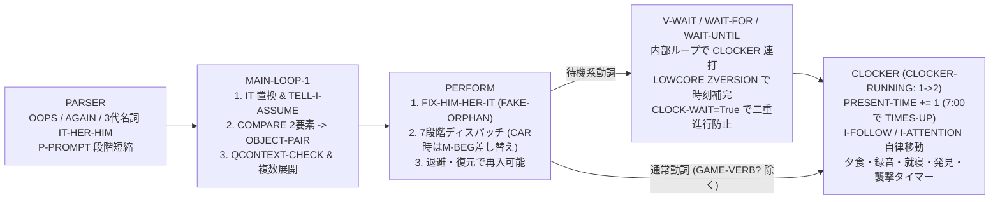
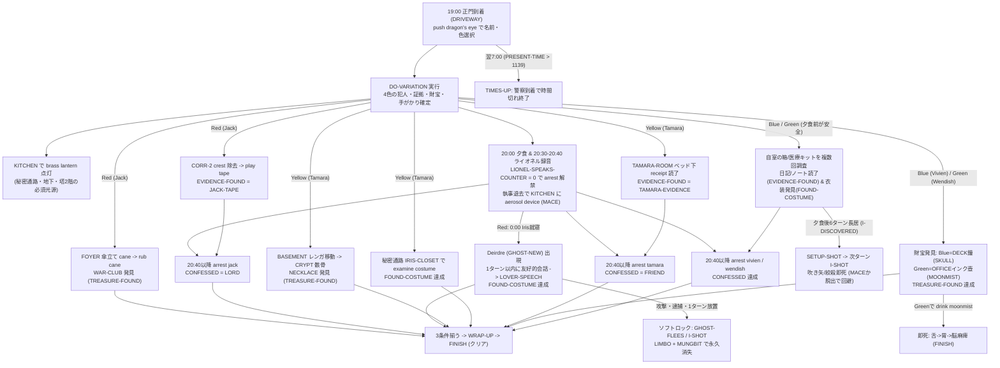

# MOONMIST (Python 版) の内部構造・探偵視点・マルチストーリー人間ドラマ解析

ZilPy が Infocom のゴシック・ミステリーアドベンチャー *Moonmist* (1986, Stu Galley & Jim Lawrence 作) の ZIL ソース (`moonmist/`) から生成した Python 版 (`out/moonmist/`) を、構成要素・動的キャラメイクと人称活用 `TELL` 拡張・1986 年版推理パーサーと 12 時間リアルタイム制御・4 色バリエーション動的構成エンジン (`colors.py`)・自律 NPC 移動 (`goal.py`)・因果的ターニングポイントとソフトロック・素人名探偵視点のギャップ・4 つのゴシック人間ドラマの観点から詳細に解説します。

- **ネタバレ注意:** 全 4 色（Red / Yellow / Blue / Green）の真犯人・幽霊の正体・財宝の隠し場所・勝利条件・ソフトロックおよび即死条件まで記載しています。
- **ライセンス配慮:** *Moonmist* (© 1986 Infocom, Inc.) は MIT ライセンス対象作品ではないため、ゲーム本文やソースコードの長文転載は避け、構造解析に必要なシンボル名・条件式・短い目印の引用にとどめています。
- **解析手順の再現性:** 本ドキュメントはプロジェクトルートの `GameArchitecture.md`（Stage 1〜5）および `infocomGame.md` に従って作成しました。元の ZIL の位置は `colors.zil:132` のように記載します。

---

## 1. 全体像

### 1.1 規模

| 項目 | 数 |
|---|---|
| モジュール (ZIL ファイル) | 14 |
| ルーチン | 794 |
| 部屋 | 69 (居住棟・屋外・秘密通路の一部 `castle` 32 + 塔・地下・秘密通路の一部・仮想 `LIMBO` `tower` 37) |
| オブジェクト (部屋以外) | 185 |
| 構文 (`SYNTAX`) | 356 (動詞の語 118 個) |
| 割り込みのルーチン (`I-*`) | 24 (`QUEUE` 呼び出し 59 箇所) |
| グローバル変数・定数 | 363 |
| 点数 (`VALUE` / `TVALUE`) | 0 (非スコア制。**19:00〜翌朝 7:00 の 12 時間リアルタイム制** ＋ 3 勝利フラグ制) |

ルーチンを役割で分類すると次のとおりです (`tools/analyze_game.py` の自動分類と完全一致)。

| 役割 | 数 | 例 |
|---|---|---|
| そのほか (イベント・移動・進行補助) | 163 | `DO-VARIATION`、`CONFESSION`、`WRAP-UP`、`ESTABLISH-GOAL`、`FOLLOW-GOAL`、`DRESS-GHOST` |
| オブジェクトのアクション | 157 | `DRAGON-EYE-F`、`GHOST-NEW-F`、`IRON-MAIDEN-F`、`MOONMIST-F`、`MACE-F`、`CLUE-1-F` |
| 動詞のアクション (`V-*`) | 149 | `V-ARREST`、`V-WAIT-FOR`、`V-WAIT-UNTIL`、`V-SCORE`、`V-CONFRONT`、`V-LEAP` |
| そのほか (パーサー) | 106 | `MAIN-LOOP-1`、`PARSER`、`PERFORM`、`QCONTEXT-CHECK`、`FIX-HIM-HER-IT` |
| そのほか (動詞の補助) | 89 | `V-WAIT`、`DISCOVER`、`CONGRATS`、`ENTER-ROOM`、`YES?`、`FINISH` |
| 部屋のアクション | 52 | `DRIVEWAY-F`、`DINING-ROOM-F`、`VIVIEN-ROOM-F`、`BASEMENT-F`、`LOVER-PATH-F` |
| 事前アクション (`PRE-*`) | 43 | `PRE-ARREST`、`PRE-ASK-ABOUT`、`PRE-COMPARE`、`PRE-THROUGH`、`PRE-SEARCH` |
| 割り込み (`I-*`) | 24 | `I-DINNER`、`I-LIONEL-SPEAKS`、`I-WITHDRAW`、`I-SEARCH`、`I-BEDTIME`、`I-DISCOVERED`、`I-SHOT` |
| マクロから作った関数 | 6 | `PROB`、`GET-REXIT-ROOM`、`GET-DOOR-OBJ`、`RMGL-SIZE`、`GT-O`、`T?` |
| そのほか (共通のオブジェクト) | 5 | `COMMON-OTHER` 等の共通人物・部位ヘルパー |

### 1.2 モジュールと読み込みの順

| # | モジュール (元の ZIL) | 行数 | 中身 |
|---|---|---|---|
| 1 | `moonmist.py` (`moonmist.zil`) | 76 | 入口。`VERSION('ZIP', 'TIME')`・12 方向定義・読み込み順・`SIZE` 既定値 (5) |
| 2 | `macros.py` (`macros.zil`) | 361 | `TELL` 人称/動詞活用マクロ定義、`PROB`・`GT-O`・`T?`・`GET/B`・`PSEUDO` 3 要素設定 |
| 3 | `misc.py` (`misc.zil`) | 442 | `GO`・冠詞/代名詞/動詞活用 (`PRINTT`, `START-SENTENCE`, `HE-SHE-IT`, `HIM-HER-IT`)・時計 (`CLOCKER`, `QUEUE`, `INT`)・`I-FOLLOW` / `I-ATTENTION` |
| 4 | `syntax.py` (`syntax.zil`) | 1,390 | 語彙 (`BUZZ` / `SYNONYM`) と構文 356 個 (`ARREST`・`CONFRONT`・`COMPARE`・`UNDRESS`・`WAIT FOR/UNTIL` 等) |
| 5 | `parser.py` (`parser.zil`) | 3,754 | 1986 年版推理パーサー (`MAIN-LOOP-1`, `PERFORM`, `PARSER`, `OOPS`, `AGAIN`, `QCONTEXT-CHECK`, `IT`/`HER`/`HIM` 3 代名詞解決) |
| 6 | `verbs.py` (`verbs.zil`) | 5,190 | 動詞 281 ルーチン (`V-SCORE` 進捗報告、`V-ARREST` / `CONFESSION` / `WRAP-UP`、`DISCOVER` / `CONGRATS`、`V-WAIT`、`LOWCORE` 系) |
| 7 | `goal.py` (`goal.zil`) | 2,176 | 自律 NPC 移動エンジン (`TRANSFER-TABLE`, `ESTABLISH-GOAL`, `FOLLOW-GOAL`)・一夜のイベント群 (`I-DINNER`〜`I-BEDTIME`, `I-DISCOVERED`, `DRESS-GHOST`, `I-SHOT`) |
| 8 | `people.py` (`people.zil`) | 3,198 | 登場人物 23 オブジェクト (Jack・Tamara・Iris・Vivien・Dr. Wendish・Ian・Hyde・執事 Bolitho・`GHOST-NEW` 等) と尋問・`SETUP-SHOT` |
| 9 | `castle.py` (`castle.zil`) | 3,140 | 屋外と居住棟 1・2 階の部屋 32 個・オブジェクト 62 個 (正門 `DRAGON-EYE`・ダイニングの胸像・`SEARCH-KIT-BOX` 等) |
| 10 | `tower.py` (`tower.zil`) | 2,540 | 塔（地下〜屋上）と秘密通路の部屋 37 個（`LIMBO` 含む）・オブジェクト 36 個 (`IRON-MAIDEN-F`・書斎・図書室・事務所等) |
| 11 | `things.py` (`things.zil`) | 451 | 小道具 14 個 (`MACE` 護身スプレー・`BLOWGUN`・`COSTUME`・`LAMP`・`LUGGAGE` 等) |
| 12 | `places.py` (`places.zil`) | 322 | 共通場所オブジェクト 3 個・視界ビットマスク `COR-1` / `COR-2` / `COR-4` と `CORRIDOR-CHECK` |
| 13 | `global_.py` (`global.zil`) | 1,038 | 遠隔/共通オブジェクト 31 個 (`GLOBAL-OBJECTS` / `LOCAL-GLOBALS`)・`TIMES-UP` |
| 14 | `colors.py` (`colors.zil`) | 930 | **4 色バリエーション動的構成エンジン** (`INTRO`, `GET-NAME`, `GET-COLOR`, `DO-VARIATION`, 4 財宝と `CLUE-1`〜`4`) |

合計 **25,008 行**。前作 *The Witness* (1983, 11 モジュール・29 部屋) から空間は 69 部屋（居住棟＋塔＋地下＋秘密通路網）へと倍増し、さらに **`VARIATION` (1〜4) によって同一の城と同一の 8 名の登場人物から 4 本の独立したミステリーを動的生成する** という、Infocom の中でも極めて異色のリプレイ特化アーキテクチャを採用しています。

### 1.3 リアルタイム時間制（19:00〜翌朝 7:00）と 4 色バリエーション (`VARIATION`)

- **時間管理 (`misc.zil:206-295`)**: `VERSION('ZIP', 'TIME')` のステータス行に `SCORE = 19`（時）、`MOVES = 0`（分）を格納し、内部カウンタ `PRESENT-TIME` は **420 (19:00)** から毎ターン `+1` されます。**`PRESENT-TIME > 1139`（翌朝 7:00）** に達すると `TIMES-UP()` (`global.zil:903`) が発火し、警察の到着により強制終了 (`FINISH()`) します（制限時間 = 12 時間 / 720 分）。
- **非スコア制と進捗可視化 (`V-SCORE`, `verbs.zil:343`)**: 数値スコアは存在せず、`score` コマンドは「出会った客の数・入浴/服装・秘密通路の発見・幽霊目撃・証拠・逮捕・財宝」の現在状況を自然文で要約し、未達成の勝利条件を親切に列挙します。
- **4 色バリエーション (`colors.zil:101-119`)**: `COLOR-WORDS` の 1 始まりインデックスがそのまま登場人物定数 (`FRIEND-C = 1`, `LORD-C = 2`, `PAINTER-C = 3`, `DOCTOR-C = 4`) に対応しており、選んだ 1 色（Yellow=1 / Red=2 / Blue=3 / Green=4）がそのまま真犯人 ID に直結します。

---

## 2. 起動・メインループ・パーサーの詳細処理と世界への反映

### 2.1 動的キャラメイク（名前・性別・好きな色）と `READ()` の例外呼び出し

本作は開始直後の `GO()` (`misc.zil:4`) が `V-VERSION()` → `INTRO()` → `MAIN-LOOP()` を呼んだ後、正門のインターホン（`DRAGON-EYE-F` → `VOICE-SAYS`, `castle.zil:432`）で **通常パーサーを一時バイパスして `READ(P-INBUF, P-LEXV)` を直接呼ぶ** ことで、プレイヤーの名前・性別・好きな色を動的に構築します。

1. **名前・性別解析 (`GET-NAME`, `colors.zil:756-890`)**:
   - 入力バッファ長を一時的に `PUTB(P-INBUF, 0, 30)` に縮小（コメント `; "for CoCo"` は TRS-80 Color Computer 等の画面幅配慮）して `READ()` を実行。
   - 先頭語が `TITLE-NOUN?` に一致すると `TITLE-WORD` に記録し、`doctor`/`dr`/`detect` 以外なら `GENDER-KNOWN = True`。さらに `mr`/`mister`/`master`/`lord`/`sir` の場合のみ **`FCLEAR(PLAYER, FEMALE)`** を実行します（つまり **`PLAYER` の既定性別は女性 (`FEMALE` フラグあり)** であり、男性敬称を入力した時だけ男性化されます）。
   - 末尾の `Jr.` / `Sr.` やローマ数字 (`i`/`v`/`x` のみで構成された 5 文字以下の語) を `SUFFIX` へ分離し、`the` / `of` / `comma` を含む複合姓・アポストロフィ付き姓（O'Neill 等）まで処理した上で `FIRST-NAME`・`LAST-NAME` バイトテーブルに格納します。
   - 出力時は `PRINT-NAME` (`colors.zil:894`) がスペース・`.`・`-`・`&`・アポストロフィ直後を自動大文字化し、`TITLE-NAME` (`colors.zil:710`) が `Mr.`/`Ms.`/`Dr.` 等なら敬称＋姓 (`Mr. Smith`)、それ以外（`Lord`/`Lady`/`Sir` や敬称なし）なら敬称＋名 (`Lady Jane`) で呼び分けます。
2. **好きな色と 4 パターン確定 (`GET-COLOR`, `colors.zil:38-95`)**:
   - `COLOR-WORDS` (`YELLOW`=1, `RED`=2, `BLUE`=3, `GREEN`=4) に一致する語を走査して `VARIATION` を決定。
   - **4 色以外の色** を入力した場合でも弾かず、先頭文字の ASCII コード `SUM` を `COLOR-LETTERS` (`y`/`r`/`b`/`g`) で照合し、`p`（pink/purple 等）は `PAINTER-C` (Blue = 3)、それ以外は **`1 + (SUM % 4)`** で 4 色のいずれかに決定論的に割り当て、`COLOR-FORCED` に内部色を記録します（例: `"pink and blue"`）。
   - `YES?` 確認後、`DO-VARIATION()` (`colors.zil:132`) を呼んで城全体の証拠・財宝・犯人・形容詞を一括配置し、`PUTB(P-INBUF, 0, 80)` でバッファ長を元に戻します。
3. **パーサー以外の `READ()` 呼び出し一覧**:
   - `GET-COLOR` (`colors.zil:48`)・`GET-NAME` (`colors.zil:769`)・`YES?` (`verbs.zil:335`, 専用 `YES-INBUF`/`YES-LEXV`)・`FINISH` (`verbs.zil:5155`, RESTART/RESTORE/QUIT 選択) の 4 箇所のみで、通常探索中のパーサー乗っ取りはありません。

### 2.2 `macros.py` の人称代名詞・動詞活用 `TELL` 拡張と `LOWCORE`

*Moonmist* はプレイヤーの性別（男女）および動的に入れ替わる幽霊・犯人の性別/三人称を自然な英語で出力するため、**`macros.zil:79-163` の `TELL` マクロと `misc.zil:12-250` の補助ルーチン群** で強力な自然言語生成（NLG）拡張を実装しています。

| `TELL` 書式トークン | 展開先ルーチン | 動作・特徴 |
|---|---|---|
| `FN` / `LN` / `TN` | `PRINT-NAME(FIRST-NAME)` / `LAST-NAME` / `TITLE-NAME()` | キャラメイクで登録したプレイヤーの名・姓・敬称付き呼称を動的に出力 |
| `THE <obj>` / `CTHE <obj>` | `PRINTT` / `START-SENTENCE` | `SEENBIT` 未設定なら `a`/`an`（`VOWELBIT` 考慮）、既視なら `the` を付け同時に `SEENBIT` を立てる。`YOUR-ROOM` 等は `"Your room"` へ専用変換 |
| `HE <obj>` / `CHE <obj>` | `HE-SHE-IT(obj, 0/1)` | `NO-PRONOUN?` で直近の `P-IT-OBJECT`/`P-HER-OBJECT`/`P-HIM-OBJECT` と一致すれば `he`/`she`/`it`/`you` に代名詞化。不一致なら名詞句を出力して `THIS-IS-IT` を更新 |
| `HE <obj> <verb>` / `CHE <obj> <verb>` / `V <obj> <verb>` | `HE-SHE-IT(obj, 0/1/-1, verb)` | **動詞の自動活用**。主語が `PLAYER` なら `is→are`、`has→have`、`tri→try`、`empti→empty`、その他は原形。三人称単数なら `do`/`kiss`/`push`/`tri`/`empti` に `es`、その他（`is`/`has` 除く）に `s` を自動付与 |
| `HIM <obj>` / `HIS <obj>` / `CHIS <obj>` | `HIM-HER-IT(obj, cap, possess?)` | 目的格 (`him`/`her`/`it`/`you`)・所有格 (`his`/`her`/`its`/`your`、非代名詞時は `'s`) を性別・既出文脈に応じて自動生成 |

また、Z-machine ヘッダ（ローコア）への直接アクセスを行う **`LOWCORE` / `LOWCORE-TABLE`** は `verbs.zil` の 4 箇所で実運用されています。

| ルーチン (ZIL 位置) | ZIL 記述 | Python 生成コード | 用途 |
|---|---|---|---|
| `V-SCRIPT` (`verbs.zil:8`) | `<LOWCORE FLAGS <BOR <LOWCORE FLAGS> 1>>` | `PUT(0, 8, (GET(0, 8) \| 1))` | ヘッダ `FLAGS2` のビット 0（トランスクリプト有効化）をセット |
| `V-UNSCRIPT` (`verbs.zil:16`) | `<LOWCORE FLAGS <BAND <LOWCORE FLAGS> -2>>` | `PUT(0, 8, (GET(0, 8) & -2))` | ビット 0 をクリアしてトランスクリプト停止 |
| `V-VERSION` (`verbs.zil:316,322`) | `<BAND <LOWCORE ZORKID> *3777*>` / `<LOWCORE-TABLE SERIAL 6 PRINTC>` | `GET(0, 1) & 2047` / `GETB(0, 18..23)` | リリース番号と 6 桁シリアル番号を読み出し、`VARIATION != 0` なら `/ <color> variation` を併記 |
| `V-WAIT` (`verbs.zil:3931`) | `<BAND <LOWCORE ZVERSION> 16>` | `(((GETB(0, 0) * 256) \| GETB(0, 1)) & 16)` | ステータス行非対応端末（v3 Flags1 bit 4）を検出し、`wait` 中断時に `(HH:MM)` を本文側へ補完出力 |

### 2.3 *DEADLINE* / *The Witness* から進化した 1986 年版推理パーサー＆メインループ

*DEADLINE* (1982)・*The Witness* (1983) の推理系エンジンから 3 年後に作られた *Moonmist* (1986) では、`parser.py` が 3,754 行・108 ルーチンまで洗練されています。

| 観点 | *DEADLINE* (1982) / *The Witness* (1983) | *Moonmist* (1986) での進化・変更点 |
|---|---|---|
| **`OOPS` / `AGAIN` の完全実装** | *DEADLINE*: `V-AGAIN` のみ / *Witness*: どちらも未搭載 | `OOPS-INBUF` (80B)・`OOPS-TABLE` (4 語: `O-PTR`, `O-START`, `O-LENGTH`, `O-END`)・`AGAIN-LEXV` (79 語) による **標準 1986 世代のインプレース修正＆再実行** を完備 (`parser.zil:23-37, 1285-1354`) |
| **3 系統の代名詞管理** | `IT` と `HIM-HER`（男女兼用）の 2 系統 | **`IT` (`P-IT-OBJECT`)・`HER` (`P-HER-OBJECT`, 初期値 `FRIEND`)・`HIM` (`P-HIM-OBJECT`, 初期値 `LORD`)** の 3 系統に分離 (`misc.zil:106-125`, `parser.zil:42-44`)。毎ターン先頭で `TOUCHBIT` をクリアし、`FIX-HIM-HER-IT` (`parser.zil:710`) で照合＋`TELL-I-ASSUME` 補完 |
| **副詞 `P-ADVERB`** | *Witness* で導入・実判定に使用 | `P-ADVERB` はコメントアウト (`parser.zil:111`) され廃止（初心者向け推理作として副詞必須パズルを排除） |
| **プロンプト段階短縮 (`P-PROMPT`)** | *Witness*: `I-PROMPT-1/2` の時間割り込み | `P-PROMPT-START = 4` のカウントダウン方式 (`parser.zil:1039-1049, 1250-1255`)。初回 `"What would you like to do?"` → 3 回 `"What next?"` → 自動解除 |
| **会話文脈 (`QCONTEXT-CHECK`)** | 主語省略の質問を広く補完 | `parser.zil:354-376`: `HELP` または `SHOW`/`TELL-ABOUT` (対 `PLAYER`) で同室に人物が 1 人だけなら自動で `QCONTEXT` を設定し `WINNER = QCONTEXT` に切替 |
| **`OBJECT-PAIR` の用途** | *DEADLINE*: `ARREST` / *Witness*: `ARREST` + `COMPARE` | `MAIN-LOOP-1` (`parser.zil:217`) で **`COMPARE` のみ** を `OBJECT-PAIR` にディスパッチ（真犯人が各色 1 名のため `ARREST` の 2 人同時逮捕は不要） |
| **`PERFORM` のディスパッチと `CAR` 例外** | *Witness*: 8 段階＋末尾 `M-END` | `CONTFCN` と末尾 `M-END` がコメントアウトされ **7 段階 (`Not Here` → `Actor` → `Room(M-BEG)` → `Preaction` → `PRSI` → `PRSO` → `V-*`)** (`parser.zil:759-851`)。特筆点として `IN?(WINNER, CAR)` の間は `HERE` ではなく **`CAR` の `ACTION` が `Room (M-BEG)` として呼ばれる** |
| **`CLOCKER-RUNNING` 状態機械** | なし | `MAIN-LOOP-1` が `CLOCKER()` 実行中を `1`、終了後を `2` に記録 (`parser.zil:338-341`)。`SETUP-SHOT` が `QUEUE(I-SHOT, CLOCKER-RUNNING)` と呼ぶことで、**割り込み中発火でも通常行動中発火でも常に「きっちり 1 ターンの回避猶予」を保証** |

`GAME-VERB?` (`parser.zil:346`) により `CLOCKER()` をスキップするメタ動詞は `BRIEF`, `QUIT`, `RESTART`, `RESTORE`, `SAVE`, `SCORE`, `SCRIPT`, `SUPER-BRIEF`, `TELL`, `TIME`, `UNSCRIPT`, `VERBOSE`, `VERSION`, `$VERIFY` の 14 個です。

### 2.4 具体的コマンドのエンドツーエンド実行トレース (3 例)

#### トレース 1: `push dragon's eye` → 動的キャラメイクと世界初期化 (`DO-VARIATION`)
1. **`PARSER` → `MAIN-LOOP-1` → `PERFORM`**: `PRSA = V?PUSH`, `PRSO = DRAGON-EYE`。`DRAGON-EYE` は `DRIVEWAY` に存在し、`IN?(WINNER, CAR)` のため `CAR` の `M-BEG` を経て `DRAGON-EYE-F` (`castle.zil:404`) に到達。
2. **`DRAGON-EYE-F` → `VOICE-SAYS()` (`castle.zil:432`)**:
   - `QUEUE(I-DRAGON-EYE, 0)` で待機催促タイマーを停止し、`QUEUE(I-FRIEND-GREETS, 6)`（6 分後に Tamara が出迎え）を予約。
   - `GET-NAME()` (`colors.zil:756`) が `READ()` で敬称・姓名を読み取り、`FIRST-NAME` / `LAST-NAME` と `PLAYER` の `FEMALE` フラグを確定。
   - `GET-COLOR()` (`colors.zil:38`) が `READ()` で好きな色（例: `red`）を読み取り、`VARIATION = 2` (`LORD-C`) を確定。
3. **`DO-VARIATION()` (`colors.zil:132`)**:
   - `FIX-COLOR-ADJ` で `YOUR-COLOR`・`YOUR-ROOM`・`CAR`・3 種の服の `ADJECTIVE` スロット内のプレースホルダ `A?F.C` を `A?RED` へ動的書き換え。
   - `HIDING-PLACE = LOC(LOVER)`、`VILLAIN-PER = LOVER`、`SEARCHER = LORD`、`TREASURE = WAR-CLUB` を設定し、`CLUE-2` を `PAINTER` (Vivien) へ、`CANE` を `UMBRELLA-STAND` へ、`CLUE-3` を `STAINED-WINDOW` へ、`CLUE-4` を `GARDEN` へ一括 `MOVE`。
   - `GATE-OPENS()` で正門を開放して通常ループへ復帰。

#### トレース 2: 深夜 0:00 以降の幽霊遭遇イベント (`I-BEDTIME` → `DRESS-GHOST` → `GHOST-LURKS` → `LOVER-SPEECH` / `I-SHOT`)
1. **0:00 (`PRESENT-TIME = 720`, `I-BEDTIME`, `goal.zil:1571`)**: 5 分おきに `CHARACTER-TABLE` の客を 1 名ずつ `GOAL-FUNCTION = X-RETIRES` で自室へ帰還させる。
2. **自室到着 (`X-RETIRES`, `goal.zil:1618` → `TIME-FOR-GHOST?`, `goal.zil:1723`)**:
   - **Red**: 最後の客 Iris (`DEB`) が自室へ戻ると `TIME-FOR-GHOST?` が真となり、`DRESS-GHOST(LOC(LOVER), LOVER-C)` を実行。`GHOST-NEW` に `COSTUME` を着せ、`GOAL-FUNCTION = LOVER-XFER` で `LOVER-PATH` → `DUNGEON` → `BASEMENT` → `KITCHEN` → `BACKSTAIRS` → `DINING-PASSAGE` → `YOUR-CLOSET` へと移動開始。
   - **Blue / Green**: 犯人本人が自室へ戻ると（衣装未発見・吹き矢未接触等の条件を満たせば）`DRESS-GHOST` が本人を `LOCAL-GLOBALS` へ退避させ、`HEAD`/`HANDS`/`EYE`/`OTHER-OUTFIT` の形容詞を `A?G'S` に動的パッチし、`BLOWGUN` を持たせて `YOUR-CLOSET` へ送り出す。
3. **遭遇 (`I-FOLLOW` → `FOLLOW-GOAL` → `GHOST-LURKS`, `goal.zil:1904`)**:
   - `LOC(GHOST-NEW) == HERE` になると `GHOST-NEW-D()` で初見描写を出し、`SHOOTER = GHOST-NEW`、`QUEUE(I-SHOT, CLOCKER-RUNNING)`（`CLOCKER` 中なので tick = `1`）を登録して `M-FATAL` を返し、プレイヤーの `wait` を即座に中断させる。
   - **次ターン**: Red で `ask ghost about jack` を打つと `GHOST-NEW-F` (`people.zil:1994`) → `LOVER-SPEECH()` (`goal.zil:1838`) が発火し、Deirdre が生存と真相を告白して **`CONGRATS(COSTUME)`**（条件 2 達成）が立つ。逆に 1 ターン何もしない／攻撃すると `I-SHOT` (`goal.zil:1971`) または `GHOST-FLEES` (`goal.zil:1863`) が `GHOST-NEW` を **`LIMBO` へ移動＋`MUNGBIT` 付与** し、二度と戻らない（詰み）。Blue/Green では同室に留まると次ターン `I-SHOT` で毒矢／絞殺即死となる。

#### トレース 3: 証拠確保＋逮捕＋財宝発見による勝利発火 (`play tape` → `arrest jack` → `WRAP-UP`)
1. **証拠確保（例: Red の `CORR-2` で `remove crest` → `play tape`）**: `JACK-TAPE` 再生時に `EVIDENCE-FOUND = JACK-TAPE` が設定される（`people.py:830`）。
2. **逮捕 (`arrest jack`, 20:40 以降)**:
   - `PRE-ARREST` (`verbs.zil:1411`) が `PERSONBIT`・未逮捕 (`not CONFESSED`)・**ライオネル録音終了済み (`LIONEL-SPEAKS-COUNTER == 0`)** を検証。
   - `V-ARREST` (`verbs.zil:1439`) が `VARIATION == GETP(PRSO, 'CHARACTER')` かつ `T?(EVIDENCE-FOUND)` を確認し、`CONFESSION(LORD)` (`verbs.zil:1455`) を呼び出す。
3. **自白と勝利発火 (`CONFESSION` → `WRAP-UP` → `FINISH`)**:
   - `CONFESSED = LORD` を記録し、護衛役 `CAPTOR`（全 3 条件達成なら執事 `BUTLER`、未完なら Red は `DOCTOR`・他は `LORD`）を同室へ出現させ、犯人の自白を出力。
   - **`T?(TREASURE-FOUND) and T?(FOUND-COSTUME[PLAYER-C])`** が揃っていれば即座に `WRAP-UP()` (`verbs.zil:1509`) で作者解説を提示し、`FINISH()` (`verbs.zil:5144`) で完全クリアとなる。なお 3 条件の達成順は不問であり、財宝発見 (`CONGRATS(ARTIFACT)`) や幽霊正体特定 (`CONGRATS(COSTUME)`) が最後だった場合も `CONGRATS` (`verbs.zil:3232`) 側から同じく `WRAP-UP()` → `FINISH()` が発火する。

---

## 3. *Moonmist* 固有の主要サブシステム

### 3.1 `colors.py` による 4 バリエーション動的構成エンジン

`DO-VARIATION()` (`colors.zil:132-211`) は、静的に定義された同一の 69 部屋・8 名の NPC に対し、以下の 7 軸をランタイムで一括差し替えします。

| 軸 | Red (`LORD-C = 2`) | Yellow (`FRIEND-C = 1`) | Blue (`PAINTER-C = 3`) | Green (`DOCTOR-C = 4`) |
|---|---|---|---|---|
| **真犯人 (`VARIATION` = `CHARACTER`)** | Lord Jack (`LORD`) | Tamara Lynd (`FRIEND`) | Vivien Pentreath (`PAINTER`) | Dr. Wendish (`DOCTOR`) |
| **幽霊の正体 (`VILLAIN-PER`)** | **Deirdre (`LOVER`)**（生存！） | Tamara (`FRIEND`) | Vivien (`PAINTER`) | Dr. Wendish (`DOCTOR`) |
| **城内探索者 (`SEARCHER`)** | Jack (`LORD`) | Tamara (`FRIEND`) | Vivien (`PAINTER`) | Dr. Wendish (`DOCTOR`) |
| **衣装・吹き矢の隠し場所 (`HIDING-PLACE`)** | `LOC(LOVER)`（本人が着用） | `IRIS-CLOSET`（濡れ衣） | `VIVIEN-BOX` | `WENDISH-KIT` |
| **決定的証拠 (`EVIDENCE-FOUND`)** | `JACK-TAPE` (`CORR-2` 紋章裏) | `TAMARA-EVIDENCE` (`TAMARA-BED` 下) | `VIVIEN-DIARY` (`VIVIEN-BOX` 内) | `WENDISH-BOOK` (`LIBRARY` 本棚) |
| **財宝 (`TREASURE`) と配置** | `WAR-CLUB` (`FOYER` 傘立ての `CANE` 塗装下) | `NECKLACE` (`BASEMENT` 緩んだレンガ奥 `CRYPT` の骸骨) | `SKULL` (`DECK` の鐘の中) | `MOONMIST` (`OFFICE` のインク壺) |
| **`CLUE-2` 所持者 & 手がかり連鎖** | **Vivien** → 礼拝堂ステンドグラス → 庭園 → 玄関傘立て | **Jack** → 屋上鐘 → 鉄の処女/地下墓所棺 → 地下室レンガ | **Jack** → 楽譜/タペストリー/酒瓶 ("SUIT ARMOUR") → 鎧 → 屋上鐘 | **Jack** → サイの剥製義眼 ("I") → 秘密通路行き止まり ("N") → インク壺 ("INK") |

さらに細かい芸として、**`CLUE-1`（パンチボウルの下の絵カード）の絵柄はプレイヤーの性別 (`FEMALE` フラグ) でも分岐** します (`colors.zil:484-503`)。たとえば Yellow では女性主人公には「黒い水に潜るポリネシアのダイバー」、男性主人公には「歌手パール・ベイリー（Pearl Bailey → 真珠）の写真」が描かれます。

### 3.2 自律 NPC 移動・視界・変装エンジン (`goal.py` / `places.py`)

*DEADLINE* の `goal.py` を 1986 年仕様に洗練した自律移動システムが搭載されています。

1. **4 路線と乗換行列 (`TRANSFER-TABLE`, `goal.zil:41`)**:
   - 全部屋が `LINE` (1〜4) と最寄り駅 `STATION` を持ち、`ESTABLISH-GOAL` (`goal.zil:155`) が `((start_line - 1) * 8) + ((goal_line - 1) * 2)` (`GOAL-I-MULTIPLIER = 8`) で `TRANSFER-TABLE` を参照し、乗換ペア（`GREAT-HALL`↔`GALLERY`、`CORR-1`↔`JUNCTION`、`YOUR-ROOM`↔`YOUR-CLOSET`、`LIBRARY`↔`SECRET-LANDING-LIB`）を自動経由させます。
   - 毎ターン `CLOCKER` から常駐デーモン `I-FOLLOW`（`TICK = -1`, `misc.zil:298`）と `I-ATTENTION`（`TICK = -1`, `misc.zil:317`）が全キャラクター (`1..GHOST-NEW-C`) を走査し、移動と会話中の待機時間（残り 1 分で `G-IMPATIENT` 発火）を制御します。
2. **3 本の視界ライン (`COR-1` / `COR-2` / `COR-4`, `places.zil:251-290`)**:
   - `COR-1`: `CORR-1` ↔ `JUNCTION`（東西）
   - `COR-2`: `GALLERY-CORNER` ↔ `GALLERY`（秘密通路の覗き穴からギャラリーを監視）
   - `COR-4`: `LUMBER-ROOM` ↔ `TAMARA-ROOM`（塔 2 階物置の覗き穴から Tamara の寝室を監視）
   - `CORRIDOR-CHECK` は対象部屋が暗い (`LIT?(RM) == 0`) と視認できない仕様になっており、覗き穴のリアリティを保っています。
3. **変装時の動的語彙パッチ (`DRESS-GHOST` / `UNDRESS-GHOST`, `goal.zil:1745` / `people.zil:2052`)**:
   - 犯人が幽霊に変装すると、`HEAD`・`HANDS`・`EYE`・`OTHER-OUTFIT` の `ADJECTIVE` テーブルから犯人の所有格形容詞 (`STATION` プロパティ) を **`A?G'S` ("ghost's")** に書き換え、`UNDRESS-GHOST` で元に戻します。また Green では Dr. Wendish の付け髭 (`MUSTACHE`) が `WENDISH-KIT` へ移動し、変装の痕跡として残ります。

### 3.3 一夜のタイムラインと寝室発見タイマー (`I-DISCOVERED`)

| 時刻 (`PRESENT-TIME`) | 割り込み / ルーチン | 世界への影響（実コード確認済み） |
|---|---|---|
| **19:00** (`420`) | 初期 `C-TABLE` (`misc.zil:218`) | `I-DINNER` (50 分後)・`I-DRAGON-EYE` (10 分後)・`I-ATTENTION` (-1)・`I-FOLLOW` (-1)・`I-PROMPT` (1 分後) が初期登録 |
| **19:50** (`470`) | `I-DINNER` (`goal.zil:1054`) | 1 分おきに客 1 名ずつ `DINING-ROOM` へ移動開始。全員送り出し後 5 分で `I-DINNER-SIT` 予約 |
| **20:00** (`480`) | `BUTLER-LEAVES` (`goal.zil:1122`) & `I-DINNER-SIT` (`goal.zil:1148`) | 執事 Bolitho が鐘を鳴らし、**キッチンに護身用 `aerosol device` (`MACE`) を落として**退去。全員着席で `DINNER-SAT = True`、20:30 に `I-LIONEL-SPEAKS` 予約 |
| **20:30〜20:40** (`510`〜`520`) | `I-LIONEL-SPEAKS` (`goal.zil:1203`) | `LIONEL-SPEAKS-COUNTER` を 6→0 まで 2 分おきに減算しながら胸像の録音を再生。カウント 1 で `CLUE-1`/`CLUE-2` の `SECRETBIT` 解除、カウント 0 で `SEARCHER` が `CLUE-1` を持ち去り、9 分後に `I-WITHDRAW` 予約。**これ以降 `PRE-ARREST` の時間制限が解除** |
| **20:49 頃** | `I-WITHDRAW` (`goal.zil:1327`) | 全員が `SITTING-ROOM` へ移動。9 分後に `I-SEARCH`（以後 19 分周期）、0:00 に `I-BEDTIME` を予約。**この瞬間に他人の寝室にいると 1 ターン後に `I-DISCOVERED` が発火** |
| **20:40 以降の他室侵入** | `ENTER-ROOM` (`verbs.zil:4268`) → `I-DISCOVERED` (`goal.zil:1468`) | 7 つの客室（Jack/Tamara/Iris/Wendish/Vivien/Ian/Hyde）に入ると `DISCOVERED-HERE = HERE`、`QUEUE(I-DISCOVERED, 6)` を登録。**ただし `I-DISCOVERED` 冒頭に `(LIONEL-SPEAKS-COUNTER == 0)` 条件があるため、20:40 の録音終了前（夕食前）は一切発動しない！** 6 ターン長居すると持ち主が戻ってドアを閉め、Blue/Green の犯人が吹き矢所持かつ 2 人きりなら即 `SETUP-SHOT` 発火 |
| **0:00** (`720`) | `I-BEDTIME` (`goal.zil:1571`) → `X-RETIRES` (`goal.zil:1618`) | 5 分おきに客が自室へ戻り施錠 (`LOCKED`)。秘密通路未発見時は Tamara が偶然ベッド柱を回して秘密扉を開く救済イベントが発火。`TIME-FOR-GHOST?` を満たすと Red/Blue/Green で幽霊徘徊開始（Yellow は徘徊なし） |
| **翌 7:00** (`1140`) | `TIMES-UP` (`global.zil:903`) | 警察到着により強制終了 |

### 3.4 鉄の処女エレベーターと秘密通路ネットワーク

- **鉄の処女 (`IRON-MAIDEN-F`, `tower.zil:402-430`)**: 見た目は中世の拷問具で、`examine` しても「内側に棘が並んでいる」と脅すだけですが、`enter iron maiden` (`BOARD`/`CLIMB-ON`/`THROUGH`) すると即死罠ではなく、**`DUNGEON` と地下の `TOMB`（秘密の墓室）を往復する昇降機** として動作します（NPC に命じると `"No thank you!"` と拒否されます）。Yellow ルートの `CLUE-4` 回収に必須です。
- **秘密通路ネットワーク (`SECRETBIT`)**: 城内のほぼ全寝室と居間・裏階段を裏側で結ぶ環状通路。部屋側からは専用の隠しスイッチ（鏡の裏のスイッチ、ベッド柱、望遠鏡、歴史書、小像、燭台、薪置き、居間窓際ワイバーンの一方通行落下等）で開きますが、通路側からは全扉を `pull lever` で開閉可能です。また `ENTER-ROOM` (`verbs.zil:4270`) により、`SECRETBIT` のある埃っぽい通路に入ると `WASHED = False` にリセットされます。

---

## 4. クリアへの因果的ターニングポイントと障壁

### 4.1 勝利 3 条件と進捗管理

本作の勝利条件は、順序不問で次の **3 フラグすべてを真にする** ことです（`CONFESSION`, `verbs.zil:1503` / `CONGRATS`, `verbs.zil:3244-3252`）。

| # | 条件 | コード上のフラグ | 達成要件 |
|---|---|---|---|
| 1 | **真犯人の逮捕・自白** | `CONFESSED` | 決定的証拠 (`EVIDENCE-FOUND`) を読了/再生した上で、`LIONEL-SPEAKS-COUNTER == 0`（20:40 以降）に真犯人と同室で `arrest <犯人>` |
| 2 | **幽霊の正体特定** | `FOUND-COSTUME[PLAYER-C]` | **Red**: 0:00 以降に出現する `GHOST-NEW` に友好行動（`LOVER-SPEECH` → `CONGRATS(COSTUME)`）。 **Yellow / Blue / Green**: `COSTUME` を発見/調査（`DISCOVER(COSTUME)` または Yellow は `examine costume`/`wig`、あるいは 0:00 以降の幽霊に `MACE` → `undress ghost`） |
| 3 | **ライオネルの財宝発見** | `TREASURE-FOUND` | 各色固有の隠し場所から `TREASURE` を発見 (`DISCOVER(TREASURE)` → `CONGRATS(ARTIFACT)`) |

### 4.2 因果依存グラフ (Mermaid)

### 4.3 不可逆ソフトロック・即死障壁のコード検証

| 障壁・失敗要因 | 対象色 | コード根拠と条件式 | 性質と回避法 |
|---|---|---|---|
| **Deirdre 逃走による永久詰み** | **Red** | `GHOST-FLEES` (`goal.zil:1863`) / `I-SHOT` (`goal.zil:1971`): 攻撃系 (`ARREST`, `MUNG`, `PUSH`, `SLAP`, `STOP`, `YELL`, `TAKE`) または **遭遇から 1 ターン放置** で `MOVE(GHOST-NEW, LIMBO)` ＋ `FSET(GHOST-NEW, MUNGBIT)` | **本作最大の静かなソフトロック**。ゲームオーバーにならず続行できてしまうが、`FOUND-COSTUME[PLAYER-C]` が永久に埋まらない。遭遇直後に `ask ghost about jack` / `hello ghost` / `smile at ghost` 等を実行 |
| **吹き矢・絞殺による 1 ターン遅延即死** | **Blue / Green** | `SETUP-SHOT` (`people.zil:2721`) → `QUEUE(I-SHOT, CLOCKER-RUNNING)` → `I-SHOT` (`goal.zil:1985-2017`): `AIMED-HERE == HERE` のまま次ターンを迎えると、吹き矢所持なら毒矢、非所持なら絞殺で即 `FINISH()` | 1 ターン猶予内に ① 別室へ退避、② キッチンの `MACE` (`aerosol device`) を `push button` / `shoot X with spray` で気絶させる、③ 事前に箱/医療キットから吹き矢を回収し夕食前に探索を終える |
| **`Moonmist` 飲用即死・こぼし消滅** | **Green** | `MOONMIST-F` (`colors.zil:416-435`): `DRINK`/`EAT` で即 `FINISH()`、`POUR`/`PUT` で `MOVE(MOONMIST, LOCAL-GLOBALS)` して蒸発消滅 | 発見した時点で `TREASURE-FOUND` は立つが、決して飲まないこと |
| **高所からの飛び降り即死** | **全色** | `V-LEAP` (`verbs.zil:2525`): `HERE in (DECK, LOVER-PATH)` で `jump` すると転落即死 (`FINISH()`) | 屋上・崖道で `jump` しない |
| **7:00 時間切れ** | **全色** | `CLOCKER` (`misc.zil:277`): `PRESENT-TIME > 1139` → `TIMES-UP()` (`global.zil:903`) | 12 時間 (720 分) 以内に 3 条件を達成 |
| **箱・医療キットの 1 回 1 アイテム仕様** | **Blue / Green** | `SEARCH-KIT-BOX` (`castle.zil:2522`): `LENS-BOX` → `VIVIEN-DIARY` → `COSTUME` → `BLOWGUN` の順に **1 回の `examine` で 1 個だけ発見して探索を中断** (`You stop searching.`) | 1 回調べてプラスチック箱だけ出た時点で満足せず、3〜4 回連続で調べる必要がある |

### 4.4 登場人物視点（ダイエジェティック視点）での 3 層分類

- **物理的・工学的必然**: 暗闇の秘密通路・地下でのランタン点灯、執事の護身スプレーによる反撃阻止、屋上や崖道からの転落死、未知の有毒秘薬（Moonmist）の飲用死、秘密通路の埃で入浴が台無しになる (`WASHED = False`) 仕様。
- **物語的・ゴシック的必然**: 夕食（20:00）と故ライオネルの遺言録音（20:30〜20:40）を待ってから告発する英国貴族館の礼儀作法 (`Bad form. Wait until after dinner.`)、生存していた Deirdre が攻撃的な侵入者を見れば逃げ出す心理、4 色それぞれの動機と証拠の結びつき。
- **構造的・システム的不条理**:
  - **`LIONEL-SPEAKS-COUNTER == 0` の盲点**: 夕食前（20:40 前）なら他人の寝室に何十分居座っても `I-DISCOVERED` が一切発動せず、夕食後になると突然 6 ターンで持ち主が鍵を開けて飛び込んでくる。
  - **1 ターン放置での永久詰み (Red)**: 幽霊と遭遇して「まず観察しよう (`examine ghost`)」としただけで `I-SHOT` が発火し、Deirdre が永遠に `LIMBO` へ消えてクリア不能になる。
  - **`SEARCH-KIT-BOX` の強制中断**: 1 つの箱を 1 回調べると必ず 1 アイテムだけで手を止めてしまうため、同じ箱を何度も調べ直す必要がある。

---

## 5. 主人公（素人名探偵・Tamara の親友）の視点: 初回情報のみの「最も知的・理想的な行動」vs「クリアに必要な行動」

プレイヤーは *DEADLINE* や *The Witness* のような「警察バッジを持つプロの刑事」ではなく、**親友 Tamara Lynd に「婚約者 Lord Jack の古城に出る幽霊の正体を調べてほしい」と招かれた若い素人名探偵（既定は女性、敬称により男性）** です。同梱の「Tamara からの手紙」と古城のパンフレット、そして到着直後の情報だけから導かれる「最も知的で理想的な賓客・探偵行動」と、コード上でクリアに実際に要求される行動の間には、鮮明なギャップがあります。

| 捜査フェーズ | 初回情報のみでの「最も知的・理想的な行動」 | クリアに実際に必要な行動（コード上の制約） | ギャップの本質（必然 vs システム制約） |
|---|---|---|---|
| **1. 到着〜夕食前 (19:00〜20:00)** | 賓客としてまず自室で入浴 (`bathe`) し、`dinner outfit` に着替えてから、客間で招待客全員に礼儀正しく挨拶・聞き込みを行う。他人の寝室へ無断侵入するのは論外 | 入浴も着替えもクリアには不要。むしろ **`I-DISCOVERED` が発動しない 20:40 前の時間こそが最大の「安全な空き巣タイム」** であり、夕食前に他人の寝室（Tamara/Vivien/Wendish）を徹底捜索して証拠と衣装を回収するのが最適解 | **システム制約による逆説**。礼儀正しい賓客ほど夕食後に寝室捜索を回してしまい、6 ターン制限と吹き矢即死のリスクを背負う |
| **2. 箱・家具の捜索** | 1 回 `examine wooden box` / `medical kit` して中身（コンタクトレンズケース）を確認したら、別の場所を調べる | `SEARCH-KIT-BOX` は 1 ターンに 1 アイテムしか出さないため、**同じ箱を 3〜4 回連続で `examine` し続ける** 必要がある | **構造的不条理**。現実の探偵なら箱の底まで一度に見るはずだが、コード上は反復コマンドが必須 |
| **3. 地下牢の拷問具 (`iron maiden`)** | 内側に鋭い棘が並んだ鉄の処女など、絶対に中へ入らず別の隠し扉を探す | **`enter iron maiden`** で中へ踏み込むことで地下墓所 (`TOMB`) へ降りる昇降機を起動する（Yellow の手がかり連鎖） | **ゴシック・パズル的飛躍**。現実の常識では自殺行為だが、古城の隠しギミックとして必須 |
| **4. 深夜の幽霊遭遇 (Red ルート)** | これまで親友 Tamara を襲ってきた危険な幽霊なのだから、執事の護身スプレー (`MACE`) で撃退するか、まず `examine ghost` で正体を観察する | **観察 (`examine`) した瞬間に 1 ターン経過して `I-SHOT` が発火し、`LIMBO` へ永久逃走して詰み**。攻撃も即逃走。出会った瞬間に無防備なまま **`ask ghost about jack` / `smile at ghost` 等の友好的行動** をとる必要がある | **本作最大のギャップ**。Blue/Green では「即スプレーか逃走しないと次ターン即死」なのに、Red だけは「即座に優しく話しかけないと永久詰み」という正反対の 1 ターン二択を迫られる |
| **5. 告発・逮捕 (`arrest`)** | 怪しい人物を見つけたら、証拠を本人に見せて自白を迫る (`confront` / `show`) か、夕食前にすぐ逮捕する | 夕食前の逮捕は `LIONEL-SPEAKS-COUNTER != 0` で却下。また Blue/Green の自室で 2 人きりの時に証拠を見せると `SETUP-SHOT` で反撃される。**20:40 以降に `EVIDENCE-FOUND` を保持した状態で `arrest`** するだけで安全に自白する | **推理ゲームとしての親切化と罠の同居**。誤認逮捕でゲームオーバーにならない点（*DEADLINE*/*Witness* からの大幅な緩和）は初心者向けだが、自室での直接対決は危険 |

### *DEADLINE* (1982)・*The Witness* (1983) との設計思想の対比

- **プロ刑事（法廷立証の厳格さ）から素人探偵（探索とリプレイの楽しさ）へ**:
  - *DEADLINE*・*The Witness* では、誤認逮捕や証拠 1 つ欠落の逮捕で即座に「不起訴／無罪の手紙」が出てゲームオーバーになり、動機・手段・機会のすべてを法的要件として満たす必要がありました。
  - *Moonmist* は Infocom の「入門〜中級 (Introductory)」ラインとして設計され、**誤認逮捕は時間すら消費せず警告で止まり、`score` が未達成条件を明示し、さらに 1 本のソフトで 4 通りの事件を遊べる** という革新的なユーザーフレンドリー設計を実現しています。その一方で、Red ルートの 1 ターン逃走ソフトロックだけは、リアルタイム推理エンジン特有の厳しさが色濃く残っています。

---

## 6. このゲームで行われていた具体的な行為と 4 つのゴシック・ミステリー人間ドラマ

*Moonmist* の物語構造における最大の妙は、**「トレシリアン城（Tresyllian Castle）」という同一の舞台、ライオネル卿の死と元婚約者 Deirdre の失踪（井戸への転落）という同一の前提事件、そして同一の 8 名の登場人物が、プレイヤーが冒頭で答えた「好きな色」によって全く異なる 4 つのゴシック悲劇へと変貌する** 点にあります。`WRAP-UP` (`verbs.zil:1509`)・`LOVER-SPEECH` (`goal.zil:1838`)・`I-LIONEL-SPEAKS` (`goal.zil:1203`) から 4 つの人間ドラマを再構成します。

### 6.1 Red（赤）: 生存していた元婚約者と、古城の主の冷酷な闇
- **過去の行為**: Lord Jack は爵位と城を早く手に入れるため、叔父ライオネルを殺害した。Jack の殺害計画を知った元婚約者 **Deirdre Hallam** は、それをネタに結婚を迫って Jack を脅迫する。邪魔になった Jack は Deirdre も井戸へ突き落として口封じを図った（さらに `CORR-2` の家紋裏の隠しテープレコーダーに犯行の痕跡が残っていた）。
- **現在のドラマ**: ところが Deirdre は井戸の地下水流に運ばれて海へ流れ着き、ヨットに救助されて生きていた。彼女は「白衣の幽霊」に変装して夜な夜な城の秘密通路へ忍び込み、① 新しい婚約者 Tamara の神経を削り（彼女も Jack の共犯ではないかと疑っていた）、② ライオネル殺害の証拠を探し、③ 自らのネックレスの宝石 (`JEWEL`) を Jack のズボンの折り返しに忍ばせて「自分の殺人罪」を着せようとしていた（途中で客間に落としてしまう）。
- **救済の結末**: 他の 3 色と異なり、Red の幽霊は「加害者」ではなく **「殺されかけた被害者の復讐劇」** である。探偵が彼女を攻撃せず耳を傾けることで、Deirdre は「あなたが調べてくれるなら、もう大丈夫」とヨットの船長のもとへ旅立ち、真の殺人鬼 Jack が裁かれる——4 色の中で最もドラマティックで救いのあるゴシック・ロマンスの反転劇となっている。

### 6.2 Yellow（黄）: 親友の裏切りと、嫉妬が生んだ濡れ衣
- **過去の行為**: Deirdre の死は純粋な事故だった。しかし Jack の新しい婚約者であり主人公の親友でもある **Tamara Lynd** は、「自分は Jack の愛を繋ぎ止められないのではないか」という深い不安と、華やかな元恋人候補 **Iris（`DEB`）** への強烈な嫉妬に囚われていた。
- **現在のドラマ**: 城に探偵（親友である主人公）を招きながら、Tamara 自身が Deirdre の幽霊に変装して自作自演の襲撃（詐欺）を仕組んでいた。その目的は、幽霊衣装 (`COSTUME`) と吹き矢を **Iris の秘密通路 (`IRIS-CLOSET`)** に隠し、Iris に「嫉妬に狂った偽幽霊」の濡れ衣を着せて城から追い出すことだった。
- **皮肉な結末**: だからこそ Yellow ルートでは、深夜 0:00 になっても幽霊は二度と徘徊しない（`TIME-FOR-GHOST?` が `FRIEND` を除外）。親友を助けるためにコーンウォールの古城へ駆けつけた探偵が、ベッドの下から毒蛇の領収書を見つけ、衣装のウィッグに付着した **親友自身の赤毛** を突き止めて「詐欺罪」で逮捕するという、最も苦い心理的裏切りのドラマが展開する。

### 6.3 Blue（青）: 芸術家の歪んだ執着と、すれ違いの復讐
- **過去の行為**: 画家 **Vivien Pentreath** は亡き Deirdre に激しい執着を抱いており、彼女を奪った Jack を激しく憎んでいた。Deirdre が井戸に落ちて死んだのも純粋な事故だったが、Vivien は「Jack に見捨てられた絶望による自殺だ」と思い込んでしまった。
- **現在のドラマ**: 思い込みから復讐の鬼と化した Vivien は、Deirdre の幽霊になりすまして城内を徘徊し、Jack の罪悪感を刺激して自白させようとし、さらに Deirdre の座を奪った Tamara を恐怖に陥れ、ついには殺意（殺人未遂）を向けるようになる。
- **悲劇の構造**: ここには「実際の殺人は起きていなかったのに、愛憎と誤解が本物の殺人未遂を生む」という古典的ゴシック・ホラーの悲劇がある。彼女の自室の絵の具まみれの木箱 (`VIVIEN-BOX`) に隠された日記・コンタクトレンズケース・幽霊衣装・吹き矢は、芸術家の狂気へと傾いた内面そのものである。

### 6.4 Green（緑）: 狂気の医師による連続殺人と、秘薬への執念
- **過去の行為**: **Dr. Wendish** は患者に対して非人道的な人体実験を行っていた。祖父の死因に疑念を抱いた Deirdre は、叔父ライオネルに手紙 (`LETTER-DEE`) を送って調査を依頼し、ライオネルが動き出した。それを察知した Wendish は、口封じのために Deirdre とライオネルの両方を殺害した。
- **現在のドラマ**: Wendish が幽霊に変装して深夜に城を徘徊していたのは、亡霊騒動で Tamara を脅かして「Deirdre はまだ生きているのかもしれない」と錯覚させつつ、その裏でライオネルが隠した伝説の秘薬 **「Moonmist」** を独占すべく城内を捜索するためだった。
- **マッドサイエンティストの末路**: 4 色の中で唯一、タイトルそのものである **`MOONMIST`** が実体を持つ財宝として登場するルートであり、図書室の本棚に隠された実験ノート (`WENDISH-BOOK`)、医療キットに隠された付け髭 (`MUSTACHE`) と幽霊衣装・吹き矢が、冷徹な連続殺人犯の正体を暴く。

---

## 7. まとめ

*Moonmist* (1986) は、*DEADLINE* (1982)・*The Witness* (1983) で培われたリアルタイム自律 NPC 推理エンジンを土台としつつ、以下の 4 点で Infocom 推理ゲームの到達点の一つを築いています。

1. **動的パーソナライズと自然言語生成**: 正門での名前・性別・色入力 (`GET-NAME` / `GET-COLOR`) と、`macros.py` / `misc.py` の人称代名詞・動詞自動活用 `TELL` 拡張 (`HE-SHE-IT` / `HIM-HER-IT` / `V`) により、プレイヤー自身が物語の主人公として完全に溶け込む設計。
2. **1 城 4 事件のマルチストーリー構成 (`colors.py`)**: 同一の 69 部屋・8 名の NPC の上で、真犯人・幽霊の正体・証拠・財宝・手がかり連鎖・人間ドラマを動的に組み替える `DO-VARIATION` の見事なデータ駆動設計。
3. **洗練された 1986 年世代パーサーと時間制御**: `OOPS`/`AGAIN`、`IT`/`HER`/`HIM` 3 代名詞分離、`LOWCORE` による端末適応、`CLOCKER-RUNNING` を使った厳密な 1 ターン猶予タイマー (`I-SHOT`)。
4. **入門者への優しさと 1 ターン二択の緊張感**: 誤認逮捕の非ペナルティ化と `V-SCORE` による進捗可視化で敷居を下げつつ、Red ルートの「攻撃せず話しかける」というゴシック・ロマンス的転回と 1 ターン逃走ソフトロックが強烈な記憶を残す構成となっています。
