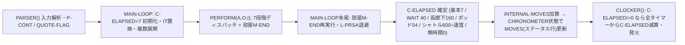
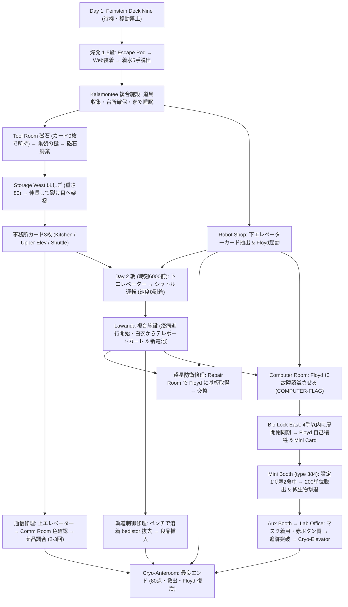

# Planetfall (Python 版) の内部構造・サバイバル設計・Floyd AI・SF ドラマ解析

ZilPy が Infocom の名作 SF アドベンチャー *Planetfall* (1983, Steve Meretzky) の ZIL ソース (`planetfall/`) から生成した Python 版 (`out/planetfall/`) を、静的構成要素・1983 年世代パーサーと可変時間クロック (`C-ELAPSED`)・4 重サバイバルタイマー・自律ロボット Floyd AI・クリアを阻む因果的障壁・七等隊員視点のギャップ・そして惑星 Resida と Floyd の SF 感動ドラマの観点から詳細に解説します。

- **ネタバレ注意:** 仕掛けの解き方、不可逆なソフトロック条件、Floyd の自己犠牲、全エンディング分岐まで記載しています。
- **解析手順の再現性:** 本ドキュメントの作成に用いた 5 ステージ解析計画は、プロジェクトルートの `GameArchitecture.md`（および基礎棚卸し手順の `infocomGame.md`）にまとめています。
- **元の ZIL の位置:** `misc.zil:73` のように記載します。生成コードの各定義直前の `# zil:` 注記および `out/planetfall/zilmap.json` から対応を引けます。

---

## 1. 全体像

### 1.1 規模

`tools/analyze_game.py out/planetfall` による静的棚卸し結果は以下のとおりです。

| 項目 | 数 |
|---|---|
| モジュール (ZIL ファイル) | 8 |
| ルーチン | 520 |
| 部屋 | 105 (宇宙船・シャトル等の `GLOBAL OBJECTS` 区画 12、惑星 Resida 側 93) |
| オブジェクト (部屋以外) | 150 |
| 構文 (`SYNTAX`) | 253 (動詞の語 105 個) |
| 割り込みのルーチン (`I-*`) | 37 (`QUEUE` 呼び出し 78 箇所) |
| グローバル変数・定数 | 307 (`state` 174、`const` 81、`scratch` 52) |
| 満点 | 80 点 (`VALUE` 合計 43 点 / 15 個 + 特別加点 37 点、`TVALUE` 0) |

ルーチンを役割で分類すると次のとおりです。

| 役割 | 数 | 例 |
|---|---|---|
| 動詞のアクション (`V-*`) | 140 | `V-WALK`、`V-TELL`、`V-TYPE`、`V-DIAGNOSE`、`V-SCORE` |
| オブジェクトのアクション | 98 | `FLOYD-F`、`SLOT-F`、`LASER-F`、`CHEMICAL-FLUID-F`、`BED-F` |
| そのほか (共通のオブジェクト) | 66 | `WAKING-UP`、`RESET-TIME`、`SHUTTLE-ACTIVATE`、各種 `*-PSEUDO` |
| そのほか (場面・システム処理) | 50 | `MAIN-LOOP`、`PERFORM`、`CLOCKER`、`SHOOT-SPECK`、`COMM-SETUP` |
| そのほか (パーサー) | 42 | `PARSER`、`CLAUSE`、`NUMBER?`、`SYNTAX-CHECK`、`GET-OBJECT` |
| 部屋のアクション | 38 | `CRYO-ANTEROOM-F`、`BIO-LOCK-EAST-F`、`COMM-ROOM-F`、`INFIRMARY-F` |
| 割り込み (`I-*`) | 37 | `I-FLOYD`、`I-FLOYD-FORAY`、`I-BLOWUP-FEINSTEIN`、`I-HUNGER-WARNINGS` |
| そのほか (動詞の補助) | 36 | `GOTO`、`JIGS-UP`、`FINISH`、`ITAKE`、`DESCRIBE-ROOM` |
| 事前アクション (`PRE-*`) | 11 | `PRE-TAKE`、`PRE-PUT`、`PRE-ZAP`、`PRE-EXAMINE` |
| マクロから作った関数 | 2 | `PROB`、`DISABLE` |

### 1.2 モジュールと読み込みの順

メインの `planetfall.py` が `VERSION('ZIP')`、`NEW-VOC? = True`（1 語が形容詞・名詞・動詞を同時に兼ねられる新語彙モード）を設定し、以下の 8 モジュールを順に読み込みます。プロパティ既定値は `SIZE = 5`、`CAPACITY = 0`、`VALUE = 0` です。

| # | モジュール (元の ZIL) | 行数 | ルーチン | 部屋 | オブジェクト | 構文 | 中身 |
|---|---|---|---|---|---|---|---|
| 1 | `planetfall.py` (`planetfall.zil`) | 44 | 0 | 0 | 0 | 0 | 入口。`VERSION ZIP`、`NEW-VOC?`、既定プロパティ、読み込み順 |
| 2 | `syntax.py` (`syntax.zil`) | 920 | 0 | 0 | 0 | 253 | 語彙 (`DIRECTIONS`, `BUZZ`, `SYNONYM`) と 253 構文 (`SLIDE`, `TYPE`, `FIRE`, `SCRUB`, `OIL` 等) |
| 3 | `misc.py` (`misc.zil`) | 547 | 14 | 0 | 0 | 0 | 旧 `MACROS`・`MAIN`・`CLOCK` を統合。`GO`、`MAIN-LOOP`、`PERFORM`、`CLOCKER` |
| 4 | `globals.py` (`globals.zil`) | 2,748 | 119 | 12 | 48 | 0 | 共通オブジェクト、宇宙船 Feinstein 脱出劇、カードスロット、シャトル、睡眠・空腹・疫病、各種 `PSEUDO` |
| 5 | `parser.py` (`parser.zil`) | 1,499 | 42 | 0 | 0 | 0 | 1983 年世代 Z-machine パーサー (42 ルーチン) |
| 6 | `verbs.py` (`verbs.zil`) | 2,314 | 186 | 0 | 0 | 0 | 動詞の標準動作 (`V-*`, `PRE-*`, `GOTO`, `JIGS-UP`, `V-SCORE` 等) |
| 7 | `compone.py` (`compone.zil`) | 3,029 | 84 | 56 | 53 | 0 | 西の **Kalamontee 複合施設** (崖・寮・台所・管理棟・機械棟・**Floyd AI**・上下エレベーター・通信塔) |
| 8 | `comptwo.py` (`comptwo.zil`) | 2,935 | 75 | 37 | 49 | 0 | 東の **Lawanda 複合施設** (診療室・惑星防衛・軌道制御・図書館・実験棟・**Floyd 犠牲**・電算機内部・エンディング) |

### 1.3 満点 80 点の内訳 (コード検証済み)

`V-SCORE` (`verbs.zil:220`) は満点を **80 点** として 8 段階の階級（80 = `Galactic Overlord`、73 以上 `Cluster Admiral`、65 以上 `System Captain`、49 以上 `Planetary Commodore`、37 以上 `Lieutenant`、25 以上 `Ensign First Class`、13 以上 `Space Cadet`、12 以下 `Beginner`）を表示します。

| 獲得源 | 点数 | コード上の根拠 |
|---|---|---|
| 部屋到達 `VALUE` (10 箇所) | 38 | `ESCAPE-POD`(3), `CRAG`(3), `STORAGE-WEST`(4), `KITCHEN`(4), `ADMIN-CORRIDOR-N`(4), `TOWER-CORE`(4), `KALAMONTEE-PLATFORM`(4), `LAWANDA-PLATFORM`(4), `STRIP-NEAR-STATION`(4), `AUXILIARY-BOOTH`(4) |
| カード入手 `VALUE` (5 枚) | 5 | `KITCHEN-CARD`, `UPPER-ELEVATOR-CARD`, `SHUTTLE-CARD`, `LOWER-ELEVATOR-CARD`, `MINI-CARD` (各 1、`SCORE-OBJ`) |
| Floyd 起動 | 2 | `FLOYD-F` (`compone.zil:2070`, `FLOYD-SCORE-FLAG`) |
| レーザー初撃ち | 2 | `LASER-F` (`comptwo.zil:2695`, `LASER-SCORE-FLAG`) |
| Floyd がミニカードを持ち帰り絶命 | 2 | `I-FLOYD-FORAY` (`comptwo.zil:1991`, `FORAY-COUNTER == 5`) |
| 3 大システム修理 (各 +6) | 18 | 通信 (`CHEMICAL-FLUID-F`, `compone.zil:3002`)、惑星防衛 (`comptwo.zil:417`)、軌道制御 (`comptwo.zil:575`) |
| メインコンピュータ修理 (塵を蒸発) | 8 | `SHOOT-SPECK` (`comptwo.zil:2851`, `COMPUTER-FIXED = True`) |
| Cryo-Elevator ボタン押下 | 5 | `CRYO-BUTTON-PSEUDO` (`globals.zil:2659`, `CRYO-SCORE-FLAG`) |
| **合計** | **80** | (`VALUE` 合計 43 + 特別加点 37 = **80**。修理済み系統を破壊すると -6 点減点) |

---

## 2. 起動・メインループ・パーサーの詳細処理と世界への反映

### 2.1 二段階起動 (`GO` と `I-RANDOM-INTERRUPTS`、`misc.zil:73-113`)

`GO` はゲーム開始時に以下を初期化します。

1. 初期割り込みを 6 本登録・有効化する。
   - 常駐デーモン (`-1`): `I-BLATHER` (鬼上官 Blather の巡回)、`I-AMBASSADOR` (異星人大使の訪問)
   - タイマー: `I-RANDOM-INTERRUPTS` (`1`)、`I-SLEEP-WARNINGS` (`3600`)、`I-HUNGER-WARNINGS` (`2000`)、`I-SICKNESS-WARNINGS` (`1000`)
2. 内部時刻 `INTERNAL-MOVES` を `4450 + RANDOM(180)`（ZIP20 デバッグ時は `4540`）に設定し、腕時計表示 `MOVES` に同期する。
3. `WINNER = ADVENTURER`、`HERE = DECK-NINE`、`P-IT-OBJECT = POD-DOOR` を設定し、七等星間パトロール隊員としてデッキを磨く導入文を表示して `MAIN-LOOP` へ入る。
4. 最初の 1 コマンド後に `I-RANDOM-INTERRUPTS` が発火し、**実行ごとに変化する乱数要素**を確定する。
   - `I-BLOWUP-FEINSTEIN` を `240 + RANDOM(90)` ミリクロン後に予約（宇宙船爆発の開始時刻）。
   - `COMM-SETUP()` でレーザー電池の弾数（`OLD-SHOTS = 2 + RANDOM(3)`、`NEW-SHOTS = 20 + RANDOM(10)`）と通信室に必要な薬品の色順・回数（`STEPS-TO-GO = 1 + RANDOM(2)` → 2〜3 色）をシャッフル。
   - `NUMBER-NEEDED = RANDOM(1000)` で Conference Room のダイヤル番号を確定。

### 2.2 パーサー (`parser.py`) の特徴と 1983 年世代構造

`parser.py`（42 ルーチン）は *Zork I* 改訂版 (`gparser.py`) より一世代前の 1983 年 ZIP パーサーであり、以下の固有仕様を持ちます。

1. **バッファ構成と `OOPS` 不在**:
   - `P-INBUF` は 80 バイト、`P-LEXV` は 120 バイト（最大 59 語、`SIBREAKS = '.,\"'`）。`OOPS-INBUF` や `AGAIN-LEXV` は存在しません。
   - `AGAIN` / `G` はパーサーではなく動詞 `V-AGAIN` (`verbs.zil:334`) が、`MAIN-LOOP` で退避した `(L-PRSA, L-PRSO, L-PRSI)` を `PERFORM` で再実行する方式です。
2. **会話構文とマニュアル警告 (`parser.zil:174-182, 275-280`)**:
   - `TELL <NPC> TO <命令>` の `TO`、または動詞未出時の `<NPC>, <命令>`（`THEN` / `,`）を検出し、`P-VERB = ACT?TELL`・`quote` へ変換して `P-CONT` と `QUOTE-FLAG` に後続命令を積みます。
   - もし `TELL FLOYD GO NORTH` のように `TO` や `,` なしで第 2 の動詞を書くと、`"Please consult your manual for the correct way to talk to other people or creatures."` を返して弾きます。
3. **整数解析 `NUMBER?` (`parser.zil:394`)**:
   - ASCII 数字のみを読み取り、`SUM <= 10000` の整数を `P-NUMBER` に格納して `WORD('intnum')` に置換します（ミニチュア化ブースの `type 384`、図書館端末のメニュー番号、会議室ダイヤル、レーザー出力 `set laser to 1` に使用）。
4. **パーサー乗っ取りなし**:
   - `parser.zil:161` 以外で `READ()` を直接呼ぶのは `FINISH` (`verbs.zil:268`) と `YES?` (`verbs.zil:301`) のみで、通常ゲームプレイを乗っ取る例外部屋はありません。

### 2.3 世界への反映パイプライン: 可変時間クロック (`C-ELAPSED`) と腕時計 (`CHRONOMETER`)

*Planetfall* のメインループ (`misc.zil:114-261`) が他作品と決定的に異なるのは、**「1 コマンド = 1 ターン」ではなく、行動の種類ごとに経過ミリクロン (`C-ELAPSED`) が動的に決まる可変時間エンジン**である点です。

1. **可変時間 `C-ELAPSED` の算出ルール (`misc.zil:116, 238-248`)**:
   - ターン開始時に `C-ELAPSED = C-ELAPSED-DEFAULT` (`7`) に初期化されます。
   - アクション実行中に重い行動が値を上書きします（例: `V-WAIT` = `40`、`V-WALK` は部屋の `C-MOVE` 表を参照し通常移動 `15`〜`30`、`LONG-HALL-F` = `160`、`LADDER-F` 伸長 = `36`、`V-DIAGNOSE` = `18`、Floyd 看取り時の扉閉鎖 = `95`）。
   - アクション終了後、`MAIN-LOOP` が特殊モードを強制上書きします:
     - `I-POD-TRIP` 有効中（脱出ポッド降下中）: **`54`**
     - `SHUTTLE-VELOCITY > 0`（シャトル走行中）: **`600 // SHUTTLE-VELOCITY`**（速度 5 なら 120、速度 10 なら 60、速度 20 なら 30）
     - `TELL` または `TIMELESS-VERB?`（`BRIEF`, `SUPER-BRIEF`, `VERBOSE`, `SAVE`, `RESTORE`, `SCORE`, `SCRIPT`, `UNSCRIPT`, `TIME`, `QUIT`, `RESTART`, `VERSION`, デバッグ動詞、およびそれらの `AGAIN`）: **`0`**
   - `C-ELAPSED == 0` のときは `CLOCKER()` 自体がスキップされます。非 0 のとき `CLOCKER()` は正のタイマーから `1` ではなく **`C-ELAPSED` を減算**し、`TICK <= 1` で発火します（`misc.zil:475-479`）。
2. **ステータス行 `MOVES` と腕時計 `CHRONOMETER` の連動 (`misc.zil:253-258`)**:
   - Z-machine のステータス行右端に表示される `MOVES` を「手首のクロノメーターの表示」として流用しています。
   - クロノメーターを所持していなければ `MOVES = 0`、酸を浴びて `MUNGEDBIT` が立つと破損時刻 `MUNGED-TIME` で永久停止、正常所持時のみ `INTERNAL-MOVES` を表示します。
3. **`PERFORM` と `M-END` の構造 (`misc.zil:324-379, 230-233`)**:
   - `PERFORM` は `(PRSA, PRSO, PRSI)` を退避して再入可能性を確保し、**`WINNER(ACTION)` → `HERE(M-BEG)` → `PREACTIONS` → `PRSI(ACTION)` → `Container(CONTFCN)` → `PRSO(ACTION)` → `ACTIONS(V-*)`** の 7 段階でディスパッチします。
   - さらに `M-FATAL` (`2`) でなければ `PERFORM` 末尾で `HERE(M-END)` を呼び、**`MAIN-LOOP` 側でも `M-END` を呼ぶ**構造になっています（`INFIRMARY-F` や `BIO-LOCK-EAST-F` のように 1 回限りフラグで制御する部屋では二重発火を防いでいます）。

### 2.4 具体的コマンドのエンドツーエンド実行トレース (3 例)

#### トレース①: `floyd, go north`（Repair Room でロボット穴へ入らせる）
1. **`PARSER` (1 周目)**: `floyd` の直後の `,` (`THEN` 扱い) を検出し、`VERB` 未出のため `P-VERB = ACT?TELL`、`P-CONT` に `go north` の先頭を保存して `QUOTE-FLAG = True`、`PRSO = FLOYD` で戻る。
2. **`MAIN-LOOP` → `PERFORM` → `V-TELL` (`verbs.zil:1353`)**: `FLOYD` に `ACTORBIT` があり `P-CONT` が真なので、**`WINNER = FLOYD`、`HERE = LOC(FLOYD)`** に切り替える。`VERB? TELL` なので `C-ELAPSED = 0`、`CLOCKER()` は回らない。
3. **`PARSER` (2 周目)**: `P-CONT` から `go north` を方向ショートカットとして解析し、`PRSA = V?WALK`, `PRSO = NORTH`, `P-WALK-DIR = NORTH` で即返却。
4. **`PERFORM` (`WINNER == FLOYD`)**: 最優先の `WINNER(ACTION)` ＝ `FLOYD-F` (`compone.zil:1852`) が呼ばれる。`HERE == REPAIR-ROOM` かつ `PRSO == 'NORTH'` に一致し、`FLOYD-THROUGH-HOLE()` を実行してロボット穴の奥に `GOOD-BOARD` があることを報告（`BOARD-REPORTED = True`）。直後に **`FLUSH()`** を呼び、もしプレイヤーが `floyd, go north. take board` と連続命令していても `P-CONT` を破棄して `M-FATAL` (`2`) を返す（「Floyd は 2 つ目以降の命令を忘れる」挙動の実装）。次ターン冒頭の `PARSER` で `WINNER = ADVENTURER` に自動復帰する。

#### トレース②: `slide mini card through slot` → `type 384`（電算機内部への転送）
1. **`PARSER`**: `SYNTAX('SLIDE', 'OBJECT', ..., 'WITH', 'OBJECT', '=', 'V-SLIDE')`（`THROUGH` は `WITH` の同義語）に一致。`PRSO = MINI-CARD`, `PRSI = SLOT`。
2. **`PERFORM` → `SLOT-F` (`globals.zil:1365`)**: まず `SCRAMBLEDBIT`（磁石による磁気破損）をチェック。無傷なら `HERE == MINI-BOOTH` を確認し、**`MINI-ACTIVATED = True`** と **`QUEUE(I-TURNOFF-MINI, 30)`** を登録して起動音声を出力。
3. **次コマンド `type 384`**: `PARSER` の `NUMBER?` が `"384"` を `P-NUMBER = 384`・`WORD('intnum')` に変換。`V-TYPE` (`verbs.zil:1628`) が `MINI-ACTIVATED` と `P-NUMBER == 384` を検証し、`GOTO(STATION-384)`・`BEEN-HERE = True` を設定して電算機内部へ転送する（10〜1024 の別番号なら感電即死）。

#### トレース③: Bio Lock East での `open door` → `close door` → `wait` → `open door` → `close door`（Floyd の自己犠牲）
1. **前提**: `BIO-LOCK-EAST-F` (`M-END`, `comptwo.zil:1717`) で `COMPUTER-FLAG == True` のとき、Floyd が窓を覗いて `FLOYD-WAITING = True` を立てる（4 手以内に開けないと `WAITING-COUNTER > 3` で `FLOYD-GAVE-UP = True` となりすねて退室）。
2. **`open door` (1 回目)**: `BIO-DOOR-EAST-F` (`comptwo.zil:1826`) が `FLOYD-WAITING` と `FORAY-COUNTER == 0` を検知し、**`QUEUE(I-FLOYD-FORAY, -1)`** を登録、`FLOYD-FORAYED = True`、`BIO-DOOR-EAST` を `OPENBIT`、`REMOVE(FLOYD)`、`DISABLE(I-FLOYD)` を実行。Floyd が Bio Lab へ突入し、直後の `CLOCKER` で `I-FLOYD-FORAY` が `FORAY-COUNTER = 1` に進む。
3. **`close door` (1 回目)**: 扉を閉鎖。`CLOCKER` → `I-FLOYD-FORAY` (`FORAY-COUNTER = 2`) で扉の奥から格闘音と金属の悲鳴。
4. **`wait`**: `C-ELAPSED = 40`、`CLOCKER` → `I-FLOYD-FORAY` (`FORAY-COUNTER = 3`) で **3 回の素早いノック** と金属の引き裂かれる音。
5. **`open door` (2 回目)**: 扉開放。`CLOCKER` → `I-FLOYD-FORAY` (`FORAY-COUNTER = 4`) で `OPENBIT` を確認し、`MOVE(FLOYD, HERE)`（ミニカードを抱えて転がり出る）。※ここで閉じたまま 1 手遅れると Floyd は中で破壊され `I-FLOYD-FORAY` が無効化、カード永久喪失で詰む。
6. **`close door` (2 回目)**: `BIO-DOOR-EAST-F` が `FORAY-COUNTER == 4` を検知して **`C-ELAPSED = 95`** を設定（看取りの時間を反映）。`CLOCKER` → `I-FLOYD-FORAY` (`FORAY-COUNTER = 5`) が `FLOYD` を消去・`DEAD-FLOYD` と `MINI-CARD` を配置、`SCORE += 2`、最期の台詞と *Ballad of the Starcrossed Miner* を出力して `I-FLOYD-FORAY` を停止する。

---

## 3. Planetfall 固有の主要サブシステム

### 3.1 時間・空腹・睡眠・疫病の 4 重サバイバルタイマー

*Planetfall* は探索パズルに「人間の生理的限界」を 4 本の独立割り込みと日次クロックで重ね合わせた生存システムを持ちます。

| サブシステム | ルーチン / 状態変数 | 進行スケジュール (ミリクロン) | 死亡・ペナルティ条件と回復手段 |
|---|---|---|---|
| **空腹** | `I-HUNGER-WARNINGS` (`globals.zil:2295`) / `HUNGER-LEVEL` (0〜5) | 開始 2000 → Lv1(+450) → Lv2(+150) → Lv3(+100) → Lv4(+50) → **Lv5 餓死** | 警告前 (`Lv0`) は食べられない。ゴー（`FOOD-KIT`、各 +1450）または高タンパク液（`CANTEEN`、+3600）で `Lv0` に回復。**空腹 (`Lv>0`) のまま寝ると起床時即 `Lv4` (残り 100)** に悪化 (`WAKING-UP`)。 |
| **睡眠** | `I-SLEEP-WARNINGS` (`globals.zil:2026`) / `SLEEPY-LEVEL` (0〜5) | Day1 は 3600 → Lv1(+400) → Lv2(+135) → Lv3(+60) → Lv4(+50) → **Lv5 強制就寝** | 寮の寝台 (`BED-F`) で `Lv>0` のとき `I-FALL-ASLEEP(16)` で安全就寝。床寝は **30% で獣に襲われ即死**、水没階（Day1 `CRAG`・Day3 `BALCONY`・Day5 `WINDING-STAIR`）は溺死。**診療室 (`INFIRMARY`) の寝台は壊れた医療ロボットが 347 種の血清を注射し脚を切断しようとして即死** (`BED-F`, `globals.zil:2097`)。 |
| **疫病** | `I-SICKNESS-WARNINGS` (`globals.zil:2330`) / `SICKNESS-LEVEL` (0〜9) | 700 周期で常時チェック。`WAKING-UP` と `LAWANDA-PLATFORM-F` 初到達で `SICKNESS-WARNING-FLAG = True` が立ち、次周期に +1 段 | 1 段ごとに **`LOAD-ALLOWED -= 10`**（初期 100 → 運搬力が激減）。**Lv9 で病死**。診療室の薬 (`MEDICINE-F`, 1 回限り) で **`SICKNESS-LEVEL -= 2`、`LOAD-ALLOWED += 20`**。 |
| **日次クロック & 海面上昇** | `WAKING-UP` / `RESET-TIME` (`globals.zil:2197-2288`) / `DAY` (1〜9) | Day2 起床 `1600+r(80)` (活動 5800) → Day3 `1750` (5550) → Day4 `1950` (5200) → Day5 `2150` (4800) → Day6 `2450` (4300) → Day7 `2800` (3700) → Day8 `3200` (3000) → **Day9 朝に死亡** | 起床時に未装着アイテムはすべて床へ落下、開いたカンティーンの液とフラスコの薬品は蒸発。日ごとに起床が遅れ活動時間が縮む設計は、図書館の赤スプール (`RED-TEXT`) にある疫病の二次症状「必要睡眠時間の急増」をそのまま実装している。同時に海面が上昇し低層が水没。 |

### 3.2 ロボット Floyd AI (`FLOYD-F` / `I-FLOYD`、`compone.zil:1852-2311`)

Floyd（型番 `B-19-7`）は Z-machine の限られたメモリ上で「人格と自律性」を感じさせるための巧妙な状態機械で実装されています。

1. **起動と下エレベーターカードの二経路**:
   - Robot Shop で停止中の Floyd に対し、起動前に `search robot` すると `LOWER-ELEVATOR-CARD` を即座に入手できます（`CARD-STOLEN = True`）。
   - `turn on robot` すると `"Nothing happens."` (+2 点) ののち **25 ミリクロン後**に `I-FLOYD` が発火し、`FLOYD-COMES-ALIVE` で目覚めます（`RLANDBIT` = 稼働中フラグ、`ACTORBIT` = 会話可能フラグ）。
   - 起動前にカードを抜かなかった場合、プレイヤーが他カードを使った際 `FLOYD-REVEAL-CARD-F` (`globals.zil:1440`) が確率（Day2 午前 5% / 午後 10%、Day3 午前 20% / 午後 40%、Day4 以降 100%）でカードを自慢して見せます。
2. **自律移動・気まぐれ・感情表現 (`I-FLOYD`, `compone.zil:2158`)**:
   - 同じ部屋にいるとき: `FLOYDBIT` が立つ部屋では **6% の確率** で `"Floyd going exploring. See you later."` と離脱（`REMOVE(FLOYD)`）。留まっているときは `FLOYD-SPOKE` が偽なら **40% の確率** で `FLOYDISMS` テーブルから無邪気な仕草をランダム出力。
   - 別室にいるとき: `FLOYD-FOLLOW` が真なら **80% の確率** で追従。さらにテレポートブース・シャトル運転室・各種エレベーター・エアロック・ミニチュア化ブースでは **強制合流** し、放置して閉め出されるのを防ぎます。離脱中も **30% の確率** で飛び込んで再合流します。
   - **旧友 Lazarus の記憶 (`INFIRMARY-F`, `comptwo.zil:105`)**: 診療室に Floyd といると 30% の確率で錆びたロボットの胸板 `"Lazarus"` を見つけ、静かにすすり泣いて Fork へ逃げ出します。以後 Lazarus の胸板がある部屋へ入ろうとすると鼻をすすって引き返します（胸板をプレゼントすると泣いて逃げ出す）。
3. **Bio Lab での自己犠牲 vs Radiation Lab での拒否**:
   - 隣接する **Radiation Lab (`RADIATION-LAB`)** は入っただけで 50 ミリクロン後に `I-NUKED-BLUE` が発火し 3 ターンで放射線死する罠部屋（2 ターン目に髪が抜け落ちると Floyd が爆笑する）であり、Floyd に東へ行けと命じても `"After you."` と断ります。
   - 一方、Radiation Lab 北壁の亀裂から漏れた放射線で生物が変異した **Bio Lab (`BIO-LAB`)** に対しては、Computer Room で故障を知った後 (`COMPUTER-FLAG = True`) に限り、`BIO-LOCK-EAST-F` で震える声のまま自ら突入を申し出、1 ターン単位の扉開閉同期 (`I-FLOYD-FORAY`) を経て命を落とします。

### 3.3 惑星 Resida の 3 大システム修理＋電算機修復と結末分岐

| 系統 | 場所・担当ルーチン | 修理手順とコード上の状態遷移 |
|---|---|---|
| **① 通信系 (`COMM`)** | Comm Room (`COMM-ROOM-F`, `CHEMICAL-FLUID-F`) + Machine Shop | `COMM-SETUP` が決めた 2〜3 色の薬品をフラスコで調合し `FUNNEL-HOLE` へ注ぐ。全色一致で `COMM-FIXED = True` (+6 点)。誤色または他液体を注ぐと `COMM-SHUTDOWN = True` で永久停止。 |
| **② 惑星防衛 (`DEFENSE`)** | Planetary Defense (`PLANETARY-DEFENSE-F`) + Repair Room | Floyd にロボット穴の奥から `GOOD-BOARD` を取らせ、パネルの焼損した `SECOND-BOARD` と交換 → `DEFENSE-FIXED = True` (+6 点)。 |
| **③ 軌道制御 (`COURSE`)** | Course Control (`PLANETARY-COURSE-CONTROL-F`) + Storage East | ペンチで溶着した `FUSED-BEDISTOR` を抜き、良品の `GOOD-BEDISTOR` を挿入 → `COURSE-CONTROL-FIXED = True` (+6 点)。修理後に再接触すると感電死。 |
| **④ メインコンピュータ (`COMPUTER`)** | Mini Booth → Station 384 (`SHOOT-SPECK`, `I-FRY`, `I-MICROBE`, `I-CHASE-SCENE`) | ダイヤル `1`（赤）でリレー内の塵 `SPECK` を 2 回命中させる（初回命中率 0%、外すたび `MARKSMANSHIP-COUNTER += 12`）。2 回目で `COMPUTER-FIXED = True` (+8 点)・`CRYO-ELEVATOR-DOOR` 開放・**`I-FRY(200)` 起動**。帰路の微生物は設定 `2` 以上で撃ち熱したレーザー (`WARMTH-FLAG >= 9`) を溝へ投げ落として撃退。Auxiliary Booth → Lab Office でガスマスク装着＋赤ボタンの殺菌霧 (50 単位) → Bio Lab 突破 → `I-CHASE-SCENE` の追跡を振り切り Cryo-Elevator でボタンを押す (+5 点)。 |

`CRYO-ANTEROOM-F` (`comptwo.zil:1393`) のエンディング分岐は **`COURSE-CONTROL-FIXED`** と **`COMM-FIXED and DEFENSE-FIXED`** の 2 軸（全 4 パターン）で厳密に決まります。

| `COURSE-CONTROL-FIXED` | `COMM-FIXED` ∧ `DEFENSE-FIXED` | 結末 (`CRYO-ANTEROOM-F`) |
|---|---|---|
| **True** | **True** | **最良トゥルーエンド (80 点)**: Veldina 覚醒、S.P.S. *Flathead* 到着、主人公は一等中尉へ昇進・Blather は十二等隊員へ降格、疫病完治、**技術陣が Floyd を修復して再会**。 |
| **True** | **False** (`DEFENSE` 未修理) | 惑星は救われるが、救助船は防衛システムに撃墜され、主人公は Resida に取り残される（無制限の銀行口座と別荘を贈呈）。 |
| **True** | **False** (`COMM` 未修理) | 惑星は救われるが、救助船は生存者を発見できず撤収し、主人公は Resida に取り残される。 |
| **False** | **True** / **False** | 治療薬は完成するも軌道崩壊が手遅れとなり、Resida は太陽へ落下。`COMM ∧ DEFENSE` なら *Flathead* に主人公だけ救出され、未修理なら惑星と運命を共にする。 |

---

## 4. クリアへの因果的ターニングポイントと障壁

### 4.1 因果依存グラフ

### 4.2 主要な不可逆ソフトロック・致命的障壁 (コード根拠付き)

| 障壁・ソフトロック | 発生条件とコード上の実装 | 影響・回復可否 |
|---|---|---|
| **① 序盤 Feinstein の離脱・出遅れ** | `I-BLATHER` (`globals.zil:680`): Deck Eight / Reactor Lobby に留まると 4 回目 (`BRIGS-UP > 3`) で営倉 (`BRIG`) 送り（脱出不能）。`I-BLOWUP-FEINSTEIN` (`globals.zil:1162`): 3 段目でポッド扉閉鎖、5 段目で爆死。`I-POD-TRIP`: 着水時 `SAFETY-WEB` 未装着で即死。`I-SINK-POD`: 起立後 5 手で沈没死。 | 即死または強制詰み (`restore`) |
| **② 磁石による磁気カード破壊** | `I-MAGNET` (`compone.zil:1595`): 磁石 (`MAGNET`) とカードを同時所持すると、**毎ターン 1 枚ずつ無警告で `SCRAMBLEDBIT` が立つ**（優先順: Kitchen → Shuttle → Teleport → Upper → Lower → Mini → ID）。`SLOT-F` は `"Magnetik striip randumiizd"` と拒絶し、修復手段なし。 | **最悪の静かなソフトロック** (`restore` 必須) |
| **③ はしごの裂け目落下** | `LADDER-F` (`compone.zil:649`): 伸長 (`LADDER-EXTENDED`) せずに `put ladder across rift` するか、架橋後に `close ladder` すると `REMOVE(LADDER)` で永久消滅。管理棟北のカード 3 枚が回収不能。 | 不可逆ソフトロック (`restore`) |
| **④ 通信室への誤薬品注入** | `CHEMICAL-FLUID-F` (`compone.zil:2964`): 指示色以外や高タンパク液・薬を `FUNNEL-HOLE` に注ぐと `COMM-SHUTDOWN = True`。以後通信修理不可。 | 最良エンド不能 (`restore`) |
| **⑤ レーザー出力ミスによるリレー破壊** | `SHOOT-SPECK` (`comptwo.zil:2842`): `LASER-SETTING != 1` のまま塵を撃つと `REMOVE(RELAY)` でマイクロリレーごと溶断。コンピュータ修理不能。 | 不可逆ソフトロック (`restore`) |
| **⑥ Floyd 犠牲イベントの 1 手ズレ** | `BIO-LOCK-EAST-F` (`comptwo.zil:1717`): 申し出後 4 手放置 (`WAITING-COUNTER > 3`) で `FLOYD-GAVE-UP = True` となり二度と協力しない。`I-FLOYD-FORAY` (`comptwo.zil:1949`): `FORAY-COUNTER == 4`（ノック直後）に扉が開いていないと Floyd が中で破壊され `MINI-CARD` 永久喪失。開けっ放しは即死。 | 不可逆ソフトロック / 即死 (`restore`) |
| **⑦ シャトル 2 台破損・夜間規制** | `SHUTTLE-ACTIVATE` (`globals.zil:1782`): `INTERNAL-MOVES > 6000` は夜間規制で起動不可。`DESCRIBE-SHUTTLE-ARRIVE` (`globals.zil:1976`): 到着時速度 5〜15 でその車両が永久故障（20 以上で即死）。Alfie・Betty 両方壊すと移動不能。 | 車両永久喪失 / 即死 |
| **⑧ 重量限界と疫病・睡眠の複合破綻** | 疫病 1 段ごとに `LOAD-ALLOWED -= 10`。はしごは重さ `80`、レーザー `25`、ペンチ `15`。重量超過でフラスコを落とすと薬液蒸発。9 日目の朝 (`DAY == 9`) で無条件死亡。 | 遅延詰み |
| **⑨ 酸による鍵・装置溶解 & Cryo 2 回押し** | `CHEMICAL-FLUID-F`: 白ボタンの酸を亀裂に注ぐと鍵が永久溶解 (`REMOVE(KEY)`)。`CRYO-BUTTON-PSEUDO` (`globals.zil:2652`): 到着後にボタンを 2 回押すと上階へ戻りミュータントに捕食され即死。 | 不可逆ソフトロック / 即死 |

### 4.3 登場人物視点（ダイエジェティック視点）での 3 層分類

- **物理的・工学的必然**: 宇宙船爆発時の安全ウェブ装着と沈没ポッドからの脱出、磁石で磁気ストライプカードが壊れる現象、伸長式はしごの重量と架橋、赤い透明カバーを通過する赤色レーザー（設定 1）の光学原理、ガスマスクと緊急殺菌霧、減速なしのシャトル衝突。いずれも現実の物理・工学法則として納得度が高い。
- **物語的・SF 的必然**: 疫病の進行に伴う高熱・筋力低下（運搬上限低下）と睡眠時間増加、軌道崩壊による海面上昇、シャトルの夜間運用制限、Floyd の気まぐれや Lazarus の記憶・自己犠牲。Resida という世界の設定がゲームメカニクスへ見事に統合されている。
- **構造的・システム的不条理**: `I-MAGNET` が磁気破壊の瞬間に一切警告を出さない点、空腹警告が出る 1 ミリクロン前には食事を拒否される (`Thanks, but you're not hungry.`) 点、`I-FLOYD-FORAY` の 1 ターン刻みの厳密な扉開閉、そして起動前に Floyd の腹を探れば即取れる下エレベーターカードを起動後は確率待ちになる仕様。

---

## 5. 主人公（七等星間パトロール隊員）の視点: 初回情報のみの「知的・理想的な行動」vs「クリア必須行動」

### 5.1 初期情報（Turn 0〜1）の確定

`GO` (`misc.zil:98`) と `DECK-NINE` の描写から、攻略知識ゼロの初見プレイヤーが最初に知っている事実は次の範囲に限られます。
- 自分は星間パトロール艦 *Feinstein* の最下級隊員 **七等少尉（Ensign Seventh Class）** であり、第 9 デッキの床を掃除ブラシで磨くよう命じられている。
- 鬼上官 Blather がいつ現れて減点してくるか分からない。
- 所持品は掃除ブラシ、腕時計（クロノメーター）、パトロール制服（ポケットに ID カード）のみ。

### 5.2 初見の知的理想行動 vs クリア必須行動のギャップ

| フェーズ | 初回情報のみでの「最も知的で理想的な行動」 | クリアに実際に必要な行動 (コード上の制約) | ギャップの本質 |
|---|---|---|---|
| **① 宇宙船 Feinstein** | 艦内の異変や上官への報告のため他デッキを探索する、あるいは真面目にデッキを磨き続ける。 | 持ち場を離れると Blather に営倉送り (`BRIGS-UP > 3`)。爆発開始まで Deck Nine で待機し、1 段目で即ポッドへ飛び込み、ウェブ装着→着水後 5 手で脱出。 | **軍隊の理不尽と緊急事態の必然**: 探索意欲を抑えて持ち場を守る従順さが生存条件になる皮肉。 |
| **② 食料と睡眠の管理** | 栄養補給できるときにこまめに食べ、疲れる前に早めに休息を取る。診療室を見つけたらベッドで治療を受ける。 | 空腹は `HUNGER-LEVEL >= 1` の警告が出るまで食事不可。逆に就寝時は「空腹 Lv0 で寝る」よう時刻調整が必要。診療室のベッドは即死罠 (`BED-F`)。 | **システム的制約と廃墟の罠**: 予防的摂食を許さない仕様はゲーム的制約だが、壊れた医療ロボットの暴走は廃墟 SF らしい必然。 |
| **③ 道具管理と磁石** | 入手した磁気カードや便利そうな磁石は、いつでも使えるよう一式まとめて持ち歩く。 | 磁石とカードを同時所持した瞬間から `I-MAGNET` が毎ターン無警告でカードを破壊 (`SCRAMBLEDBIT`)。カードを 0 枚にして鍵を釣り、即座に磁石を捨てる必要がある。 | **工学的必然だが無警告の不条理**: 磁石と磁気カードの相性自体は常識的だが、破壊通知がスロット使用時まで遅延する点が初見殺し。 |
| **④ 通信・防衛・軌道の修復** | まず最優先の「故障したメインコンピュータ」だけ直せば救助も呼べると考え、他の監視モニターは後回しにする。 | コンピュータ単体修理でもクリア自体は可能だが、`COMM`・`DEFENSE`・`COURSE-CONTROL` の 3 系統すべてを事前に直さない限り、惑星滅亡か救助不能のバッドエンドになる (`CRYO-ANTEROOM-F`)。 | **全体最適の知的必然**: 監視室 (`SYSTEMS-MONITORS`) の 4 つの赤ランプを読み解くことで初見でも気付ける優れた伏線設計。 |
| **⑤ Floyd との協働と Bio Lab** | ロボットを起動したら丁寧に接し、危険な Bio Lab には自分が武装（レーザー等）して入るか、Floyd を安全な場所へ退避させる。 | 起動前に「無断で腹を探って」カードを抜く方が圧倒的に有利。そして終盤は、震える Floyd をあえてミュータントの巣窟へ送り込み、1 手の狂いもなく扉を開閉して彼の死と引き換えにカードを得るしか道がない。 | **英雄譚への強制転換**: 最下級の掃除係が「友を送り出す決断」を迫られる物語的必然。 |

### 初見の「優秀な隊員」が陥る最大の逆説
初回プレイで最も真面目かつ慎重に行動する隊員ほど、**「持ち場から艦内を見回って Blather に営倉へ放り込まれ、便利な磁石とカードを大事にポケットへしまって全滅させ、診療室のベッドで休もうとして医療ロボットに殺され、あるいはコンピュータだけ直して惑星ごと太陽へ落ちる」** という結末を辿ります。*Planetfall* が七等隊員に要求するのは、マニュアル通りの軍務ではなく、**廃墟の物理法則を肌で学び、限られた運搬力と時間を切り詰め、唯一の相棒の覚悟を受け止めるサバイバーとしての判断力**なのです。

---

## 6. このゲームで行われていた具体的な行為と人間・SF 感動ドラマ

図書館の端末テキスト (`_11_TEXT`〜`_53_TEXT`, `RED-TEXT`)、通信室の再生音声 (`PLAYBACK-BUTTON-F`)、Floyd のイベント (`INFIRMARY-F`, `I-FLOYD-FORAY`)、そして `CRYO-ANTEROOM-F` のエンディングを時系列に繋ぎ合わせると、軽妙なコメディ調の序盤の裏に、**重厚なハード SF の悲劇とゲーム史上屈指の自己犠牲のドラマ**が浮かび上がります。

### 6.1 過去軸: 惑星 Resida の悲劇と「ザ・プロジェクト」

1. **希望から生まれた疫病 (`_51_TEXT`, `comptwo.zil:1142`)**:
   高度に発展した惑星 Resida の「高度冷凍保存研究センター」は、冷凍冬眠期間を無期限に延長する画期的技術に成功した。しかしその過程で、発症から 8〜10 日で必ず死に至る致死性の疫病 **`Xe Dizeez`（ザ・ディジーズ）** が流出し、星全体へ蔓延した。
2. **数百万人が未来へ託した眠り (`_52_TEXT`, `_53_TEXT`)**:
   Resida の指導者 Veldina たちは、双子の高峰 Kalamontee と Lawanda に巨大複合施設と地下冷凍室を建設し、**全住民を冷凍冬眠させたまま、超高精度コンピュータによる自動研究で治療薬を開発・解凍する「4 段階計画（`Xe Prajekt`）」**を発動した。住民たちは目覚めの朝を信じて眠りについた。
3. **たった一粒の塵と数世紀の崩壊**:
   しかし、メインコンピュータのセクター 384 にあるマイクロリレーへ**たった一粒の青い塵 (`SPECK`)** が入り込んだことで、治療薬の完成と解凍プロセスは停止した。数世紀の無人の歳月のうちに施設は朽ち、軌道制御の故障 (`COURSE-CONTROL`) で惑星は太陽へ近づき氷冠が溶けて大陸の半分が水没（`_41_TEXT`）。放射線実験室の亀裂から漏れた放射線が生物実験室の検体を凶暴なミュータントへ変貌させ、さらに故障した惑星防衛システム (`DEFENSE`) は、**救援応答を求めて接近した主人公の母艦 *S.P.S. Feinstein* 号すら隕石と誤認して撃墜してしまった** (`PLAYBACK-BUTTON-F`)。

### 6.2 現在軸: 無邪気なロボット Floyd の孤独と自己犠牲、そして再会

廃墟と化した Resida に流れ着いた最下級隊員が出会うのが、ロボット工場の片隅で電源を切られていた汎用ロボット **Floyd (`B-19-7`)** です。

- **子どものような無邪気さと「喪失の記憶」**:
  目覚めた Floyd は、ポケットにクレヨンを 1 本忍ばせ、「鬼ごっこ（Hider-and-Seeker）しよう」「お話を聞かせて」とねだる無邪気な相棒です。しかし診療室で錆びついたロボットの胸板 **"Lazarus"** を見つけた瞬間、彼は言葉を失って静かにすすり泣き、部屋を飛び出します (`INFIRMARY-F`)。彼もまた、かつての人間たち（"Doctor-person" や "Achilles"）やロボット仲間をすべて失った孤独な生き残りなのです。
- **震える声での決断と最期 (`BIO-LOCK-EAST-F`, `I-FLOYD-FORAY`)**:
  コンピュータの故障を知り (`COMPUTER-ACTION`)、Bio Lab の中にミニチュア化ブースのカードを見つけたとき、Floyd は初めて「遊び」をやめます。窓を覗き込み、**声をわずかに震わせながら (`Floyd's voice trembles slightly`)** こう告げます。
  > *"Looks dangerous in there. I don't think you should go inside. ... Robots are tough. Nothing can hurt robots. Floyd will get card."*
  
  ロボットは頑丈だから大丈夫だと自分を奮い立たせて飛び込んだ Floyd は、ミュータントに引き裂かれながらもカードを抱えて戻り、主人公の膝の上でオイルを流しながら問いかけます――**"Floyd did it ... got card. Floyd a good friend, huh?"**。主人公が彼の大好きな歌 *Ballad of the Starcrossed Miner* を静かに歌い終えると、Floyd は満足そうに微笑んで目を閉じます。このとき `BIO-DOOR-EAST-F` が `C-ELAPSED = 95` ミリクロンもの長い時間を消費するのは、主人公が友の亡骸のそばで黙祷を捧げる時間のコード表現です。
- **報われる犠牲と復活の希望 (`CRYO-ANTEROOM-F`)**:
  Floyd が命と引き換えに託したカードで塵を焼き払い、3 大システムをすべて修復して冷凍室の控え室へ辿り着くと、数世紀の眠りから目覚めた指導者 Veldina が主人公と惑星の救済を告げます。救助艦 *S.P.S. Flathead* が到着し、主人公は一等中尉へ昇進（鬼上官 Blather は十二等隊員へ降格され専用トイレ係に配属）、疫病も完治します。そして最後に、ロボット技術者たちの列が左右に割れると――修復された Floyd が満面の笑みで飛び出してきます。
  > *"Hi! Floyd feeling better now! Look what Floyd found!"*
  
  彼が差し出すのは、本編では手に入らなかったヘリコプターの鍵・リアクターエレベーターカード・パドルボールセット――*"Maybe we can use them in the sequel..."*（続編 *Stationfall* への粋な伏線）。最下級の掃除係と旧式ロボットが交わした友情が、滅びかけた一つの星と数百万の命を救い、再び笑顔で再会するという、テキストアドベンチャー史に残る完璧なカタルシスが、わずか 8 モジュール・520 ルーチンのコードの中に緻密に組み込まれています。

---

## 7. この解説の作り方

本解説は、プロジェクトルートの `GameArchitecture.md`（Stage 1〜5）および `infocomGame.md` に従って作成しました。

1. `tools/analyze_game.py out/planetfall` の静的棚卸し一覧から、8 モジュール・520 ルーチン・105 部屋・150 オブジェクト・253 構文・37 割り込み・307 グローバル変数 (`state` 174 / `const` 81 / `scratch` 52)・満点 80 点の全数値を確定。
2. `planetfall.py`・`misc.py`・`parser.py` を精読し、`NEW-VOC?`・可変経過時間 `C-ELAPSED`・腕時計 `CHRONOMETER` 連動ステータス行・`TIMELESS-VERB?`・`M-END` 二重呼び出し・1983 年世代パーサーの会話構文を検証。
3. `tools/analyze_game.py out/planetfall --show` を用いて、4 重サバイバルタイマー (`I-HUNGER-WARNINGS`, `I-SLEEP-WARNINGS`, `I-SICKNESS-WARNINGS`, `WAKING-UP`, `RESET-TIME`, `BED-F`, `MEDICINE-F`)、Floyd AI (`FLOYD-F`, `I-FLOYD`, `INFIRMARY-F`, `BIO-LOCK-EAST-F`, `BIO-DOOR-EAST-F`, `I-FLOYD-FORAY`, `DEAD-FLOYD-F`)、3 大システム＋電算機内部 (`COMM-SETUP`, `COMM-ROOM-F`, `CHEMICAL-FLUID-F`, `PLANETARY-DEFENSE-F`, `PLANETARY-COURSE-CONTROL-F`, `SHOOT-SPECK`, `I-FRY`, `I-MICROBE`, `I-CHASE-SCENE`)、不可逆障壁 (`I-BLATHER`, `I-BLOWUP-FEINSTEIN`, `I-MAGNET`, `LADDER-F`, `SHUTTLE-ACTIVATE`, `CRYO-BUTTON-PSEUDO`)、および図書館テキスト・エンディング (`CRYO-ANTEROOM-F`) をすべて Python 実コードで検証して再構成。
