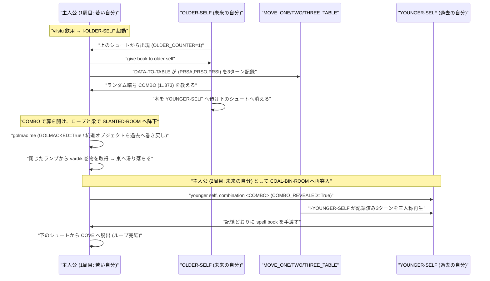
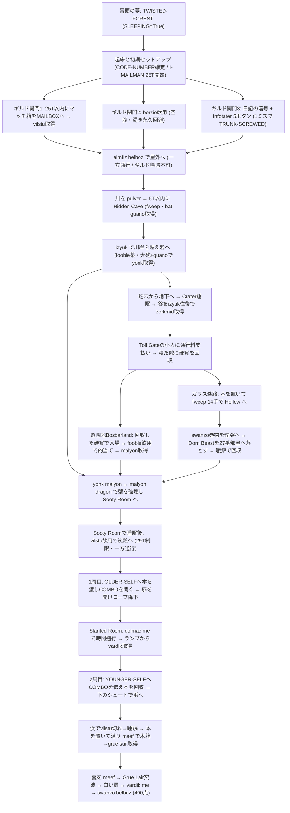

# Sorcerer (Python 版) の内部構造と因果解析

ZilPy が *Sorcerer*（1984 年、Enchanter 三部作 第 2 作、S. Eric Meretzky 作）の ZIL ソースから生成した Python 版 (`out/sorcerer/`) を、構成要素・パーサーと呪文システムの内部処理・ゲーム世界への反映パイプライン・固有サブシステム（Infotater・ガラス迷路・タイムループ・Belboz 救出）・クリアを阻む因果的ターニングポイント、そして若き魔術師の視点と人間ドラマの観点から詳細に解説します。

- **ネタバレ注意:** 仕掛けの解き方、不可逆な詰み条件、タイムループの実装、全エンディング分岐まで記載しています。
- **解析手順の再現性:** 本ドキュメントはプロジェクトルートの `GameArchitecture.md` の手順に従い、`tools/analyze_game.py out/sorcerer` で生成した静的棚卸しと実コードの検証に基づいています。
- **元の ZIL の位置:** `coal.zil:305` のように記載します。生成コードの各定義直前の `# zil:` 注記と `out/sorcerer/zilmap.json` から対応を引けます。

---

## 1. 全体像

### 1.1 規模

*Sorcerer* は Z-machine Version 3 (ZIP) の制約下で制作されており、部屋 84 個とオブジェクト 170 個の合計が **254 個**（Version 3 の上限 255 個まで残り 1 スロット）という極限密度で設計されています。

| 項目 | 数 |
|---|---|
| モジュール (ZIL ファイル) | 13 |
| ルーチン | 620 |
| 部屋 | 84 |
| オブジェクト (部屋以外) | 170 |
| 構文 (`SYNTAX`) | 318 (動詞の語 153 個) |
| 割り込みのルーチン | 37 (`QUEUE` 呼び出し箇所 62 箇所) |
| グローバル変数・定数 | 289 (`state` 143、`const` 85、`scratch` 61) |
| 満点 | 400 点 (`VALUE` / `TVALUE` は 0。すべてイベント時の直接加算) |

ルーチンを役割で分類すると次のとおりです (`tools/analyze_game.py` による自動分類)。

| 役割 | 数 | 例 |
|---|---|---|
| 動詞のアクション (`V-*`) | 176 | `V-CAST`、`V-SLEEP`、`V-GOLMAC`、`V-RESEARCH` |
| オブジェクトのアクション | 127 | `SPELL-F`、`BUTTON-F`、`OLDER-SELF-F`、`BELBOZ-F` |
| そのほか (場面処理・迷路・時間制御等) | 113 | `GO`、`MAIN-LOOP-1`、`PERFORM`、`YOUNGER-ACTIONS`、`RADAR-VIEW` |
| そのほか (動詞の補助) | 60 | `JIGS-UP`、`ITAKE`、`GOTO`、`ROPE-BEAM-CHECK` |
| そのほか (パーサー) | 44 | `PARSER`、`SYNTAX-CHECK`、`GET-OBJECT` |
| 割り込み (`I-*`) | 37 | `I-OLDER-SELF`、`I-YOUNGER-SELF`、`I-DORN-BEAST`、`I-BREATHE` |
| 部屋のアクション | 37 | `GLASS-MAZE-F`、`COAL-BIN-ROOM-F`、`COVE-F`、`GRUE-LAIR-F` |
| そのほか (共通のオブジェクト補助) | 14 | `SPELL-CHECK`、`FORGET-SPELL`、`TWO-POTIONS` |
| 事前アクション (`PRE-*`) | 10 | `PRE-CAST`、`PRE-RESEARCH`、`PRE-TAKE`、`PRE-PUT` |
| マクロから作った関数 | 2 | `PROB`、`DISABLE` |

### 1.2 モジュールと読み込みの順

メインの `sorcerer.py` が ZIL の読み込み順に 12 個のモジュールを `from ... import *` で読み込み、プロパティ既定値 (`SIZE=5`, `CAPACITY=0`) を設定したのち、`ZG._link()` で遅延宣言を解決して `ZG.GO()` で起動します（総行数 15,245 行）。

| # | モジュール | 行数 | ルーチン | 部屋 | オブジェクト | 構文 | 主な中身 |
|---|---|---:|---:|---:|---:|---:|---|
| 1 | `sorcerer` | 58 | 0 | 0 | 0 | 0 | エントリポイント。`ZORK-NUMBER = 5`、`PROPDEF`、全モジュール読み込み |
| 2 | `misc` | 712 | 16 | 0 | 0 | 0 | `GO`、`MAIN-LOOP`、`MAIN-LOOP-1`、`PERFORM`、`D-APPLY`、`QUEUE`/`INT`/`CLOCKER` |
| 3 | `gparser` | 1,830 | 44 | 0 | 0 | 0 | パーサー本体 (`SPELL-CHECK`・`BLORTED` 対応拡張版) |
| 4 | `syntax` | 1,178 | 0 | 0 | 0 | 318 | 語彙 (`BUZZ`, `SYNONYM`) と 318 個の `SYNTAX`（16 呪文の直接動詞構文を含む） |
| 5 | `verbs` | 3,549 | 246 | 0 | 0 | 0 | 標準動詞、16 呪文の `PRE-CAST`/`V-CAST`/`V-<呪文>`、`V-SLEEP`、`V-RESEARCH`、`JIGS-UP` |
| 6 | `globals` | 1,545 | 45 | 0 | 41 | 0 | 共通オブジェクト、魔法書・巻物・呪文の共通ロジック、疲労・空腹・渇き、人物 (`BELBOZ`/`JEEARR` 等) |
| 7 | `guild` | 1,200 | 43 | 13 | 36 | 0 | ギルド館、Infotater・日記・トランクの暗号、配達人 (`I-MAILMAN`)、`berzio`/`vilstu` ポーション |
| 8 | `belboz` | 1,838 | 77 | 31 | 30 | 0 | 夢の森、川と洞窟、城跡、地下街道、通行料の小人、谷と Zorkmid の木、竜の彫刻の間 |
| 9 | `fort` | 416 | 14 | 5 | 9 | 0 | 砦 (Fort)、旗竿の `fooble` ポーション、大砲と `yonk` 巻物 |
| 10 | `park` | 762 | 30 | 8 | 11 | 0 | 地下遊園地 Bozbarland、お化け屋敷・乗り物・的当て (`malyon` 巻物)・カジノ |
| 11 | `maze` | 851 | 25 | 6 | 11 | 0 | 3×3×3 仮想ガラス迷路 (`GLASS-MAZE`)、ソナー視覚 (`RADAR-VIEW`)、Dorn Beast 追跡 |
| 12 | `coal` | 1,210 | 42 | 10 | 17 | 0 | 石炭坑道、窒息・ダイヤル扉・ロープ降下、`OLDER-SELF` / `YOUNGER-SELF` タイムループ |
| 13 | `end` | 896 | 38 | 11 | 15 | 0 | 浜辺と湖、Grue Lair、Mammoth Cavern、拷問部屋 2 種、Belboz 救出とエンディング |

### 1.3 Z-machine Version 3 限界突破の実装技巧

*Sorcerer* のコードには、255 オブジェクト上限（実使用 254）を乗り切るための印象的な設計技巧が 2 つ確認できます。

1. **部屋オブジェクトへの百科事典・テレポート用 `SYNONYM` 過積載**:
   `V-RESEARCH` (`verbs.zil:1189`) や `V-AIMFIZ` (`verbs.zil:2132`) では、独立した概念オブジェクトを作る余裕がないため、既存の **部屋オブジェクトに無関係な固有名詞の `SYNONYM`/`ADJECTIVE` を相乗り** させています。たとえば `SOOTY-ROOM` (`coal.zil:16`) には `SYNONYM: 'RIVER', ADJECTIVE: 'FRIGID'`、`OCEAN-NORTH` (`end.zil:69`) には `SYNONYM: ('DAM', 'FCD'), ADJECTIVE: ('FLOOD', 'CONTRO')`、`COAL-MINE-1`〜`3` には Entharion / Duncanthrax / Dimwit Flathead、`SLIMY-ROOM` には前作の宿敵 Krill が割り当てられています。
2. **`DIAL` オブジェクトの「異空間（ゴミ箱）」転用**:
   消滅した巻物・飲み干したポーション・立ち去った NPC をゲーム世界から取り除く際、`REMOVE` ではなく **`MOVE(..., ZG.DIAL)`** を多用しています（`PRE-CAST`、`V-GNUSTO`、`VILSTU-POTION-F`、`I-HELLHOUND`、`I-OLDER-SELF`、`COVE-F` 等）。`DIAL` 自体はダイヤル扉の部品で中身を見られない (`CONTBIT` なし) ため、オブジェクトを安全に退避させるゴミ箱コンテナとして機能しています。

---

## 2. 起動・メインループ・パーサーの詳細処理と世界への反映

### 2.1 起動 (`GO`) と「夢の中の死」による本編初期化 (`JIGS-UP`)

`GO` (`misc.zil:187`, `misc.zil:187`) はいきなり本編のギルドではなく、**`SLEEPING = True` の夢の世界 (`TWISTED-FOREST`)** からゲームを開始します。

1. `P-LEXV` の最大語数を 59、`P-INBUF` の最大文字数を 60 に初期化。
2. 割り込み `I-WAKE-UP` (7 ターン後に落雷) と `I-HELLHOUND` (毎ターン `-1` で地獄犬が襲来) を有効化。
3. `LIT = True`、`WINNER = PLAYER = PROTAGONIST`、`HERE = TWISTED-FOREST` に設定し、`V-LOOK` と `I-HELLHOUND()` を 1 回呼んで `MAIN-LOOP` に入る。

夢の中で地獄犬に食い殺されるか 7 ターン目の落雷を受けると `JIGS-UP` (`verbs.zil:2857`, `verbs.zil:2857`) が呼ばれますが、**`if ZG.SLEEPING:` 分岐が本編の初期化ルーチンを兼ねている**点が極めてユニークです。

- `SLEEPING = False` とし、夢で歩いた可能性のある屋外 10 部屋の `TOUCHBIT` をすべてクリア。
- 本編の 5 つの基本割り込みを一斉に起動: `I-PARROT(-1)`、`I-MAILMAN(25)`、`I-TIRED(80)`、`I-HUNGER(21)`、`I-THIRST(18)`。
- **Infotater 暗号の決定**: `CODE-NUMBER = RANDOM(12)`、`CURRENT-TLOC = CODE-NUMBER * 6`、`NEXT-NUMBER = GET(NEXT-CODE-TABLE, CURRENT-TLOC)` をここで確定。
- `SCORE += 5`、`SPELL-BOOK` を主人公に持たせ、`YOUR-QUARTERS` の `BED` へ移動、`LIT = False` にして暗闇の中で目覚めさせます。

### 2.2 メインループ (`MAIN-LOOP-1`)・`PERFORM`・`CLOCKER`

`MAIN-LOOP-1` (`misc.zil:213`, `misc.zil:213`) の 1 ターン処理は Zork 系共通基盤を継承しつつ、*Sorcerer* 固有の判定が組み込まれています。

1. **`PARSER()` の呼び出し**: 失敗 (`False`) なら `P-CONT = False` として時計を進めず終了。
2. **代名詞 `IT` 置換**: `P-IT-OBJECT` が `ACCESSIBLE?` なら `P-PRSI` → `P-PRSO` の順で `IT` を置換。
3. **目的語 0 個時の特殊ガード**:
   - 暗闇判定が **`(not ZG.LIT) and (not ZG.BLORTED)`** になっており、暗視ポーション `blort` (`BLORTED = True`) が光源と対等に扱われます。
   - 現在地が `CHAMBER-OF-LIVING-DEATH` または `HALL-OF-ETERNAL-PAIN` の場合は即座に `AGONY()` を出力して連続コマンドを破棄します。
4. **`PERFORM(A, O, I)` の再入可能ディスパッチ** (`misc.zil:434`, `misc.zil:434`):
   現在の `(PRSA, PRSO, PRSI)` をローカル変数 `(OA, OO, OI)` に退避し、以下の優先順位で最初に真を返したハンドラで打ち切ります。
   `NOT-HERE-OBJECT-F` → `WINNER(ACTION)` → `LOC(WINNER)(M-BEG)` → `PREACTIONS[A]` (`PRE-CAST` 等) → `PRSI(ACTION)` → `LOC(PRSO)(CONTFCN)` → `PRSO(ACTION)` → `ACTIONS[A]` (`V-*`)。
5. **部屋アクション `M-END` と `CLOCKER` スキップ**:
   - `V != M-FATAL` かつメタ動詞 (`TELL`, `BRIEF`, `SUPER-BRIEF`, `VERBOSE`, `SAVE`, `VERSION`, `RESTORE`, `SCRIPT`, `UNSCRIPT`) でなければ `LOC(WINNER)` の `M-END` を実行。
   - さらに `TIME`, `QUIT`, `RESTART`, `SCORE`, `$RANDOM`, `$COMMAND`, `$RECORD`, `$UNRECORD` を加えたメタ動詞群では `CLOCKER()` をスキップします。
   - `V-WAIT` (`verbs.zil:1876`) は内部で最大 3 回 `CLOCKER()` を回し、最後に `CLOCK-WAIT = True` を立てることで、`MAIN-LOOP-1` 末尾の `CLOCKER()` による 4 回目の二重加算を防ぎます。

### 2.3 パーサー (`gparser.py`) と Enchanter からの進化点

*Sorcerer* のパーサーは 44 ルーチン・1,830 行からなり、`OOPS`・`AGAIN`/`G`・`ORPHAN`（聞き返し）・`GWIM`（暗黙補完）・`NPC, <命令>`（`ACT?TELL` + `QUOTE-FLAG`）を備えています。さらに *Enchanter* の魔法システムを洗練させる以下の拡張が組み込まれています。

1. **`GET-OBJECT` 内の `SPELL-CHECK` フック** (`gparser.zil:1132-1136`, `globals.zil:1415`):
   通常の部屋・所持品探索 (`DO-SL`) で対象が見つからなかった場合、`P-NAM` が `WORD('spell')` または偽で `P-ADJ` があれば `P-NAM = P-ADJN` に昇格させ、`SPELL-CHECK(TBL, P-NAM)` を呼び出します。これにより、巻物や魔法書が手元になくても（あるいは暗闇でも）16 種類の呪文オブジェクト (`GNUSTO-SPELL` 〜 `MALYON-SPELL`) が即座に解決され、`learn izyuk` や `cast frotz on me`、`yonk malyon` が自然に解釈されます。
2. **暗視ポーション `BLORTED` の統合** (`gparser.zil:1122, 1181`):
   `GET-OBJECT` で部屋のオブジェクトを探索する条件および `NOT-HERE-OBJECT` へのフォールバック条件がすべて `ZG.LIT or ZG.BLORTED` に拡張されています。
3. **`NOT-HERE-OBJECT-F` の遠隔魔法・百科事典対応** (`globals.zil:72`, `globals.zil:72`):
   通常は目の前にない物を参照するとエラーになりますが、`V?AIMFIZ`（人物への転移）・`V?AIMFIZ-TO`・`V?CAST` (`AIMFIZ-SPELL`)・`V?RESEARCH`（百科事典検索）・`V?WHO`/`V?WHERE`/`V?WHAT` については `FIND-NOT-HERE` で世界中（`MOBY-FIND`）から対象オブジェクトを検索して通過させます。これにより、遠く離れた `BELBOZ` や `JEEARR` に対して `aimfiz belboz` を唱えたり、図書館で歴史上の人物を調べたりできます。
4. **直接 `READ()` の例外**:
   通常パーサー以外で `READ(P-INBUF, P-LEXV)` を直接呼ぶのは `FINISH` (`verbs.zil:104`) と `YES?` (`verbs.zil:121`) の確認プロンプトのみで、Zork I の `LOUD-ROOM` のようなゲーム内パーサー乗っ取りはありません。

### 2.4 呪文システムの構造（`PRE-CAST` と `V-CAST` の二重入口）

*Sorcerer* には全 16 種類の呪文があり、プレイヤーは **`frotz me`（呪文名を直接動詞にする）** と **`cast frotz on me`（`V-CAST` 経由）** の 2 通りの構文で唱えられます。

- **`V-CAST` (`verbs.zil:2024`)**: `PRSO` の呪文オブジェクトを対応する動詞シンボル (`V?FROTZ` 等) に変換し、`PERFORM(VRB, PRSI)` を再帰呼び出しします。
- **`PRE-CAST` (`verbs.zil:1954`)**: 全 16 呪文の事前アクションとして共通登録され、以下を一括検証します。
  1. `PERFORMING-SPELL` が真ならフラグを戻して即通過（内部転送時の二重消費防止）。
  2. 呪文自身やその巻物自体への詠唱を禁止（`Thaumaturgy 101` エラー）。
  3. 水濡れ等で `LOC(SPELL)` に `MUNGBIT` が付いており、常時記憶でもなく `COUNT == 0` なら読めない旨を表示して中断。
  4. `LOC(SPELL)` が巻物 (`SCROLLBIT`) かつ主人公が所持していれば、**巻物を `DIAL` へ移動して消滅**させ、一時的に `COUNT = 1` とする（ただし `YONK-SPELL` で対象が見えない場合は消費前に抜ける）。
  5. コウモリ変身中 (`FWEEPED == True`) なら甲高い鳴き声しか出ず詠唱不可。
  6. 常時記憶 3 呪文 (`ALWAYS-MEMORIZED`: `gnusto`, `frotz`, `rezrov`) は回数無制限。それ以外は `COUNT == 0` なら失敗、1 以上なら `COUNT -= 1`, `SPELL-ROOM += 1` として実行へ進む。

### 2.5 具体的コマンドのエンドツーエンド実行トレース

#### トレース①: 呪文強化と実体化 (`yonk malyon` → `malyon dragon`)

1. **`yonk malyon` の解析 (`PARSER`)**:
   - 動詞 `YONK` (`ACT?YONK` → `V-YONK`, `PRE-CAST`)、名詞 `malyon`。
   - `GET-OBJECT` が魔法書内の `MALYON-SPELL`（または `SPELL-CHECK` 経由）を `P-PRSO[1]` に解決。
2. **`PERFORM(V?YONK, MALYON-SPELL)`**:
   - `PRE-CAST` が発火。`LOC(YONK-SPELL)` が手持ちの `YONK-SCROLL` (`SCROLLBIT`) であることを確認し、`MOVE(YONK-SCROLL, DIAL)` で巻物を消滅させ `COUNT = 1` → 直後に `COUNT = 0`, `SPELL-ROOM += 1` として通過。
   - `V-YONK` (`verbs.zil:2461`) が `PRSO == MALYON-SPELL` を検知し、**`ZG.MALYON_YONKED = True`** を設定。
3. **次ターン `malyon dragon`**:
   - `PRE-CAST` が魔法書から暗記済みの `MALYON-SPELL` の `COUNT` を 1 減らし `SPELL-ROOM += 1`。
   - `PERFORM` の `PRSO(ACTION)` 段階で `DRAGON-F` (`belboz.zil:1684`) が呼ばれ、`MALYON-YONKED == True` かつ `not DRAGON-MOVED` を確認。**`ZG.DRAGON_MOVED = True`** となり、`HALL-OF-CARVINGS` の南出口 (`IF DRAGON_MOVED`) が開通する。

#### トレース②: ポーション飲用とタイマー連鎖 (`drink orange potion` in `COAL-BIN-ROOM`)

1. **`PARSER`**: 事前に `open orange vial` 済みのため、`DO-SL` が開いた瓶の中の `VILSTU-POTION` を `P-PRSO[1]` に解決（`PRSA = V?DRINK`）。
2. **`PERFORM(V?DRINK, VILSTU-POTION)`**:
   - `PRSO(ACTION)` である `VILSTU-POTION-F` (`guild.zil:748`) が実行される。
   - `MOVE(VILSTU-POTION, DIAL)` で薬を消費。他の薬が効いていれば (`UNDER-INFLUENCE != False`) `TWO-POTIONS()` で即死。
   - 正常時: `UNDER-INFLUENCE = VILSTU-POTION`、`VILSTUED = True`、`ENABLE(QUEUE(I-BREATHE, 19))` を設定。
   - さらに現在地が `COAL-BIN-ROOM`（または `DIAL-ROOM`）であるため、**窒息タイマー `I-SUFFOCATE` を停止し、`ENABLE(QUEUE(I-OLDER-SELF, 1))` を即座に起動**。
3. **`CLOCKER()`**:
   - 同ターンの `CLOCKER()` で `I-OLDER-SELF` の `TICK` が `1 → 0` になって即発火！`OLDER-COUNTER = 1` となり、未来の自分 (`OLDER-SELF`) が上のシュートから滑り落ちてくる。

#### トレース③: NPC 命令と因果ループの完結 (`younger self, combination 856`)

1. **`PARSER` の NPC 命令正規化**:
   - カンマ `,` の直前が動詞未出の `younger self` であるため、Phase 3 が暗黙の `P-VERB = ACT?TELL` を補い、`,` を `WORD('quote')` に置換、`P-CONT` を `combination 856` の位置に保存する。
   - 第 1 実行 (`V-TELL`, `verbs.zil:1701`): `PRSO = YOUNGER-SELF` (`ACTORBIT`) かつ `P-CONT != False` を確認し、**`ZG.WINNER = ZG.YOUNGER_SELF`**, `ZG.HERE = LOC(YOUNGER-SELF)` に切り替えて終了。メタ動詞 `TELL` のため `CLOCKER()` はスキップされる。
2. **第 2 実行 (`P-CONT` から `combination 856` を解析)**:
   - `NUMBER?` が `856` を解析して `P-NUMBER = 856`, トークンを `WORD('intnum')` に置換。構文 `COMBIN OBJECT = V-COMBO` に一致 (`PRSA = V?COMBO`, `PRSO = INTNUM`)。
3. **`PERFORM(V?COMBO, INTNUM)`**:
   - `WINNER` が `YOUNGER-SELF` なので、最優先の `Actor` 段階で `YOUNGER-SELF-F` (`coal.zil:410`) が呼ばれる。
   - `P-NUMBER == ZG.COMBO` が真になり、**`ZG.COMBO_REVEALED = True`** を記録して真を返す。
4. **`CLOCKER()`**:
   - `I-YOUNGER-SELF` (`coal.zil:486`) が発火し、`YOUNGER-COUNTER == 2` で **`YOUNGER-ACTIONS(MOVE-ONE-TABLE)`** を実行。過去に自分が `give book to older self` を実行した記録が再生され、若い自分から `SPELL-BOOK` が主人公の手に戻る。

---

## 3. Sorcerer 固有の主要サブシステム

### 3.1 魔法書・記憶・睡眠・夢の予言・蘇生 (`gaspar`)

- **記憶容量と疲労による忘却 (`SPELL-F`, `I-TIRED`, `FORGET-SPELL`)**:
  - 初期の最大記憶数 `REAL-SPELL-MAX = 4`、`SPELL-MAX = 4`（起床直後は `SPELL-ROOM = 3` だが、`V-SLEEP` 後は `REAL-SPELL-MAX` が毎回 `+1` され `SPELL-ROOM = SPELL-MAX` に回復する）。
  - 記憶枠がいっぱい (`SPELL-ROOM == 0`) の状態で別の呪文を `learn` すると、`FORGET-SPELL` (`globals.zil:1167`) が `FORGET-TBL` に暗記済み呪文を回数分並べて乱数 (`PICK-ONE`) で 1 回分を忘却させる。
  - `I-TIRED` (`globals.zil:1318`) は睡眠後 80 ターンで発火し、以後 8 ターンごとに `AWAKE` を 1 ずつ増やす（`0`〜`8`）。そのたびに `LOAD-ALLOWED -= 10`、`FUMBLE-NUMBER -= 1`、`SPELL-MAX -= 1`、`SPELL-ROOM -= 1` と能力が段階的に低下し、`AWAKE > 8` で強制的にその場で眠り込む (`V-SLEEP`)。
- **睡眠と夢 (`V-SLEEP`, `DREAMS`, `V-VEZZA`)**:
  - `AWAKE == -1`（疲れていない状態）では眠れない。眠ると `MOVES += 50` され、`FORGET-ALL()` と `WEAR-OFF-SPELLS()` で暗記呪文・飛行・薬効がすべて解除される。
  - 50% の確率で `DREAMS` テーブルの 4 種の夢を見る。また予知呪文 `V-VEZZA` (`verbs.zil:2414`) は `VEZZAS` テーブルの 1〜9 番から未達成の場面の幻視をランダム表示し、該当エリア到達時に `PUT(VEZZAS, idx, 0)` で消去していく。なお 8 番（Borphee の評議会での激論）と 9 番（ルーン文字が刻まれた純白のキューブ）は、三部作完結編 ***Spellbreaker* の直接的な予告**である。
- **空腹・渇きと `berzio` ポーション (`I-HUNGER`, `I-THIRST`, `BERZIO-POTION-F`)**:
  - 起床後 18 ターンで渇き、21 ターンで空腹が始まり、それぞれ 9 ターン／11 ターンごとに段階が進んでレベル 6 で餓死・渇死 (`JIGS-UP(..., True)`) する。ゲーム内に食料も飲み水もなく、Store Room の `ochre vial` (`berzio`) を飲むことで `BERZIOED = True`（`I-UNBERZIO` は 100 ターンだが、その間に `I-HUNGER` が `580+RANDOM(80)`、`I-THIRST` が `540+RANDOM(100)` へ大幅に先送りされるため実質ゲーム終了まで免除される）。
- **死と守護天使の蘇生 (`gaspar` / `JIGS-UP`)**:
  - *Enchanter* と異なり、通常の死は即ゲーム終了となる。事前に `gaspar me` を唱えて `RESURRECTION-ROOM = HERE` を設定していた場合のみ、1 回だけ守護天使が現れて `RESURRECTION-ROOM` で蘇生させる（ただし `GLASS-MAZE` や増水後の川床では蘇生直後に再死して完全終了、ギルド内設定で既に屋外に出ていた場合は天使の怠慢により `RUINS` に送られる）。また `RANDOMIZE-OBJECTS` により、所持していた巻物は死亡地点に落ちる（`HAUNTED-HOUSE`/`COAL-BIN-ROOM`/`DIAL-ROOM` では `DIAL` へ送られ永久消失）。

### 3.2 Infotater（同梱コピープロテクト／輪盤パズル）のコード検証機構

パッケージ同梱の物理ホイール「Infotater」によるコピープロテクトは、`guild.py` 内で以下の 4 段階のデータフローとして実装されています。

1. **乱数決定 (`JIGS-UP`, `verbs.zil:2857`)**: 冒頭の夢から目覚めた瞬間に `CODE-NUMBER = RANDOM(12)`（1〜12）を決定。`CURRENT-TLOC = CODE-NUMBER * 6`、`NEXT-NUMBER = GET(NEXT-CODE-TABLE, CURRENT-TLOC)` をセット。
2. **ヒント提示 (`JOURNAL-F`, `guild.zil:309`)**: Belboz の日記を開くと、`GET(CODE-TABLE, CODE-NUMBER)` で 12 種の怪物名（`bloodworm`〜`yipple`）のうち選ばれた 1 つが `"Current code: <怪物名>"` として表示される。ゲーム内の `WHEEL` (`WHEEL-F`) を回そうとしても `"Refer to the infotater in your SORCERER package."` と物理同梱物の参照を促す。
3. **5 桁カラーコードの照合 (`NEXT-CODE-TABLE`, `guild.zil:1054`)**:
   78 要素（6 要素 × 13 ブロック、先頭ブロックはダミー 0）のテーブルに、各怪物名に対応する 5 色の番号列（`1=BLACK`, `2=GRAY`, `3=RED`, `4=PURPLE`, `5=WHITE`）と終端番兵 `0` が格納されている。
4. **一発アウトの検証 (`BUTTON-F`, `guild.zil:1139`)**:
   ボタンを押すたびに `PRSO` と `NEXT-NUMBER` を照合し、一致すれば `CURRENT-TLOC += 1` で次の期待値をロード、終端 `0` に到達しかつ `not TRUNK-SCREWED` ならトランクが開き +25 点。**1 回でも誤ったボタンを押すと `ZG.TRUNK_SCREWED = True` が立ち、以後リセットされる手段が存在しない**ため、正しい順で押し直しても二度と開かない。

### 3.3 ポーション体系と 25 ターン配達イベント (`I-MAILMAN`)

- 起床と同時に `ENABLE(QUEUE(I-MAILMAN, 25))` が開始される。25 ターン目に `I-MAILMAN` (`guild.zil:674`) が発火し、`MAILBOX`（受け口）に `MATCHBOOK`（マッチ箱の無料サンプル応募券）が入っていれば **`MOVE(VILSTU-VIAL, MAILBOX)`** で呼吸不要薬 `vilstu` を配達する。**配達人は 1 回しか来ない**ため、25 ターンを逃すと炭鉱突破が永久不能になる。
- 5 種類のポーションのうち、`vilstu`（呼吸不要: 19+4+6 = 29 ターン構造、`I-BREATHE` 終了時に炭鉱内なら即死、外なら `AWAKE=8` の極限疲労）、`fooble`（器用さ向上: 17 ターン、的当て必須）、`blort`（暗視: 24 ターン）の 3 種は **`UNDER-INFLUENCE`** フラグを共有する。効き目が残っている間に別の 1 種を飲むと **`TWO-POTIONS()` (`globals.zil:1276`) が即死**を引き起こす（`berzio` とジョーク薬 `flaxo` は対象外）。

### 3.4 仮想 3×3×3 ガラス迷路と Dorn Beast (`maze.py`)

255 オブジェクト上限のため、27 部屋からなる 3×3×3 立方体のガラス迷路は **たった 1 つの部屋オブジェクト `GLASS-MAZE` と状態変数 `ROOM-NUMBER` (1〜27)** で仮想実装されています。

- **12 本の接続テーブル**: 往路用の `PRE-UP/DOWN/NORTH/SOUTH/EAST/WEST-EXITS` と、巻物取得後に迷路が組み替わった復路用の `POST-*-EXITS` を `MAZE-CROSSED` フラグで切り替える（`40` は入口 `OUTSIDE-GLASS-DOOR`、`50` は奥の `HOLLOW` への特殊遷移コード）。
- **床の有無判定 (`NO-FLOOR?`, `maze.zil:188`)**: 該当部屋の `DOWN` 出口が `0` でない（＝下に抜ける空間がある）場合に「床がない (`True`)」と判定し、飛行していない (`not FLYING`) と `PLUMMET()` で墜落死する。
- **コウモリ変身とソナー視覚 (`V-FWEEP` & `RADAR-VIEW`, `maze.zil:240`)**: `fweep me` で 15 ターン（唱えたターン + 14 手）コウモリに変身し、全持ち物を落とす代わりに飛行状態かつ `RADAR-VIEW()` が 6 方向のうちガラス壁がある方向（出口テーブル値が `0` の方向）を毎ターン列挙してくれる。
- **仮想部屋ごとのアイテム保存 (`MAZE-TO-TABLE` / `TABLE-TO-MAZE` / `REARRANGE-MAZE-TABLE`)**: 部屋を移動するたび、床に落ちたアイテムを `MAZE-TABLE`（`[部屋番号, オブジェクト]` の 20 組）へ退避・復元する。巻物取得で迷路構造が組み替わると、`REARRANGE-MAZE-TABLE` が床の抜けた部屋にあったアイテムを下層部屋へ落下させる細やかさを持つ。
- **Dorn Beast の追跡と 27 番部屋の罠 (`BRICK-STRUCTURE-F` & `I-DORN-BEAST`, `maze.zil:803`)**: `swanzo` の巻物を煙突 (`BRICK-STRUCTURE`) へ落とすと 2 ターン後に Dorn Beast が起動し、毎ターン `LAST-DORN-ROOM` と `DORN-BEAST-ROOM` を更新しながらプレイヤーを追跡する（同じ部屋に留まるか 1 歩戻ると即死）。床のない **27 番部屋** へ誘い込むと怪物は空中を走って墜落死し、`SPLATTERED = True` となる。

### 3.5 石炭坑道と自己参照タイムループ (`coal.py`)

*Sorcerer* の技術的白眉が、石炭坑道 (`COAL-BIN-ROOM` 〜 `SLANTED-ROOM`) における **「過去の自分 (`YOUNGER-SELF`)」と「未来の自分 (`OLDER-SELF`)」の因果ループ** です。

1. **行動記録 (`DATA-TO-TABLE`, `coal.zil:389`)**: 1 周目で `OLDER-SELF` が滞在する 3 ターン分のコマンド `(PRSA, PRSO, PRSI)` を `MOVE-ONE-TABLE`・`MOVE-TWO-TABLE`・`MOVE-THREE-TABLE` の 3 つのテーブルにそのまま保存する。
2. **時間巻き戻し (`ME-F` の `GOLMAC` 分岐, `globals.zil:351`)**: `golmac me` を唱えると `GOLMACKED = True` となり、**坑道内の物理オブジェクトを時間遡行前の状態へ強制リセット**する（`KEROSENE-LAMP` を閉じて中に `VARDIK-SCROLL` を生成、`GOLMAC-SCROLL` を床へ戻す、`ROPE` を `SHAFT-BOTTOM`、`BEAM` を `COAL-MINE-1` へ戻し、`DIAL-DOOR` を閉じて `CURRENT-SETTING = 0` に戻す）。
3. **過去行動の再生 (`I-YOUNGER-SELF` & `YOUNGER-ACTIONS`, `coal.zil:500`)**: 2 周目で `COAL-BIN-ROOM` に滑り落ちると `YOUNGER-SELF` が出現し、記録しておいた 3 テーブルを 1 ターンずつ再生する。この際、`OLDER-SELF` を `YOU-OBJECT` ("you") に、`ME` を `YOUNGER-SELF` に視点変換するため、1 周目に自分が取った行動（`give book to older self` だけでなく、`look`, `inventory`, `save` 等のメタコマンドまで `"is performing a spell of high technology."` として）を客観視点で目撃することになる。
4. **因果パラドックス検知 (`POOF()`, `end.zil:61`)**:
   - `golmac me` を 2 回唱える (`ME-F`)。
   - `SLANTED-ROOM-EXIT-F` (`coal.zil:1040`): `golmac` 前に `GOLMAC-SCROLL` を持たずに出る、または `golmac` 後に `GOLMAC-SCROLL` を持って出る。
   - `COVE-F` (`end.zil:29`): `GOLMACKED == True` なのに `COMBO-REVEALED == False`（若い自分に正しい `COMBO` を教えずに浜へ降りる）。
   これらに抵触すると **`Suddenly, without the slightest fanfare, you cease to exist!`** と表示され、`POOFED = True` で存在消滅・強制終了となる（`V-SCORE` まで `"If you still existed, your score would be ..."` に変化する徹底ぶり）。

### 3.6 悪魔 Jeearr に憑依された師 Belboz の救出機構 (`end.py`)

終盤の `MAMMOTH-CAVERN` には 3 枚の扉があるが、黒の扉 (`BLACK-DOOR-F`) は `CHAMBER-OF-LIVING-DEATH` へ、銀の扉 (`SILVER-DOOR-F`) は `HALL-OF-ETERNAL-PAIN` へ引きずり込まれる不可逆トラップである。正解の白い扉 (`WHITE-DOOR-F`, `end.zil:762`) を開けると +20 点を得て `BELBOZ-HIDEOUT` へ入り、**`I-BELBOZ-AWAKES`（8 ターン猶予）** が起動する。

8 ターン以内に取る行動により、結末は 4 パターンに分岐する。

| 行動・条件 | ルーチン | 結果とスコア |
|---|---|---|
| 8 ターン経過または `wake belboz` | `I-BELBOZ-AWAKES` | Jeearr に覚醒した Belboz の雷撃で `HALL-OF-ETERNAL-PAIN` へ送られ事実上詰み |
| `vardik me` なしで `swanzo belboz` | `SWANZO-BELBOZ` (`VARDIKED=False`) | Belboz から追い出された Jeearr が主人公の精神を乗っ取り、世界を支配する最悪のバッドエンド (**-99 点**, 称号 `Menace to Society`) |
| `kill belboz with knife`（`gaspar` 未適用） | `KILL-BELBOZ` → `SWANZO-BELBOZ` (`BELBOZ-DEAD=True`) | `VARDIKED=True` なら Jeearr は滅びるが、師を自らの手で殺した悲劇のエンディングで終了（`BELBOZ-GASPARED=True` なら傷が癒えて即覚醒） |
| **`vardik me` → `swanzo belboz`** | `SWANZO-BELBOZ` (`VARDIKED=True`, `BELBOZ-DEAD=False`) | 精神盾に弾かれた Jeearr が宿主を失って消滅。正気に戻った Belboz が評議会の間へ転移させ、主人公を次期評議会筆頭に指名 (**+25 点、400 点満点クリア**) |

---

## 4. クリアへの因果的ターニングポイントと障壁

### 4.1 因果フローチャート

### 4.2 主要な不可逆ソフトロック・進行ゲート一覧（コード根拠付き）

| # | 障壁・ソフトロック | 発火条件・コード根拠 | 結果 |
|---|---|---|---|
| 1 | **夢の中で自分を起こす** | `ME-F` (`globals.zil:351`): `VERB? ALARM` かつ `SLEEPING == True` | ギルド襲撃・仲間虐殺のバッドエンド (`FINISH`) |
| 2 | **トランクのボタン誤押下** | `BUTTON-F` (`guild.zil:1139`): 期待値 `NEXT-NUMBER` と不一致で `TRUNK-SCREWED = True` | リセット手段なし。`aimfiz` 巻物が手に入らずギルド脱出永久不能 |
| 3 | **25 ターン配達逃し** | `I-MAILMAN` (`guild.zil:674`): 起床 25 ターン目に `IN?(MATCHBOOK, MAILBOX)` が偽 | `vilstu` が届かず、後の石炭坑道で確実に窒息死 |
| 4 | **ギルド脱出前の睡眠** | `V-SLEEP` (`verbs.zil:1432`): `not FSET?(TWISTED-FOREST, TOUCHBIT)` | 憑依 Belboz の襲撃を受け `CHAMBER-OF-LIVING-DEATH` へ永久監禁 |
| 5 | **`aimfiz` の誤使用** | `PRE-CAST` (`verbs.zil:1954`) + `V-GNUSTO`: `AIMFIZ-SPELL` は写本不可・1 回消費 | Belboz / Jeearr 以外に使うと巻物消滅（Helistar/Frobar 等なら即死） |
| 6 | **硬貨に `frotz` をかける** | `GNOME-F` (`belboz.zil:1212`) / `PARK-GNOME-F`: `FSET?(ZORKMID, ONBIT)` で受取拒否 | 通行料・遊園地入場料が払えず迷路と `malyon` へ到達不能 |
| 7 | **Hollow へ魔法書を持ち込む** | `HOLLOW-F` (`maze.zil:685`): `M-END` で `HELD?(SPELL-BOOK)` が真 | 怪鳥に `SPELL-BOOK` を `DIAL` へ奪われ永久喪失 |
| 8 | **疲労状態でのロープ降下** | `CHUTE-EXIT-F` (`coal.zil:983`): `AWAKE > 0` または `not NOTHING-HELD?()` | 手が滑って `COAL-BIN-ROOM` へ落下。`vilstu` の 29 ターン制限内に再挑戦が極めて困難 |
| 9 | **タイムパラドックス消滅** | `SLANTED-ROOM-EXIT-F` (`coal.zil:1040`) / `COVE-F` (`end.zil:29`) / `ME-F` | 巻物所持の矛盾、`golmac` 2 回目、または `not COMBO-REVEALED` で浜へ降りると `POOF()` 存在消滅 |
| 10 | **魔法書・巻物の水濡れ** | `LAGOON-F` (`end.zil:221`): `M-ENTER` で所持中の `SCROLLBIT` と `SPELL-BOOK` に `MUNGBIT` | インクが滲んで読解・暗記・詠唱が永久不能になる |
| 11 | **黒／銀の扉・覚醒タイムアウト** | `BLACK-DOOR-F` / `SILVER-DOOR-F` / `I-BELBOZ-AWAKES` (`end.zil:720-874`) | 全アイテム没収 (`ROB`)＋拷問部屋へ転送され、メタ動詞以外すべて `AGONY()` でロック |
| 12 | **精神盾なしの悪魔払い** | `SWANZO-BELBOZ` (`end.zil:803`): `VARDIKED == False` | Jeearr に乗っ取られ **-99 点** で強制終了 |

---

## 5. 冒険者（若き魔術師）の視点: 初回情報のみの「最も知的・理想的な行動」vs「クリアに必要な行動」

主人公は前作 *Enchanter* で邪悪な魔術師 Krill を倒した英雄であり、現在は Accardi 支部の個室を与えられた若き魔術師（Enchanter）です。初回プレイでゲーム内情報だけを手がかりにした「最も知的で倫理的・慎重な魔術師の行動」と、コード上で 400 点クリアのために実際に要求される行動の間には、鮮烈なギャップが存在します。

| 局面 | 初回情報のみでの「最も知的・理想的な魔術師の行動」 | クリアに実際に必要な行動（コード上の制約） | ギャップの本質 |
|---|---|---|---|
| **① 冒頭の悪夢とギルドの規律** | 危険な森で地獄犬に襲われているのが夢だと気づいたら、すぐに目を覚まそうとする (`wake up`)。また起床後、Belboz の行方を追うため正門（Lobby の南）から外へ出ようとする。 | 夢の中で `wake up` するとギルド虐殺エンドで即終了するため、**あえて地獄犬に食い殺される（または落雷を受ける）まで待つ**必要がある。さらに正門は警告妖精に阻まれるため、師の私室の鍵を探して日記を読み、地下室の暗号トランクを破って禁断級の転移巻物 `aimfiz` で飛び出すしかない。 | **受動の強制と非常手段**: 理性的な危機回避（目覚める）が破滅を招き、規則正しい外出ではなく「師の秘密を暴く」ことから冒険が始まる。 |
| **② ポーションと無料サンプル** | Store Room の見知らぬマッチ箱（怪しげな通販の無料サンプル応募券）は後回しにし、まず師の部屋や図書館をじっくり調べて状況を把握する。 | 起床から **25 ターン以内に** マッチ箱を受け口へ入れないと、配達人が 1 度きり通り過ぎて `vilstu` が永久に手に入らない。 | **初見殺しの時間制約**: 冒険の核心である石炭坑道の攻略アイテムが、最序盤の「怪しい通販応募」に 25 ターン制限で紐づいている。 |
| **③ 小人からの硬貨の「取り返し」** | 通行料として 1 Zorkmid を門番の小人に正直に支払ったのだから、それは対価として諦め、遊園地の入場料には別の資金源を探す。 | ゲーム内に Zorkmid は 1 枚しか存在しない。**通行料を払って再び眠り込んだ小人のポケットから硬貨をスリ取る (`search gnome`)** ことで初めて遊園地に入れる。 | **魔術師の倫理 vs 資源の単一性**: 評議会の美徳を重んじる魔術師に、結果的に「窃盗」を強いるユーモラスな皮肉。 |
| **④ 光源と魔法書の扱い** | 暗闇対策として常に魔法書やランプを携行し、大事な魔法書は片時も手放さない。 | `frotz me` で**自分自身を病的な黄色の光で発光させ続ける**のが最適解であり、さらにガラス迷路の前では「怪鳥に奪われないよう」、湖の前では「水濡れで `MUNGBIT` にならないよう」、**命の次に大切な魔法書を地面に置き去りにする**必要がある。 | **自己発光と愛書の放棄**: 普通の魔術師ならためらう「自分への光源化」と「魔法書の放置」が必須の生存戦略になる。 |
| **⑤ タイムループでの「未来の自分」との連携** | 突如シュートから落ちてきた見知らぬ（自分に瓜二つの）人物に、大切な魔法書を安易に渡すのは危険だと警戒する。また過去へ戻った後は、自分の存在が不安定にならないよう急いで脱出する。 | 1 周目で**即座に未来の自分へ魔法書を預け**、2 周目で自分が未来の立場になったときは、息の限界が迫る中で**過去の自分に正しい番号を教え (`younger self, combination <N>`)、過去の自分が本を差し出すのを受け取ってから**脱出しなければ、因果律の破綻で存在が消滅 (`POOF()`) する。 | **ブートストラップ・パラドックスの遵守**: 「番号を最初に知ったのは誰か？」という起源なき因果の輪を、自らの意思で完璧に閉じなければならない。 |
| **⑥ 師を救う最終決断** | ようやく見つけた師 Belboz を救うため、急いで駆け寄り、手に入れた悪魔払い `swanzo` を即座に唱える。 | `swanzo` をそのまま唱えると、追い出された Jeearr が主人公の精神へ飛び移り **-99 点の破滅エンド**になる。まず自分の心を閉ざす **`vardik me`** を唱え、悪魔の逃げ場を完全に断ってから `swanzo belboz` を放つ必要がある。 | **自己防衛なき善意の破滅**: 師への純粋な献身だけでは悪魔の術中に嵌まる。「まず己の精神を守り抜く」冷静さこそが、評議会筆頭を継ぐ資格の最終試験となっている。 |

---

## 6. このゲームで行われていた具体的な行為と人間・叙事詩ドラマ

*Sorcerer* は一見するとコミカルな Infocom ファンタジー（遊園地 Bozbarland やジョーク薬 `flaxo`、おしゃべりなオウムなど）の体裁をとっていますが、コード内の描写・日記・オウムの言葉・`YOMIN` の読心テキスト・エンディングを繋ぎ合わせると、**「老いた師の孤独な犠牲と、過去と未来の自分自身すら味方につけて師を救い、次世代の指導者へ至る重厚な師弟ドラマ」** が浮かび上がります。

### 6.1 悪魔 Jeearr の陰謀と Belboz の孤独な戦い

- **太古の災厄 Jeearr (`JEEARR-F`, `globals.zil:867`)**: かつて多くの王と魔術師の総力によって世界の彼方の虚無へ追放された悪魔 Jeearr は、「追放は永遠ではないかもしれない」という警告どおり復活の機会を窺っていた。
- **師 Belboz の決断 (`JOURNAL-F`, `guild.zil:309`)**: 評議会筆頭 Belboz は Jeearr の脅威を察知したが、**評議会と仲間たちを危険から遠ざけるため、誰にも告げず単独で調査実験に踏み切った**。日記の末尾 3 件が Belboz の流麗な筆跡から「異質で恐ろしい未知の言語」へ変貌していること、そして部屋のオウムが繰り返す言葉（`PARROTISMS`: `"You should never have let down your mindshield, you doddering old Enchanter."`）が、Belboz が一瞬の隙を突かれて精神盾を解き、Jeearr に乗っ取られた決定的な瞬間を証言している。
- **寄生された精神の惨状 (`BELBOZ-F` の `YOMIN`, `globals.zil:596`)**: 終盤、昏睡する Belboz の心を `yomin` で覗くと、無数の脚を持つ巨大な蜘蛛のような存在が師の肉体と魂に絡みついて貪り食っている光景が見える。Jeearr は老いた Belboz の記憶と魔術の秘奥を吸い尽くし、魔法界全体を支配する「百万年の恐怖政治」の準備を進めていた。

### 6.2 若き魔術師の試練――「自分自身との共闘」

- **孤独な旅立ち**: ギルドには、次期筆頭候補ながら融通の利かない Helistar（休暇中）も、実直だが想像力に欠ける Frobar（買い物中）も不在である。前作で Krill を倒した若き主人公だけが、悪夢という予兆を受け取り、師の残した微かな手がかり（壁掛けの裏の鍵と日記）から単独で追跡を開始する。
- **石炭坑道での自己邂逅**: 旅の最大の転換点である石炭坑道で、主人公を救うのは評議会の仲間でも神でもなく、**「数分後の傷ついた自分自身」** である。1 周目でボロボロの姿で現れた未来の自分に本を託し、2 周目で自分がそのボロボロの未来の自分となって過去の自分の背中を押す――この因果ループは、誰にも頼れない極限状況で「未来の自分が必ずやり遂げている」という自己信頼そのものをゲームメカニクスとして体現している。

### 6.3 師弟の絆と継承、そして次章への伏線

- **悲劇の分岐 (`KILL-BELBOZ` / `SWANZO-BELBOZ`)**: もし主人公が `BELBOZ-HIDEOUT` の壁に掛かった短剣で師を刺し、`vardik` で Jeearr を滅ぼした場合、王国は救われるが、コードは痛切な結末を出力する――*「王国は救われた。だがお前は未知の地にひとり取り残され、最も親しい友であり時代最高の魔術師は、お前自身の手によって血塗れの骸となって横たわっている。お前は膝をつき、もう一度の機会を乞う……」*。評議会の第 2 戒律（`TENETS`: 「魔術師の義務は個人ではなくギルドと王国にある」）を超えた、深い師弟愛の証明である。
- **真の結末（400 点満点）**: 精神盾 (`vardik`) を張った上で `swanzo` を唱え、宿主を失った Jeearr を虚無へ消し去ると、正気に戻った Belboz は主人公を評議会の間 (`CHAMBER-OF-THE-CIRCLE`) へ連れ戻す。居並ぶ評議会員の前で、老いた師はこう宣言する。
  > 「ふたたび、この若き魔術師はギルドと王国全体に比類なき奉仕を成し遂げた。最も偉大な魔術師にふさわしい機知と想像力を示して。私は老い、まもなく評議会筆頭の座を退かねばならぬ。だが知れ――後継者はすでに見つかったのだ。」
- **日常への着地と *Spellbreaker* への橋渡し**: 荘厳な戴冠の直後、もし主人公が序盤で Belboz の部屋から異国産の植物 (`MORGIA-PLANT`) を持ち出していた場合、遠くから **「私のモルギア草に何をしたんだ！」** という師の怒鳴り声が響くユーモアが仕込まれている (`SWANZO-BELBOZ`, `end.zil:859-872`)。そして `V-VEZZA` に秘められた 2 つの未達成予言――「Borphee ギルド館での評議会筆頭たちの激論」と「ルーン文字の刻まれた純白のキューブ」――は、新たに評議会筆頭となった主人公を待ち受ける三部作完結編 ***Spellbreaker*** の幕開けを静かに告げている。
