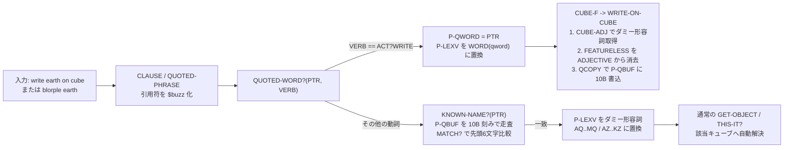
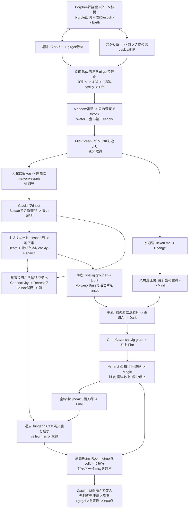

# Spellbreaker (Python 版) の内部構造・魔術師ギルド長視点・叙事詩ドラマ解析

ZilPy が Infocom の Enchanter 三部作完結編 *Spellbreaker* (1985 年、開発コード名 `Z6` / `MAGE`) の ZIL ソースから生成した Python 版 (`out/spellbreaker/`) を、構成要素・パーサーの動的命名機構・壊れゆく魔法と基盤のキューブ群・クリアを阻む因果的ターニングポイント・魔術師ギルド長としての認知ギャップ・魔法の時代の終焉ドラマの観点から詳細に解説します。

- **ネタバレ注意:** 13 個の立方体の入手手順、時間遡行の因果条件、影の正体、不可逆な詰み条件、全エンディング分岐まで記載しています。
- **解析手順の再現性:** 本ドキュメントの作成に用いた解析計画は、プロジェクトルートの `GameArchitecture.md`（および基礎棚卸し手順の `infocomGame.md`）に基づいています。
- **元の ZIL の位置:** `magic.zil:638` のように記載します。生成コード各定義直前の `# zil:` 注記および `out/spellbreaker/zilmap.json` から対応を引けます。

---

## 1. 全体像

### 1.1 規模

`tools/analyze_game.py` による静的棚卸しと `ZilGlobal.py` の集計結果は次のとおりです。

| 項目 | 数 |
|---|---|
| モジュール (ZIL ファイル) | 15 (計 19,638 行) |
| ルーチン | 762 |
| 部屋 | 79 |
| オブジェクト (部屋以外) | 169 |
| 構文 (`SYNTAX`) | 363 (動詞の語 164 個) |
| 割り込みのルーチン (`I-*` 等) | 47 (`QUEUE` 呼び出し 80 箇所) |
| グローバル変数・定数 | 331 (`state` 168 / `const` 98 / `scratch` 65) |
| `VALUE` / `TVALUE` の合計 | 0 (0 個) — プロパティ静的点ではなく動的加点方式 |
| 満点 / 最低点 | **600 点** (`Scientist`) / **−99 点** (`Menace to Society`) |

ルーチン 762 個を役割で分類すると次のとおりです。

| 役割 | 数 | 例 |
|---|---|---|
| そのほか (場面処理・キューブ制御・パズル補助) | 205 | `INITIALIZE-CUBES`、`SPELL-PROB?`、`WRITE-ON-CUBE`、`JUGGLE-CUBES` |
| 動詞のアクション (`V-*`) | 190 | `V-BLORPLE`、`V-GIRGOL`、`V-JINDAK`、`V-SLEEP`、`V-COPY` |
| オブジェクトのアクション | 97 | `CUBE-F`、`MAGIC-BOX-F`、`ZIPPER-F`、`SHADOW-F`、`BELBOZ-F` |
| 動詞の補助 | 71 | `ITAKE`、`SCORE-OBJECT`、`GOTO`、`JIGS-UP` |
| 部屋のアクション | 64 | `COUNCIL-CHAMBER-F`、`SCALES-ROOM-F`、`MAZE-F`、`CASTLE-F` |
| パーサー | 54 | `PARSER`、`QUOTED-PHRASE`、`QUOTED-WORD?`、`KNOWN-NAME?`、`MATCH?` |
| 割り込み (`I-*`) | 47 | `I-ORATION`、`I-TIRED`、`I-AVALANCHE`、`I-SHADOW`、`I-UNFREEZE` |
| 事前アクション (`PRE-*`) | 21 | `PRE-CAST`、`PRE-WRITE`、`PRE-SWRITE`、`PRE-PUT` |
| 共通オブジェクトのアクション | 12 | `NOT-HERE-OBJECT-F`、`GROUND-F`、`WATER-F` |
| マクロから作った関数 | 1 | `DEBUG-CODE` |

### 1.2 モジュールと読み込みの順

入口の `z6.py`（開発時の仮題は `*** MAGE: Interactive Fantasy ***`、`z6.zil:10`）が以下の順に全 15 モジュールを読み込み、プロパティ既定値（`SIZE` 5、`CAPACITY` 0）を設定した上で `ZG._link()` → `ZG.GO()` を実行します。

| # | モジュール | 行数 | ルーチン | 部屋 | オブジェクト | 構文 | 主な役割 |
|---|---|---|---|---|---|---|---|
| 1 | `z6` | 86 | 1 | 0 | 0 | 0 | 入口。仮題表示、`DEBUG-CODE`、読み込み順、既定プロパティ |
| 2 | `misc` | 968 | 27 | 0 | 0 | 0 | `GO`、`MAIN-LOOP`、`MAIN-LOOP-1`、`PERFORM`、`QUEUE`、`CLOCKER`、`DPRINT`/`IPRINT` |
| 3 | `parser` | 2,018 | 54 | 0 | 0 | 0 | 1985 年世代パーサー＋引用符付き動的ラベル (`P-QBUF` / `QUOTED-PHRASE`) |
| 4 | `syntax` | 1,299 | 0 | 0 | 0 | 359 | 方向・`BUZZ`・`SYNONYM`・構文定義（呪文動詞 16 種・`WRITE`/`LABEL`/`COPY` 等） |
| 5 | `debug` | 6 | 0 | 0 | 0 | 0 | デバッグ用スタブ |
| 6 | `record` | 54 | 4 | 0 | 0 | 4 | `#RANDOM` / `#COMMAND` / `#RECORD` / `#UNRECORD` テスト記録構文 |
| 7 | `interrupts` | 1,363 | 64 | 0 | 0 | 0 | 全 47 種の割り込み・タイマー・`I-SHADOW`・`END-OF-WORLD`・`I-TIRED` |
| 8 | `verbs` | 2,977 | 256 | 0 | 0 | 0 | 標準動詞、`V-SCORE`/`RANKINGS`、`V-SLEEP`、`ITAKE`、`GOTO`、`JIGS-UP`、`V-COPY` |
| 9 | `magic` | 1,398 | 45 | 0 | 24 | 0 | 呪文・巻物・呪文書・`PRE-CAST`・`SPELL-PROB?`・`V-BLORPLE`・`V-GIRGOL`・`BLANK-SCROLL-F` |
| 10 | `globals` | 1,112 | 32 | 1 | 37 | 0 | 共通オブジェクト、Retreat と `BELBOZ-F` / `ANSWER-BELBOZ` / `FORLORN-ENCYSTMENT` |
| 11 | `guild` | 721 | 27 | 4 | 13 | 0 | Borphee ギルドホール（開幕評議会）と最終決戦の城 (`CASTLE-F` / `SHADOW-F` / `HYPERCUBE-F`) |
| 12 | `c1` | 1,818 | 52 | 18 | 19 | 0 | 序盤異界（Earth / Life / Water 周辺: 遺跡・崖・山頂・鬼の洞窟・`MAGIC-BOX-F`） |
| 13 | `c2` | 1,475 | 50 | 15 | 18 | 0 | 水・空異界（海・オブリエット・水道管・地下牢・見張り塔・ロック鳥の巣・`CABINET`） |
| 14 | `c3` | 2,393 | 87 | 19 | 31 | 0 | 空・火・闇・宝物庫（氷河・バザール・火山・グルーの洞窟・`SCALES-ROOM-F`・`INITIALIZE-CUBES`） |
| 15 | `c4` | 1,950 | 63 | 22 | 27 | 0 | 終盤異界（平原・八角形迷路・魔法の部屋・時の部屋・過去の 2 部屋・`WRITE-ON-CUBE`） |

### 1.3 得点・称号システム (`V-SCORE` / `SCORE-OBJECT`)

本作には Zork 系の静的プロパティ点 (`VALUE` / `TVALUE`) が一切なく、`ITAKE` から呼ばれる `SCORE-OBJECT` (`verbs.zil:1737`, `verbs.zil:1737`) とイベント固有加算で 600 点満点を構成します。

- `SCORE-OBJECT`: 初回取得 (`not FSET?(OBJ, TOUCHBIT)`) 時に `TOUCHBIT` を立て、プロパティ `CUBE` を持つ立方体なら **+25 点**（ただし `TIME-CUBE` だけは宝物庫で実際に `blorple` 成功した瞬間に `CUBES-TO-PILES` で +25 点）、`SCROLLBIT` または `MAGICBIT` なら **+10 点** を加算します。
- イベント加点: `blorple` 初回確認 (+15)、黴びた本を `caskly` で修復 (+15)、Belboz の試問に回答 (+25)、過去の牢 (`PAST-CELL-EAST`) 整合退出 (+25)、過去の遺跡 (`PAST-RUINS-ROOM`) 整合退出 (+25)、最終勝利で `SCORE = 600`（+50 相当）。
- 称号 (`RANKINGS`, `verbs.zil:248`, `verbs.zil:248`): `SCORE // 50` で 13 段階を引きます。
  - `0`=`Charlatan` → `50`=`Parlor Magician` → `100`=`Magician` → `150`=`Novice Enchanter` → `200`=`Enchanter` → `250`=`Expert Enchanter` → `300`=`Novice Sorcerer` → `350`=`Sorcerer` → `400`=`Expert Sorcerer` → `450`=`Novice Mage` → `500`=`Mage` → `550`=`Archimage` → **`600`=`Scientist`**。
  - 敗北結末（影に世界を乗っ取られる・宇宙消滅・Castle で眠る）では `SCORE = -99` となり、`V-SCORE` (`verbs.zil:241`) が **`Menace to Society`**（社会への脅威）を出力します。

---

## 2. 起動・メインループ・パーサーの詳細処理と世界への反映

### 2.1 起動 (`GO`, `misc.zil:290`, `misc.zil:290`)

`GO` はゲーム開始時に 1 回だけ以下を実行します。

1. `INITIALIZE-CUBES()` (`c3.zil:1868`): 宝物庫の 12 個の立方体 (`FAKE-CUBE-LIST`: `CUBE-1`〜`CUBE-11` + `TIME-CUBE`) の `NAME` プロパティに `P-QBUF` の先頭 12 スロット (`"x1"`〜`"x12"`) を割り当て、直後を `P-QNEXT`（プレイヤーが以降に書き込む動的ラベルの追記先）にセットします。
2. `CLOCK-HAND = REST(C-TABLE, C-TABLELEN)` で割り込みキューを初期化し、`I-TIRED` (80 ターン後) と `I-ORATION` (毎ターン `-1`) を `QUEUE` します。
3. `MAGIC-BOX-CUBE = WATER-CUBE`、`WINNER = PLAYER`、`HERE = COUNCIL-CHAMBER`、`ORATOR = SNEFFLE` を設定し、`V-VERSION` → `V-LOOK` → `MAIN-LOOP` へ入ります。

### 2.2 `MAIN-LOOP-1`・`PERFORM`・`CLOCKER` の進化点 (1985 年世代)

Zork I / Enchanter / Sorcerer 世代と比較した *Spellbreaker* の実行エンジンには、4 つの顕著な進化点があります。

1. **`PERFORM` の 7 段階ディスパッチ＋`SPELL-CAST` 自動精算 (`misc.zil:556`, `misc.zil:556`)**:
   - ディスパッチ順は `WINNER(ACTION)` → 乗り物 `LOC(WINNER)(M-BEG)` → `HERE(M-BEG)` → `PREACTIONS` → `PRSI(ACTION)` → **`LOC(PRSO)(CONTFCN, M-CONTAINER)`** → `PRSO(ACTION)` → `ACTIONS(V-*)` の 7 段階です。`CONTFCN` により、Belboz の懐から鍵を盗もうとした瞬間の即処刑 (`BELBOZ-F` の `M-CONTAINER`) などを汎用的にフックできます。
   - 末尾で **`if SPELL-CAST:`** を確認し、その呪文の記憶回数 `COUNT` を 1 減算、空きスロット `SPELL-ROOM` を 1 回復して `SPELL-CAST = False` に戻します。**呪文が `PRE-CAST` 内で不発 (`SPELL-PROB? == False`) になっても `SPELL-CAST` は既に立っているため、必ず記憶回数が 1 回消費される** 仕組みがここで一元保証されています。
2. **`CLOCKER` / `QUEUE` の `CLOCK-HAND` と負数エンコード (`misc.zil:737-810`, `misc.zil:737-819`)**:
   - `QUEUE(RTN, TICK)` は、登録スロット `INT` が現在走査中の `CLOCK-HAND` より後ろにある場合（つまり割り込み処理中に別の割り込みを予約した場合）、**`TICK = -(TICK + 3)`** と負数エンコードして格納します。
   - `CLOCKER` は `TICK < -1` を検出すると、そのターンでは発火・減算せず **`PUT(CLOCK-HAND, C-TICK, (-TICK) - 3)`** で元の正の値に戻すだけに留めます。これにより「同じターン内に連鎖予約されたタイマーが 1 ターン早く減算される」古典的バグが解消されています。
3. **`NO-CLOCK-VERB?` の独立化 (`misc.zil:454`, `misc.zil:454`)**:
   - メタ動詞判定が `MAIN-LOOP-1` から独立ルーチン化され、`CASTLE-F` や `SHADOW-F` からも参照されます（セーブ・スコア確認・ヘルプ等で影のターンが誤進行しない）。
4. **引用符付き動的キューブ命名パーサー (`P-QBUF` + ダミー形容詞写像)**:
   - Z-machine の辞書 (VOCAB) はコンパイル時に固定された読み取り専用領域であり、実行時に新しい単語を追加できません。*Spellbreaker* はこれを突破するため、**「24 個のダミー形容詞」と「10 バイト固定長テーブル `P-QBUF`」** による動的エイリアス機構を `parser.py` に組み込みました。

### 2.3 動的命名システム (`P-QBUF`) の内部メカニズム

- **オブジェクト定義 (`c1.zil:47`, `c1.zil:47`)**: 13 個の本物キューブと 11 個の偽キューブは、それぞれ一意の 2 文字ダミー形容詞（`AQ`〜`MQ`、`AZ`〜`KZ`、`CUBE-LIST` に定義）を `ADJECTIVE` プロパティ先頭に持ちます（例: `EARTH-CUBE` は `('AQ', 'SMALL', 'FEATURELESS', 'WHITE')`）。
- **書き込み (`WRITE-ON-CUBE`, `c4.zil:1840`, `c4.zil:1840`)**:
  1. `CUBE-F` が `KNOWN-NAME?(P-QWORD)` で重複ラベルを弾きます（既に別キューブに使った語は書けない）。
  2. 未記入キューブ (`GETP(OBJ, 'NAME') == 0`) の場合、`F = GETPT(OBJ, 'ADJECTIVE'); PUTB(F, 1, GETB(F, 2))` により、**形容詞配列の `FEATURELESS` を上書き消去** します。これにより「ラベル未記入のキューブだけを `featureless cube` で指す」操作が可能になります。
  3. `P-QNEXT` から 10 バイト領域を確保し、`QCOPY` (`parser.zil:678`, `parser.zil:678`) が **`[ダミー形容詞(2B), 文字長(2B), ASCII文字(最大6B)]`** を書き込みます（6 文字超過は切り捨てられるため `"connectivity"` は `"connec"` として記憶されます）。
- **参照と表示**:
  - 以降、`blorple "earth"` のように二重引用符で囲んで入力すると、`KNOWN-NAME?` → `MATCH?` (`parser.zil:658`) が `P-INBUF` の生文字（最大 6 文字）と `P-QBUF` を照合し、トークンを `AQ` に書き換えます。
  - 表示時は `IPRINT` (`misc.zil:111`, `misc.zil:111`) が `GETP(O, 'NAME') != 0` を見て `CUBE-NAME(O)` を呼び、`"earth" cube` と印字します。

### 2.4 エンドツーエンド実行トレース 3 例

#### トレース 1: `write "earth" on cube` → `blorple "earth"`（動的命名と異界転移）
1. **`PARSER` → `CLAUSE` → `QUOTED-PHRASE` (`parser.zil:611`)**: `"` を `$buzz` に置換し、`earth` を `QUOTED-WORD?(PTR, ACT?WRITE)` へ渡す。`P-QWORD = PTR` を記録し、`P-LEXV` 上のトークンを `WORD('qword')` に書換。結果 `PRSA = V?WRITE, PRSO = QWORD, PRSI = EARTH-CUBE`。
2. **`PERFORM` → `PRE-WRITE` (`verbs.zil:2257`)**: `IN?(BURIN, WINNER)` を確認して通過。
3. **`EARTH-CUBE` (`CUBE-F`, `c3.zil:2227`)**: `KNOWN-NAME?(P-QWORD)` が偽なので `WRITE-ON-CUBE(EARTH-CUBE)` を実行。`P-QBUF` の空きスロットに `[VOC('AQ','ADJ'), 5, 'e','a','r','t','h', 0]` を書き込み、`EARTH-CUBE` の `NAME` にそのポインタを格納、`FEATURELESS` を消去、`THE` フラグを付与。
4. 次ターンで `blorple "earth"` を入力すると、`QUOTED-PHRASE` → `KNOWN-NAME?` が `P-QBUF` から `VOC('AQ','ADJ')` を返し、`P-LEXV` を `AQ` に置換。標準の `GET-OBJECT` が `EARTH-CUBE` を特定。
5. **`PRE-CAST` (`magic.zil:531`)**: `BLORPLE-SPELL` の記憶回数 `COUNT > 0` と所持を確認、`SPELL-CAST = BLORPLE-SPELL` を立て、`SPELL-PROB?(BLORPLE-SPELL)` は常に `True` を返す。
6. **`V-BLORPLE` (`magic.zil:825`)**: 現在地がキューブ部屋でないことを確認し、`BLORPLE-OBJECT = EARTH-CUBE`、`RM = GETP(EARTH-CUBE, 'CUBE') = EARTH-ROOM` とし、`REMOVE(EARTH-CUBE)` でキューブを一時消去して `GOTO(EARTH-ROOM)`。
7. **`PERFORM` 末尾**: `SPELL-CAST` の `COUNT` を 1 減らし、`SPELL-ROOM` を 1 回復。
8. 後で `EARTH-ROOM` を出ると、`GOTO` → `EARTH-ROOM-F(M-LEAVE)` → `RECOVER-CUBE()` (`magic.zil:856`) が `EARTH-CUBE` をプレイヤーの手に戻す。

#### トレース 2: `lesoch`（崩壊する魔法の不発と記憶消費）
1. **`PARSER`**: `SYNTAX('LESOCH', '=', 'V-LESOCH', 'PRE-CAST')` に一致。`PRSA = V?LESOCH, PRSO = False`。
2. **`PERFORM` → `PRE-CAST` (`magic.zil:531`)**:
   - `SPELL = LESOCH-SPELL`。`COUNT > 0` を確認し、**`SPELL-CAST = LESOCH-SPELL` を設定**。
   - `SPELL-PROB?(LESOCH-SPELL)` (`magic.zil:638`) を呼ぶ。序盤（所持キューブ 0 個、縁の深い `AIR-CUBE`・`FIRE-CUBE` とも未所持）では確率 `P = 50 + 0*5 + 0 + 0 = 50%`。
   - `PROB(50)` が外れると `The casting feels wrong, and sure enough, <PICK-ONE(FIZZLES)>` を出力し、`PRE-CAST` が **`True` を返して `V-LESOCH` をスキップ**。
3. **`PERFORM` 末尾 (`misc.zil:658`)**: `PRE-CAST` が `True` で中断しても `SPELL-CAST` は設定済みのため、`LESOCH-SPELL` の `COUNT` が 1 減算され、不発なのに記憶が消える。

#### トレース 3: 最終決戦 `attack shadow` → `z`×8 → `girgol` → `take "magic"` → `put fish in hypercube`
1. `CASTLE` 入室 2 ターン後に `I-SHADOW-ARRIVES` が `SHADOW` を出現させ、`I-SHADOW` (`-1`) を起動。
2. プレイヤーが `attack shadow` を打つと、`SHADOW-F` (`guild.zil:485`) の `HOSTILE-VERB?` 分岐から **`FREEZES-YOU()`** (`interrupts.zil:380`) が呼ばれ、`FROZEN? = 5` に設定される。プレイヤーが `MAGIC-CUBE` を所持しているため **`QUEUE(I-UNFREEZE, 2)`** が予約される（これが無いと永久凍結）。
3. 以降 `z`（`WAIT`）を続けると、`I-UNFREEZE` が毎ターン `FROZEN?` を `4→3→2→1→0` と減らし、約 6 ターン後に解凍完了（`FROZEN? = False`）。その間 `I-SHADOW` が `SHADOW-COUNT` を `1→9` へ進め、4 ターン目の自動凍結 (`if not FROZEN?: FREEZES-YOU(True)`) は既に凍結中なのでスキップされる！
4. `SHADOW-COUNT == 9` で影が `MAGIC-CUBE` を `HYPERCUBE` の中心に押し込み、飛び込む直前になる。
5. **`girgol`**（vellum scroll に写した `SPELL-COPY`）を詠唱: `PRE-CAST` が `SPELL = SPELL-COPY` の `EXITS` プロパティ (`V?GIRGOL`) を `PRSA` に復元し、`V-GIRGOL` (`magic.zil:919`) が `SHADOW-COUNT == 9` を検知して **`TIME-STOPPED? = CASTLE`、`QUEUE(I-GIRGOL, 3)`** を設定（わずか 3 ターンだけ時間を止める）。
6. **`take "magic"`**: `CASTLE-F(M-BEG)` (`guild.zil:633`) が `TIME-STOPPED? == HERE` かつ `SHADOW-COUNT == 9` かつ `PRSO == MAGIC-CUBE` を検知し、`MOVE(MAGIC-CUBE, WINNER)` で抜き取り成功。
7. **`put fish in hypercube`**: `CASTLE-F(M-BEG)` (`guild.zil:655`) が `MOVE(FISH, HYPERCUBE)` を実行。
8. 時間停止が切れた次の `I-SHADOW` (`SHADOW-COUNT == 10`, `interrupts.zil:230`): `FIRST?(HYPERCUBE)` が `FISH` であり `MAGIC?(FISH) == False` なので **`WON? = 3`** へ分岐。影と超立方体が消滅し、`MAGIC-CUBE` が手の中で氷のように溶け、Belboz の演説とともに **`SCORE = 600` → `FINISH()`**。

---

## 3. Spellbreaker 固有の主要サブシステム

### 3.1 基盤のキューブ (`CUBES`) 13 個と金の箱 (`MAGIC-BOX`) の空間連結

世界の根源を象徴する 13 個の白い立方体（`CUBE-LIST`, `c4.zil:1810`）は、それぞれ専用の異界ルーム (`CUBE` プロパティ) へ `blorple` で転移する拠点システムを形成します。

- **出入り規約**: キューブ部屋内部（`GETP(HERE, 'CUBE')` が真）および `DULL-ROOM` からは `blorple` が無効化 (`V-BLORPLE`) されます。一度外へ出ると `M-LEAVE` の `RECOVER-CUBE()` でキューブが手元に戻ります。
- **金の箱 (`MAGIC-BOX-F`, `c1.zil:1718`) と空間連結 (`MAGIC-BOX-EXIT`, `c1.zil:1700`)**:
  - どのキューブ部屋にも通常は通れない「謎の出口」が 1 つあります（`MAGIC-BOX-EXIT`）。
  - 開いた金の箱に任意のキューブを入れると、グローバル変数 **`MAGIC-BOX-CUBE`** がそのキューブに書き換わり、箱の装飾の生き物（サラマンダー・モグラ等）が変化します（初期値は `WATER-CUBE`）。
  - 金の箱を別の通常部屋 `L`（`EMPORIUM` とキューブ部屋以外）に置いておくと、`MAGIC-BOX-CUBE` に対応するキューブ部屋の「謎の出口」が **`L` へ直接つながるポータル** になります。溶岩の湖の孤島 (`OUTCROPPING-ROOM`) へ金の箱を投げ込み、`Fire Room` の東出口から渡って `MAGIC-CUBE` を取るパズルはこの仕様の応用です。
- **城への門 (`MAGIC-DOOR-EXIT`, `c4.zil:1492`)**: `Magic Room` の東出口は `HAS-ALL-CUBES?()`（`COUNT-CUBES() == 13`、ジッパー内や `BLORPLE-OBJECT` 含む）を満たしたときのみ `CASTLE` へ開通します。

### 3.2 壊れゆく魔法 (`magic.py`)

Enchanter / Sorcerer の Vancian 魔法（呪文書から `learn` し、唱えると忘れる）を土台に、**「世界から魔法が失われつつある」設定を確率と制約の数式として実装** しています。

| 要素 | ルーチン・変数 | 仕様（Python 実コードで確認） |
|---|---|---|
| 常備 3 呪文 | `PRE-CAST` (`magic.zil:589`) | `gnusto`・`frotz`・`rezrov` は `COUNT == 0` でも無制限に詠唱可 |
| 記憶スロット | `REAL-SPELL-MAX` (初期 4、睡眠ごとに +1、最大 8) / `SPELL-MAX` / `SPELL-ROOM` | 満杯時に `learn` すると `FORGET-SPELL()` で古い呪文を 1 つ忘れる。同一呪文の重ね覚え上限も `SPELL-MAX` |
| 崩壊成功率 | `SPELL-PROB?` (`magic.zil:638`) | **基本 50%**（`gnusto`/`frotz` は **75%**）+ **所持キューブ数 × 5%** + **縁の深いキューブ 2 種につき各 +20%**。100% 以上で必中 |
| 例外ルール | `SPELL-PROB?` (`magic.zil:639-677`) | ① `MAGIC-CUBE` 所持中は `girgol` 以外 **100% 成功**、② `blorple` は常時成功（ただし `CASTLE` の `SHADOW-COUNT > 8` では失敗）、③ `frotz` は `DARK-CAVE` / `GRUE-CAVE` / `LIGHT-POOL` / `PILLAR-ROOM` で **強制失敗**、④ `PLAIN-ROOM` では `blorple` 以外すべて `PLAIN-SPELL-FAIL` で無効化 |
| 巻物複写 | `BLANK-SCROLL-F` (`magic.zil:1303`) | `copy <spell> to vellum scroll` は `BURIN` 必須。呪文書からの複写は「コピープロテクト」で拒否、`girgol` の複写は `MAGIC-CUBE` 所持が必須。内部的には `SPELL-COPY` (`$XEROX`) の形容詞・テキスト・`EXITS`(元動詞) を動的書換して複製を実現 |

### 3.3 疲労・睡眠・所持数連動 (`I-TIRED` / `V-SLEEP` / `ITAKE`)

Enchanter 系の「空腹・睡眠」から空腹を削ぎ落とし、**疲労 (`AWAKE`) が魔力と身体能力を同時に蝕むシステム** へ統合されています。

- `GO` で 80 ターン後、睡眠後は 150 ターン後に `I-TIRED` (`interrupts.zil:453`) が発火し、以後 **8 ターンごと** に `AWAKE` が `0→8` へ上昇します。
- 1 段階進むたびに以下が同時低下します:
  1. `LOAD-ALLOWED -= 10`（重量上限低下）
  2. `FUMBLE-NUMBER -= 1`（直接所持個数上限が初期 8 → 最小 1 に低下、`ITAKE` で `CCOUNT(WINNER) > FUMBLE-NUMBER` なら取得失敗）
  3. `SPELL-MAX -= 1` および `SPELL-ROOM -= 1`（記憶上限低下、`SPELL-ROOM == 0` で混乱警告）
  4. `SPELL-F` での `learn` 失敗確率が `5 * AWAKE %` に上昇し、`AWAKE > 6` では暗記不能。
- `AWAKE > 8` で強制気絶 (`V-SLEEP(True)`)。海・水道管・満水オブリエット・鬼の洞窟・落下中・ロック鳥の巣で倒れると **即死 (`JIGS-UP`)**。
- **`MAGIC-CUBE` の恩恵と罠**: `I-TIRED` 先頭に `if HELD?(MAGIC-CUBE): return True` があるため、魔法の立方体を持つと疲労進行が完全停止します（ただし、既に低下した `FUMBLE-NUMBER` は眠らないと戻らない）。
- **四次元ジッパー (`ZIPPER-F`, `c1.py`)**: 無限容量の亜空間バッグ。中に入れた物は `CCOUNT(WINNER)` に数えられず、閉じれば防水になるため、所持数制限・水没対策（呪文書/巻物の `RMUNGBIT` 防止）の中核ツールとなります。

### 3.4 異界構造と 5 大固有パズル

| 異界 / 領域 | 中核ルーチン | 構造とアルゴリズム |
|---|---|---|
| **宝物庫 (12 枚天秤)** | `SCALES-ROOM-F` / `JUGGLE-CUBES` / `MEASURE` / `USE-SPELL` (`c3.zil:1801-1980`) | 入室ごとに 12 個 (`x1`〜`x12`) を 2 山に再シャッフルし、50% で `(REAL=3, FAKE=2)` または `(REAL=2, FAKE=3)` を決定。`jindak` による 2 山の輝度比較を **3 回以内** で終わらせる古典的 12 枚硬貨パズル。3 回目の呪文で `I-ALARM` + `I-GUARDS(2)` が発火。`SAVE` は `M-BEG` で明示禁止、さらに `USED-JINDAK? == False` のまま `TIME-CUBE` を `blorple` しても強制的に `DULL-ROOM` へ飛ばされる二重の不正防止策を備える。 |
| **八角形迷路と羅針盤の薔薇** | `MAZE-F` / `COMPASS-ROSE-F` (`c4.zil:933, 1326`) | 3×3 格子 (`MAZE-1`〜`MAZE-9`)。各部屋の `WALLS` プロパティが通行不可方向を表し、薔薇を壁に当てるとグローバルビットマスク `COMPASS-ROSE-STATE` にその方角ビットが立ち、以後その方角の腕は鉛になって二度と使えない（全 8 方向中、入口の北を含め重複不可の一筆書き経路探索）。 |
| **岩の平原 (4×4 追跡 AI)** | `PLAIN-ROOM-F` / `I-OTHER-ROCK` (`c4.zil:29`, `interrupts.zil:1231`) | 北西隅 (0 番) を欠く 4×4 格子（1〜15 番）。緑の岩 (`ROCK-LOC=5`) に乗って命令すると、茶色の岩 (`OTHER-ROCK-LOC=7`) がマンハッタン距離と偶奇 `(DROW + DCOL) & 1` に基づく逃走 AI で 1 マス逃げる。4↔1 間の斜め移動 (`NE`/`SW`) で偶奇を崩し、同マスに重ねると `mesmerized` で停止する。 |
| **オブリエットと水道管** | `OUBLIETTE-F` / `V-TINSOT` / `V-LISKON` (`c2.py`) | `tinsot water` 3 段階で「半閉塞→氷栓（水位上昇開始）→浮島生成」と状態遷移させ、満水の一瞬に `rezrov trap door` で上の地下牢へ脱出する水理パズル。一方 `liskon me` で縮小して水路へ入ると 3 ターンごとに下流へ流され、15 ターンで縮小が切れる前に割れ目から `CHANGE-CUBE` を拾って脱出する。 |
| **時間遡行と因果整合** | `TIME-ROOM-F` / `PAST-CELL-EAST-F` / `PAST-RUINS-ROOM-F` (`c4.zil:1556-1708`) | `Sand Room` から上＝過去の遺跡、下＝過去の地下牢へ移動。退室時 (`M-LEAVE`) に「現代の初期状態と完全一致しているか」を厳密検証し、1 つでもズレると時間逆説 (`TIME-SICK`) で `DEATHS = 3` → 強制ゲームオーバーになる。 |

### 3.5 影 (`SHADOW`) と蘇生・最終決戦ロジック

- **3 回蘇生の伏線 (`JIGS-UP`, `verbs.zil:2029`, `verbs.zil:2029`)**: 通常の死では `DEATHS` を加算し、3 回目までは黒マントの人物が「まだお前が必要だ」(`DEATH-SPEECHES`) と告げて `DEATH-ROOM` (Boneyard) に蘇生させます。4 回目 (`DEATHS > 3`) で `FINISH()`。この黒マントの人物こそが **影 (`SHADOW`)** であり、`CASTLE` 到達時に `DEATHS > 0` だと皮肉交じりに礼を言います (`I-SHADOW`, `SHADOW-COUNT == 1`)。
- **城でのタイムライン (`I-SHADOW`, `interrupts.zil:208`, `interrupts.zil:208`)**:
  - `SHADOW-COUNT = 1..3`: 独白（4 個のキューブを先に集め、魔力を揺らがせて主人公を誘導した経緯と、自身の正体を明かす）。
  - `SHADOW-COUNT = 4`: まだ凍結していなければ `FREEZES-YOU(True)` で主人公を永久凍結させ、地球のキューブを空中に配置。
  - `SHADOW-COUNT = 5..8`: 12 個のキューブ＋影自身の 4 個のキューブ＝計 16 頂点で **4 次元超立方体 (tesseract / hypercube)** を構築し始める。
  - `SHADOW-COUNT = 9`: `MAGIC-CUBE` を超立方体の中心に据え、飛び込む直前になる。
  - `SHADOW-COUNT = 10`: 影が飛び込み、超立方体の中身で 4 分岐 (`END-OF-WORLD`, `interrupts.zil:358`):
    - `MAGIC-CUBE` がそのまま (`WON? = False`): 影が全能の神となり世界を支配（**−99 点**）。
    - 空っぽ (`WON? = 1`): 影も世界もマッチの火のように消滅（**−99 点**）。
    - 別の魔法アイテム (`MAGIC?(X) == True`, `WON? = 2`): 影が激怒して引き返し `MAGIC-CUBE` を奪い返して世界支配（**−99 点**）。
    - **非魔法アイテム** (`MAGIC?(X) == False`、例: 燻製の魚, `WON? = 3`): 魔法そのものが消滅し、影も消滅、世界は救われる（**600 点満点**）。

---

## 4. クリアへの因果的ターニングポイントと障壁

### 4.1 進行依存グラフ

### 4.2 主要進行ゲートと不可逆ソフトロック（コード検証済み）

| 障壁 / 詰み条件 | 判定ルーチン・条件式（Python 実コード） | 結果・影響 |
|---|---|---|
| **`flimsy scroll (girgol)` の早期消費・雪崩失敗** | `V-GIRGOL` (`magic.zil:919`) / `I-AVALANCHE` (`interrupts.zil:757`) | `girgol` は本に `gnusto` 不可で 1 枚きり。雪崩の `ROCK-SLIDE-COUNT == 1` の 1 ターン以内に止めないと山頂 (`MOUNTAIN-TOP`) へ登れず `LIFE-CUBE` 入手不可（不可逆詰み）。 |
| **Belboz の試問誤答による遅延即死** | `ANSWER-BELBOZ` (`globals.zil:976`: `not CORRECT?(...) -> FAKE-KEY = True`) → `CABINET-F` (`c2.zil:1006`) | **誤答しても「正解だ」と褒められ +25 点と鍵をもらえる**。しかし終盤の過去牢で鍵を差し込んだ瞬間に `FORLORN-ENCYSTMENT()` (`DEATHS = 3` → 永久投獄死) で即ゲームオーバーになる最凶の時限ソフトロック。 |
| **過去の地下牢の整合違反** | `PAST-CELL-EAST-F(M-LEAVE)` (`c4.zil:1685`): `not RMUNGBIT(PAST-CABINET) and LOCKED(PAST-CABINET) and OPENBIT(CELL-DOOR) and ONLY?(SPELL-BOOK, PAST-CABINET) and ONLY?(PAST-CABINET, HERE)` | 戸棚を `rezrov` で壊す・鍵をかけ忘れる・呪文書以外の物を残す・牢の扉を吹き飛ばさずに出る、のいずれかで `TIME-SICK-CELL-EAST()` (`DEATHS = 3` → 強制終了)。 |
| **過去の遺跡の整合違反 / 再訪** | `PAST-RUINS-ROOM-F(M-LEAVE)` (`c4.zil:1594`): `ONLY?(ZIPPER, HERE) and ONLY?(GIRGOL-SCROLL, ZIPPER) and not OPENBIT(ZIPPER)` / `M-ENTER`: `PAST-WATER-FLAG > 0` | ジッパーを閉じ忘れる・中に余計な物を残す・袋を部屋に置いていくと時間逆説で `DEATHS = 3` 即死。一度出た後に再訪しても水没即死。 |
| **宝物庫の `jindak` 未使用・再訪・警報** | `V-BLORPLE` (`magic.zil:830`: `PRSO == TIME-CUBE and not USED-JINDAK?`), `USE-SPELL` (`magic.zil:617`: `SPELLS-USED > 2`), `SCALES-ROOM-F(M-ENTER)` (`c3.zil:1842`: `TREASURY-GUARDED?`) | `jindak` を 1 回も唱えずに `TIME-CUBE` を `blorple` すると偽物扱い。3 回目の呪文から 2 ターン後に番兵が殺害。`TIME-CUBE` 取得後に戻ると常駐番兵に即殺。 |
| **呪文書・巻物の水没 / 雑草の切断** | `SOAK-STUFF` (`RMUNGBIT` 付与)、`SPELL-F` (`magic.zil:385`)、`WEED` の `RWATERBIT` | ジッパーを閉じずに海・水道管・満水オブリエットへ入ると呪文書・巻物が `RMUNGBIT` で読めなくなる。雑草を剪定ばさみで切ると挿し木 (`RWATERBIT`) になり `throck` で育たない。 |
| **海で `WATER-CUBE` を魚に飲まれる** | `I-GROUPER` / `OCEAN-ROOM-F` | 初回・2 回目の入水時に手を打たず 2 ターン経過すると魚が `WATER-CUBE` を飲み込み、13 個揃わなくなる。 |
| **Castle での凍結タイミング失敗** | `I-SHADOW` (`interrupts.zil:254`: `SHADOW-COUNT == 4` で `FREEZES-YOU(True)`) / `I-UNFREEZE` (`interrupts.zil:420`) | 影が 4 ターン目に自動で凍らせた場合、解凍 (`FROZEN?` 5→0 に 6 ターン) が `SHADOW-COUNT == 9` の猶予に間に合わない。**1〜3 ターン目に自ら影を挑発して先に凍らされる**必要がある。 |
| **超立方体への誤投入** | `I-SHADOW` (`interrupts.zil:232-312`: `WON?` 判定) | `MAGIC-CUBE` を抜かない・空のままにする・魔法属性 (`MAGIC?` が真) の物を代わりに入れると、いずれも `END-OF-WORLD` → `SCORE = -99` で敗北。 |

---

## 5. 冒険者（魔術師ギルド長）の視点: 初回情報のみの「最も知的・理想的な行動」vs「クリアに必要な行動」

*Spellbreaker* の主人公は、前 2 作 (*Enchanter*, *Sorcerer*) で邪悪な魔術師 Krill や Jeearr を倒し、いまや **魔術師ギルド評議会の長（最強の魔術師）** となった人物です。しかし本作では、**自らのアイデンティティであり最強の武器である「魔法そのもの」が崩壊し始めている** という極限状況に置かれます。

初回プレイで得られる情報のみから「最も知的で責任感ある魔術師ギルド長」が取るであろう理想行動と、実際のクリアに要求される行動の間には、以下の鮮烈なギャップが存在します。

| 局面 | 初回情報のみの「最も知的・理想的な行動」 | クリアに必要な実際の行動 | ギャップの正体（設計上の意図） |
|---|---|---|---|
| **1. Borphee 評議会** | 他ギルドからの非難に対し、ギルド長として壇上で弁明・鎮撫し、異常の原因を調査するため即座に外へ出て行動する。 | **4 ターン完全に黙って待機 (`z`×4)** し、同僚全員がカエルやイモリに変えられるのをただ見届ける。 | `COUNCIL-CHAMBER-F(M-BEG)` が発言・移動・詠唱をすべて同僚 Orkan に制止させ、プレイヤーの「無力な目撃者」化を強制する。 |
| **2. 未知の立方体と呪文崩壊** | 危険な古代遺物（立方体）の正体が分かるまで下手に触れず、まずは最強の魔術師として自分の呪文で周囲を解決しようとする。 | 逆に **立方体を抱え込むほど呪文成功率が上がる** ため、正体不明の立方体を片っ端から集め、魔力のこもった `burin` で勝手に名前を刻み続けて異界へ飛び込む。 | 世界の魔力低下は「影が立方体を揺さぶっている」ため。主人公が立方体を集めること自体が、実は影の計画の完遂を手伝う構造になっている。 |
| **3. 崖の底なし穴・死の危険** | 賢明な魔術師なら `Packed Earth` の底なし穴に飛び込むような自殺行為は絶対に避け、別の安全なルートを探す。 | 警告を振り切って **自ら穴へ二度 `d` を入力して飛び降りる**（しかも約 9% の確率でロック鳥に拾われず墜落死する）。 | `caskly` を得る唯一の経路が「落下してロック鳥にさらわれる」こと。しかも死んでも影が 3 回まで蘇生させてくれるというメタ構造に支えられている。 |
| **4. 師匠 Belboz との再会** | 敬愛する師匠 Belboz には誠実に危機を伝え、共に解決策を探る（クイズに間違えても「正解だ」と言われれば安心して進む）。 | 付属資料（エンチャンターの歴史知識）に基づく 6 択の口頭試問に **一発で正確に答える** 必要がある。誤答しても Belboz は偽の鍵を渡して微笑むため、終盤まで気づけない。 | 影が既に主人公の姿で Belboz を訪ねて騙そうとした後であり、Belboz は「偽者なら罠の鍵で封印する」冷徹な対抗策を仕込んでいる。 |
| **5. 過去の地下牢・遺跡への介入** | 過去へ行けるなら、悲劇を未然に防いだり、貴重な呪文書や便利な四次元ジッパーは手放さず持ち帰るのが合理的。 | **自分の呪文書を過去の牢に閉じ込め、四次元ジッパーも過去の遺跡に捨てていく**（現代の自分が拾った状態と 1 ミリも違えず歴史を保存する）。 | 歴史を変えると即座に時間逆説で存在崩壊 (`TIME-SICK`) する閉じた因果ループ。最強の魔術師であっても時間の理（ことわり）には逆らえない。 |
| **6. 影との最終決戦** | 宿敵が現れたら、直ちに強力な攻撃呪文や `girgol` で先手を取るか、距離を取って出方をうかがう。 | **登場直後にわざと殴りかかって (`attack shadow`) 意図的に凍らされる**。解凍しても微動だにせず待ち、飛び込む一瞬だけ時間を止めて、**魔法の立方体を抜き、代わりに「燻製の魚」を押し込む**。 | 真正面からの魔力勝負では影に勝てない（魔法を使うほど影を強化してきたから）。「先制挑発による凍結タイミングの前倒し」と「非魔法の魚で魔法の体系そのものを破壊する」という、魔術師の常識を裏切る発想の転換が求められる。 |

---

## 6. このゲームで行われていた具体的な行為と人間・叙事詩ドラマ

コード内のテキストとイベント構造から浮かび上がる *Spellbreaker* の物語は、単なるファンタジー冒険譚ではなく、**「魔法という絶対権力の終焉と、科学の時代の幕開け」を描く Enchanter 三部作（ひいては Zork 世界全体）の壮絶な叙事詩** です。

### 6.1 「日常のインフラとしての魔法」の崩壊 (`I-ORATION`)
開幕の評議会 (`interrupts.zil:63`, `interrupts.zil:63`) で次々と立ち上がるのは、魔王でも騎士でもなく **パン屋 (Sneffle)・醸造家 (Hoobly)・猟師 (Gzornenplatz)・詩人 (Ardis)** です。
- パン生地を 83 回折る `gloth` 呪文が壊れてバターが溶け、ビールの醸造魔法が壊れてグルーの風呂水のような味になり、魔獣を町の外に留める `fripple` 結界が破れて猟師が傷つき、詩人の韻律補助魔法まで動かなくなる。
- ここで描かれるのは、**「魔法が社会のあらゆる生活基盤を独占してしまった世界」の脆さ** であり、同時に民衆の感謝が一瞬で「魔術師は裏切り者だ (`traitors`)」という憎悪へ反転する人間社会のリアルです。そしてその直後、全ギルド長が両生類に変えられる惨劇によって、主人公はたった一人で世界の崩壊に立ち向かうことになります。

### 6.2 宿敵「影」の正体——魔術師の栄光が産んだ原罪 (`I-SHADOW` / `SHADOW-F`)
城の玉座でフードを脱いだ影の正体は、**「透き通るように黒く、主人公と瓜二つの姿」** (`interrupts.zil:199`) です。
- `yomin`（読心術）を影にかけると、返ってくるのは次の描写です (`guild.zil:541`):
  > *"You feel your own innermost desires, petty jealousies, and unworthy thoughts magnified a thousand times."*
  > （あなた自身の最も奥深い欲望、ちっぽけな嫉妬、卑しい想念が千倍に増幅されて流れ込んでくる。）
- 影は自らその誕生原理を語ります (`interrupts.zil:199`): 偉大な魔術師が呪文を唱えるたび、その力の一部が「影」へと零れ落ち、やがて自我を持つ「影の自己 (shadow-self)」を形作る。*Enchanter* で Krill を倒し、*Sorcerer* で Belboz を救い、**史上最強の魔術師となった主人公の輝かしい功績そのものが、史上最悪の怪物（自分の影）を育て上げてしまった** のです。
- さらに皮肉なことに、主人公が道中で死ぬたびに蘇生させてくれたのも影であり (`DEATH-SPEECHES`)、13 個の立方体を集めさせたのも「自分一人では集めきれなかった創造の道具を、最も有能な『本体』に集めさせるため」でした。主人公の英雄的な冒険のすべてが、影の掌の上で踊らされていたことが明かされます。

### 6.3 孤独な自己救済の円環（時間遡行のブートストラップ）
しかし、主人公を助けていたのは影だけではありませんでした。終盤の `Sand Room` から過去へ跳んだとき、主人公は衝撃の事実に気づきます。
- 地下牢の朽ちた戸棚で見つけた「黴びた魔導書（`snavig` が書かれていた）」は、**未来の自分が過去の牢に閉じ込めておいた自分自身の呪文書** でした (`PAST-CELL-EAST-F`)。
- 序盤に遺跡で見つけた「四次元ジッパー」と、雪崩を止めて命を救った「`girgol` の巻物」は、**未来の自分が洪水に呑まれる過去の遺跡にそっと残しておいたもの** でした (`PAST-RUINS-ROOM-F`)。
- つまり主人公は、影に操られながらも、**時間を超えた「未来の自分」と「過去の自分」が互いに命綱を渡し合うことで、ようやく影を出し抜く 1 手（複製した `girgol` の巻物）を手に入れた** のです。

### 6.4 魔法の時代の終焉と `Scientist` への到達 (`I-SHADOW`, `WON? == 3`)
最終局面で、主人公は超立方体の中心から「魔法の立方体」を抜き取り、代わりに何の魔力も持たない **「ありふれた燻製の魚」** を押し込みます。
- 影は *"Fool, you've destroyed me! You've destroyed magic itself!"* と叫びながら消滅し、主人公の手の中で `MAGIC-CUBE` が氷のように溶けて消えます (`interrupts.zil:283-312`)。
- Belwit Square に戻ると、元の姿に戻ったギルド長たちと師匠 Belboz が主人公を囲み、Belboz は静かにこう宣言します (`interrupts.zil:296`):
  > *"A new age begins today. The age of magic is ended, as it must, for as magic can confer absolute power, so it can also produce absolute evil. We may defeat this evil when it appears, but if wizardry builds it anew, we can never ultimately win. The new world will be strange, but in time it will serve us better."*
  > （今日、新しい時代が始まる。魔法の時代は終わったのだ——終わらねばならなかった。魔法が絶対の力を与えるのと同じように、それは絶対の悪をも生み出すからだ。悪が現れるたびに打ち倒すことはできても、魔術そのものが悪を新たに生み出し続ける限り、我々に究極の勝利はない。新しい世界は奇妙だろうが、やがて我々にとってより良いものになるはずだ。）
- そしてスコア画面に表示される 600 点満点の最終称号は、`Archimage`（大魔導士）の先にある **`Scientist`（科学者）** です。
- 史上最強の魔術師が、自らの力と栄光の源泉である「魔法」を自らの手で終わらせ（文字どおりの **Spellbreaker**）、理性と科学の新時代を開く——この自己否定と世界更新のドラマこそが、Enchanter 三部作の完結編にして Infocom ファンタジー史の頂点たる本作の核心です。
