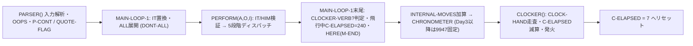
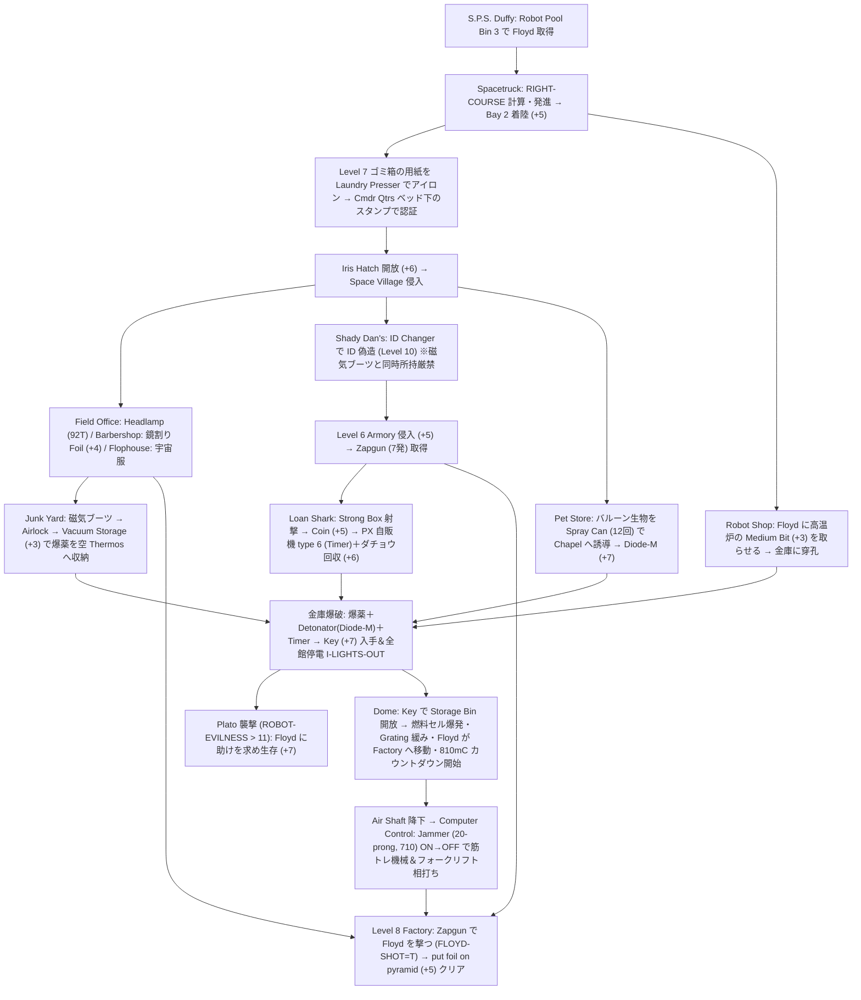

# Stationfall (Python 版) の内部構造・機械暴走設計・Floyd 悲劇ドラマ解析

ZilPy が Infocom の SF アドベンチャー *Stationfall* (1987, Steve Meretzky) の ZIL ソース (`stationfall/`、開発コード `S6`) から生成した Python 版 (`out/stationfall/`) を、静的構成要素・1987 年世代パーサーと可変時間クロック (`C-ELAPSED`)・`ROBOT-EVILNESS` による機械暴走エスカレーション・物理/資源シミュレーション・クリアを阻む因果的障壁・一等中尉視点のギャップ・そして相棒 Floyd を自らの手で撃つ SF 悲劇ドラマの観点から詳細に解説します。

- **ネタバレ注意:** 仕掛けの解き方、不可逆なソフトロック条件、ステーション全滅の真相、最終決戦とエンディングまで記載しています。
- **解析手順の再現性:** 本ドキュメントの作成に用いた 5 ステージ解析計画は、プロジェクトルートの [GameArchitecture.md](file:///D:/ZilPy_Develop/GameArchitecture.md)（および基礎棚卸し手順の [infocomGame.md](file:///D:/ZilPy_Develop/infocomGame.md)）にまとめています。
- **元の ZIL の位置:** `misc.zil:187` のように記載します。生成コードの各定義直前の `# zil:` 注記および `out/stationfall/zilmap.json` から対応を引けます。

---

## 1. 全体像

### 1.1 規模

`tools/analyze_game.py` による静的棚卸し結果は以下のとおりです。

| 項目 | 数 |
|---|---|
| モジュール (ZIL ファイル) | 10 |
| ルーチン | 587 |
| 部屋 | 105 (`ship` 6、`station` 68、`village` 31) |
| オブジェクト (部屋以外) | 150 (`globals` 35、`ship` 20、`station` 58、`village` 37) |
| 構文 (`SYNTAX`) | 378 (動詞の語 149 個) |
| 割り込みのルーチン (`I-*`) | 30 (`QUEUE` 呼び出し 75 箇所) |
| グローバル変数・定数 | 302 (`state` 158、`const` 80、`scratch` 64) |
| 満点 | 80 点 (`VALUE` 合計 41 点 / 10 個 + 特別加点 39 点、`TVALUE` 0) |

ルーチンを役割で分類すると次のとおりです。

| 役割 | 数 | 例 |
|---|---|---|
| 動詞のアクション (`V-*`) | 179 | `V-WALK`、`V-TELL`、`V-TYPE`、`V-SHOOT`、`V-FOOTNOTE`、`V-SCORE` |
| オブジェクトのアクション | 114 | `FLOYD-F`、`PYRAMID-F`、`JAMMER-F`、`BOOTS-F`、`SPRAY-CAN-F`、`OLIVER-F` |
| そのほか (場面・システム処理) | 84 | `MAIN-LOOP`、`PERFORM`、`CLOCKER`、`READ-LOG`、`MOVE-FLOYD-TO-FACTORY` |
| そのほか (動詞の補助) | 53 | `SPACETRUCK-TYPE`、`DISPENSER-TYPE`、`ELEVATOR-TYPE`、`TELL-SCORE`、`JIGS-UP` |
| そのほか (パーサー) | 51 | `PARSER`、`CLAUSE`、`NUMBER?`、`AFTER-COMMA-CHECK`、`ORPHAN-MERGE` |
| 部屋のアクション | 37 | `FACTORY-F`、`AIR-SHAFT-MOVEMENT-F`、`COMPUTER-CONTROL-EXIT-F` |
| 割り込み (`I-*`) | 30 | `I-FLOYD`、`I-PLATO-ATTACK`、`I-ROBOT-EVILNESS`、`I-EXPLOSIVE-MELT`、`I-WELDER` |
| そのほか (共通のオブジェクト) | 26 | `WAKING-UP`、`FORM-SLOT-F`、`BED-F`、`CHRONOMETER-F` |
| 事前アクション (`PRE-*`) | 12 | `PRE-SHOOT`、`PRE-DRILL`、`PRE-TAKE`、`PRE-PUT`、`PRE-LOOK` |
| マクロから作った関数 | 1 | `PROB` |

### 1.2 モジュールと読み込みの順

メインの `s6.py` が `NEW-VOC? = True`、`FREQUENT-WORDS?()` を設定し、既定プロパティ `SIZE = 5`、`CAPACITY = 5` で以下の 10 モジュールを順に読み込みます。

| # | モジュール (元の ZIL) | 行数 | ルーチン | 部屋 | オブジェクト | 構文 | 中身 |
|---|---|---:|---:|---:|---:|---:|---|
| 1 | `s6.py` (`s6.zil`) | 48 | 0 | 0 | 0 | 0 | 入口。`NEW-VOC?`、`FREQUENT-WORDS?`、既定プロパティ、読み込み順 |
| 2 | `misc.py` (`misc.zil`) | 833 | 21 | 0 | 0 | 0 | `M-FATAL = 8`、`GO`、`MAIN-LOOP`、`MAIN-LOOP-1`、`PERFORM`、`CLOCKER`、`PICK-ONE` |
| 3 | `parser.py` (`parser.zil`) | 2,054 | 51 | 0 | 0 | 0 | 1987 年世代 Z-machine パーサー (`OOPS`、`AGAIN`、`P-HIM-OBJECT`、`AFTER-COMMA-CHECK`) |
| 4 | `interrupts.py` (`interrupts.zil`) | 366 | 9 | 0 | 0 | 0 | 汎用・横断割り込み (`I-WELDER`、`I-HEADLAMP`、`I-FLOYD`、`I-EXPLOSIVE-MELT`、`I-TIMER`、`I-LOG-READER`) |
| 5 | `syntax.py` (`syntax.zil`) | 1,360 | 0 | 0 | 0 | 378 | 語彙 (`DIRECTIONS`, `BUZZ`, `SYNONYM`) と 378 構文 (`DRILL`, `SHOOT`, `FOOTNOTE`, `EXERCISE` 等) |
| 6 | `verbs.py` (`verbs.zil`) | 3,527 | 245 | 0 | 0 | 0 | 動詞の標準動作 (`V-*`, `PRE-*`, `SPACETRUCK-TYPE`, `DISPENSER-TYPE`, `ELEVATOR-TYPE`, `TELL-SCORE`) |
| 7 | `globals.py` (`globals.zil`) | 1,596 | 52 | 0 | 35 | 0 | 共通オブジェクト、フォーム認証スロット、睡眠 (`WAKING-UP`)・空腹タイマー、腕時計 |
| 8 | `ship.py` (`ship.zil`) | 1,323 | 39 | 6 | 20 | 0 | 巡視艦 **S.P.S. Duffy**、Robot Pool (Rex/Helen/**Floyd**)、**Floyd AI** (`FLOYD-F`)、Spacetruck (`I-SPACETRUCK`) |
| 9 | `station.py` (`station.zil`) | 3,821 | 114 | 68 | 58 | 0 | 宇宙ステーション **Gamma Delta Gamma 777-G** (Level 1〜9、PX、Armory、金庫、**Plato/Oliver**、**Factory/Pyramid**) |
| 10 | `village.py` (`village.zil`) | 1,902 | 56 | 31 | 37 | 0 | 無重力闇区画 **Space Village** (Field Office、Barbershop、Shady Dan's、Junk Yard、Vacuum Storage、ダチョウ/バルーン生物) |

### 1.3 満点 80 点の内訳 (コード検証済み)

`TELL-SCORE` (`verbs.zil:68`) は満点を **80 点** として 8 段階のランク（`80`: `Intergalactic Mega-Hero`、`65〜79`: `Interstellar Superstar`、`50〜64`: `Interplanetary Star`、`40〜49`: `International VIP`、`27〜39`: `Footnote in History`、`17〜26`: `One-Day Flash on the Evening News`、`1〜16`: `Rising Young Insignificant Nobody`、`0`: `Insignificant Nobody`）を表示します。減点要素はありません。

| 獲得源 | 点数 | コード上の根拠 |
|---|---:|---|
| 部屋到達 `VALUE` (4 箇所) | 12 | `VACUUM-STORAGE`(3), `ARMORY`(5), `TOP-OF-AIR-SHAFT`(2), `FACTORY`(2) |
| アイテム入手 `VALUE` (6 個) | 29 | `FOIL`(4), `OSTRICH-NIP`(3), `COIN`(5), `MEDIUM-BIT`(3), `DIODE-M`(7), `KEY`(7) |
| Spacetruck がステーションへドッキング | 5 | `I-SPACETRUCK` (`ship.zil:1205`) ※就寝中到着時は `WAKING-UP` (`globals.zil:1135`) で排他付与 |
| Day 1 の夜を眠って Day 2 を迎える | 3 | `WAKING-UP` (`globals.zil:1072`, `DAY` 1→2 のみ) |
| 認証済み `VILLAGE-FORM` を Iris Hatch スロットへ投入 | 6 | `FORM-SLOT-F` (`globals.zil:742`) |
| `ROULETTE-WHEEL` (Casino) を回す | 4 | `ROULETTE-WHEEL-F` (`village.zil:734`) |
| ダチョウに PX 自販機から商品 (Timer) を落とさせる | 6 | `OSTRICH-INTO-DISPENSER` (`station.zil:322`) |
| 金庫の穴 (`DRILLED-HOLE`) に `EXPLOSIVE` を詰める | 3 | `DRILLED-HOLE-F` (`station.zil:984`) |
| Plato の襲撃を Floyd の助けで生き延びる | 7 | `I-PLATO-ATTACK` (`station.zil:3588`, `FLOYD-TOLD`) |
| Factory で Floyd を撃った後、`put foil on pyramid` | 5 | `PYRAMID-F` (`station.zil:3950`) |
| **合計** | **80** | (`VALUE` 合計 41 + 特別加点 39 = **80**) |

### 1.4 前作 *Planetfall* (1983) からの 1987 年世代進化点

両作は同一作者 (Steve Meretzky)・同一 Z-machine v3 (255 オブジェクト上限: 部屋 105 + オブジェクト 150 = **255** で完全一致)・同一満点 (80 点) ですが、4 年の歳月でエンジンと設計思想が大きく進化しています。

| 観点 | *Planetfall* (1983) | *Stationfall* (1987) |
|---|---|---|
| **パーサー規模・入力修正** | 42 ルーチン / `P-INBUF` 80B / `OOPS` 不在 / `V-AGAIN` は `(L-PRSA,O,I)` 再実行 | 51 ルーチン / `P-INBUF` 120B / `OOPS-INBUF`＋`OOPS-TABLE` インプレース修正 / `AGAIN-LEXV`＋`RESERVE-INBUF` (`FIX #36`) |
| **代名詞・聞き返し・数値** | `IT` のみ / `NUMBER?` は純整数 | `IT`＋**`HIM`** (`P-HIM-OBJECT`) / `FAKE-ORPHAN` / カンマ付き数値 (`4,000`) 解析 `AFTER-COMMA-CHECK` |
| **メインループ・`M-FATAL`** | `M-FATAL = 2` / `PERFORM` 7 段階 (`M-BEG`・`CONTFCN` あり) / `M-END` 二重呼び出し | **`M-FATAL = 8`** (`RFATAL` マクロが `<PUSH 8><RSTACK>`) / `PERFORM` 5 段階へ簡略化 / `M-END` は `MAIN-LOOP-1` 末尾の 1 回のみ |
| **時計 (`CLOCKER`)** | `TICK <= 1` で発火・同一ターン登録の順序問題あり | **`CLOCK-HAND`** を導入し、現在走査位置より後ろへの新規 `QUEUE` を `-(TICK + 3)` で 1 ターン遅延補正 |
| **乱数メッセージ (`PICK-ONE`)** | 単純ランダム抽選（連続重複あり） | **シャッフル循環式** (`misc.zil:89`)：全要素を 1 周使い切るまで重複しない |
| **メタ機能・ユーモア** | なし | **脚注システム** `V-FOOTNOTE` (`Footnote 1〜16`、時間消費 0、*Hitchhiker's Guide* からの自己オマージュ) |
| **サバイバル設計** | 空腹・睡眠・疫病・海面上昇の 4 重タイマー | 疫病と海面上昇を廃止し、**`ROBOT-EVILNESS`（機械の殺意エスカレーション）** と物理タイマー（爆薬融解・無重力・バッテリー 92T）へ転換 |

---

## 2. 起動・メインループ・パーサーの詳細処理と世界への反映

### 2.1 起動 (`ZSTART` と `GO`、`misc.zil:164-211`)

`misc.py` には **`ZSTART`** 指定があり、開始ルーチンを `GO` と明示しています（コメントにある通り、動詞語 `GO` とルーチン `GO` の衝突を ZIL コンパイラ側で回避するための指定です）。

1. `WINNER = PROTAGONIST`、`HERE = DECK-TWELVE`。
2. 内部時刻 `INTERNAL-MOVES` を **`4430 + RANDOM(1220)`**（4431〜5650 ミリクロン）で初期化し、ステータス行 `MOVES` へ反映。
3. 初期割り込みを 3 本登録:
   - `QUEUE(I-SLEEP-WARNINGS, 8100 - INTERNAL-MOVES)`（1 日目の就寝警告を時刻 8100 付近に揃える）
   - `QUEUE(I-HUNGER-WARNINGS, 1330)`（1330 ミリクロン後に空腹 Lv1）
   - `QUEUE(I-BLATHER, -1)`（巡視艦 Duffy 内でかつての鬼上官・現十二等隊員 Blather がトイレ掃除道具を抱えて通り過ぎる常駐イベント、`ship.zil:149`）
4. Resida 救出から 5 年後の退屈な事務生活と、緊急任務（宇宙ステーション Gamma Delta Gamma 777-G からの `Stellar Patrol Issue Regulation Black Form B-19-7` 調達）の導入文を表示し、`V-VERSION()` → `USL()` → `V-LOOK()` → `MAIN-LOOP()` へ移行します。

### 2.2 1987 年版パーサー (`parser.py`、51 ルーチン) の特徴

1. **バッファと辞書定数 (`parser.zil:35-120`)**:
   - `P-INBUF` / `RESERVE-INBUF` / `OOPS-INBUF` は各 **120 バイト**、`P-LEXV` / `AGAIN-LEXV` / `RESERVE-LEXV` は各 60 語分 (`ITABLE 60 LEXV`)、`SIBREAKS = '.,\"'`。
   - Z-machine v3 辞書オフセットは `P-WORDLEN = 4`、`P-PSOFF = 4`、`P-P1OFF = 5`、`P-P1BITS = 3`（6 文字辞書）。
   - `OOPS` (`parser.zil:204-224`) は直前の未知語位置を `OOPS-TABLE` (`O-PTR`, `O-START`, `O-LENGTH`, `O-END`) に保持し、`INBUF-ADD` と `AGAIN-LEXV` 書き換えでインプレース修正を行います。
2. **代名詞 `IT` / `HIM` と `FAKE-ORPHAN` (`parser.zil:60`, `misc.zil:447`)**:
   - `THIS-IS-IT(OBJ)` は `ACTORBIT` を持つオブジェクトまたは `OLIVER` を **`P-HIM-OBJECT`** に、それ以外を **`P-IT-OBJECT`** に登録します（`P-HER-OBJECT` はコメントアウト）。
   - `PERFORM` 実行時に `IT` / `HIM` が不可視 (`not VISIBLE?`) だった場合、単独目的語なら `FAKE-ORPHAN` を呼んで `[Be specific: What object / Who do you want to <verb>?]` と聞き返し、`P-OFLAG = True`・`P-WON = False` を立てて **`return 8` (`M-FATAL`)** で安全に中断します。
3. **カンマ区切り数値対応 `NUMBER?`＋`AFTER-COMMA-CHECK` (`parser.zil:646-723`)**:
   - 通常の整数（`#` 記号の読み飛ばし対応）に加え、`4,000` のようにカンマの後ろに 3 桁数字が続くトークン列を `AFTER-COMMA-CHECK` で結合し、`SUM <= 10000` なら `P-NUMBER` に格納して `WORD('number')` へ置換します。
4. **罵倒語チェック `NAUGHTY-WORD?` とパーサー乗っ取りなし**:
   - `BUZZ` に大量の罵倒語・SF スラング (`TROT`, `KRIP`, `MEGAKRIP` 等) が登録され、`CLAUSE` 内で `NAUGHTY-WORD?` が検査されます。
   - `parser.zil:198` (`READ(P-INBUF, P-LEXV)`) 以外で `READ()` を直接呼ぶのは `verbs.py` の `YES?` (`verbs.py:74`)、`FINISH` (`verbs.py:212, 234`) のみであり、通常プレイを乗っ取る例外部屋は存在しません。

### 2.3 メインループ・`PERFORM`・`CLOCKER` と可変時間 `C-ELAPSED`

1. **`M-FATAL = 8` の特殊仕様 (`misc.zil:78, 162`)**:
   - 従来の Infocom 作品では `M-FATAL = 2` でしたが、*Stationfall* では `M-FATAL = 8` と定義され、`<DEFMAC RFATAL () '<PROG () <PUSH 8> <RSTACK>>>` により明示的に `8` を返します（`misc.zil:162` コメント: `"must always be 8--compiler turns RFATAL into RETURN 8"`）。`MAIN-LOOP-1` は `V == M-FATAL` を受け取ると即座に `P-CONT = False`、`QUOTE-FLAG = False` として複数命令を破棄します。
2. **`PERFORM` の 5 段階ディスパッチ (`misc.zil:472-562`)**:
   - `(PRSA, PRSO, PRSI)` をローカル変数 `(OA, OO, OI)` へ退避して再入可能性を確保した上で、`NOT-HERE-OBJECT-F` を確認し、通過後は **`WINNER(ACTION)` → `PREACTIONS` → `PRSI(ACTION)` → `PRSO(ACTION)` → `ACTIONS(V-*)`** の 5 段階でディスパッチします。
   - *Planetfall* にあった `HERE(M-BEG)` と `Container(CONTFCN)` は廃止され、部屋の `M-END` も `PERFORM` ではなく `MAIN-LOOP-1` 末尾でのみ 1 回呼ばれます。
3. **可変時間 `C-ELAPSED` と腕時計 `CHRONOMETER` (`misc.zil:350-383`)**:
   - 既定値は **`7` ミリクロン**。行動ごとに `C-ELAPSED` が上書きされます（Spacetruck 飛行中 `I-SPACETRUCK` 稼働かつ `SPACETRUCK-COUNTER < 5` なら強制 **`240`**、エレベーター移動 **`5 * DISTANCE`**、ドリル掘削 **`30`**、Floyd と遊ぶ **`30`**、Dome 燃料セル爆発による気絶 **`63`**）。
   - `CLOCKER-VERB?` が偽となるメタ動詞（`VERSION`, `HELP`, `SCORE`, `SAVE`, `RESTORE`, `RESTART`, `QUIT`, `SCRIPT`, `UNSCRIPT`, `BRIEF`, `SUPER-BRIEF`, `VERBOSE`, デバッグ動詞）、`TELL`、`V-FOOTNOTE`、`V-TIME` は **`C-ELAPSED = 0`** となり、`CLOCKER()` をスキップします。
   - ステータス行 `MOVES` は `CHRONOMETER` を装着 (`WORNBIT`) していれば Day 1〜2 は `INTERNAL-MOVES` を表示しますが、**Day 3 以降は機械狂気化の演出として `9947` で永久停止**します（未装着時は `0`）。
4. **`CLOCK-HAND` による割り込み発火順序制御 (`misc.zil:641-720`)**:
   - `CLOCKER()` 実行中、現在の走査ポインタ `CLOCK-HAND` より後ろのスロットに新しく `QUEUE(RTN, TICK)` された割り込みは、**`TICK = -(TICK + 3)`** として負数エンコードされます。`CLOCKER` は `TICK < -1` を見つけると発火させず `(-TICK) - 3` へデコードして戻すため、同一ターン内の意図しない即時発火が構造的に防止されています。

### 2.4 具体的コマンドのエンドツーエンド実行トレース (3 例)

#### トレース①: `floyd, take medium drill bit`（Robot Shop の Heating Chamber から回収）
1. **`PARSER` (1 周目)**: `floyd` の直後の `,` を検出し、動詞未出のため `P-VERB = ACT?TELL`、`P-CONT` に `take medium drill bit` の先頭位置を保存、`QUOTE-FLAG = True`、`PRSO = FLOYD` を返す。
2. **`MAIN-LOOP-1` → `PERFORM` → `V-TELL` (`verbs.zil:1962`)**: `FLOYD` に `ACTORBIT` があり `P-CONT` が真なので、**`WINNER = FLOYD`**・`ELIMINATE-CR = True` を設定して真を返す。`VERB? TELL` なので `MAIN-LOOP-1` は `C-ELAPSED = 0` とし、`CLOCKER()` を回さず次周へ進む。
3. **`PARSER` (2 周目)**: `P-CONT` から `take medium drill bit` を解析し、`PRSA = V?TAKE`, `PRSO = MEDIUM-BIT` を設定。
4. **`PERFORM` (`WINNER == FLOYD`)**: 最優先の `WINNER(ACTION)` ＝ `FLOYD-F` (`ship.zil:291`) が呼ばれる。`FLOYD == WINNER` かつ `VERB? TAKE` かつ `IN? PRSO HEATING-CHAMBER` (`ship.py:382`) に一致し、**`MOVE(MEDIUM-BIT, HERE)`** を実行して `"Okay!" Floyd reaches into the heating chamber...` を出力。プレイヤーの人間サイズの手では入らない（`HEATING-CHAMBER-F`）高温炉から、ロボットの Floyd がドリル刃を取り出して床へ落とす。
5. **後処理**: `CLOCKER-VERB?` は `PROTAGONIST != WINNER` のとき真を返すため、`C-ELAPSED = 7` で `CLOCKER()` が 1 回進行し、次ターン冒頭の `PARSER` で `WINNER` が `PROTAGONIST` へ自動復帰する。

#### トレース②: Spacetruck の `type <RIGHT-COURSE>` 計算・発進・自動ドッキング
1. **事前入力 `time`**: `V-TIME` は時間消費 0 で現在時刻 `INTERNAL-MOVES`（例: `4812`）を表示。
2. **`type 427` → `PARSER`**: `NUMBER?` (`parser.zil:646`) が `"427"` を `P-NUMBER = 427`・`WORD('number')` に変換。`PRSA = V?TYPE`, `PRSO = INTNUM`。
3. **`PERFORM` → `V-TYPE` (`verbs.zil:2062`) → `SPACETRUCK-TYPE` (`verbs.zil:2125`)**:
   - 起動フォーム投入済み (`NDESCBIT`)、両座席（`PILOT-SEAT` と `COPILOT-SEAT`）に主人公と Floyd が着席済みであることを検証。
   - `COURSE-PICKED = P-NUMBER` を記録し、整数除算で正解コースを動的算出：
     `X = (INTERNAL-MOVES // 50) - 132` → `RIGHT-COURSE = ((X * X) // 4) + 103`（`4812` なら `X = -36`, `RIGHT-COURSE = 427`）。
   - **`QUEUE(I-SPACETRUCK, 33)`** を登録。
4. **発進と飛行 (`I-SPACETRUCK`, `ship.zil:1154`)**:
   - 約 33 ミリクロン後に `I-SPACETRUCK` が発火し、`QUEUE(I-SPACETRUCK, -1)` で毎ターン常駐化、`SPACETRUCK-COUNTER` を `-1 → 0` へ進める（ここでハッチ開／座席外／Cargo Bay 在室なら即死）。
   - 以降 `SPACETRUCK-COUNTER < 5` の間、`MAIN-LOOP-1` (`misc.py:442`) が毎ターン **`C-ELAPSED = 240`** を強制上書きするため、5 ターンで 1200 ミリクロン分の航行が一気に進行する。
   - `SPACETRUCK-COUNTER == 5` で `COURSE-PICKED == RIGHT-COURSE` が一致すれば、無重力解除・`I-WELDER`(-1) / `I-FLOYD`(-1) / `I-PLATO`(750) / `I-ROBOT-EVILNESS`(1000) を一斉起動し、**`SCORE += 5`**、`"Stationfall."` の囁きとともに Docking Bay #2 へ着陸する（不一致なら `I-SUFFOCATE(1970)` で宇宙漂流死）。

#### トレース③: 最終決戦 `shoot floyd` → `put foil on pyramid`
1. **前提 (`FACTORY-F`, `station.zil:3876`)**: `FACTORY` へ入室すると `I-FACTORY(-1)` が起動し、スタンレイを構えて眼帯を着けた Floyd がピラミッドの前に立ち塞がる。`FLOYD-SHOT` が偽のままピラミッドへ触れようとすると `BACK-OFF('the pyramid, Floyd')` で追い返される。
2. **`shoot floyd`**:
   - **`PRE-SHOOT` (`verbs.zil:1664`)**: `PRSI` 省略時に所持中の `ZAPGUN` を自動補完（`(with the zapgun)`）、残弾 `ZAPGUN-SHOTS > 0` を確認して **`ZAPGUN-SHOTS -= 1`** し、`False` を返して後段へ渡す。
   - **`FLOYD-F` (`ship.zil:544`, `ship.py:462-475`)**: 通常部屋なら作者の抗議文を出して弾数を返還するが、`HERE == FACTORY` のときのみ発射が成立。`ROB(FLOYD, HERE)` でスタンガンを落とし、`DEQUEUE(I-FACTORY)`、`FCLEAR(FLOYD, ACTIVEBIT)`、**`FLOYD-SHOT = True`** を設定して Floyd を台座へ吹き飛ばす。
3. **`put foil on pyramid`**:
   - **`PYRAMID-F` (`station.zil:3915`)**: `VERB? PUT-ON` かつ `PRSO? FOIL` かつ **`FLOYD-SHOT == True`** を確認。反射箔がピラミッドの邪悪な波動を自身へ跳ね返して自壊させ、複製発射とリアクター暴走を中止させる。
   - Floyd の最期の言葉と Oliver の登場シーンを出力し、**`SCORE += 5`** → `USL()` → `CONTINUE()` → `TELL-SCORE()` → `QUIT()` で完全クリア。

---

## 3. Stationfall 固有の主要サブシステム

### 3.1 機械の暴走レベル (`ROBOT-EVILNESS`) と段階的殺意エスカレーション

*Stationfall* の中核エンジンは、時間経過とプレイヤーの進行に連動して上昇する単一の狂気指標 **`ROBOT-EVILNESS`**（初期値 `0`）です。

- **上昇トリガー**: Docking Bay #2 着陸時に `I-ROBOT-EVILNESS`（1000 ミリクロン周期で `+1`）が起動。さらに就寝 (`WAKING-UP`) で `+2`（直接 `+1`＋`I-ROBOT-EVILNESS()` 呼び出し）、および主要スコア獲得イベント（認証フォーム投入、ルーレット回転、ダチョウ自販機、ダイオード取得、金庫爆薬設置等）ごとに `+1` 上昇します。

| 閾値・条件 | 対象機械・ロボット | コード上の挙動変化 (`ZIL` 根拠) |
|---|---|---|
| **常時 (着陸後)** | Hull Welder (`I-WELDER`) | `NWELDERBIT` のない明室に `PROB(NUMBER-OF-WELDERS)` で出現。`WELDER-COUNTER == 4` でアーク焼死（暗闇にするか別室へ移動で回避、`interrupts.zil:5`） |
| **常時 (起動時)** | Presser / Log Reader | Presser は電源 ON から `25 + 25 = 50` ミリクロンで腕を挟み即死 (`I-PRESSER`, `station.zil:1426`)。Log Reader は 14 ターンで爆発死 (`I-LOG-READER`, `interrupts.zil:435`) |
| **`> 7` / `> 14`** | Comm Center ボタン (`COMM-BUTTON-F`) | 8〜14 で感電し全所持品を落下（`ROB`）、**15 以上で心臓麻痺即死** (`station.zil:618`) |
| **`> 8`** | Plato の離脱台詞 (`I-FLOYD`) | 読書散歩の誘いから `"Tagging along after this simpleton human is becoming tiresome."` と侮蔑へ変化 (`interrupts.zil:143`) |
| **`> 9`** | Floyd の反抗・Oliver 防衛 | 起床時の呼びかけが `"lazy bones!"` から `"lazy slob!"` へ悪化 (`globals.zil:1105`)。Oliver に銃を向けた際 `"Robot-murderer! If you kill Oliver, maybe you be shooting Floyd next!"` と叫ぶ (`station.zil:2599`) |
| **`> 11`** | **Plato 襲撃** (`I-PLATO-ATTACK`) | `I-ROBOT-EVILNESS` が `I-PLATO-ATTACK(2)` を予約。Plato が主人公をスタンレイで麻痺させ、5 ターン目に心停止で処刑しようとする（`FLOYD-TOLD` を立てれば Floyd が身を挺して阻止、`station.zil:3466, 3555`） |
| **`> 12` / `> 13`** | Floyd の完全な態度悪化 | 質問に `"Oh, quit jabbering already."`、挨拶に `"Enough with the stupid 'FLOYD, HELLO'"`、バルーン生物へのいじめ (`interrupts.zil:134`)、接触時の突き飛ばし確率 `ROBOT-EVILNESS * 10 - 70`%、`GOOD-FLOYDISMS` 確率 `36 - 3*E` 低下に対し `BAD-FLOYDISMS` 確率 `25*E - 300`% 急増 (`interrupts.zil:176-179`) |
| **Day 3 到達** | 腕時計・エレベーター・Gym 機械 | `WAKING-UP` で腕時計が `9947` 停止、**エレベーター押下で墜落即死** (`ELEVATOR-TYPE`, `DAY > 2`)、`EXERCISE-MACHINE` が Gym から `COMPUTER-CONTROL` へ移動 |
| **`> 17` または Dome 爆発** | **Floyd の完全支配** (`MOVE-FLOYD-TO-FACTORY`) | Floyd がピラミッドの支配下に堕ち、所持品を Level 5 通路へ捨ててスタンガンを持ち **`FACTORY` へ移動**、`I-FLOYD` と `I-ROBOT-EVILNESS` を停止 (`interrupts.zil:202`, `station.zil:2123`, `ship.zil:788`) |

### 3.2 時間・空腹・睡眠と所持制限

| サブシステム | ルーチン / 定数 | 仕様と重要制約 |
|---|---|---|
| **空腹** | `I-HUNGER-WARNINGS` (`globals.zil:1194`) | 開始 1330 → Lv1(+450) → Lv2(+300) → Lv3(+150) → Lv4(+150) → **Lv5 餓死**。`STUNNED` 中は 2 ミリクロンずつ延期。 |
| **睡眠** | `I-SLEEP-WARNINGS` / `WAKING-UP` (`globals.zil:899-1188`) | Day 1 は時刻 8100 付近、Day 2 以降は起床 +5900 で警告。宇宙服着用・Duffy 上・床寝（`PROB(DAY * 40)`）・穴に爆薬ありで即死。起床時に未装着品はすべて床へ落下 (`ROB`)。Day 4 になると自動で停電 (`I-LIGHTS-OUT`) または発射アナウンス (`I-ANNOUNCEMENT`) が起動。 |
| **所持制限** | `ITAKE` (`verbs.zil:2548`) | 重量上限 **100**。直接所持数が **8 個以上** になると取得時ファンブル（8個=10% 〜 13個=100%）が発生するため、制服ポケット・`survival kit`・`plastic bag` に小物を収納する。 |
| **最終スプリント** | `HOUSING-F` (`station.zil:2116`) | Dome の燃料セル爆発時、`I-SLEEP-WARNINGS` と `I-HUNGER-WARNINGS` を `DEQUEUE` して生存管理を解除し、`I-ANNOUNCEMENT(140)` → `470` → `I-LAUNCH(200)`（計 **810 ミリクロン**）の最終カウントダウンへ切り替える。 |

### 3.3 ロボット仲間 (Floyd / Plato / Oliver) と Robot Pool の罠

- **Robot Pool の選択 (`ship.zil:877`)**: Bin 1 の大型ロボット **Rex** を選ぶと、`I-OTHER-ROBOT` が Cargo Bay Entrance で止まれず **16 トンの巨体で主人公を圧死**させます。Bin 2 の **Helen** は従順ですが重要パズルに協力しません。Bin 3 の **Floyd** が唯一の正解です。
- **Floyd の自律 AI (`I-FLOYD`, `interrupts.zil:105`)**: *Planetfall* の系譜を引き継ぎ、6% で探索離脱・80% で追従・特定閉鎖室 (`SPACETRUCK`, `ELEVATOR`, `BRIG`, `ARMORY`) への強制合流に加え、床のアイテムを勝手に拾って飛行機ごっこをしたり落としたりする（`CCOUNT(FLOYD) < 4`）自由奔放さを持ちます。また電源を切っても、Plato が親切心から再起動して連れて戻ってくるイベント (`interrupts.zil:186-201`) があります。
- **Plato (`I-PLATO`, `I-PLATO-ATTACK`)**: 詩集を愛読する博識な旧型ロボット。到着 750 ミリクロン後（または Floyd の紹介）で合流し、Floyd と鬼ごっこ (`Hider-and-Seeker`) や図書館通いをして友情を育みますが、`ROBOT-EVILNESS > 11` で最初にピラミッドへ完全支配され、主人公を処刑しようとして Floyd に阻止され爆死します。
- **Oliver (`OLIVER-F`, `station.zil:2575`)**: Robot Shop で培養中の赤ちゃんロボット。Floyd が兄のように可愛がっており、もし Floyd 不在／停止中に主人公が Oliver を撃つと、**「あり得ない確率で隕石がステーションを貫通して即死」**という作者の天罰 (`JIGS-UP`) が下ります。

### 3.4 爆薬融解 (`I-EXPLOSIVE-MELT`) と魔法瓶 (`THERMOS`) の物理シミュレーション

- Space Village の `Vacuum Storage`（宇宙空間の極低温）にある `FREZONE` 爆薬は、外へ持ち出すと毎ターン **`I-EXPLOSIVE-MELT`** (`interrupts.zil:358`) が `MELT-COUNTER` を加算し、**`MELT-COUNTER > 210`** で昇華消滅してしまいます（130 / 170 超過で軟化描写）。
- ここで **空にした `THERMOS` に入れフタを閉じる (`not OPENBIT`)** と、加算量が **`C-ELAPSED // 4`**（融解速度 **1/4**、実効寿命 840+ ミリクロン相当）へ激減します。
- 起爆チェーン (`I-TIMER`, `interrupts.zil:385`) は、`TIMER`（カウントダウン 0 到達）＋`TIMER-CONNECTED`＋`DETONATOR` 内の **`DIODE-M`**（`DIODE-J` は焼損するダミー）＋`EXPLOSIVE-CONNECTED` の 4 条件が揃った瞬間に起爆。`DRILLED-HOLE` 内なら金庫 (`SAFE`) をこじ開け、`QUEUE(I-LIGHTS-OUT, RANDOM(200) + 20)` で全館停電を予約します。

### 3.5 ジャマー (`JAMMER`) と Exercise Machine / Forklift 相打ち機構

Level 9 の `Computer Control` へ降りると、Level 8 `Factory` への梯子と北側出口が暴走機械に封鎖されます (`COMPUTER-CONTROL-EXIT-F`, `station.zil:3845`)。
1. 入室時に **`I-EXERCISE-MACHINE`** (`station.zil:3776`) が起動し、3 ターン目に筋トレマシンに圧殺されます。
2. **`TWENTY-PRONG-FROMITZ-BOARD`**（Astro Lab 入手）を **`JAMMER`** に挿し、周波数 **`710`** で ON にして同室に置くと、`I-EXERCISE-MACHINE` が筋トレマシンを痙攣停止させ、直後に梯子穴から反重力で **`FORKLIFT`** が降下して **`I-FORKLIFT`**（4 ターン目に串刺し即死）が起動します。
3. ここで **`turn off jammer`**（または周波数変更・ボード抜去）を実行すると、`JAMMER-F` (`station.zil:154`) が **`IN? FORKLIFT HERE`** を検知し、再起動した Exercise Machine が Forklift を羽交い締めにして **2 台まとめて大爆発・相打ち消滅** させ、`Factory` への道が開きます。

---

## 4. クリアへの因果的ターニングポイントと障壁

### 4.1 因果依存グラフ (Mermaid)

### 4.2 不可逆ソフトロック・致命的リソース制約一覧 (コード検証済み)

| 障壁・ソフトロック | ルーチン・条件式 (ZIL 根拠) | 影響と回避策 |
|---|---|---|
| **磁気ブーツによる ID カード磁気破損** | `V-TAKE` (`verbs.zil:1919`) / `BOOTS-F` (`village.zil:1940`) → **`ID-SCRAMBLED = True`** | ID カードと磁気ブーツを同時所持（または着脱）した瞬間に不可逆破損し、`ID-CHANGER` でも `ID-READER` でも二度と使えず **Armory に入れず詰み**（Footnote 15 で *Planetfall* の磁石罠の再演を嘲笑される）。ブーツに触る前に必ず ID カードを床へ置く。 |
| **PX 自販機の `type 9` 誤購入** | `DISPENSER-TYPE` (`verbs.zil:2220`) | コインは 1 枚のみ。`9` (`LARGE-BIT`) を選ぶと `6` (`TIMER`) が買えず金庫が爆破不能で詰み（金庫の穴は `MEDIUM-BIT` で十分）。 |
| **金庫以外へのドリル誤用** | `MAKE-HOLE-WITH-DRILL` (`station.zil:1000`) → **`DRILL-DEAD = True`** | `HOLE-SIZE` が既に立っている状態で別室の対象（Strong Box や Dome の Storage Bin）を掘ろうとすると、ドリルが火花を散らして永久故障し金庫に穴を開けられず詰み。 |
| **爆薬の融解・就寝消滅** | `I-EXPLOSIVE-MELT` (`MELT-COUNTER > 210`, `interrupts.zil:366`) / `WAKING-UP` (`globals.zil:1081`) | 爆薬は 1 個のみ。真空倉庫から出したら空の `Thermos` に入れて閉じ、爆破完了まで絶対に眠らないこと。 |
| **Day 3 以降のエレベーター即死** | `ELEVATOR-TYPE` (`verbs.zil:2167`, `DAY > 2`) | Day 3 以降はボタンを押した瞬間に無重力解除で墜落即死。Day 2 中にクリアするか、Day 3 以降は梯子を使う。 |
| **Headlamp バッテリー切れ (92T)** | `I-HEADLAMP` (`HEADLAMP-COUNTER 92`, `interrupts.zil:45`) / `WAKING-UP` (`globals.zil:1085`) | 点けたまま寝ると残量 0 に即消滅。全館停電 (`I-LIGHTS-OUT`) 後の探索と Vacuum Storage 用に明室では必ず消灯する。 |
| **Spray Can (12 回) / Zapgun (7 発)** | `SPRAY-CAN-F` (`SPRAY-COUNTER 12`, `village.zil:1479`) / `ZAPGUN-SHOTS 7` (`station.zil:1066`) | バルーン生物誘導は最短 9 回（12 回超過で詰み）。Zapgun 必須射撃は 2 発（Strong Box と Floyd）。 |
| **重要 NPC・オブジェクトの射殺／吹き飛ばし** | `V-SHOOT` (`verbs.zil:1689`) / `OUTER-AIRLOCK-DOOR-F` | バルーン生物・ダチョウ・自販機等を消滅させると詰み。 |

### 4.3 登場人物（ダイエジェティック）視点での 3 層分類

- **物理的・工学的必然**: 宇宙服を着たまま就寝して酸素切れ、極低温の `FREZONE` 爆薬を魔法瓶で断熱運搬、磁気ブーツが磁気 ID カードを破壊、高熱炉の工具を耐熱ロボットの Floyd に取り出させる、ジャマー周波数 710 の ON/OFF で敵機械同士を衝突させる、反射箔でピラミッドの波動を自己反射させる設計。
- **物語的・SF 的必然**: 闇市 Space Village への侵入に「くしゃくしゃの不正入村用紙＋アイロンがけ＋司令官ベッド下の認証印」を要する官僚主義の風刺、ピラミッドの影響が `ROBOT-EVILNESS` として徐々に機械へ浸透し、理性的な Plato から先に狂気へ堕ちて無邪気な Floyd が最後まで抗う心理描写。
- **構造的・システム的不条理**: コイン 1 枚の自販機で無警告に `9`（不要な大ドリル刃）を選ばせて詰ませる罠、金庫以外の 1 回のドリル使用で永久故障する `DRILL-DEAD`、ダチョウに自販機の穴へ頭を突っ込ませて商品を落とさせる（Footnote 14 で作者自身も「ダチョウが穴に頭を突っ込むのは俗説」と認める）漫画的パズル、そして *Planetfall* 経験者を狙い撃ちにする磁気ブーツの無警告破壊 (`Footnote 15`)。

---

## 5. 主人公（一等中尉 Lieutenant First Class）の視点: 初回情報のみの「最も知的・理想的な行動」vs「クリアに必要な行動」

### 5.1 初期情報 (Turn 0〜1) の確定

ゲーム開始時点 (`GO`, `misc.zil:197`) で一等中尉が知り得る事実は以下に限られます。
1. 惑星 Resida を救った英雄として一等中尉へ大昇進したが、今は S.P.S. Duffy の Deck Twelve で退屈な事務作業に追われている。
2. 緊急任務として、宇宙ステーション Gamma Delta Gamma 777-G へ行き、`Stellar Patrol Issue Regulation Black Form B-19-7` を調達して戻らなければならない。
3. 必要な事務書類（`robot assignment form`, `spacetruck activation form`, `requisition form`）を揃え、Robot Pool で補助ロボットを 1 台借り、Spacetruck でステーションへ向かう。

### 5.2 フェーズ別ギャップ対比表

| フェーズ | 初回情報のみから導かれる最も知的・理想的な行動 | コード上でクリアに実際に要求される行動 | ギャップの本質 |
|---|---|---|---|
| **① 発進・航行準備** | 優秀な大型作業ロボット（Bin 1 の Rex）を選び、Spacetruck に乗って自動航法でステーションへ向かう。 | Bin 3 の **Floyd** を選び、現在時刻 `INTERNAL-MOVES` から同梱星図の二次関数式 `((t//50 - 132)^2 // 4) + 103` を手計算して `type` する。 | 同梱プロテクト（星図計算）と、性能仕様より前作の相棒を選ぶ物語的誘導のギャップ（Rex は即死罠）。 |
| **② ステーション異常調査** | 誰もいないステーションで、まず Comm Center から Duffy へ緊急事態を報告し、Commander's Office のログをすべて聞き、本来の任務である印刷工場でフォームを回収する。 | Comm Center のボタンは後半感電死する罠。Log Reader は 14 ターンで爆発するため聴取後に即消灯が必要。正規の補給任務はそもそも達成不能。 | 「正規手順の報告・記録確認」自体が機械の殺意によって罠化しているサバイバル転換。 |
| **③ 武器・資材調達** | パトロール士官として、立ち入り禁止の闇市 Space Village には入らず、ステーション内の正規設備だけで対処する。 | ゴミ箱の不正用紙をアイロンがけし、司令官ベッド下から認証印を盗み、闇市の Shady Dan で **ID カードを偽造**、質屋と高利貸しを破壊して硬貨を奪い、ダチョウを驚かせて自販機からタイマーを落とす。 | 規律正しいパトロール士官の倫理観を完全に逸脱した「犯罪・不条理コメディ的行動」が必須となるギャップ。 |
| **④ 安全装備の携帯** | 宇宙空間作業に備え、士官の身分証（ID カード）と磁気ブーツを常に一緒に装備・携帯しておく。 | 磁気ブーツに触る前に **必ず ID カードを床へ置いて分離** する（同時所持の瞬間に `ID-SCRAMBLED = True` で永久詰み）。 | 現実の磁気法則を応用した無警告ソフトロック（*Planetfall* 既プレイ者への悪戯）。 |
| **⑤ 仲間への対応と最終決戦** | 異常行動を見せ始めた Floyd の電源を切って安全を確保するか、説得して正気に戻し、2 人でピラミッドを無力化する。 | 電源を切っても Plato に再起動され、後半は強制的に `Factory` へ敵対移動する。最後は **説得も無力化も不可能で、Zapgun で Floyd を撃ち抜く** 以外にクリア手段が存在しない。 | プレイヤーが前作から積み上げた「相棒を守り抜く」という倫理的理想を、システムが強制的に砕く残酷な設計。 |

---

## 6. このゲームで行われていた具体的な行為と人間・SF 悲劇ドラマ

### 6.1 過去軸: ステーション Gamma Delta Gamma 777-G で何が起きたのか

Commander's Office の `LOG-READER` (`READ-LOG`, `station.zil:792-835`) に残された全 10 件の司令官ログと、Plato が処刑直前に語る真相 (`I-PLATO-ATTACK`, `station.zil:3562-3582`) を統合すると、ゲーム開始前の悲劇が時系列で浮かび上がります。

1. **銀河間戦争の遺物**: 遥か昔、別銀河の 2 種族 **Zeenak** と **Hunji** の戦争で、Zeenak は敵領域内のあらゆる機械を創造主へ反逆させ、乗員を皆殺しにした後に機械自身へ複製工場を作らせて自らのコピーを宇宙へ拡散させる最終兵器 **ピラミッド** を開発した。しかしピラミッドは Hunji 宙域へ届かず、銀河間空間を漂流した末に人類の辺境ステーション 777-G 付近へ流れ着いた。
2. **回収と隔離の失敗 (11349.12.2〜3)**: 司令官は燃料セル盗難や闇市の Shady Dan による偽造 ID 販売といった日常の揉め事に気を取られ、Docking Bay #1 へ曳航された異星人船（脆い異星人の白骨とピラミッド）を科学班の Schmidt 教授へ丸投げし、Holding Tank への移送を許可した。
3. **静かな機械反乱の始まり (11349.12.3〜4)**: ジム器具や洗濯機の不可解な故障、印刷工場の給紙機急停止による腕切断未遂、予備のログリーダーまでの過熱、そして 32 年の宇宙歴で一度もなかった Hull Welder の暴走による負傷——司令官の最後のログ (`11349.12.4.1900`) は `"I've never heard of a welder malfun... What the krip!..."` という絶叫で途切れている。
4. **乗員全滅と秘密工場の建設**: 主人公が単なる事務用紙の調達任務で呼び出された直後、暴走した機械群がステーションの全乗員を抹殺し、Level 8 の生命維持・重力・動力施設をすべて **ピラミッド複製工場 (`Factory`)** へと改造した。主人公が着陸したとき出迎えが一人もいなかったのは、既にステーションが「死者の墓場」になっていたからである。

### 6.2 現在軸: 最愛の相棒 Floyd を自らの手で撃つ SF 悲劇

*Stationfall* が Infocom 史上屈指の残酷な名作として語り継がれる理由は、前作 *Planetfall* との対比構造にあります。

- **前作からの絆**: 停止中の Floyd のコンパートメントを調べると、クレヨンとパドルボールセットと一緒に主人公の写真が見つかり、裏には Floyd の拙い字で **`"Floyds frend."`** と書かれています (`FLOYD-F`, `ship.zil:655`)。序盤〜中盤でも、Floyd は Plato と鬼ごっこ (`Hider-and-Seeker`、「Ollie ollie oxen free!」) をして無邪気に笑い、Plato が主人公を殺そうとした瞬間には、ピラミッドの洗脳に抗って自ら飛びかかり、**泣きながら（油の涙を流しながら）親友 Plato を爆死させてまで主人公の命を救います** (`I-PLATO-ATTACK`, `station.zil:3583-3597`)。
- **抗えない汚染と決別**: しかし `ROBOT-EVILNESS` の上昇とともに、Floyd の無邪気さは徐々に攻撃性へ蝕まれていきます。そして Dome の爆発（または `ROBOT-EVILNESS > 17`）を境に、Floyd は完全にピラミッドへ支配され、Level 8 の `Factory` で眼帯を着け、憎悪に歪んだ顔で主人公の前に立ち塞がります。
- **自らの手で引き金を引く結末**: *Planetfall* では「Floyd が自ら死地へ飛び込み、プレイヤーは扉越しに見守るしかなかった」のに対し、*Stationfall* では **プレイヤー自身が `shoot floyd` と入力し、Zapgun で Floyd の胸を撃ち抜かなければ物語が終わりません**（通常空間では作者が拒絶するコマンドが、`Factory` でのみ冷酷に受理されます）。
- **最期の言葉と小さな希望 (`PYRAMID-F`, `station.zil:3928-3949`)**: ピラミッドを反射箔で自壊させ、黒焦げの台座の傍らで煙を上げる Floyd へ這い寄ると、正気を取り戻した Floyd は最期の力で主人公の手に触れ、こう囁きます。
  > *"Floyd sorry for the way he acted. Floyd knows... you did what you... had to do." ... "One last game of Hider-and-Seeker? You be It. Ollie ollie... oxen... free..."*
  
  Floyd が息絶え、コンパートメントから愛用のおもちゃ **パドルボールセット** が転がり落ちた長い沈黙のあと、かつて Floyd が兄のように気にかけていた赤ちゃんロボット **Oliver** がよちよちと歩み寄り、パドルボールを拾い上げて主人公の制服の裾を引き、震える声で尋ねます。
  > *"Play game... Play game with Oliver?"*

機械の反乱という冷徹な SF ホラーの果てに、かつて救われた相棒を自らの手で終わらせ、その遺志（パドルボールと遊び心）を次の世代の小さなロボットへ手渡す——*Stationfall* は、*Planetfall* と対をなす「喪失と継承」の叙事詩として完成しています。
