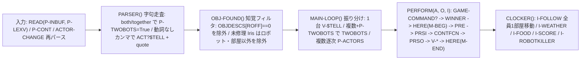
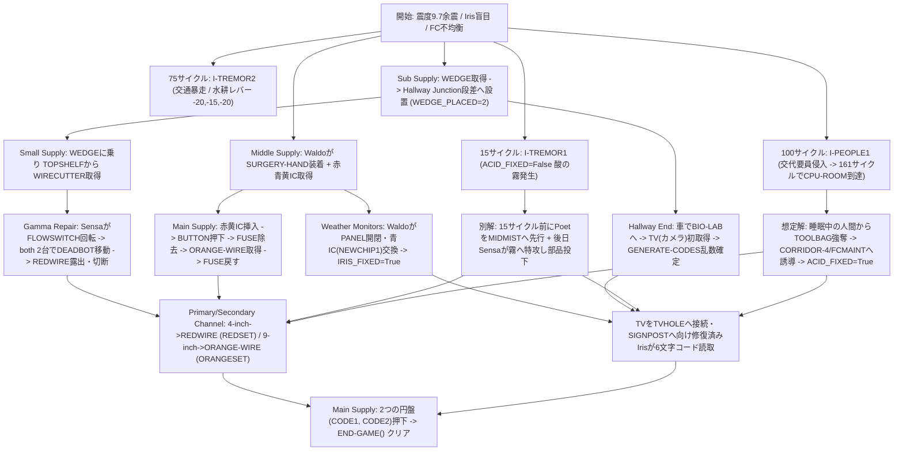

# SUSPENDED (Python 版) の内部構造・感覚分離設計・SF 孤独ドラマ解析

ZilPy が Infocom の異色 SF シミュレーション・アドベンチャー *SUSPENDED* (1983, Release 88 / Serial 840726) の ZIL ソース (`suspended/`) から生成した Python 版 (`out/suspended/`) を、構成要素・6 台ロボット同時制御パーサー・感覚器官分離設計・自律移動＆地上災害シミュレーター・制御官視点の因果障壁と SF ドラマの観点から詳細に解説します。

- **ネタバレ注意:** 真の解法・別解（酸漏れ修理ルート／先行配置特攻ルート）・交代要員の行動機械・エンディング評価まで記載しています。
- **解析手順の再現性:** 本ドキュメントはプロジェクトルートの `GameArchitecture.md` の 5 ステージ解析計画に基づき、`tools/analyze_game.py out/suspended` および生成 Python コード (`out/suspended/*.py`) の直接検証によって作成しています。
- **元の ZIL の位置:** `parser.zil:140` のように記載します。生成コードの `# zil:` 注記および `out/suspended/zilmap.json` から対応を引けます。

---

## 1. 全体像

### 1.1 規模

| 項目 | 数 |
|---|---|
| モジュール (ZIL ファイル) | 16 |
| ルーチン | 378 |
| 部屋 | 63 |
| オブジェクト (部屋以外) | 128 |
| 構文 (`SYNTAX`) | 236 (動詞の語 104 個) |
| 割り込みルーチン (`I-*`) | 21 (`QUEUE` 呼び出し 32 箇所) |
| グローバル変数・定数 | 305 |
| 宝物点 (`VALUE` / `TVALUE`) | 0 (点数制ではなく **地上市民の犠牲者数 `TOTAL-SCORE` と経過サイクル `MOVES` による評価**) |

ルーチンを役割で分類すると次のとおりです (`tools/analyze_game.py` の自動分類)。

| 役割 | 数 | 例 |
|---|---|---|
| 動詞のアクション (`V-*`) | 120 | `V-$TELL`、`V-WALK-TO`、`V-PLUGIN`、`V-QUERY`、`V-POINT`、`V-REPLACE` |
| そのほか (場面処理・NPC・移動・状態表示) | 59 | `END-GAME`、`DO-RTD`、`FOLLOW-GOAL`、`PARRIVE1`〜`9`、`STATUS-LINE` |
| パーサー | 42 | `PARSER`、`ACTOR-CHANGE`、`GET-OBJECT`、`GLOBAL-CHECK`、`OBJ-FOUND` |
| 動詞の補助 | 42 | `DESCRIBE-OBJECT`、`DO-QUERY`、`JIGS-UP`、`GOTO`、`ITAKE` |
| オブジェクトのアクション | 41 | `IRIS-FCN`〜`WHIZ-FCN`、`TWOBOTS-FCN`、`PANEL-FCN`、`CIRCLE-FCN` |
| 割り込み (`I-*`) | 21 | `I-FOLLOW`、`I-WEATHER`、`I-FOOD`、`I-SCORE`、`I-TREMOR1`、`I-PEOPLE1`、`I-CHASEAUDA` |
| 事前アクション (`PRE-*`) | 15 | `PRE-EXAMINE`、`PRE-REPLACE`、`PRE-PUT`、`PRE-GIVE`、`PRE-LISTEN` |
| 部屋のアクション | 13 | `CPU-FCN`、`WEATHER-BANKS-FCN`、`SUPPLIES-N-FCN`、`ACIDMIST-FCN`、`SLEEP-CHAMBER-FCN` |
| メインループ | 9 | `GO`、`CHANGE-WINNER`、`MAIN-LOOP`、`ALL-THERE?`、`PERFORM` |
| マクロ由来関数・マクロ補助・時計 | 16 | `NDESC`、`IRIS?`〜`WHIZ?`、`DEMON`、`QUEUE`、`CLOCKER` |

### 1.2 モジュールと読み込みの順

`suspended.py` の `from ... import *` 順と各ファイルの行数は以下のとおりです。

| # | モジュール (元の ZIL) | 行数 | ルーチン | 部屋 | オブジェクト | 構文 | 中身 |
|---|---|---|---|---|---|---|---|
| 1 | `suspended.py` (`suspended.zil`) | 69 | 0 | 0 | 0 | 0 | 入口。既定プロパティ (`SIZE=5`, `CAPACITY=0`, `VALUE=0`) と読み込み順 |
| 2 | `macros.py` (`macros.zil`) | 259 | 12 | 0 | 0 | 0 | `TELL` マクロ仕様、動的呼称解決 `NDESC`、`IRIS?`〜`WHIZ?` 判定 |
| 3 | `syntax.py` (`syntax.zil`) | 870 | 0 | 0 | 0 | 236 | 語彙と構文 (`$TELL`, `PLUG`, `QUERY`, `POINT`, `REPLACE`, `ARR`/`ARL` 等) |
| 4 | `globals.py` (`globals.zil`) | 530 | 2 | 0 | 32 | 0 | 世界状態変数・地上パラメータ・グローバル／ローカル共通オブジェクト |
| 5 | `clock.py` (`clock.zil`) | 101 | 4 | 0 | 0 | 0 | 割り込みテーブル (`C-TABLELEN=180`, 30 スロット) と `CLOCKER` |
| 6 | `main.py` (`main.zil`) | 366 | 9 | 0 | 0 | 0 | `GO`、`CHANGE-WINNER`、`MAIN-LOOP`（複数ロボット制御）、`PERFORM` |
| 7 | `parser.py` (`parser.zil`) | 1,511 | 42 | 0 | 0 | 0 | パーサー (`P-ACTORS` / `P-TWOBOTS` / `OBJ-FOUND` 知覚フィルタ / `MOBY-FIND`) |
| 8 | `crufty.py` (`crufty.zil`) | 22 | 1 | 0 | 0 | 0 | 語彙照合 `THIS-IT?` |
| 9 | `verbs.py` (`verbs.zil`) | 2,775 | 177 | 0 | 0 | 0 | 全動詞の標準動作 (`V-LOOK`、`V-EXAMINE`、`V-TOUCH`、`V-POINT`、`V-WALK-TO` 等) |
| 10 | `status.py` (`status.zil`) | 121 | 5 | 0 | 0 | 0 | 3 行ステータスバー (`Cryolink`・当サイクル犠牲者・サイクル数・6 台の現在地) |
| 11 | `robots.py` (`robots.zil`) | 938 | 30 | 0 | 15 | 0 | 6 台のロボット本体＋プロキシ、`TWOBOTS`、`PEOPLE`、地上災害・評価・死亡管理 |
| 12 | `rooms.py` (`rooms.zil`) | 1,444 | 18 | 63 | 0 | 0 | 地下複合施設の 63 部屋と 6 ロボット別 `ROOMDESCS` |
| 13 | `objects.py` (`objects.zil`) | 1,571 | 32 | 0 | 81 | 0 | 施設内オブジェクト 81 個と 18+1 スロット `OBJDESCS`、装置ロジック |
| 14 | `goal.py` (`goal.zil`) | 581 | 20 | 0 | 0 | 0 | 6 路線 (`A-LINE`〜`F-LINE`) 自動経路探索 `I-FOLLOW` と 9 廊下視界 `CORRIDOR-LOOK` |
| 15 | `people.py` (`people.zil`) | 476 | 23 | 0 | 0 | 0 | 地上からの交代要員 (`PEOPLE`) の 9 段階状態機械と追跡・酸漏れ修理イベント |
| 16 | `setup.py` (`setup.zil`) | 95 | 3 | 0 | 0 | 0 | 初手限定カスタム設定 (`V-CONFIGURE`) と数値入力 `READ-NUMBER` |

### 1.3 スコア構造（犠牲者数と回復予測）

*SUSPENDED* には宝物や加点が一切なく、**`SCORE` が「当サイクルに発生した地上犠牲者数（千人単位）」、`TOTAL-SCORE` が「累計犠牲者数（千人単位、初期値 `3` = 3,000 人）」、`MOVES` が「経過サイクル数」** を表します。

- 毎サイクル末に常駐割り込み `I-SCORE` (`robots.zil:699-715`) が発火し、風速 (`WINDS`)・気温 (`DEGREES`)・食料 (`FOOD-TONS`)・交通 (`DO-RTD`) から当サイクル犠牲者 `SCORE` を算出して `TOTAL-SCORE` に加算します。
- `TOTAL-SCORE > 30000`（3,000 万人超）に達すると `ALL-DEAD()` (`robots.zil:928-932`) で FC が全系統の電源を落としてゲーム終了となります。
- クリア時の `END-GAME()` (`robots.zil:620-697`) では、その時点の気圧差から回復所要サイクル数 `WINDS = abs(P2-P3)//2 + abs(P1-P2)` を計算し、回復中予測犠牲者 `DEGREES = SCORE * WINDS`（さらに `MOVES > 75` なら `FOOD_OPT - FOOD_TONS` を加算）を `TOTAL-SCORE` に上乗せします。元人口 `30,172,000` 人から最終 `TOTAL-SCORE`（千人単位）を引いた生存者数を表示し、通常モード 7 段階（40 以下で最良ランク 1、701 以上で最悪ランク 7）、上級モード (`ADVANCED-FLAG`) 5 段階（95 以下でランク 1、401 以上でランク 5）の評価を下します。
- **ZIL 原作由来の計算バグ 2 箇所:**
  1. `I-SCORE` (`robots.zil:707-709`): `MOVES > 75` かつ `FOOD_TONS < 50` のとき `ZG.SCORE = (SCORE + 1)` とローカル変数 `SCORE` (`0`) を参照しており、天候による犠牲者を `1` に上書きしてしまいます。
  2. `DO-RTD` (`robots.zil:753-755`): 動く歩道 `SWITCH3` が ON で `RAMP_SPEED > 30` のとき `SCORE = (ZG.SCORE + 1)` とローカル変数に代入しているため、ON の間は犠牲者が加算されず、OFF にして減速する瞬間だけ `+1` されます。

---

## 2. 起動・メインループ・パーサーの詳細処理と世界への反映

### 2.1 起動 (`GO`) と二重位置管理 (`HERE` vs `WINNER-HERE`)

`GO()` (`main.zil:34-67`) は以下の手順で世界を立ち上げます。

1. `INIT-STATUS-LINE()` (`status.zil:12-41`) で画面上部 3 行の反転ステータスバーを初期化する（1 行目: `Cryolink to:` / `Casualties this Cycle:` / `Cycle:`、2〜3 行目: 全 6 台の現在地をリアルタイム表示）。
2. `REDSET = REDCABLE`、`ORANGESET = ORANGECABLE` と壊れた配線を初期状態に登録し、**12 個の割り込み** を一括 `QUEUE`＋`ENABLE` する:
   - 時限イベント: `I-TREMOR1` (`15`), `I-TREMOR2` (`75`), `I-PEOPLE1` (`100`), `I-AUDA-HINTS` (`100`)
   - 周期イベント: `I-WEATHER` (`4` → 以後 5 毎), `I-DECAY` (`5` → 以後 25 毎)
   - 常駐デーモン (`-1`): `I-FOLLOW`, `I-FOOD`, `I-WIRE-MESSAGE`, `I-ROBOTKILLER`, `I-SCORE`, `I-IRIS-HINTS`
3. `BEGINNING()` で緊急覚醒メッセージ（FC 不均衡と震度 9.7 余震の報告）を出力し、`CHANGE-WINNER(IRIS, True)` で初期接続先を Iris に設定、全ロボットの初期位置報告 (`V-ALL-REPORT-LOC`) と `SET-LAST-ROOM()` を経て `MAIN-LOOP()` へ入る。

本作特有の設計として、**`HERE` には部屋ではなく「現在接続中のロボット (`WINNER`)」が入り、実際の部屋は `WINNER-HERE` に格納される** 点が挙げられます (`CHANGE-WINNER`, `main.zil:69-93`)。これは `STATUS-LINE()` が `TELL(D, HERE)` で 1 行目に接続先ロボット名を表示する仕様と連動しています。同時に `ROFF = GETP(WINNER, 'ROBOT')`（1=Iris, 2=Waldo, 3=Sensa, 4=Auda, 5=Poet, 6=Whiz, 0=TWOBOTS）と手の本数 `NUM-EXT` も更新されます。

### 2.2 6 台ロボット同時・切替命令パーサー (`parser.py` / `main.py`)

*SUSPENDED* のパーサーは 1982 年世代の Z-machine パーサー（`P-INBUF` 100B、`P-LEXV` 120B、`SIBREAKS = '.,\"'`、`OOPS` なし）を土台に、**「複数ロボットへの切替・並列・協調命令」** と **「ロボット別の知覚フィルタ」** を深く組み込んだ独自構造を持ちます。

#### ① 単一ロボット切替 (`<robot>, <cmd>`)
- `PARSER()` (`parser.zil:198-215`) は、動詞が未確定のまま `,`（辞書上 `then` と同義語登録されたトークン等、または `to`）に当たると、暗黙に `P-VERB = ACT?$TELL` を補い、`WORD` を `quote` に変換して残りの語句位置を `P-CONT` に保存します。
- `V-$TELL` (`verbs.zil:1692-1703`) が `GLOBAL-IRIS` 等のグローバル・プロキシを `REAL-ROBOT()` で実体に変換し、`CHANGE-WINNER(PRSO)` を実行します。
- `MAIN-LOOP` (`main.zil:208`) では `$TELL` は `CLOCKER()` をスキップするため、**Cryolink の切替自体は 0 サイクル** です。続くループで `P-CONT` が自動再パースされ、切り替わった `WINNER` で `<cmd>` が実行されます。

#### ② 複数ロボットへの逐次一括命令 (`iris and waldo, look` / `all robots, ...`)
- `GET-OBJECT` (`parser.zil:937-939`) は `all robots` を検出すると即座に `GCHECK = True` として `GLOBAL-OBJECTS` から全 6 台のプロキシを収集します。
- `MAIN-LOOP` (`main.zil:137-184`) は `PRSA == V?$TELL` かつ `NUM > 1` を検出すると、対象ロボット群を `P-ACTORS` テーブルに格納し、残りトークン長 `P-OPLEN` と開始位置 `P-OPCONT` を保存、`P-NACTORS = NUM` としてまず 1 台目に `V-$TELL` を実行します。
- 1 台目の `<cmd>` が終わって `P-CONT` が空になると、次回の `PARSER()` 冒頭 (`parser.zil:156-158`) で `P-NACTORS > 1` が真となり、`ACTOR-CHANGE()` (`parser.zil:313-320`) が次のロボットへ `CHANGE-WINNER` し、`P-LEXV` の語数と `PTR = P-OPCONT` を巻き戻して **同じ命令句を 2 台目・3 台目の知覚空間で再パース** します。

#### ③ `BOTH` / `TOGETHER` による 2 台同時協調命令 (`both sensa and auda, move fred`)
- 字句走査中に `both` または `together` が出現すると `P-TWOBOTS = True` が立ちます (`parser.zil:193-194`)。これがコンマより後ろ（命令句側）にあると `$TELL` 処理時にはまだ読まれていないため、`sensa and auda, move fred together` は逐次命令になって失敗します。
- `MAIN-LOOP` (`main.zil:153-180`) で `P-TWOBOTS` が真のとき、`ALL-THERE?()` で 2 台が同一部屋にいるか検証し、人間 (`ROBOT == 7`) を弾いた上で **`WINNER = TWOBOTS`, `ROFF = 0`** という仮想の「2 台合体アクター」へ一時切替します (`FC: Dual-Cryolink established to Sensa and Auda.`)。
- 続く命令は `PERFORM` の最優先段階である `TWOBOTS-FCN` (`robots.zil:458-493`) に横取りされ、`TAKE` / `MOVE` かつ対象が `DEADBOT`（かつキャビネット開放済み）の場合のみ Fred を動かして `REDWIRE` の `INVISIBLE` を解除し、自動的に `P-ACTORS[1]` へ `CHANGE-WINNER` で戻します。

#### ④ 自律経路移動エンジン (`V-WALK-TO` → `I-FOLLOW` → `goal.py`)
- `go to <room>` は `V-WALK-TO` (`verbs.zil:2050-2082`) を呼び、`GLOBAL-CHECK` が `WALK-TO` / `MOVE-ROBOT-TO-LOC` / `EXAMINE` / `FOLLOW` のときに限り `ROOMS` ツリー全体を探索して部屋オブジェクトを解決します (`parser.zil:1113-1115`)。
- `SET-GOAL(RBT, GOAL)` (`goal.zil:183-192`) は、出発部屋の路線 `LINE` (0〜5) と目的部屋の `LINE` から 6×6 の乗換表 `TRANSFER-TABLE` の添字 `GOAL-I = LINE_from * 12 + LINE_to * 2` を計算し、`GOAL-TABLES[ROFF]` に保存します。
- 以後、毎サイクルの `CLOCKER()` で常駐デーモン `I-FOLLOW` (`goal.zil:423-432`) が全 7 キャラクター（ロボット 6 台＋人間 `PEOPLE`）の `FOLLOW-GOAL()` を 1 ステップずつ進めます。
  - **6 路線 (`A-LINE`〜`F-LINE`)** は各部屋を 3 ワード単位 `(部屋, 正方向, 逆方向)` で並べた双方向リストであり、最寄り駅 `STATION` への移動 → 路線上の 1 部屋移動 → 乗換駅到達時に `TRANSFER-TABLE[IGOAL + 1]` へ跨線移動 → `SET-GOAL` 再計算、という鉄道乗換モデルで経路を辿ります。
  - 移動のたびに `MOVE-RBT?` (`goal.zil:298-331`) が 4 つの物理制約を検証します: ① `HUMAN-ENTRY`⇔`HALLWAY-JUNCTION` 間の段差（`WEDGE-PLACED == 2` でなければロボットは `STUCK`、人間は通過可）、② `CORRIDOR-4`→`ACIDMIST`（`not ACID-FIXED` なら `DEADBOTS[ROFF] = 1` で酸に被曝）、③ `HALL-END`⇔`CAR-AREA`（車移動必須のため `STUCK`）、④ `IRIS` の `CPU-ROOM`→`CORRIDOR-1`（行動範囲制限で `STUCK`）。

#### ⑤ パーサー以外の `READ()` 呼び出しと時間管理
パーサー以外で `READ()` を直接呼ぶのは、Y/N 確認の `YES?` (`verbs.zil:293`) とカスタム設定の `READ-NUMBER` (`setup.zil:88`) のみで、通常ゲーム中のパーサー乗っ取りはありません。なお `V-WAIT` (`verbs.zil:1034-1041`) は内部で最大 3 回 `CLOCKER()` を回し、割り込みが `True` を返した瞬間に途中終了し、`CLOCK-WAIT = True` を立てて `MAIN-LOOP` 末尾の二重加算を防ぎます。

### 2.3 具体的コマンドのエンドツーエンド実行トレース（3 例）

#### トレース ①: 複数ロボット同時命令 `both sensa and auda, move fred` と自律移動 `poet, go to east end`
1. **`poet, go to east end`**:
   - `PARSER`: `poet`（`GLOBAL-POET`）の後に `,` を検出 → `ACT?$TELL`、`P-CONT` に `go to east end` を退避。
   - `MAIN-LOOP` → `PERFORM(V?$TELL, GLOBAL-POET)` → `V-$TELL` が `CHANGE-WINNER(POET)`（`ROFF=5`, `WINNER_HERE=CPU_ROOM`）。`$TELL` のため `CLOCKER` スキップ。
   - 次ループで `P-CONT` を再パース → `GLOBAL-CHECK` が `WALK-TO` 特例で `ROOMS` から `MIDMIST` (`East End`) を解決 → `V-WALK-TO` が `SET-GOAL(POET, MIDMIST)`（`B-LINE`→`C-LINE` 乗換駅 `HALLWAY-JUNCTION`→`CORRIDOR-3`）を登録し、確認台詞を出力。
   - `CLOCKER` 発火 → `I-FOLLOW` が Poet を 1 部屋移動（`CPU-ROOM`→`CORRIDOR-1`）。以後、他ロボットへの命令ごとに 1 部屋ずつ進み、約 8 サイクル目で `MIDMIST` 到着、`G-ROBOT(POET, G-REACHED)` が `POET INTERRUPT:` を割り込み通知。
2. **`both sensa and auda, move fred`**:
   - `PARSER`: 先頭の `both` で `P-TWOBOTS = True`。`sensa and auda` で `P-PRSO = [GLOBAL-SENSA, GLOBAL-AUDA]`。`,` で `ACT?$TELL` 確定、`P-CONT` に `move fred` を退避。
   - `MAIN-LOOP`: `NUM=2`・`PRSA=V?$TELL`・`P-TWOBOTS=True` → `P-ACTORS = [SENSA, AUDA]`。`ALL-THERE?()` が両者 `REPAIR3` 在室を確認 → `WINNER = TWOBOTS`, `ROFF = 0` に切替（`CLOCKER` スキップ）。
   - 次ループで `move fred` をパース → `PERFORM(V?MOVE, DEADBOT)` → 最優先の `GETP(TWOBOTS, 'ACTION')` = `TWOBOTS-FCN` が発火。`CABINET` の `OPENBIT` を確認後、`MOVE(DEADBOT, REPAIR3)`・`FCLEAR(REDWIRE, INVISIBLE)` を実行し、`CHANGE-WINNER(SENSA)` で単体操作へ復帰。`CLOCKER` が 1 サイクル進行。

#### トレース ②: Iris の視覚修復 (`waldo, put blue ic in panel` → `close panel`) による描写変化
1. `waldo, open panel`: `PANEL-FCN` (`objects.zil:74-87`) が `WALDO?` かつ `SURGERY-HAND` の `WEARBIT` を検証し、`OPENBIT` を立てる。
2. `take blue chip` → `put blue ic in panel`: `CHIPFILTER-FCN` / `V-PUT` で `NEWCHIP1` が `PANEL` に入り、`CHIPS0`・`CHIP2` と揃うと Iris が `OOOH! That felt good! Close my panel, big boy.` と割り込み反応。
3. `close panel`: `PANEL-FCN` (`objects.zil:90-108`) が `FCLEAR(PANEL, OPENBIT)` の直後に 3 チップ揃いを確認し、**`IRIS_FIXED = True`** を設定（`IRIS INTERRUPT: You never looked so good.`）。
4. 修復後の `iris, look`（Weather Monitors 在室）:
   - 修復前は `V-LOOK` (`verbs.zil:22-24`) の `IRIS? and not IRIS_FIXED` で即座に `Visual function nonfunctional.` を返して終了していた。
   - 修復後は `OBJ-FOUND` の盲目フィルタが解除され、`WEATHER-BANKS-FCN(M-LOOK)` (`rooms.zil:62-119`) が等幅フォント (`FIXED-FONT-ON`) で気温・風速・降水量・3 塔気圧の数値を出力し、さらにカメラ映像 (`V-POINT` → `IRIS INTERRUPT:`) も受信可能になる。

#### トレース ③: Whiz の CLC 接続と検索 (`whiz, plug in` → `ask about iris`)
1. `whiz, plug in`: `V-PLUGIN` (`verbs.zil:1421-1442`) が `WHIZ?` と現在地 (`PERIPH-1`〜`4`) を検証し、`PLUGGED-IN = 1..4`（Advisory Peripheral なら `3`）を設定。
2. `ask about iris`:
   - `PARSER` → `GET-OBJECT` で現在室に Iris がいないため `GCHECK = True` となり `GLOBAL-CHECK` へ進む。`GLOBAL-IRIS` が見つかり、`V-QUERY` の前に `GLOBAL-ROBOT` が `PRSO` を実体 `IRIS` へ変換する（もし部屋にも `GLOBAL-OBJECTS` にもない遠隔オブジェクト、たとえば `ask about wedge` の場合は、`GLOBAL-CHECK` (`parser.zil:1086-1112`) が **`MOBY-FIND(TBL)`** を起動し、全 63 部屋と `LOCAL-GLOBALS` を総当りスキャンして見つけ出す！）。
   - `V-QUERY` → `DO-QUERY` (`verbs.zil:1488-1512`) が対象オブジェクトの `CLC-TXT` テーブル（3 要素: 0=Technical, 1=Advisory, 2=Historical）を読み、`PLUGGED-IN == 1` (Index) なら非ゼロの台座一覧を、`2..4` なら `CLC-TXT[PLUGGED-IN - 1]` を出力する。
   - その後 Whiz に移動命令を出すと、`WHIZ-FCN` (`robots.zil:435-439`) が移動前に自動で `(Unplugging first.)` と `PLUGGED-IN = False` を実行する。

---

## 3. Suspended 固有の主要サブシステム

### 3.1 感覚器官の分離設計（パーサー層・出力層の二重実装）

本作の最大の技術的発明は、**「同じ 1 つのオブジェクト／部屋に対して、6 台のロボットが全く異なる知覚世界を持つ」** ことを、例外分岐の羅列ではなくデータ駆動テーブルとパーサーフィルタで一貫実装している点です。

1. **`OBJDESCS` の 18+1 スロット構造** (`FDOFF=0`, `SDOFF=6`, `RTOFF=12`, `robots.zil:8`):
   - スロット `1..6` (`FDOFF + ROFF`): 未接触 (`not TOUCHBIT`) の初見描写。**ここが `0` だと、そのロボットにはその物体が知覚不能になる。**
   - スロット `7..12` (`SDOFF + ROFF`): 短縮名（呼称）。`TELL` マクロの `D` 指定子が `NDESC(OBJ)` (`macros.zil:76-83`) を呼び、自動で `OBJDESCS[ROFF + SDOFF]` を引くため、システムメッセージ中の名詞までロボットごとに変化する。
   - スロット `13..18` (`RTOFF + ROFF`): `EXAMINE` 時の詳細描写 (`V-EXAMINE`, `verbs.zil:247`)。
   - スロット `19` (任意): Poet が `V-TOUCH` (`verbs.zil:2219-2234`) したときだけ返される電気・異常診断メッセージ。
2. **パーサー層での知覚遮断 (`OBJ-FOUND`)**:
   - `parser.zil:1191-1209` で `GET(GETP(OBJ, 'OBJDESCS'), ROFF) == 0`（かつ未所持）の物体はマッチ表に追加されません。結果として Auda（聴覚特化）は音を出さない楔・IC・カメラ・スイッチ・円盤を **存在しないものとして扱い**、`Sorry, but I can't hear any ... here.` (`DETECT-TBL[4]`) を返します。
3. **部屋描写 `ROOMDESCS`（6 スロット）**:
   - `LONG-DESCS()` (`verbs.zil:40-44`) が `ROOMDESCS[ROFF]` を出力します。

以下は、同じ対象を 6 台のロボットがどう認識するかの実コード比較です（`rooms.py` / `objects.py` / `robots.py` より）。

| 対象 | Iris (1: 視覚) | Waldo (2: 触覚・ソナー) | Sensa (3: 磁気・振動) | Auda (4: 聴覚) | Poet (5: 詩的診断) | Whiz (6: CLC タグ) |
|---|---|---|---|---|---|---|
| **`CPU-ROOM`** (部屋) | 球体内部の配線と扉付きの柱を見る | ソナーで球形空間と均質な中空柱を検知 | 電荷が中央の電気柱へ流れ込むのを感知 | 床から天井への柱から微かな唸り音を聴く | 「跳ねて飛んでビットを残す…」と詩で詠む | CLC が CPU 室とタグ付けした区域 |
| **`HOME`** (呼称) | `tall column` | `hollow column` | `electrical column` | `noiseless column` | `sweet home` | `CPU` |
| **`WEDGE`** (呼称/知覚) | `ramp` (瓦礫の下の急な楔) | `solid wedge` (頑丈な傾斜物) | `dense wedge` (CLC 識別波のみ) | **知覚不能 (`0`)** | `slanting wedge` (昇降の比喩) | `W1` (タグ識別波) |
| **`PEOPLE`** (呼称) | `humans` | `mobile objects` | `creatures` | `talking mechanisms` | `Creators` | `mobile cores` |
| **物理能力** | 手 2 / 積載 75 / 補給・監視区画外へ出られない | 手 6 (手術手で 7) / 積載 100 / 精密作業 | 手 3 / 積載 60 / フロースイッチ操作可能 | 手 1 / 積載 70 / 人間の会話を盗聴 (`AUDA-LISTENS`) | 手 3 / 積載 20 / `TOUCH` 異常診断 | 手 2 / 積載 50 / CLC 台座接続・質問 |

### 3.2 地上災害シミュレーター（天候・交通・食料）

| 系統 | 割り込み・ルーチン | 故障・劣化の仕組み（実コード） | 放置時の被害・破綻 | 対策（Whiz 等がスカイウォークで操作） |
|---|---|---|---|---|
| **天候 (Weather)** | `I-WEATHER` (5 サイクル毎) `I-DECAY` (25 サイクル毎) | 3 塔の気圧 `PRESSURE1..3` が `DIALSETS[1..3]` へ差分 `//5` ずつ近づくが、`PRESSURE2` のみ毎回 `DECAY`（初期 `6`、25 サイクル毎に `+1`）だけ低下。`WINDS = abs(P2-P3)+abs(P1-P2)`、`DEGREES = 60 + ((平均-60)*2)`。 | `WINDS > 25` で `(WINDS-25)//5`、`> 50` で `(WINDS-25)//3`、`DEGREES < 40` で `(40-DEGREES)//3` の犠牲者が毎サイクル発生。 | `second dial = 100`, `first = 60`, `third = 60` で 3 塔均衡を維持。 |
| **交通 (RTD)** | `I-TREMOR2` (75 サイクル目) `DO-RTD` (毎サイクル) | `SWITCH1` (浮遊車): ON の間 `FLOATERS += 2`、75 以降 `+1` 犠牲/サイクル。**OFF にした瞬間に空中の `FLOATERS` 全員が墜落死して一括加算！** `SWITCH2` (自動タクシー): 75 以降 ON で `+1`/サイクル。 `SWITCH3` (動く歩道): 75 以降加速（バグにより減速時のみ `+1`）。 | 75 サイクル目以降、交通網暴走で毎サイクル犠牲者が積み上がる。 | 3 スイッチを早期に OFF（特に `first switch` は早いほど墜落数が少ない）。 |
| **水耕 (Hydroponics)** | `I-TREMOR2` (75 サイクル目) `I-FOOD` (毎サイクル) | 75 サイクル目超過後、実効値が設定値から **水 `-20`・ミネラル `-15`・照明 `-20`** だけ強制低下 (`robots.zil:592-595`)。最適値 (`70, 30, 50`) からの絶対偏差合計を `100` から引いた値が `FOOD-TONS`。 | `FOOD_TONS <= 0` になった瞬間、FC が全システムを停止し **即ゲーム終了** (`robots.zil:614-618`)。 | 事前にレバーを `90 / 45 / 70` に設定しておけば 75 サイクル目以降に最適値 `70 / 30 / 50` となる。 |

### 3.3 地上からの交代要員 (`PEOPLE`) と真の解法・別解

100 サイクル目（上級は 80 サイクル目）に `I-PEOPLE1` (`people.zil:29-36`) が発火し、地上から 2 人組の交代要員 (`PEOPLE`) が `STERILE-AREA` に侵入します。彼らは `goal.py` の経路探索と `PR-NUMBER` (1〜9) による状態機械で自律行動します。

1. `PR_NUMBER = 1`: `TOOL-AREA` へ移動 → `PARRIVE1` で戸棚から `TOOLBAG` を取り出し、「長旅で疲れた」と睡眠室へ向かう。
2. `PR_NUMBER = 2`: `SLEEP-CHAMBER` 到着 → `PARRIVE2` で `TOOLBAG` を床に置き、`I-STEAL` で 20 サイクル就寝。
3. `PR_NUMBER = 3`: 起床 (`I-PEOPLE2`) → `INNER-CORE`（図書館）へ移動 → `PARRIVE3` で CLC から主人公クローンの蘇生アクセスコードを取得（3 サイクル待機 `I-PEOPLE4`）。
4. `PR_NUMBER = 4`: `HALL-END` へ移動 → `PARRIVE4` で車に乗って `CRYOUNITS` へ行き、`I-KILL` (15 サイクル後) に **主人公のクローンを連行して帰還**。
   - **車がない／誰かが乗っている場合**: `I-CAR-WAIT` で待機するが、**75 サイクル経過すると我慢の限界に達し、クローン無しで手動オーバーライドによる主人公切断へ向かう** (`PR_NUMBER = 7` → `PARRIVE7` で即死)。
5. `PR_NUMBER = 5`: `CPU-ROOM` 到達 → `PARRIVE5` で冷凍カプセルの扉が開かれ、自分のクローンを見ながら光と激痛の中でゲーム終了（無介入なら **161 サイクル目**）。

#### 真の解法（酸漏れ修理ルート）vs 別解（先行配置＋特攻ルート）
- **本来の想定解（人間による酸漏れ修理）**: `SLEEP-CHAMBER` で人間が寝ている間にロボットが `TOOLBAG` を盗むと、`SLEEP-CHAMBER-FCN(M-END)` (`rooms.zil:1048-1055`) が `I-CHASEAUDA` を起動し、人間が泥棒ロボットを追跡します。そのまま **`CORRIDOR-4`（または直接 `FCMAINT`）へ誘導する** と、人間は酸の霧・破裂配管に気づき、「制御官のせいではないかもしれない」と判断して工具袋を回収し、ロボットには手が届かない `FCMAINT` の弁 (`WHEEL`) を回して **`ACID_FIXED = True`** にします (`STU-1-F`, `people.zil:478-507`)。その後、人間は様子見のため `REC-AREA` で *Starcross* を **200 サイクル** プレイし続ける (`I-STARCROSS`) ため、大幅な時間猶予と全ロボット生還が得られます。
- **速度・最小犠牲の別解（先行配置＋特攻）**: 15 サイクル目の `I-TREMOR1` より前に Poet を `MIDMIST`（酸の霧の向こう側）へ送り込んでおき、後から交換用ケーブル 2 本とカメラを Sensa に持たせて霧へ突入・`MIDMIST` に投下させる（Sensa は 5 命令後に破壊されるが、Poet が安全に全配線交換とコード読取を完遂する）。これにより人間が動き出す前の **129 サイクル・評価 1** でクリア可能です。
- なお、**中央チャンバーからの脱出という別解は存在しません**。`HOME` を開ける行為は `OOPS-FCN` (`objects.zil:28-37`) により生命維持配線切断で即死します。

---

## 4. クリアへの因果的ターニングポイントと障壁

### 4.1 因果依存グラフ

### 4.2 主要ターニングポイントと不可逆・ソフトロック条件（コード検証済み）

| 障壁／ターニングポイント | 実コードの条件式・フラグ・定数 | 破壊・ソフトロック／回復可否 |
|---|---|---|
| **Iris の視覚修復** | `PANEL-FCN` (`objects.zil:74-108`): `WALDO?` かつ `FSET?(SURGERY_HAND, WEARBIT)` で開放。`NEWCHIP1`+`CHIP2`+`CHIPS0` を入れて閉めると `IRIS_FIXED = True`。 | パネルを再び開けると `IRIS_FIXED = False` に戻る（閉じ直せば復帰）。Waldo 破壊時はベルト修理まで詰み。 |
| **段差と楔 (`WEDGE`)** | `WEDGE-FCN` (`rooms.zil:653-661`) / `MOVE-RBT?`: `WEDGE_PLACED == 2` で人間区画通行可。`WEDGE_PLACED == 1`（Alpha Repair 設置）で修理ベルト押し上げ可。 | 楔を人間側に持ち去るとロボットが戻れない（置き直せば可）。Auda は楔を知覚できない。 |
| **酸の霧とロボット破壊** | `I-TREMOR1` で `ACID_FIXED = False`。以後 `ACIDMIST-FCN(M-BEG)` または `MOVE-RBT?` (`CORRIDOR_4 -> ACIDMIST`) で `DEADBOTS[ROFF] = 1`。毎サイクル `I-ROBOTKILLER` が `+1` し、`DYING3 = 7`（上級は `3`）で `JIGS-UP` → `DEADBOTS[ROFF] = 30` + `CUTBIT`。 | **回復可能だが高コスト**: 生存ロボットが `WEDGE` を Alpha Repair (`WEDGE_PLACED = 1`) に置き、壊れたロボットを引きずって `push <bot> onto walkway` (`V-PUSH-UP`) → `I-BELT` が 3 部屋運んで `DEADBOTS[ROFF] = 0` に蘇生。全 6 台破壊で即ゲーム終了 (`DEAD-FCN`)。 |
| **Fred の赤配線** | `CABINET-FCN`: Sensa/Poet が `EXAMINE`/`TOUCH` で `FLOWSWITCH` の `INVISIBLE` 解除。`FLOWSWITCH-FCN`: **Sensa のみ** 回転可。`TWOBOTS-FCN`: 2 台同時移動で `REDWIRE` 露出。`REDWIRE-FCN`: `WIRECUTTER` 切断 (`CUTBIT`) 必須（手術手は拒否）。 | Sensa が壊れたままだとフロースイッチを回せず詰み（ベルト修理が必要）。 |
| **機械のヒューズと橙配線** | `ORANGE-BUTTON-FCN`: `NEWCHIP0` in `SOCKET1`, `NEWCHIP2` in `SOCKET2`, `FUSE` in `MACHINE` で前面パネル開放。`ORANGE-WIRE-FCN`: **`FUSE` が入ったまま取ると感電即死 (`JIGS-UP`)**。`CIRCLE-FCN`: **`FUSE` が入っていないと円盤が反応しない**。 | ヒューズ抜き忘れでロボット破壊（ベルト修理可）。 |
| **生きているケーブル** | `KILL-CABLE-FCN` (`objects.zil:902-905`): 黄・緑・桃・白・青・黒の 6 本を `TAKE`/`REPLACE` すると即 `JIGS-UP`。 | 対象は `four-inch` (赤) と `nine-inch` (橙) のみ。 |
| **カメラと乱数コード** | `TV-FCN` (`objects.zil:792-793`): 初回 `TAKE` 時のみ `GENERATE-CODES()` が 8 円盤から異なる 2 つを乱数生成。`CIRCLE-FCN`: 配線未交換で押すと拒否、**誤答ペアを押すと `GENERATE-CODES()` でコード再生成**。 | 再生成されたら再び Channel でカメラを標識に向けて Iris に読ませる必要がある。 |
| **交代要員タイムリミット** | `I-PEOPLE1` (100) → `PARRIVE5` (161 頃) / `PARRIVE7` (車待機 75 後) で `QUIT()`。人間への攻撃 (`PEOPLE-FCN`: `KILL`/`MUNG`) はロボットが電源切断 (`JIGS-UP`)。 | 161 サイクル到達で不可逆ゲーム終了。工具袋奪取で `CORRIDOR-4`/`FCMAINT` 誘導（+200 サイクル）か、1 回限りの返却で再就寝（+20 サイクル）が可能。 |

### 4.3 登場人物（制御官）視点での障壁評価

- **物理的・工学的必然**: 視覚を失った Iris の精密基板を多関節＋手術手の Waldo しか開けられないこと、通電中の機械からヒューズを抜かずに配線を掴むと感電すること、全長 1 メートルのロボットでは頭上の冷却弁やクローン制御スイッチに届かず人間 (`PEOPLE`) にしか回せないこと、重い残骸 Fred を 2 台協力で動かすことは、すべて工学的リアリティに裏打ちされています。
- **物語的・SF 設定的必然**: 6 台のロボットが「コスト削減・機能特化」で感覚を分断されているため、1 台だけでは世界を把握できず、中央の人間（プレイヤー）の頭脳で感覚を統合するしかないという前提そのものが、なぜ生身の人間を冷凍カプセルに繋いでいるのかという設定と完全に噛み合っています。
- **構造的・システム的不条理**:
  - 交代要員を酸漏れに気づかせるために「寝ている人間の工具袋を盗んで危険区域まで追いかけっこさせる」という手順は、Auda が会話能力を持たず **人間に警告を発する手段が一切実装されていない** ゆえの苦肉の策であり、ゲーム的パズルの色が濃い構造です。
  - `go to` の自動経路が人間区画で大回りになる点や、`both` をコンマより前に置かないと同時命令にならない構文制約、`I-SCORE`/`DO-RTD` のローカル変数バグもシステム側の癖として現れています。

---

## 5. 主人公（冷凍睡眠下の制御官）の視点: 初見の知的理想行動 vs クリア必須行動

### 5.1 初期情報（Turn 0〜1）の厳密な範囲

起動直後、`BEGINNING()` (`main.zil:283-290`) と `V-ALL-REPORT-LOC()` が与える事実は次の 3 点のみです。
1. 地表システムが劣化しており、FC（Filtering Computers）の不均衡が検出されたため、緊急覚醒が行われた。
2. Sensa が Beta FC の北 10m で震度 9.7 の余震を検知し、Primary/Secondary Channels の接続ケーブル損傷を予測した。
3. 6 台のロボットの現在地（Iris: Weather Monitors, Waldo: Gamma Repair, Sensa/Poet: Central Chamber, Auda: Entry Area, Whiz: Advisory Peripheral）と、Iris が視覚故障中であること。

### 5.2 初回情報のみの「知的・理想的な行動」vs「クリア必須行動」のギャップ

| フェーズ | 初回情報のみから導かれる最も知的で理想的な行動 | コード上でクリアに実際に要求される行動 | ギャップの本質 |
|---|---|---|---|
| **① 初期展開 (1〜15 サイクル)** | まず全ロボットに周囲を報告させ (`arr`)、Whiz を CLC に繋いで施設・FC・Iris 修理の情報を調査し、状況を把握してから行動計画を立てる。 | `arr` は **7 サイクル消費** の罠。最速クリアには 1〜4 サイクル目で即座に Whiz・Poet・Waldo・Sensa へ `go to` を出し、**15 サイクル目の余震前に Poet を East End へ送り込む** 必要がある。 | **時間資源と情報収集のジレンマ**: 丁寧な調査ほど 15 サイクルの酸の霧デッドラインと天候悪化に間に合わなくなる。 |
| **② 地表災害の抑止** | まず Iris を修理して 3 つのモニター室で天候・交通・食料の数値を正確に読み取り、異常を確認してから制御室で適切に調整する。 | 評価 1 を取るには、モニターを見る前に Whiz を即座にスカイウォークへ送り、**75 サイクル目の余震による `-20/-15/-20` 劣化を先読みしたオフセット値 (`90/45/70`)** を事前入力し、浮遊車スイッチを早期切断する必要がある。 | **予知的前提の最適解**: モニター確認を待つ合理的行動は、浮遊車墜落数と嵐の犠牲者を激増させる。 |
| **③ 代替ケーブルの調達** | 補給室にある予備ケーブル (`RUINED-CABLES` や 16 インチ青ケーブル) を使って修理しようとする。 | 予備ケーブル箱は地震で潰れて使用不能。**壊れた同僚ロボット「Fred」の死体から赤配線を切り出し、リセット機械の内部から橙配線を抜き取る** という非常識な共食い修理が必須。 | **絶望的な物資欠乏**: 正常なマニュアル手順が地震で潰されており、あり合わせの部品流用を強いられる。 |
| **④ 交代要員への対応 (100 サイクル〜)** | 地上から人間が来たら、Auda を使って「地震による配管破裂とケーブル断線が原因だ、自分は狂っていない」と事情を説明し、協力を仰ぐ。 | ロボットは誰一人として人間に話しかけられない。**寝ている人間から工具袋を盗み、怒らせて酸の霧の現場まで鬼ごっこで誘導する** ことでしか異常を伝えられない。攻撃すれば即電源切断。 | **コミュニケーション断絶の恐怖**: 発話手段がないため、善意の協力要請が「窃盗と挑発」という逆説的行動に化ける。 |
| **⑤ 酸の霧の突破** | ロボットを壊さないよう安全を最優先し、霧を止める方法を探してから FC 区域へ入る。 | 本来解（人間誘導）は安全だが 100 サイクル以降まで待たされる。最速・最小犠牲解では **Sensa に部品を持たせて霧へ特攻・犠牲にする** ことで 129 サイクルクリアを実現する。 | **人命（地上 3,000 万人）vs ロボットの命** という功利主義的トレードオフ。 |

---

## 6. このゲームで行われていた具体的な行為と SF 倫理・孤独ドラマ

コード内の `CLC-TXT`・`OOPS-QUIPS`・`people.py` の盗聴会話・`END-GAME` を繋ぎ合わせると、*SUSPENDED* の背後にある冷徹で切実な SF ドラマの全貌が浮かび上がります。

### 6.1 過去軸: 惑星 Contra の繁栄と「冷凍カプセルの孤独な神」

- 惑星 Contra はテラフォーミング後 122 年を経て、地上の住民が「より簡便で快適な生活」を送るために地下複合施設（Complex）と 3 基の Filtering Computers を建設しました (`COMPLEX` / `PLANET` / `FCS` の `CLC-TXT`, `globals.zil:77`)。
- 施設は通常自律稼働しますが、非常時のみ人間の判断を要するため、**1 人の人間（主人公）が中央チャンバーの柱 (`HOME`) の中で冷凍睡眠状態に置かれ、生命維持配線で直結された脳だけで 6 台のロボットを遠隔統括する** 仕組みが採用されました。
- さらに生物区域 (`CRYOUNITS`) には、主人公が狂ったり死んだりした際に即座に入れ替えるための **主人公自身のクローン群 (`CLONES`)** が冷凍保管されています (`CLONES` の `CLC-TXT`: *"These clones are clones of you and are your replacements."* `globals.zil:118`)。前任者 Gregory Franklin の悲劇（`V-PUSH-UP` 等で「狂気の先例」として言及される）は、カプセルの中で孤立した制御官がいかに容易に精神を摩耗させるかを暗示しています。

### 6.2 現在軸: すれ違う善意と、不完全な 6 台との手探りの連帯

- ゲーム開始直前、震度 9.7 の巨大地震が施設を襲い、FC のバランスケーブルが断線、予備ケーブル箱も圧壊、さらに視覚担当 Iris の基板が焼き切れました。主人公は「目が潰れ、予備部品も失われた」絶望的な状態で緊急覚醒させられます。
- 地上では嵐・交通暴走・食料危機で数千〜数万人単位の犠牲者が出始めます。しかし地上側には地下の地震被害が伝わらず、**「カプセルの中の制御官がまた狂った（Franklin の二の舞だ）」** と判断され、処刑・交代部隊 (`PEOPLE`) が送り込まれます。
- Auda の耳 (`AUDA-HEARS?`) を通じて聞こえる交代部隊の会話 (`people.zil:42-295`) は、彼らが冷酷な悪役ではないことを浮き彫りにします:
  - *"I guess that person really went over the deep end, poor thing. Sitting in that capsule can't be a lot of fun."*（「カプセルに閉じ込められて気が触れたんだろうな、かわいそうに」）
  - 酸の霧を見つけた瞬間: *"Maybe the person in the cylinder isn't at fault.... If you're right, we won't have to pull this person's plug."*（「カプセルの人のせいじゃないのかも…もしそうなら、プラグを抜かずに済む」）
- つまり本作の緊張は、**「地上の命を救おうと必死に戦う制御官」と「地上の命を救うために制御官を殺してクローンと入れ替えようとする交代要員」が、対話手段を断たれたまま同じ地下施設ですれ違う悲劇** にあります。もし間に合わなければ、`PARRIVE5` (`people.zil:318`) でカプセルが開かれ、**自分と瓜二つのクローンが外に立っているのを見ながら** 激しい光と痛みの中で意識を絶たれます。
- 一方、主人公の味方である 6 台のロボットたちは、それぞれ欠損と癖を抱えた愛嬌ある相棒として描かれます。盲目になっても軽口を叩く Iris、繊細な手で仲間を治す Waldo、静かにエネルギーの流れを読む Sensa、人間の声を拾い続ける Auda、死の間際に *"Farewell, sweet prince."* と呟く Poet、そして CLC にしがみつく Whiz。**1 人（1 台）では不完全な 6 台の感覚を、カプセルの中で動けない 1 人の人間の意識が束ねて初めて世界を救える** という構造が、孤独な SF サバイバルに深い連帯感を与えています。
- そしてすべてを乗り越えて惑星を救ったエンディング (`END-GAME`, `robots.zil:649-696`) でさえ、システムは冷徹に「回復中の予測犠牲者」を算出し、犠牲者数に応じて「田舎の家と無制限の銀行口座（評価 1）」から「ロボトミー候補（評価 4）」「ネズミの脳移植（評価 5）」「火あぶりの人形（評価 7）」までを淡々と宣告します。人類のインフラを 1 人で背負わされた制御官の報われなさとブラックユーモアまで含めて、*SUSPENDED* は Infocom 屈指の硬質な SF ドラマとして完結しています。
