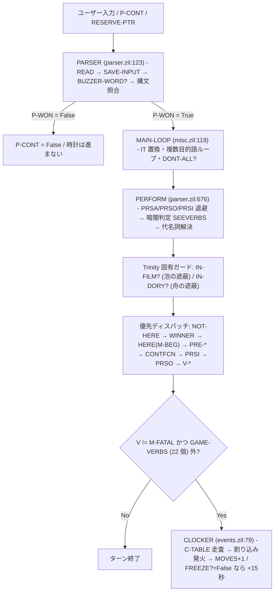

# Trinity (Python 版) の内部構造と因果解析

ZilPy が *Trinity*（1986 年、Brian Moriarty 作・Infocom "Interactive Fiction PLUS"）の ZIL ソース (`trinity/`) から生成した Python 版 (`out/trinity/`) を、構成要素・EZIP (v4) パーサーの内部処理・ゲーム世界への反映パイプライン・固有サブシステム・クリアを阻む因果的ターニングポイント・観光客視点の行動ギャップ・核時代の叙事詩ドラマの観点から詳細に解説します。

- **ネタバレ注意:** 全 7 扉の仕掛け、不可逆なソフトロック条件、最終破壊工作の手順、エンディングの真相まで記載しています。
- **解析手順の再現性:** 本ドキュメントを作成した解析計画と手順は、プロジェクトルートの `GameArchitecture.md` にまとめています。
- **元の ZIL の位置:** `events.zil:3894` のように記載します。生成コードの各定義直前の `# zil:` 注記と `out/trinity/zilmap.json` から対応を引けます。

---

## 1. 全体像

### 1.1 規模

`tools/analyze_game.py out/trinity` による機械棚卸しの実数です。EZIP (Version 4) の拡張メモリ空間をフル活用した、Infocom 屈指の巨大作品です。

| 項目 | 数 |
|---|---|
| モジュール (ZIL ファイル) | 10 |
| ルーチン | 1,781 |
| 部屋 | 134 |
| オブジェクト (部屋以外) | 459 |
| 構文 (`SYNTAX`) | 627 (動詞の語 210 個) |
| 割り込みのルーチン (`I-*`) | 56 (`QUEUE` 呼び出し 57 箇所) |
| グローバル変数・定数 | 351 (`state` 152 / `const` 116 / `scratch` 83) |
| 満点 | 100 点 (`VALUE` 合計 28 [20 個] + `UPDATE-SCORE` 個別加点、`TVALUE` 0、減点なし) |

ルーチンを役割別に分類すると、次のようになります。

| 役割 | 数 | 例 |
|---|---|---|
| オブジェクトのアクション | 434 | `RING-F`、`SCULPTURE-F`、`WIRE-F`、`GNOMON-F` |
| 動詞のアクション (`V-*`) | 218 | `V-WALK`、`V-SCORE`、`V-$PRAMS`、`V-$REFRESH` |
| 部屋のアクション | 132 | `DEATH-F`、`EXIT-ARBOR`、各歴史現場の入室フック |
| 動詞の補助 | 74 | `ITAKE`、`WEIGHT`、`CCOUNT`、`FLY-TO?` |
| パーサー | 71 | `PARSER`、`PERFORM`、`WT?`、`BUZZER-WORD?`、`SAVE-INPUT` |
| 割り込み (`I-*`) | 56 | `I-AIR-RAID`、`I-SHADOW`、`I-ORBIT`、`I-TRINITY`、`I-OPPIE` |
| マクロから作った関数 | 20 | `PROB`、`PICK-NEXT` 等 |
| 事前アクション (`PRE-*`) | 12 | `PRE-TAKE`、`PRE-PUT`、`PRE-EXAMINE` |
| そのほか (場面処理・演出・補助) | 764 | `ENDGAME`、`READ-TOME`、`BOOT-SCREEN`、`VAPORIZE-GARDENS` |

### 1.2 モジュールと読み込みの順

メインの `trinity.py` (`VERSION('EZIP')`, `FREQUENT_WORDS_p()`) が、ZIL の読み込み順に 10 モジュールを `from ... import *` で結合し、プロパティ既定値 (`SIZE=0`, `CAPACITY=0`, `MASS=0`, `VALUE=0`) を設定後、`ZG._link()` → `ZG.GO()` で起動します。

| # | モジュール (元の ZIL) | 行数 | ルーチン | 部屋 | オブジェクト | 構文 | 主な役割 |
|---|---|---|---|---|---|---|---|
| 1 | `trinity.py` (`trinity.zil`) | 56 | 0 | 0 | 0 | 0 | 入口、`VERSION('EZIP')`、モジュール結合、既定プロパティ |
| 2 | `macros.py` (`macros.zil`) | 322 | 20 | 0 | 0 | 0 | `IS?`/`MAKE`/`UNMAKE`/`PROB` などのマクロ展開補助 |
| 3 | `syntax.py` (`syntax.zil`) | 2,208 | 0 | 0 | 0 | 627 | 語彙 (`BUZZ`, `SYNONYM`) と 627 構文宣言 |
| 4 | `misc.py` (`misc.zil`) | 2,405 | 103 | 0 | 33 | 0 | `GO`, `MAIN-LOOP`, `DONT-ALL?`, `VISIBLE?`, 画面制御 (`V-$REFRESH`, `DISPLAY-PLACE`, `WINDOW`) |
| 5 | `parser.py` (`parser.zil`) | 2,969 | 73 | 0 | 4 | 0 | EZIP パーサー、`PERFORM`、`BUZZER-WORD?`、`SAVE-INPUT` |
| 6 | `verbs.py` (`verbs.zil`) | 4,526 | 301 | 1 | 1 | 0 | 標準動詞、`V-WALK` (鏡像反転含む)、`FLY-TO?`、`ITAKE`/`WEIGHT`、`UPDATE-SCORE` |
| 7 | `events.py` (`events.zil`) | 4,820 | 150 | 0 | 0 | 0 | `CLOCKER`/`QUEUE`/`DEQUEUE` と 56 個の割り込み (`I-*`)、`V-$PRAMS` |
| 8 | `people.py` (`people.zil`) | 2,012 | 67 | 0 | 14 | 0 | 人物・生き物 (老婆・長崎の少女・カロン・オッペンハイマー・ロードランナー等) |
| 9 | `places.py` (`places.zil`) | 7,381 | 342 | 133 | 0 | 0 | 全 134 部屋 (うち 1 部屋は `verbs.py`)、7 扉遷移、`EXIT-ARBOR`、`DEATH-F`、`FINISH`、`QUOTES` |
| 10 | `things.py` (`things.zil`) | 20,704 | 725 | 0 | 407 | 0 | 全 407 小物・仕掛け、`RING-F`、`SCULPTURE-F`、`WIRE-F`、`ENDGAME`、`BOOT-SCREEN`、`READ-TOME` |

### 1.3 EZIP (Version 4) 世代のアーキテクチャ特性

初期の ZIP (v3) 作品（*Zork I*・*DEADLINE* 等）と比べ、EZIP (v4) を採用した *Trinity* には次の世代的飛躍があります。

1. **9 文字辞書エンコーディングと品詞オフセット拡張**: `parser.zil:53-57` で `P-PSOFF = 6`、`P-P1OFF = 7`（ZIP 世代は 4, 5）。辞書語が 6 文字（4 バイト）から 9 文字（6 バイト）へ拡張され、`INSCRIPTI` や `SEARCHLIG` といった長語彙の識別精度が上がっています。
2. **自前ウィンドウ分割と引用句ポップアップ**: `V-$REFRESH` (`misc.zil:378`) が `SPLIT(1)` + `SCREEN(S-WINDOW)` + `CURSET(1, 1)` + `HLIGHT(H-INVERSE)` で画面最上行のステータスバーを自前描画します。さらに `DO-WINDOW` と `WINDOW()` により、物語の節目で上部ウィンドウに **13 種の文学的引用句 (`QUOTES`, `places.zil:6690`)**（David Byrne, Thoreau, Pope, Lewis Carroll, Arthur C. Clarke, P. David Lebling, Hawthorne, Melville, 1945 年ロスアラモス戯れ歌, マタイ福音書 16:3, Rimbaud, Emily Dickinson, Walt Whitman）を重ね表示します。
3. **4 種の人称代名詞と会話文脈**: `P-IT-OBJECT` に加え、`P-HER-OBJECT`, `P-HIM-OBJECT`, `P-THEM-OBJECT` (`parser.zil:22`) を独立管理し、`QCONTEXT` / `QCONTEXT-ROOM` で直前に話しかけた NPC への暗黙の語りかけを保持します。
4. **メタ入力履歴 (`INSAVE-A/B/C`) と語数計測 (`INLEN`)**: パーサーが `READ()` 直後に `SAVE-INPUT()` を呼び、直近 3 ターンのプレイヤー入力を大文字整形して `INSAVE-A/B/C` にリング保存し (`parser.zil:2849-2912`)、魔女の小屋の時祷書 (*Book of Hours*) がプレイヤー自身のコマンドを「預言書の呪文」として読み返します (`READ-TOME`, `things.zil:17884`)。また `VISIBLE?(MAGPIE)` が真のときは入力語数を `INLEN` に記録し、カササギのオウム返し (`I-MAGPIE`) に使います。
5. **円環するスコアランク (`V-SCORE`, `verbs.zil:348-363`)**: 満点は 100 点で、ランクは `0–14`: *Tourist* → `15–49`: *Explorer* → `50–99`: *Historian* → **`100`: *Tourist*** と、満点で再び「観光客」へ戻ります。また `UPDATE-SCORE` (`verbs.zil:382`) は加点時に `SOUND(1)` ビープと `NOTIFY` 切替を実装しています。

---

## 2. 起動・メインループ・パーサーの詳細処理と世界への反映

### 2.1 起動シーケンス (`GO` → `BOOT-SCREEN`)

`GO` (`misc.zil:72`, `misc.zil:72`) は次の手順で世界を初期化します。なお、ソースコード中には 1986 年 1 月のチャレンジャー号爆発事故への献辞 `# ; <TELL "for Challenger">` がコメントアウトの形で残されています (`misc.zil:89-92`)。

1. 画面幅チェック (`GETB(0, 33) // 2 + 1 < 32` なら `TOO-NARROW` で終了)。
2. 入力履歴バッファ `INSAVE-A/B/C` をゼロ初期化し、`RATS = RODENTS`、`WINNER = PLAYER` を設定。
3. `V-$REFRESH()` → `COPYRIGHT()` → `GET-KEY()` (`[Press any key to begin.]` で `INPUT(1)` 待ち) → `V-$REFRESH()` → `BOOT-SCREEN()` → `DO-MAIN-LOOP()`。
4. `BOOT-SCREEN` (`things.zil:16714`, `things.zil:16714`) はロンドンの 4 デーモン（`I-CRANE-APPEARS`, `I-BWOMAN`, `I-AIR-RAID`, `I-BOY`）を `QUEUE(..., -1)` で登録し、`HERE = PAL-GATE`（Palace Gate、初期時刻 `15:30:00`）にプレイヤーを配置して導入文と `V-LOOK` を出力します。なお 2 周目（`TR?` が真のエンディング帰還時）は導入文を省き、`DO-WINDOW` にエミリ・ディキンソンの詩 (`QUOTES[EMILY]`) をセットします。

### 2.2 パーサーの内部構造と例外箇所 (`parser.py`)

| テーブル / 変数 | サイズ・値 | 役割 |
|---|---|---|
| `P-INBUF` / `OOPS-INBUF` / `RESERVE-INBUF` | 各 100 バイト (`ITABLE('BYTE', 100)`) | 生入力文字列バッファと `OOPS`/`AGAIN`/複数文退避用 |
| `P-LEXV` / `AGAIN-LEXV` / `RESERVE-LEXV` | 各 120 バイト (最大 59 語, `P-WORDLEN=4`, `P-LEXELEN=2`) | トークン列 (`[辞書ポインタ 2B, 文字長 1B, 開始位置 1B]`) |
| `SIBREAKS` | `'.,"!?'` | 空白なしで分離する記号（ZIP の `'.,"` に `!` `?` を追加） |
| `P-PSOFF` / `P-P1OFF` / `P-P1BITS` | `6` / `7` / `3` | EZIP (9 文字語) の品詞ビットマスクと値スロットオフセット |
| `P-ITBL` / `P-OTBL` | 10 ワード (`P-ITBLLEN=9`) | `P-VERB(0)`〜`P-NC2L(9)` の文構造テーブル |
| `INSAVE-A` / `INSAVE-B` / `INSAVE-C` | 各 81 バイト | 直近 3 ターンの入力コマンドをリング保存 (`READ-TOME` 用) |
| `BUZZTABLE` | 6 カテゴリ表 | `BUZZER-WORD?` (`parser.zil:1042`) が質問語・会話語・大数値・罵倒語・Zork ネタ (`V-WISH`)・副詞を即座に捕捉して案内を出す |

**パーサーをバイパスする直接 `READ()` の検出結果**:
全モジュールを `READ(` で検索すると、通常プレイの `parser.zil:193` 以外には、`places.zil:6664` の `FINISH`（死亡・クリア後の `RESTART/RESTORE/QUIT` 専用ループ）と `verbs.zil:290` の `YES?`（確認プロンプト）のみです。*Zork I* の Loud Room のような「パーサー乗っ取り部屋」は存在せず、代わりに `PARSER` 自体が `MAGPIE` 用の `INLEN` 計測・`READ-TOME` 用の `SAVE-INPUT()`・`DO-WINDOW` のポップアップ描画を統合しています。

### 2.3 `MAIN-LOOP` → `PERFORM` → `CLOCKER` の反映パイプライン

- **`MAIN-LOOP` (`misc.zil:119-267`)**:
  - `HERE != QCONTEXT-ROOM` なら会話文脈 `QCONTEXT` を破棄。
  - 複数目的語 (`NUM > 1` または `ALL`/`EVERYTHING`) 時は `DONT-ALL?` (`misc.zil:280`) で `NOALL`・`WORN`・`POCKET`・`MEEP`・`WIGHT` 所持品を自動除外します。
  - `CLOCKER` をスキップするメタ動詞 `GAME-VERBS` (`misc.zil:271`, `NGVERBS = 22`) は、`INVENTORY`, `TELL`, `TIME`, `SCORE`, `SAVE`, `RESTORE`, `SCRIPT`, `UNSCRIPT`, `DIAGNOSE`, `HELP`, `VERBOSE`, `BRIEF`, `SUPER-BRIEF`, `VERSION`, `QUIT`, `$REFRESH`, `$VERIFY`, `$ID`, `NOTIFY`, `$CREDITS`, `$COMMAND`, `$PRAMS` の 22 種です。
- **`PERFORM` (`parser.zil:676-966`)**:
  - 呼び出し前の `(PRSA, PRSO, PRSI, NOW-PRSI?)` を退避・復元する再入可能設計です。
  - 暗闇で視覚動詞 (`SEEVERBS`) を使うと即 `TOO-DARK()` で `M-FATAL(2)` を返します。
  - **Trinity 固有の 2 大物理遮蔽ガード**: 通常の `ACTION` ディスパッチより前に、`IN-FILM?`（巨人のシャボン玉に包まれている間、外の物体への接触を `CANT-REACH-THRU-FILM()` で遮断）と `IN-DORY?`（カロンの渡し舟に乗っている間、岸辺の物体への接触や徒歩移動を遮断）が直接ハードコードされています (`parser.zil:822-920`)。
- **`CLOCKER` と `QUEUE` (`events.zil:32-129`)**:
  - `C-TABLE` (`C-TABLELEN = 100`, `C-INTLEN = 4`) 上を `CLOCK-HAND` ポインタで走査します。
  - `CLOCKER` 実行中に `QUEUE(RTN, TICK)` で現在の `CLOCK-HAND` より後ろのスロットに割り込みが登録された場合、`TICK` を `-(TICK + 3)` にエンコードして「今ターン中の二重発火」を防ぎ、次ターンで `(-TICK) - 3` に戻します（*Spellbreaker* と同世代の高度な割り込みスケジューラ）。
  - 割り込み走査の末尾で `MOVES` を `+1` し、**`FREEZE?` が `False` のときだけ `SECONDS += 15`**（60 秒で `MINUTES += 1`、60 分で `HOURS += 1`）を進めます。つまり **1 ターン = 現実時間の 15 秒**であり、`WAIT` コマンドも同じく 1 ターン（15 秒）しか進みません。

### 2.4 エンドツーエンド実行トレース（3 例）

#### トレース ①: ケンジントン公園・核ミサイル着弾直前の脱出 (`open umbrella` → `I-LONDON-HOLE` → `east`)
1. `Black Lion Gate` で乳母車 (`PRAM`) を `Long Water` 側の坂 (`southeast`) へ押し、`eat crumbs` で風向きを西風 (`WWIND`) に変えたあと、`enter pram` → `open umbrella` を実行。
2. `PARSER` が `PRSA = V?OPEN`, `PRSO = PARASOL` を返し、`PERFORM` が `PARASOL-F` を呼ぶ。乳母車に乗った状態で傘を開くと西風を受けて `Long Water` へ滑空・墜落し、`things.zil:3256-3264` でロンドン系 6 割り込み (`I-MEEP`, `I-AIR-RAID`, `I-BWOMAN`, `I-BOY`, `I-CRANE-APPEARS`, `I-BIKES`) を一括 `DEQUEUE` し、代わりに `QUEUE(I-LONDON-HOLE, -1)` を起動する。
3. 以後毎ターン `CLOCKER` が `I-LONDON-HOLE` (`events.zil:596`) を呼び、`HCNT` を `7 → 6 → 5 → 4 → 3 → 2 → 1 → 0` と減算する。
   - `HCNT == 5`: 頭上に静止したように見える核ミサイル (`MISSILE`) が出現。
   - `HCNT == 4`: 水面上に白い扉 (`LWDOOR`, `TOUCHED` 付与) が出現。
   - `HCNT == 3〜1`: カラス・白鳥・アヒル・リス・ロードランナーが次々と白い扉へ逃げ込む。
   - `HCNT == 0`: ミサイルの弾頭が扉に触れ、超スローモーションで蒸発 (`JIGS-UP()`)。
4. `HCNT == 1〜4` の間に `east` を入力すると `V-WALK` → 白い扉の通過ルーチン (`things.zil:3475-3490`) が発火。`I-LONDON-HOLE` を `DEQUEUE` し、ハブ世界の 6 デーモン（`I-FMEEP`, `I-SHADOW`, `I-BUBBLES`, `I-METEOR`, `I-MAGPIE`, `I-LUMP`）を `QUEUE` し、時計を止めて (`FREEZE? = True`) タイトル画面を挟みハブ空間の草原 (`IN-MEADOW`) へ転移する。

#### トレース ②: 日時計の影制御と時空扉の開放 (`screw gnomon into sundial` → `turn ring to 6` → `lower lever`)
1. `ARBORETUM` のクラインの壺（アーチ）を反対側へ抜けて `FLIP? = True` にした状態で `Vertex` (`ON-GNOMON`) に到達し、`screw gnomon into sundial` を入力。
2. `PERFORM` → `GNOMON-F` (`things.zil:1716-1750`) が `GNOMON-FITS?()` (`things.zil:1752`) を検証。`FLIP? == True` かつ `GNOMON` に `FLIPPED` が立っていない（＝アーチ通過時に所持していたため相対的にねじ山が反転した）ため真を返し、`GNOMON` を `BDIAL` に固定、`LEVER` を床から出現させ、`UPDATE-SCORE(5)` を加算する。
3. 続けて `turn ring to 6` を入力すると、`RING-F` (`things.zil:1230-1417`) が `P-ADJW[1] == 'six'` を `X = 10`（第 6 シンボル・火星 ♂ = 長崎）へ写像し、`NEW-OSIGN(10)` で巨大な日時計の影 (`OUTER-SHADOW`) を `OROOMS[10]` (`ON-MOOR`) へ即座に移動させ、`OSIGN-DOORS[10]` (`TS5-DOOR`) に `OPENED` を立てる。
4. `lower lever` を入力すると `LEVER-F` が `SUN-MOVING? = False` に設定。次ターン以降の `CLOCKER` で `I-SHADOW` (`events.zil:806`) は先頭行 `if (ZG.SUN_MOVING_p == 0): return False` で即帰還するようになり、開いた扉が影の移動で閉じる心配がなくなる。

#### トレース ③: 最終破壊工作と歴史の円環 (`cut blue wire with knife` → `ENDGAME` → `I-BLOW`)
1. 1945 年 7 月 16 日 5:29:00 (`MINUTES == 29`) にトリニティ鉄塔上の小屋 (`IN-SHACK`) で `cut blue wire with knife` を入力（仮に青線が当たりとする）。
2. `PARSER` の名詞句解決時、`GENERIC-WIRE-F` (`things.zil:12293`) が `positive`/`ground`/`detonator`/`informer` といった機能名での指定を弾き、`[You must refer to the wires by their color.]` と色指定を強制する。`blue wire` なら `BWIRE` へ解決される。
3. `PERFORM` → `WIRE-F` (`things.zil:12310-12358`) が `PRSI == KNIFE`、かつ `MINUTES >= 29`、かつ `XWIRE == WIRE-TYPES[1]`（青線に割り当てられた機能と無線で聞いた `XWIRE` が一致）を確認。
4. `UPDATE-SCORE(5, False)` で 100 点満点に達し、`WIN? = True` として `ENDGAME()` (`things.zil:16455`) を呼び出す。
5. `ENDGAME` は「声」の独白を出力したあと、トリニティ関連 5 割り込みを `DEQUEUE` し、ロンドン全 9 部屋の `TOUCHED`・全オブジェクト位置・時刻 (`15:30:00`)・`FREEZE? = False` を完全に初期化（ただし `TR? = True` と `SCORE` は維持）して `BOOT-SCREEN(False)` で Palace Gate へ戻す。
6. プレイヤーが `Lancaster Gate` へ行くと `I-BLOW` (`events.zil:133`) が発火。今度は `TR?` が真であるため、傘が木に飛ばされた直後に *"It's time."* の囁きとともに `HERE = THE-END` へ移り、`V-$PRAMS()` (`events.zil:207`) が画面中央に太字で **`All prams lead to the Kensington Gardens.`** を表示し、`FINISH()` で幕を閉じる。

---

## 3. Trinity 固有の主要サブシステム

### 3.1 7 つの時空扉と歴史的核実験場

ハブ世界（巨大な日時計の影が巡る幻想空間）の周縁には、巨大な毒キノコ (`TS0`〜`TS6`) の茎に開く **7 つの白い時空扉** が配置されています。各扉はギリシャ文字と天体記号（**終わり Ω から始まり α へ**）に対応し、ハブ世界では `FREEZE? = True` で時計が止まっていますが、扉をくぐった瞬間にその歴史現場の正確な時刻へジャンプし (`FREEZE? = False`)、核爆発までのカウントダウンが始まります。さらに**一度通過してハブへ戻ると扉に `NOALL` フラグが立ち、二度と開かなくなる（1 回限り）**設計です (`events.zil:938`)。

| 指輪番号 | シンボル | `OSIGN` | ハブ側の場所 (`OROOMS`) | 扉オブジェクト | 遷移先の歴史的核実験場（実史対応） | 開始時刻 → 爆発時刻 | 主な目的 |
|---|---|---|---|---|---|---|---|
| 1 | Ω (Omega) | 0 | Meadow (`IN-MEADOW`) | `TS0-DOOR` | ロンドン・ケンジントン公園（1986 年第三次世界大戦） | 15:30:00 → 15:57:45 警報後 9 手 | 入口（通過直後に消滅） |
| 2 | ☿ (Mercury) | 2 | Waterfall (`AT-FALLS`) | `TS1-DOOR` | 地球周回軌道（冷戦 SDI・X 線レーザー核衛星） | 軌道 9 手 (`I-ORBIT`) | 宇宙空間でトカゲを殺す |
| 3 | ♇ (Pluto) | 4 | Ossuary (`OSSUARY`) | `TS2-DOOR` | ネバダ地下核実験場（1960 年代地下核実験） | 17:50:00 → 18:00:00 (40 手) | トランシーバー・ランタン・トカゲ |
| 4 | ♆ (Neptune) | 6 | Mesa (`ON-MESA`) | `TS3-DOOR` | 太平洋環礁（1954 年ビキニ環礁・水爆実験） | 04:52:00 → 05:00:00 (32 手) | ココナッツ（イルカの協力） |
| 5 | ♎ (Libra) | 8 | Herb Garden (`IN-GARDEN`) | `TS4-DOOR` | ソ連ツンドラ（1961 年ノヴァヤゼムリャ・ツァーリ・ボンバ） | 14:41:00 → 15:00:00 (76 手) | レミング（毒蛇対策） |
| 6 | ♂ (Mars) | 10 | Moor (`ON-MOOR`) | `TS5-DOOR` | 長崎（1945 年 8 月 9 日・ファットマン投下） | 10:54:00 → 11:02:00 (32 手) | スコップ・折り鶴での脱出 |
| 7 | α (Alpha) | 12 | Islet (`ON-ISLE`) | `TS6-DOOR` | トリニティ実験場（1945 年 7 月 16 日・人類初の核実験） | 04:58:30 → 05:29:45 (125 手) | 最終章（一方通行・破壊工作） |

### 3.2 日時計と影の幾何学 (`I-SHADOW`)

ハブ空間は巨大な日時計そのものです。`I-SHADOW` (`events.zil:806-965`) は外周の影 (`OUTER-SHADOW`, `OSIGN` 0〜12, `ODEG` 0〜12) と内周の影 (`INNER-SHADOW`, `ISIGN` 0〜6, `IDEG` 0〜25) の 2 重構造を管理します。

- `ODEG` が 0→12 と進むごとに `OSIGN` が 1 増え、影は `OROOMS`（13 部屋）を順に這います。`OSIGN` が偶数 (0, 2, 4, 6, 8, 10, 12) の部屋には `OSIGN-DOORS` にキノコ扉が登録されています。
- **`ODEG == 5`**: 影の先端がキノコに触れ、未使用 (`not NOALL`) なら扉に `OPENED` が立つ。
- **`ODEG == 7`**: 影がキノコを離れ、扉から `OPENED` が外れて閉まる。
- `Vertex` (`ON-GNOMON`) の日時計にロンドンの指針 (`GNOMON`) をねじ込むと、指輪 (`RING`) を任意のシンボル (`1`〜`7` または天体名・方角) へ回して影を強制移動でき、さらに床から現れたレバー (`LEVER`) を倒すと `SUN-MOVING? = False` となって影と太陽が完全停止します。

### 3.3 クラインの壺（Klein Bottle）と鏡像世界 (`FLIP?` / `EXIT-ARBOR`)

*Trinity* で最も数学的・独創的なサブシステムが、`ARBORETUM` に建つ「クラインの壺」の彫刻 (`SCULPTURE`, `things.zil:4388`) とその背後の生垣アーチ (`ARBOR-TOP`) です。

- 彫刻の台座には数学者フェリックス・クラインの名 `Felix Klein 1849-1925` が刻まれ、調べるとクラークの第三法則（Arthur C. Clarke）とデイヴ・レブリング（P. David Lebling）の対句が左右ウィンドウに同時表示されます (`things.zil:4438-4439`)。
- アーチに入り、**入った方角と反対側へ抜ける**（`ENTERED-ARBOR != DIR`）と `EXIT-ARBOR` (`places.zil:2375-2398`) が発火し、以下の 2 つを同時に実行します。
  1. グローバルフラグ **`FLIP?`** を反転させる。`FLIP? == True` の間、`SHADOWY` フラグを持つハブ空間では `V-WALK` (`verbs.zil:3062-3071`) が **EAST ⇔ WEST / NE ⇔ NW / SE ⇔ SW を自動反転**し、台座の銘文も鏡文字 **`5291-9481 nielK xileF`** に変わります (`READ-KLEIN`, `things.zil:4409`)。
  2. `FLIPPERS` テーブル（`GNOMON, CREDIT-CARD, OCRANE, BAD-CRANE, PARASOL, WTK, SCOIN, BCOIN`）のうち、**プレイヤーが所持していない物 (`GOT? == 0`)** の `FLIPPED` フラグを反転させる。
- これにより、所持したまま通過したロンドンの左ねじ `GNOMON` は、世界側と相対的に反転して `GNOMON-FITS?()` (`things.zil:1752`) の排他的論理和条件 `(FLIP? and not FLIPPED) or (not FLIP? and FLIPPED)` を満たし、Vertex の右ねじ穴に完璧に噛み合います。

### 3.4 魔女の小屋・時祷書・大鍋と生き物たち

- **時祷書 (*Book of Hours*, `READ-TOME`, `things.zil:17884`)**: 魔女の小屋に置かれた巨大な本。開くと主人公を *"Wabewalker"* と呼ぶ章立てに続き、直前の 3 コマンド (`INSAVE-C`, `INSAVE-B`, `INSAVE-A`) が `>COMMAND` の形で「呪文」として記されています。
- **カササギ (`I-MAGPIE`, `events.zil:1811`)**: 鳥かごに囚われたカササギ。大鍋レシピのヒントを歌う一方、`INLEN > 0` のときはプレイヤーの直前入力文を `PRINT-SENTENCE()` でオウム返しします。小屋の扉を開けてからかごを開けると飛び去り、空のかごをレミング捕獲に使えます。
- **大鍋 (`CAULDRON`) と 4 材料 (`I-MILK`, `I-EXPLODE`)**: 翼のブーツを復活させるエメラルドを得るため、大鍋に **① にんにく (`GARLIC`)、② 宇宙の真空で殺したトカゲ (`SKINK`)、③ 割ったココナッツの汁 (`OCOCO`/`MILK`)、④ ハチの巣の蜂蜜** の 4 種を投入します。4 つ目を入れると `I-EXPLODE` (`events.zil:3095`, `XCOUNT = 3`) が始動し、3 手目に小屋ごと大爆発して `EMERALD` を残します（小屋の中に残ると即死、鳥かご内の生き物も死亡）。
- **生き物たちの自律割り込み**:
  - **トカゲ (`I-SKINK`)**: ネバダ地下の裂け目から光る木片でおびき出し、ポケットに入れて宇宙空間へ運び、握りつぶすことで「宇宙で死んだトカゲ」になる。
  - **レミング (`I-LEM`, `events.zil:1454`)**: ツンドラの裂け目で捕獲。素手で持つと 1 手暴れたあと次ターンで逃走する (`CHILLY` 判定)。かごに入れてトリニティ牧場へ持ち込み、毒蛇 (`I-SNAKE`) への囮として解放すると蛇がレミングを食べて去り、`UPDATE-SCORE(3)` とドライバーへの道が開く。
  - **ロードランナー (`I-MEEP` / `I-TMEEP`)**: ロンドンでパン屑袋からルビーを奪って逃走し、ハブ世界を経てトリニティ実験場でルビーを返却する相棒。`roadrunner, take key` で南掩蔽壕から南京錠の鍵を取ってくるほか、`Outside Blockhouse` でパン屑を食べ終えると番犬 (`I-DOG`) を吠えさせて 3 手間探照灯を逸らす陽動 (`DISTRACTION`) を担う（2 回目の陽動で `MLIVES == 0` となり銃殺される、`events.zil:3998-4010`）。
  - **長崎の少女と折り鶴 (`I-GIRL` / `I-NEWCRANE` / `I-FLIGHT`)**: 1945 年 8 月 9 日 10:56 頃に現れる少女に丸まった紙と傘を渡すと、巨大な折り鶴が出現。乗って 1 手以内に白い扉へ飛び込まないと原爆で全滅する。
  - **冥界の渡し守カロン (`I-STYX`, `events.zil:2216`)**: 12 手周期 (`STICKS` 1〜12) で岸 (`DOCKSIDE`) と砂州 (`ON-BEACH`) を往復。死者の影 (`SHADES`) に紛れるため、墓所から得た**経帷子 (`SHROUD`) を着用し銀貨 (`SCOIN`) を渡す**ことで小島 (`ON-ISLE`, 扉 7) へ渡れる。なおプレイヤー死亡時 (`JIGS-UP` → `DEATH-F`) も、同じ渡し場でカロンに銀貨を取られて彼岸へ運ばれる演出になる。

### 3.5 最終章トリニティ実験場 (`I-TRINITY` / `I-VOICES` / `I-OPPIE`)

小島の扉 7 (α) をくぐると、1945 年 7 月 16 日 04:58:30 のトリニティ実験場・鉄塔上の小屋 (`IN-SHACK`) に到着します。爆発は **05:29:45**（約 125 手）。

- **砂漠の高速移動 (`FLY-TO?`, `verbs.zil:3136`)**: `DESERT` フラグ付きの砂漠部屋間は、赤・緑のブーツ (`RBOOT`, `GBOOT`) 両方が `WORN` かつ宝石装着済み (`CHILLY`) なら 1 手 (`Whoosh!`) で飛べるが、欠けていると 1 歩ごとに `DO-MOVES(19〜29)`（徒歩約 5〜7 分）を強制消費し、時間切れが確定する。
- **初回 6 手の待機 (`I-VOICES`, `events.zil:4543`)**: 05:00:00 に技師たちのジープが去るまで鉄塔を降りると即捕まる。05:00:00 に `I-VOICES` が `I-FLARE`, `I-TRINITY`, `I-DOG`, `I-OPPIE`（南掩蔽壕でポークパイ帽を押し上げパイプをくゆらせるオッペンハイマー、`events.zil:4758`）の 4 デーモンを一斉起動する。
- **ランダム化された無線周波数と配線色**: プレイごとにジープのダイヤル値 (`MAGICFREQ`, 20〜80)、4 色電線 (`RWIRE/BWIRE/SWIRE/WWIRE`) と機能 (`POS/GND/INF/DET`) の対応表 (`WIRE-TYPES`)、および切断すべき標的線 (`XWIRE`) が乱数決定される。
- **ブレーカー操作と監視 (`I-TRINITY`, `events.zil:3894`)**:
  - 鉄塔下の箱の南京錠を鍵で外し、トランシーバー (`WTK`, 電源 ON・アンテナ展開・周波数一致・浸水なし) を聞きながら `open breaker` すると、管制が `XWIRE` の機能名（`positive`/`ground`/`informer`/`detonator`）を無線で口走る (`REVEAL-WIRE`)。
  - **次の手で必ず `close breaker` しないと** `BREAKER` の `SHADOWY` フラグが立っているため即座に実験中止・警察突入 (`POLICE-CONVERGE`) となる。2 回目の開放も `BORING` フラグにより即アウト。
  - 鉄塔上 (`ON-TOWER` / `TOWER-PLAT`) で陽動なしに手番を終えるたびに `TOLERANCE`（初期 4）が減り、0 で発見・逮捕。再登頂にはロードランナー＋パン屑袋による陽動 (`DISTRACTION` 3 手間) が必須。
- **最終 45 秒の窓 (`WIRE-F`, `things.zil:12310`)**: 05:29:00 (`MINUTES == 29`, 自動シーケンサ移行後) から 05:29:44 の間に、電球を点け (`pull chain`)、ドライバーで配線箱 (`X5`) を開け、ナイフで該当色の電線を切断する。05:29:00 より前や誤った線なら実験中止で逮捕、05:29:45 以降は核爆発で即死 (`FINAL-SECONDS`)。

---

## 4. クリアへの因果的ターニングポイントと障壁

### 4.1 因果依存グラフ

```mermaid
flowchart TD
    L1["1. ロンドン (15:30): 袋・紙鳥・gnomon・傘・乳母車"] --> L2["Long Water 滑空: 核ミサイル着弾前 (HCNT>0) に白い扉へ"]
    L2 --> H1["2. ハブ世界準備: 光る木片・斧・クラインの壺反転 (FLIP?=True)"]
    H1 --> H2["樫の橋 (chop→次手 push) / Vertex に gnomon 装着・レバーで太陽停止"]
    H2 --> D6["扉 6: 長崎 (10:54-11:02) - 傘で着地・スコップ取得・少女へ傘→鶴で脱出"]
    D6 --> CEM["墓所 (Cemetery): スコップで蓋開け→経帷子・銀貨・赤緑ブーツ"]
    CEM --> D3["扉 3: ネバダ地下 (17:50-18:00) - ランタン・トランシーバー・トカゲ捕獲"]
    D3 --> ICE["氷の洞窟→クレーター: 氷柱で隕鉄冷却 (6手以内)"]
    ICE --> D2["扉 2: 宇宙軌道 (9手) - シャボン玉＋隕鉄で衛星へ→トカゲ殺害→帰還"]
    D2 --> D5["扉 5: 魔女の小屋・ツンドラ (14:41-15:00) - 鳥かご・にんにく・レミング捕獲"]
    D5 --> D4["扉 4: 環礁 (04:52-05:00) - 潮待ち (04:56:15)→イルカからココナッツ"]
    D4 --> CAUL["大鍋 (4材料投入): にんにく・死トカゲ・ココナッツ汁(2手)・蜂蜜→爆発→エメラルド"]
    CAUL --> FERRY["渡し守カロン (12手周期): 経帷子着用＋銀貨＋荷物24/25→小島 (扉7)"]
    FERRY --> T1["3. トリニティ (04:58:30-05:29:45): しおり凡例→05:00降下→ルビー装着→翼ブーツ完成"]
    T1 --> T2["ジープ周波数確認→牧場 (ナイフ・レミングで毒蛇排除→ドライバー)"]
    T2 --> T3["風車 (防水退避→落下→ランタンで水底双眼鏡)→ロードランナーで鍵取得"]
    T3 --> T4["ブレーカー1手開閉で標的線名傍受→番犬陽動 (DISTRACTION) で鉄塔再登頂"]
    T4 --> WIN["05:29:00-05:29:44 に正しい色の線をナイフで切断 → ENDGAME → ロンドン帰還 → I-BLOW → クリア"]
```

### 4.2 進行ゲート・時間制限・不可逆ソフトロック一覧

すべて実コードの条件式・フラグ名から検証した致命的障壁です。

| 障壁 / 箇所 | 発生条件・実コード根拠 | 結果・深刻度 |
|---|---|---|
| **パン屑袋の取り上げ** | `I-BWOMAN` / `LAYAWAY = 3` (`things.zil:16671`)。購入後 3 手以内に `bag` とおつりを受け取らない | 老婆がしまい込む。パン屑袋はトリニティ番犬陽動に必須（**不可逆ソフトロック**） |
| **gnomon 未取得のまま脱出** | ロンドンの白い扉は 1 回限り消滅 (`TS0-DOOR` に `NOALL`) | Vertex の日時計が操作できず扉選択不能（**不可逆ソフトロック**） |
| **鏡像反転せずに gnomon 装着** | `GNOMON-FITS?` (`things.zil:1753`) が `(FLIP? XOR FLIPPED)` を要求 | ねじ山が合わずはまらない（アーチ通過で回復可） |
| **樫の橋の倒し損ね** | `I-DROP-OAK` (`things.zil:4572`, 2 手)。`chop oak` の次の手で `push oak north` しない | 谷側へ倒れず環礁 (扉 4) へ行けない（**不可逆ソフトロック**） |
| **墓の蓋を誤道具でこじる** | `spade` ではなく `umbrella` や `axe` でこじ開ける | 道具が破損・喪失し進行不能（**不可逆ソフトロック**） |
| **扉 3 (ネバダ) でトランシーバー取り忘れ** | 扉は 1 回限り消滅 (`NOALL`, `events.zil:938`) | 無線傍受不能＝切る電線が特定不可（**不可逆ソフトロック**） |
| **ランタン電池切れ** | 点灯中のみ減算、合計 30 手分 | ネバダで消し忘れるとトリニティ貯水池の水底で双眼鏡が見えない（**遅延ソフトロック**） |
| **ココナッツ汁の流出** | `I-MILK` (`events.zil:3054`, `DRIBBLE = 3`)。割ってから 2 手以内に大鍋へ入れない | 3 手目で汁が切れ (`KILL-MILK`)、ココナッツは 1 個しかないため大鍋未完成（**不可逆ソフトロック**） |
| **大鍋爆発時の巻き込み** | `I-EXPLODE` (`events.zil:3095`, `XCOUNT = 3`)。4 材料投入後に小屋へ残る／鳥かごを置く | プレイヤー即死、またはかご内のレミングが死亡 (`DLEM`) し毒蛇排除不能（**不可逆ソフトロック**） |
| **荷物重量・個数上限** | `LOAD-ALLOWED = 25` (`verbs.zil:3467`), `FUMBLE-NUMBER = 7` (`verbs.zil:3466`), `WEIGHT` (`verbs.zil:3521`) | 着用物は重さ 1、ポケット内は重さ 0・個数 0。ブーツと経帷子を着ないとトリニティ必須装備 (重さ 24) を持ち込めない |
| **ジープダイヤル未読で操作** | `RDIAL` の `SEEN` フラグ (`events.zil:3902`) が立つ前に回す | `MAGICFREQ` の一致判定が永遠に成立せず無線傍受不能（**不可逆ソフトロック**） |
| **ブレーカー 2 手放置 / 2 回開閉** | `I-TRINITY` (`events.zil:3914-3934`) が `BREAKER` の `SHADOWY` / `BORING` を監視 | 無線なしで開ける・1 手で閉じない・2 回開けると即座に実験中止・逮捕 |
| **風車落下による浸水・溺死** | `I-MILL` (`places.zil:6378`)。双眼鏡を取ると足場が崩れ貯水池へ転落 | 持ち込んだトランシーバーは `CHILLY` (故障)、パン屑は濡れて台無し、レミングは溺死（**不可逆ソフトロック**） |
| **ロードランナーのパン屑完食** | `I-TMEEP`。トリニティで地面や開いたかごにパン屑袋を放置 | ロードランナーがパン屑を食べ尽くし、番犬陽動が使えず鉄塔再登頂不能（**不可逆ソフトロック**） |
| **電線切断の時刻・色ミス** | `WIRE-F` (`things.zil:12321-12351`)。`MINUTES < 29` または `XWIRE` 不一致 | 実験中止・警察突入 (`POLICE-CONVERGE`)。`05:29:45` 超過は核爆発即死 |

### 4.3 登場人物視点での 3 層評価

1. **物理的・工学的必然**: 落下時の傘パラシュート、氷柱による隕鉄冷却、磁石と泡での衛星ドッキング、水没機器の事前退避、無線周波数合わせと配線図・ブレーカー照合による標的線特定、05:29:00（自動シーケンサ移行後＝手動停止不能な最終 45 秒）の切断タイミング。
2. **物語的・神話的必然**: 日時計の影が触れた扉だけが開く法則、クラインの壺（非向き付け可能曲面）を通過すると左右のねじ山が反転するトポロジー、経帷子を着て銀貨を渡しカロンの舟で冥界の川を渡るギリシャ神話の儀式、魔女の大鍋と翼のブーツ（ヘルメスのサンダルの変奏）。
3. **構造的・システム的不条理**: 1 回限りの扉消滅による無警告の取り返し不能（特にネバダでの `walkie-talkie` 取り忘れやランタン電池残量）、ジープのダイヤルを読む前に回すと永遠に無線が聞けなくなるフラグ仕様、ココナッツを床に置いたまま `put` すると失敗で 1 手消費して汁が切れる厳密すぎる 3 手タイマー、そして「機能名 (`detonator wire`) ではなく色名 (`blue wire`) で呼べ」というパーサー制約 (`GENERIC-WIRE-F`)。

---

## 5. 主人公（ロンドン旅行中の観光客）の視点: 初回情報のみの「最も知的・理想的な行動」vs「クリアに必要な行動」

`BOOT-SCREEN` (`things.zil:16723`) が示すとおり、主人公はスパイでも物理学者でもなく、**「599 ドルのロンドン格安ツアー最終日に、BBC の衛星ブラックアウトと東ベルリン戦車の不穏なニュースを聞き流しながら、ツアーバスを抜け出してケンジントン公園を散歩しているだけの一般観光客」**です。初期所持品はクレジットカード、小銭、腕時計、ポケットのみ。

この「知識ゼロの一般観光客」が初回情報のみから取るべき最も知的で理想的な行動と、コード上でクリアに要求される行動の間には、鮮烈なギャップが存在します。

| フェーズ | 初回情報のみから導かれる最も知的・理想的な行動 | コード上でクリアに実際に要求される行動 | ギャップの本質 |
|---|---|---|---|
| **1. ロンドン散歩と空襲警報** | 観光を楽しんだら空襲警報と同時に地下鉄駅や防空壕へ避難する。他人の乳母車や日時計の部品を盗まない。 | 老婆からパン屑を買い、公園の日時計の指針 (`gnomon`) を外して盗み、老婆の傘をボールで落とし、他人の乳母車に乗って傘で池へ滑空し、核ミサイルの下の白い扉へ飛び込む。 | **日常倫理の完全な破壊**: 終末の予兆（空襲警報 15:57:45）が鳴る前から、「普通の観光客なら絶対にしない器物損壊と奇妙な収集」を済ませておく必要がある。 |
| **2. ハブ世界とクラインの壺** | 異世界に迷い込んだら元の世界へ帰る道を探し、不気味な墓場や魔女の鍋には近づかず安全を確保する。 | クラインの壺のアーチをくぐって世界ごと左右反転させ、ロンドンの日時計針を巨大な日時計にはめて太陽を止め、6 つの核実験場へ自ら飛び込む。 | **能動的探索の逆転**: 生き延びるために逃げ込んだはずが、宇宙・地下・環礁・長崎・ツンドラという「最も死に近い場所」へ次々と突入せざるを得ない。 |
| **3. 長崎 (1945/8/9)** | あと 8 分で原爆が落ちると悟ったら、先生や子供たちに「今すぐ避難しろ！」と叫んで警告する。 | 先生や子供の方へ行くと騒ぎになって捕まり死ぬため**隠れ続け**、1 人の少女に紙と傘を渡して巨大な折り鶴を出し、彼女を置いて 1 人で扉へ脱出する。 | **歴史介入の無力さと悲劇**: 良心的な警告は即ゲームオーバー。プレイヤーは「スコップを拾い、少女と一瞬心を通わせて去る」ことしか許されない。 |
| **4. 生き物の扱い** | 動物（トカゲやレミング、ロードランナー）を傷つけず保護する。 | トカゲを宇宙の真空で握りつぶして鍋に入れ、レミングを毒蛇に食べさせて気を逸らし、ロードランナーを番犬の陽動に使って（2 回目には銃殺される危険に晒して）鉄塔へ登る。 | **冷酷な手段化**: 核の破滅を止めるという大義のために、無垢な小動物たちの命を道具として消費する構造的残酷さ。 |
| **5. トリニティ実験場 (1945/7/16)** | 実験を中止させたいなら、05:29 よりずっと前にブレーカーを落としたままにするか、配線を全部引きちぎればよい。 | 05:29:00 より前に線を切ったり、ブレーカーを開けたままにすると即座に実験中止→憲兵に逮捕されて**失敗**。自動シーケンサ移行後の **05:29:00〜05:29:44 の 45 秒間**に、正しい 1 本だけを切らねばならない。 | **「中止」ではなく「不発工作」の要求**: 実験そのものを中止させても歴史はやり直されるだけ。起爆シーケンスが止まらない最終 45 秒に「爆発の瞬間」を狂わせることだけが勝利条件として組まれている。 |

---

## 6. このゲームで行われていた具体的な行為と核時代の悲劇・叙事詩ドラマ

*Trinity* が Infocom 最高傑作の 1 つと評される理由は、**冷厳な現実の核兵器開発史**と、**幻想的・神話的なハブ世界**を対置させ、最終的に「歴史は変えられない」という深いパラドックスへ着地させた文学的構造にあります。

### 6.1 過去軸と現在軸: 終わり (Ω) から始まり (α) への逆行

- **過去軸（人類が積み上げた核の 41 年史）**:
  - 1945 年 7 月 16 日 05:29:45、ニューメキシコ州アラモゴード砂漠のトリニティ実験場（扉 7: **α**）。オッペンハイマー (`I-OPPIE`) がポークパイ帽を押し上げパイプをくゆらせながら見守る中、人類初の核爆発が起きる。
  - そのわずか 24 日後、1945 年 8 月 9 日 11:02 の長崎（扉 6: ♂）。続いて 1954 年太平洋環礁の水爆実験（扉 4: ♆）、1961 年ソ連ツンドラのツァーリ・ボンバ（扉 5: ♎）、ネバダ地下核実験（扉 3: ♇）、そして 1980 年代の SDI 宇宙核レーザー衛星（扉 2: ☿）へと核軍拡は止まらず、ついに 1986 年ロンドン・ケンジントン公園への核ミサイル着弾（扉 1: **Ω**）へと帰結する。
- **現在軸（観光客の旅と幻想世界のメタファー）**:
  - 平和な公園から核ミサイルの直下をくぐり抜けた観光客は、時間の止まった巨大な日時計の庭園へ迷い込む。そこは「死（カロンと墓所）」「魔術（大鍋と翼のブーツ）」「数学（クラインの壺）」「文学（13 の引用句と時祷書）」が織りなす、人類の知性と神話の圧縮空間である。
  - プレイヤーは「歴史の始点であるトリニティ実験を止めれば、ロンドンへの核攻撃も、すべての核の悲劇もなかったことにできるはずだ」という希望を抱き、各核実験場から断片的な道具を集め、ついに α の扉をくぐって 1945 年の鉄塔へ登り詰める。

### 6.2 `ENDGAME` の「声」が明かす真実と、円環する結末

しかし、プレイヤーが 05:29:00〜05:29:44 の間に正しい電線をナイフで切断した瞬間、無線機のカウントダウン（*"Minus ten seconds. Nine, eight, seven..."*）の背後から謎の「声」が語りかけます (`ENDGAME`, `things.zil:16455-16572`)。

1. **大惨事の回避**:
   > *"This gadget would've blown New Mexico right off the map if you hadn't stopped it. Imagine the embarrassment."*
   > （もし君が止めなかったら、この装置はニューメキシコを地図から吹き飛ばしていたところだ。まったく笑い事じゃない）
   ――実は歴史上のトリニティ実験（約 20 キロトン）は、本来もっと巨大な暴走爆発を起こして世界を終わらせるはずだったところを、プレイヤーの破壊工作が「歴史どおりの規模」に抑え込んだに過ぎなかったのです。
2. **因果律の牢獄（親殺しのパラドックス）**:
   > *"Of course, there's the problem of causality. If Harry doesn't get his A-bomb, the future that created you cannot occur. And you can't sabotage the test if you're never born, can you?"*
   > （もちろん因果律の問題がある。ハリー〔トルーマン〕が原爆を手に入れなければ、**君**を生んだ未来は起きない。生まれもしない君が実験を妨害できるはずがないだろう？）
3. **歴史は変えられないが、世界は続く**:
   > *"Not to worry, though. Nature doesn't know the word 'paradox.' Gotta bleed off that quantum steam somehow. Why, I wouldn't be surprised to see a good-sized bang every time they shoot off one of these gizmos. Just enough fireworks to keep the historians happy."*
   > （心配はいらない。自然は「パラドックス」という言葉を知らないのさ。量子的な蒸気をどこかで逃がさねばならない。だから連中がこの手の装置を撃つたびに、歴史家たちを満足させるだけの立派な**爆発**は起きるさ）

声の独白が終わると、`ENDGAME` はケンジントン公園の時刻を再び **15:30:00** に巻き戻し、プレイヤーの所持品をクレジットカードと小銭と腕時計だけの「観光客」に戻します。そして `Lancaster Gate` で老婆の傘が木に飛ばされる場面を見届けると、耳元で優しい声が *"It's time."* と囁き、プレイヤーは足元のロードランナーを撫で、再びボールと傘と乳母車を探しに走り出します (`I-BLOW`, `events.zil:158-203`)。

画面中央に浮かび上がる最後の一文は **`All prams lead to the Kensington Gardens.`**（すべての乳母車はケンジントン公園へ通じる、`V-$PRAMS`）、そして 100 点満点の称号は再び ***Tourist***（観光客）。
歴史の最初の核爆発を消し去ることはできなかった。だが、絶望的な破滅をわずかに食い止め、歴史を「生き延びられる軌道」に留め続けるために、観光客は何度でもケンジントン公園を歩き出す――*Trinity* は、パーサーの入力履歴 (`INSAVE`)・鏡像反転 (`FLIP?`)・円環ランク (`V-SCORE`)・完全リセット (`ENDGAME`) というソフトウェア構造の隅々までを使って、**核時代を生きる人類の宿命と祈り**をコードそのもので表現した稀有な作品です。
