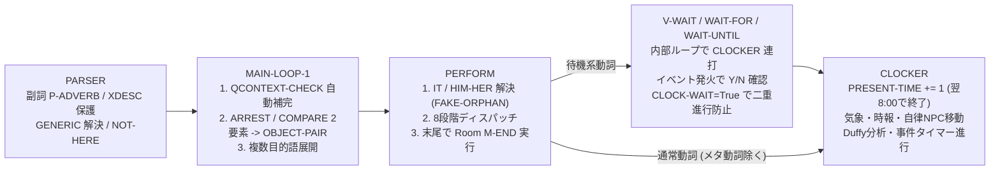
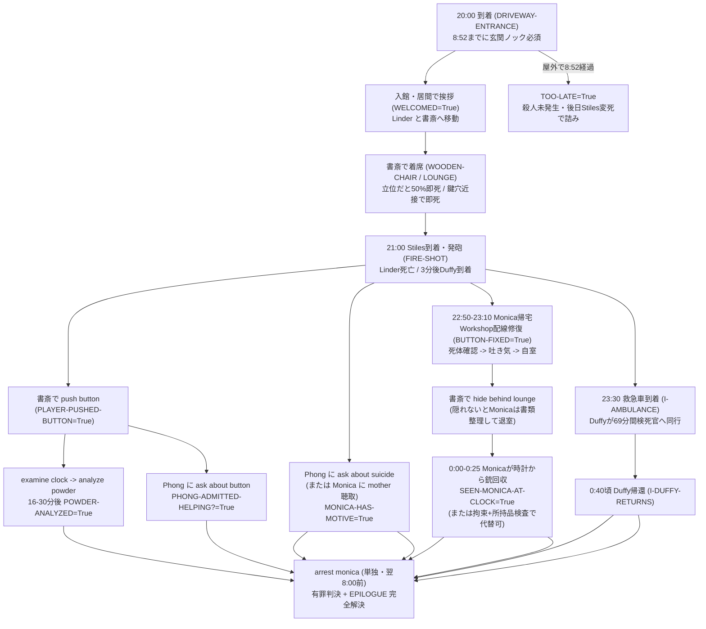

# THE WITNESS (Python 版) の内部構造・探偵視点・人間ドラマ解析

ZilPy が Infocom のハードボイルド推理アドベンチャー *The Witness* (1983, Stu Galley 作) の ZIL ソース (`witness/`) から生成した Python 版 (`out/witness/`) を、構成要素・1983 年版推理パーサーと 12 時間リアルタイム制御・自律 NPC 移動と屋敷の仕掛け・因果的ターニングポイントと立証構造・探偵視点のギャップ・ノワール人間ドラマの観点から詳細に解説します。

- **ネタバレ注意:** 真犯人・書斎での銃撃トリックの全貌・全勝利条件・分岐エンディングまで記載しています。
- **ライセンス配慮:** *The Witness* (© 1983 Infocom, Inc.) は MIT ライセンス対象作品ではないため、ゲーム本文やソースコードの長文転載は避け、構造解析に必要なシンボル名・条件式・短い目印の引用にとどめています。
- **解析手順の再現性:** 本ドキュメントはプロジェクトルートの `GameArchitecture.md`（Stage 1〜5）および `infocomGame.md` に従って作成しました。元の ZIL の位置は `events.zil:1620` のように記載します。

---

## 1. 全体像

### 1.1 規模

| 項目 | 数 |
|---|---|
| モジュール (ZIL ファイル) | 11 |
| ルーチン | 463 |
| 部屋 | 29 (屋外 9・屋内平屋 19・仮想 `LIMBO` 1) |
| オブジェクト (部屋以外) | 220 |
| 構文 (`SYNTAX`) | 245 (動詞の語 100 個) |
| 割り込みのルーチン (`I-*`) | 28 (`QUEUE` 呼び出し 45 箇所) |
| グローバル変数・定数 | 272 |
| 点数 (`VALUE` / `TVALUE`) | 0 (非スコア制。**20:00〜翌 8:00 の 12 時間リアルタイム制** と立証フラグによる結末分岐) |

ルーチンを役割で分類すると次のとおりです (`tools/analyze_game.py` の自動分類)。

| 役割 | 数 | 例 |
|---|---|---|
| 動詞のアクション (`V-*`) | 133 | `V-ARREST`、`V-ANALYZE`、`V-WAIT`、`V-HIDE-BEHIND`、`V-PHONE` |
| オブジェクトのアクション | 98 | `CLOCK-F`、`OFFICE-BUTTON-F`、`MONICA-F`、`PHONG-F`、`OBJECT-PAIR-F` |
| そのほか (イベント・移動・補助) | 82 | `ARREST`、`EPILOGUE`、`FIRE-SHOT`、`ESTABLISH-GOAL`、`MOVE-PERSON`、`CORRIDOR-CHECK` |
| パーサー | 42 | `PARSER`、`CLAUSE`、`SYNTAX-CHECK`、`GET-OBJECT`、`GLOBAL-CHECK` |
| 割り込み (`I-*`) | 28 | `I-STILES`、`I-MONICA`、`I-PHONG`、`I-WEATHER`、`I-FINGERPRINT`、`I-AMBULANCE` |
| 事前アクション (`PRE-*`) | 27 | `PRE-ARREST`、`PRE-ANALYZE`、`PRE-COMPARE`、`PRE-FIND` |
| 動詞の補助 | 24 | `DESCRIBE-ROOM`、`ITAKE`、`SEE-INTO?`、`TIME-PRINT`、`YES?` |
| 部屋のアクション | 14 | `OFFICE-F`、`SIDE-YARD-F`、`MONICA-ROOM-F`、`LIVING-ROOM-F` |
| メインループ | 9 | `GO`、`MAIN-LOOP-1`、`QCONTEXT-CHECK`、`FAKE-ORPHAN`、`PERFORM` |
| 時計 | 3 | `QUEUE`、`INT`、`CLOCKER` |
| マクロ系 | 3 | `PROB`、`DISABLE`、`PICK-ONE` |

### 1.2 モジュールと読み込みの順

| # | モジュール (元の ZIL) | 行数 | 中身 |
|---|---|---|---|
| 1 | `witness.py` (`witness.zil`) | 57 | 入口。バージョン・プロパティ既定値・読み込み順 |
| 2 | `macros.py` (`macros.zil`) | 209 | マクロ定義と `PROB`・`PICK-ONE`・`DISABLE` |
| 3 | `syntax.py` (`syntax.zil`) | 1,065 | 語彙 (`BUZZ` / `SYNONYM`) と構文 245 個 (`ANALYZE`・`COMPARE`・`HIDE BEHIND`・`WAIT FOR/UNTIL`・`ARREST` 等) |
| 4 | `places.py` (`places.zil`) | 3,515 | 部屋 29 個 (1938 年 LA 近郊の Linder 邸 1 階平屋＋庭園)・固定設備 127 個・視界 `CORRIDOR-LOOK` / `CORRIDOR-CHECK` |
| 5 | `people.py` (`people.zil`) | 1,718 | 登場人物 22 個 (Linder・Monica・Phong・Stiles・猫 Asta・Duffy 代理・靴・`OBJECT-PAIR`) と尋問・拘束応答 |
| 6 | `things.py` (`things.zil`) | 1,381 | 証拠品・小道具・概念オブジェクト 68 個 (`INSIDE-GUN`・`OUTSIDE-GUN`・`GUN-RECEIPT`・`MEDICAL-REPORT`・`NOT-HERE-OBJECT` 等) |
| 7 | `clock.py` (`clock.zil`) | 107 | 時計 (`SCORE`=時、`MOVES`=分、`PRESENT-TIME`=480〜1199) と割り込み (`QUEUE`・`INT`・`CLOCKER`) |
| 8 | `main.py` (`main.zil`) | 370 | `GO`、`MAIN-LOOP-1`、`QCONTEXT-CHECK`、`SAID-TO`、`FAKE-ORPHAN`、`PERFORM` |
| 9 | `parser.py` (`parser.zil`) | 1,557 | 1983 年世代の推理パーサー (`P-PROMPT`・`P-ADVERB`・`XDESC`・`GENERIC` 分岐・`NOT-HERE-OBJECT`) |
| 10 | `verbs.py` (`verbs.zil`) | 2,868 | 動詞の標準動作 (184 ルーチン。待機・電話・比較・隠密・逮捕前検査を含む) |
| 11 | `events.py` (`events.zil`) | 1,859 | 事件タイムライン・気象/時報・**自律 NPC 移動エンジン (旧 `goal.py` を統合)**・Duffy 科学捜査・`ARREST` 結末判定・`EPILOGUE` |

前作 *DEADLINE* (1982) の 51 部屋・8 名に比べると、本作は **29 部屋（平屋）・主要人物 4 名＋Duffy** に空間と人員を凝縮しています。その分、**「プレイヤーの目の前で殺人事件そのものが発生する」** という時間軸の劇的構造と、屋敷全体の電気配線・気象（雨と泥）・隠し拳銃トリックという物理的リアリティに注力しているのが最大の特徴です。

---

## 2. 起動・時間管理・メインループとパーサーの進化 (`clock.py` / `main.py` / `parser.py`)

### 2.1 起動 (`GO`, `main.zil:24`) と 12 時間リアルタイム制 (`clock.py`)

1. `GO()` (`main.zil:24-42`) は `SCORE = 20`（20 時）、`MOVES = 0`（0 分）、`PRESENT-TIME = 480`（1938 年 2 月 18 日 金曜 20:00）、`HERE = DRIVEWAY-ENTRANCE`、`LIT = True` を設定します。
2. 初期代名詞を `THIS-IS-IT(FRONT-DOOR)`・`THIS-IS-S-HE(PHONG)` にセットし、`QUEUE-MAIN-EVENTS()` と `START-MOVEMENT()` を起動します。
3. **`QUEUE-MAIN-EVENTS` (`events.zil:55`)** が一夜の固定スケジュールを登録します:
   - `I-PROMPT-1` (1 分後) / `I-PROMPT-2` (10 分後): プロンプトの段階的短縮
   - `I-WEATHER` (6 分後 = 20:06〜): 雷鳴 → 稲妻 → 小雨 → **豪雨 (`GROUND-MUDDY = True`)** → 晴れ (`CLOUDS-GONE = 525`, 20:45) → 月の出 (`MOONRISE = 612`, 22:12) → 日の出 (`SUNRISE = 1117`, 翌 6:37、1938-02-18 の L.A. Times 実測値に基づく注記あり)
   - `I-CHIMES` (30 分ごと): 書斎にいると大時計が正時・半時を鳴らす
   - `I-LINDER-TO-OFFICE` (52 分後 = 20:52): 来客応対がない場合の遅刻タイムリミット (`TOO-LATE = True`)
   - `I-STILES-ARRIVE` (60 分後 = **21:00**): Stiles の到着（殺人トリガー）
   - `I-LINDER-RETIRES` (290 分後 = 翌 0:50) / `I-PHONG-RETIRES` (320 分後 = 翌 1:20): 殺人未発生時（`TOO-LATE` 時）の就寝
4. **時間上限 (`clock.zil:50-56`)**:
   - `CLOCKER()` は毎ターン `PRESENT-TIME` を `+1` し、`MOVES` が `60` に達すると `SCORE` を繰り上げ、`24` で `0` に戻します（ステータス行に `20:00`〜`07:59` と表示）。
   - **`PRESENT-TIME > 1199`（翌朝 8:00）** に達すると `TIMES-UP()` (`events.zil:27`) が発火し、Klutz 署長が「市警の陸上競技会に出る時間だ」と探偵をパトカーで連れ帰って強制終了 (`QUIT()`) します。つまり制限時間は **20:00〜翌 8:00 の 12 時間（720 分）** です。

### 2.2 *DEADLINE* (1982) から進化した 1983 年版推理パーサー (`parser.py` / `main.py`)

*The Witness* のパーサーは *DEADLINE* の 1 年後にあたり、推理ゲーム向けに以下の明確な進化を遂げています。

| 観点 | *DEADLINE* (1982) | *The Witness* (1983) での進化・変更点 |
|---|---|---|
| **副詞の認識 (`P-ADVERB`)** | なし | `carefully` / `closely`（内部で `carefully` に正規化）・`quietly`・`slowly`・`quickly`・`briefly` を `P-ADVERB` に保存 (`parser.zil:315-321`)。**精密調査や証拠照合の結果を実際に分岐させる**（例: `compare wire with spool carefully` で `WIRE-MATCHED = True`） |
| **未紹介人物の保護 (`XDESC`)** | `GWIM` で実名が出ることがある | `GWIM` (`parser.zil:813-817`) が未接触 (`not TOUCHBIT`) の `PERSON` に対して `XDESC`（`the tall man` / `the young woman`）を出力し、自己紹介前の名前ネタバレを防止 |
| **汎用名詞の曖昧性解消 (`GENERIC`)** | 限定的な手動処理 | `GET-OBJECT` (`parser.zil:1001`) に `GENERIC` プロパティ呼び出しを統合。`GENERIC-GUN-F`・`GENERIC-KEY-F`・`GENERIC-WIRE-F`・`GENERIC-CAST-F`・`GENERIC-CHAIR-F` 等で文脈に応じた自動解決を実施 |
| **不在オブジェクト (`NOT-HERE-OBJECT`)** | なし | `NOT-HERE-OBJECT` と `FIND-NOT-HERE` (`things.zil:18-108`) を導入し、部屋にない物への参照を統一処理 |
| **プロンプト段階短縮 (`P-PROMPT`)** | 常に `>` | Turn 0 は `"What should you, the detective, do now?"`、Turn 1 で `"What next?"`（会話相手がいれば `(<QCONTEXT> is listening.)` も表示）、Turn 10 または Monica の部屋入室時に自動解除 (`I-PROMPT-1/2`, `parser.zil:143-157`) |
| **会話文脈 (`QCONTEXT-CHECK`)** | 既存の `QCONTEXT` のみ補完 | `main.zil:138-152` で部屋に人物が 1 人だけなら自動で `SAID-TO(WHO)` を設定し、`WHAT ABOUT ...` 等の主語省略をシームレスに受理 |
| **代名詞 `IT` 欠落時の聞き返し** | 単純エラー | `P-IT-LOC != HERE` かつ間接目的語なしなら **`FAKE-ORPHAN()` (`main.zil:165-177`)** を呼び、`P-OFLAG = True` で自然な聞き返しへ誘導 |
| **`OBJECT-PAIR` の拡張** | `V?ARREST` の 2 人逮捕のみ | `MAIN-LOOP-1` (`main.zil:88`) が **`ARREST` と `COMPARE` の両方** を `OBJECT-PAIR` にディスパッチ。`compare inside gun and outside gun carefully` が自然に動作 |
| **`PERFORM` の段数** | 6 段階＋末尾 `M-END` | `Not Here`・`Container (CONTFCN)` を加えた **8 段階＋末尾 `M-END`** (`main.zil:224-257`) |
| **`AGAIN` / `OOPS`** | `V-AGAIN` (`L-PRSA` 等) あり | `L-PRSA` 系がコメントアウトされ (`main.zil:159, 219`)、`AGAIN`・`OOPS` ともに未搭載 |
| **パーサー乗っ取り** | なし (`YES?` のみ) | なし（`READ()` の外部呼び出しは `verbs.zil:234` の `YES?` のみ） |

*DEADLINE* から継承された推理機能（先頭 `WHY`/`HOW`/`WHEN`/`IS`/`DID`/`ARE` の尋問ガイド弾き、`MR.`/`MRS.` のピリオド保護、`ASK/TELL ... TO ...` の `quote` 変換、`HIM-HER` の `GLOBAL-CHARACTER-TABLE` 差し替え、`V-WAIT`/`WAIT-FOR`/`WAIT-UNTIL` の `CLOCKER()` 内部ループと `CLOCK-WAIT` 二重加算防止）もすべて健在です。

### 2.3 具体的コマンドのエンドツーエンド実行トレース (3 例)

#### トレース 1: `wait until 9:05` → 目の前での殺人発生 (`I-STILES` → `FIRE-SHOT`)
1. **`PARSER`**: `WAIT UNTIL 9:05` を `V?WAIT-UNTIL`、`PRSO = INTNUM`、`P-NUMBER = 545`（9:05 PM）に解釈。
2. **`PERFORM` → `V-WAIT-UNTIL` (`verbs.zil:2120`) → `V-WAIT(545 - PRESENT-TIME)` (`verbs.zil:2042`)**: 毎分 `CLOCKER()` を呼び、時刻を進める。
3. **20:56 頃 (`I-PHONG`, `events.zil:1172-1185`)**: Phong が `OFFICE-PATH` に着くと、4 分後の `I-STILES-ARRIVE` を再予約しつつ **`OUTSIDE-GUN` を地面に置き、`SIDE-FOOTPRINTS` を可視化**。さらに `FRONT-PORCH` で呼び鈴を合図に鳴らし、`ENTRY` に `MUDDY-SHOES` を可視化してから `OFFICE` へ向かう。
4. **21:00 (`I-STILES-ARRIVE` → `I-STILES`, `events.zil:1207-1265`)**: Stiles が `OFFICE-PORCH` に到着し `G-REACHED` 発火。`WELCOMED` かつ `HERE == OFFICE` なので Linder が「Stiles!」と叫んで執事ボタンを押し、**`FIRE-SHOT()` (`events.zil:549-575`)** が実行される。
   - `PLAYER-NEAR-SHOT` が 1 分以内なら即死、`WOODEN-CHAIR`/`LOUNGE` に座っておらず隠れてもいない場合は **50% 確率 (`PROB(50)`) で即死**。
   - 生存すると窓が粉砕 (`OFFICE-WINDOW` に `RMUNGBIT`、`BROKEN-GLASS` 可視化)、猫が逃走 (`REMOVE(CAT)`)、`SHOT-FIRED = True`、`PIECE-OF-WIRE` / `PIECE-OF-PUTTY` が取得可能化。
   - Linder は `REMOVE(LINDER)` → `CORPSE` 可視化、`STILES` は `LIMBO` へ退避し `BACK-FOOTPRINTS` 可視化。3 分後の `I-DUFFY-ARRIVE` と 150 分後の `I-AMBULANCE` を予約し、`M-FATAL` (`2`) を返却。
5. **`V-WAIT` 側**: `VAL == M-FATAL` を受け取って待機ループを即座に打ち切り、`CLOCK-WAIT = True` にして現在時刻を表示する。

#### トレース 2: `analyze powder`（Duffy による科学捜査の非同期依頼）
1. **`PARSER`**: `CLOCK-POWDER`（事件後に `examine clock` または `examine keyhole` で `INVISIBLE` 解除済み）を `PRSO`、`PRSA = V?ANALYZE` に設定。
2. **`PERFORM` → `CLOCK-POWDER-F` (`places.zil:2544`) → `DO-ANALYZE()` → `DO-FINGERPRINT(True)` (`events.zil:214-245`)**:
   - `DUFFY-AT-CORONER` / `FINGERPRINT-OBJ` / `not MET-DUFFY?` を検査。
   - `FINGERPRINT-OBJ = CLOCK-POWDER`、`ANALYSIS-OBJ = True`、`ANALYSIS-GOAL = False` を記録し、`REMOVE(CLOCK-POWDER)` で Duffy が持ち帰り、**`QUEUE(I-FINGERPRINT, 15 + RANDOM(15))`**（16〜30 分後）を予約。
3. **16〜30 分後の `CLOCKER` → `I-FINGERPRINT` (`events.zil:258-335`)**:
   - `FINGERPRINT-OBJ == CLOCK-POWDER` に一致し、**`POWDER-ANALYZED = True`** を設定。セロファン袋に入れて `MOVE(CLOCK-POWDER, PLAYER)` で返却し、`FINGERPRINT-OBJ = False` に戻す。

#### トレース 3: `arrest monica`（単独逮捕 → 法廷結末判定 → `EPILOGUE`）
1. **`PARSER`**: `PRSA = V?ARREST`、`PRSO = MONICA`（または `GLOBAL-MONICA`）。`NUM == 1` なので `OBJECT-PAIR` ではなく直接 `PERFORM` へ。
2. **`PERFORM` → `PRE-ARREST` (`verbs.zil:689-717`)**: 殺人発生済み (`not INVISIBLE(CORPSE)`)・Duffy 対面済み (`MET-DUFFY?`)・Duffy 待機中 (`not FINGERPRINT-OBJ and not DUFFY-AT-CORONER`) を確認。
3. **`MONICA-F` (`people.zil:1372`) → `ARREST(MONICA)` (`events.zil:1620-1872`)**:
   - Monica が `LIMBO`（映画館）にいないことを確認し、`YES?` で捜査終了の確認を取る。
   - 2 月 28 日付の Klutz 署長からの手紙 (`END-HEADER('February 28')`) を出力し、**(1) トリック解明**・**(2) 動機 (`MONICA-HAS-MOTIVE`)**・**(3) Monica と時計の紐づけ (`SEEN-MONICA-AT-CLOCK or USED-CLOCK-KEY`)** の 3 条件を順に検証。
   - すべて満たしていれば `DUFFY-HINT-NUM`（0 / 1〜2 / 3 以上）に応じた祝辞を出し、**`EPILOGUE()`** (`events.zil:1902`) を呼んで完全解決終了となる。

---

## 3. *The Witness* 固有の主要サブシステム

### 3.1 統合された自律 NPC 移動・視界・会話エンジン (`events.py` / `places.py` / `people.py`)

*DEADLINE* では独立モジュール `goal.py` だった NPC 移動エンジンが、本作では `events.zil:613-1104` に統合されています。

1. **4 本の移動路線 (`events.zil:777`)**:
   - `INSIDE-LINE` (1): `LINDER-ROOM` ↔ `LIVING-ROOM` ↔ `HALL-1` ↔ `HALL-2` ↔ `HALL-3` ↔ `ENTRY`
   - `OFFICE-LINE` (2): `OFFICE` ↔ `HALL-4` ↔ `GARAGE` ↔ `WORKSHOP`
   - `MONICA-LINE` (3): `BATHROOM` ↔ `MONICA-ROOM`
   - `OUTSIDE-LINE` (4): `FRONT-YARD` ↔ `FRONT-PORCH` ↔ `DRIVEWAY` ↔ `DRIVEWAY-ENTRANCE` ↔ `SIDE-YARD` ↔ `OFFICE-PATH` ↔ `OFFICE-PORCH` ↔ `BACK-YARD` ↔ `ROCK-GARDEN`
   - 路線を跨ぐ移動は `ESTABLISH-GOAL` (`events.zil:817`) と `TRANSFER` (`events.zil:1073`) が乗換点（`FRONT-PORCH`/`ENTRY`、`HALL-4`/`HALL-3`、`MONICA-ROOM`/`HALL-2`）を自動経由させます。
2. **5 本の視界ビットマスク (`COR-1`〜`COR-16`, `places.zil:3007-3060`)**:
   - `COR-1` (裏庭南北ライン)、`COR-2` (南庭東西ライン)、`COR-4` (車道南北ライン)、`COR-8` (車庫↔車道)、`COR-16` (屋内中央廊下 `HALL-1`〜`HALL-4`) の 5 ビットで構成。廊下や庭にいると、離れた部屋を出入りする人物や Duffy に連行される Stiles がリアルタイムに視界へ入ります。
3. **注意持続時間 (`ATTENTION-SPAN`) と目撃記憶 (`WHERE-TABLES`)**:
   - `GOAL-TABLES` の `ATTENTION-SPAN` は Phong 3・Linder 4・Stiles 9・Monica 2・猫 1 分。話しかけると `GRAB-ATTENTION` が移動を一時停止させ、残り 1 分で `"is acting impatient."` と焦れ始めます。
   - また `DISCRETION(P1, P2, P3)` (`people.zil:1700`) により、話題の当事者が同室にいる場合は「ちらりとそちらを見て小声で話す」演出が入ります。

### 3.2 目の前で起きる「書斎の銃撃トリック」と屋敷の仕掛け

本作の物理的・工学的ギミックはすべて実コード上のオブジェクト状態遷移として緻密に実装されています。

| 屋敷の仕掛け・証拠 | 場所・オブジェクト | コード上の仕組みとトリックとの接続 |
|---|---|---|
| **執事ボタンと緑の配線** | `OFFICE-BUTTON`, `CLOCK-WIRES`, `PIECE-OF-WIRE`, `SPOOL-OF-WIRE`, `JUNCTION-BOX` | 屋敷の執事ボタン配線は本来 **黒線 (`BLACK-WIRE`)**、窓の防犯警報は **白線 (`WHITE-WIRE`)** だが、書斎のボタンだけは **緑のベル線 (`CLOCK-WIRES` / `PIECE-OF-WIRE`)** で柱時計と窓のパテ（爆薬）に接続されている。事件後に `push button` すると `BUTTON-FIXED` 前なら時計からカチッと音が鳴り (`PLAYER-PUSHED-BUTTON = True`)、**事件前に Linder 不在で押すと自爆トリガー `FIRE-SHOT()` が暴発する** (`OFFICE-BUTTON-F`, `places.zil:2593`)。帰宅した Monica が最初に `WORKSHOP` の `JUNCTION-BOX` をいじって `BUTTON-FIXED = True` に戻す (`I-MONICA`, `events.zil:1376`) |
| **大時計と仕掛けられた拳銃** | `CLOCK`, `KEY-HOLE`, `CLOCK-POWDER`, `INSIDE-GUN`, `CLOCK-KEY` | `CLOCK` は床にボルト固定かつ `LOCKED`。中に銃身を切り詰めた安価な拳銃 (`INSIDE-GUN`) とリレーが仕込まれ、鍵穴 (`KEY-HOLE`) を通して書斎の椅子へ照準されている。発砲後 `examine clock`（または `examine keyhole`）で `CLOCK-POWDER` が可視化され、`analyze powder` で火薬と証明 (`POWDER-ANALYZED = True`)。Monica が `CLOCK-KEY` を隠し持ち、深夜に書斎へ戻って `INSIDE-GUN` を回収・再施錠する (`CLOCK-FIXED = True`) |
| **窓の爆薬（パテ）と割れたガラス** | `OFFICE-WINDOW`, `PIECE-OF-PUTTY`, `BROKEN-GLASS` | 窓枠に付けられたパテ (`PIECE-OF-PUTTY`) に爆薬コルダイトが仕込まれており、発砲と同時に爆発して窓を粉砕する (`analyze putty` でコルダイト検出)。外から撃ち抜かれたように錯覚させる演出装置 |
| **2 種類の泥の足跡と石膏型** | `SIDE-FOOTPRINTS`, `BACK-FOOTPRINTS`, `MUDDY-SHOES`, `STILES-SHOES`, `OUTSIDE-GUN` | 20:14 の豪雨で `GROUND-MUDDY = True` になる。20:56 に Phong が裏庭にダミーの拳銃 (`OUTSIDE-GUN`) を仕掛けた足跡が `SIDE-FOOTPRINTS`（玄関の泥ブーツ `MUDDY-SHOES` と一致）、21:00 に逃げた Stiles の足跡が `BACK-FOOTPRINTS`（`STILES-SHOES` と一致）。`analyze footprints` で Duffy が石膏型 (`*-CAST`) を作成。ただし **豪雨後にプレイヤー自身が `SIDE-YARD` を歩くと `SIDE-FOOTPRINTS-CONFUSED = True` になり、足跡が踏み荒らされて鑑定不能になる** (`SIDE-YARD-F`, `places.zil:543`) |
| **電話とラジオ** | `TELEPHONE`, `RADIO`, `MATCHBOOK` | 電話 (`V-PHONE`, `verbs.zil:809`) では `0`（警察署）、`1308`（中華料理店 Brass Lantern、今夜は貸切）、`1729`（マッチ箱の Stiles 宅、応答なし）に実ダイヤル可能。ラジオ (`RADIO-F`, `places.zil:1489`) は 15 分刻みで 1938 年の実在番組（*Amos 'n' Andy*, *Lum & Abner* 等）が切り替わり、Monica の前で音量を下げようとすると止められる |
| **偽造診断書・領収書・映画半券** | `MEDICAL-REPORT`, `GUN-RECEIPT`, `RECURSIVE-BOOK`, `STUB` | Phong の部屋の小説（なんと *Deadline* の単行本！`RECURSIVE-BOOK`）に挟まれた質屋 Fritzi's の領収書 (`GUN-RECEIPT`, 偽名 Nemo Newbourne で拳銃 2 丁購入)。Monica の部屋の偽造診断書 (`MEDICAL-REPORT`, 胃癌で余命わずか＝自殺偽装用の非常口)。車庫に落ちる映画 *Dead End* の半券 (`STUB`) |

---

## 4. クリアへの因果的ターニングポイントと障壁

### 4.1 勝利条件と法的立証分岐 (`ARREST`, `events.zil:1620`)

`ARREST(PERSON, HELPER)` (`events.zil:1620-1872`) は、刑事裁判の立証要件をそのまま分岐木に落とし込んでいます。完全解決 (`EPILOGUE`) に到達するには、**`arrest monica`（単独逮捕）** を実行し、以下の **4 条件すべて** を満たす必要があります。

| # | コード上の条件式 | 法的立証要素 | 満たし方（代表ルート） | 欠落時の結末 |
|---|---|---|---|---|
| 1 | `not IN?(MONICA, LIMBO)` かつ `HELPER == False` | **被疑者の在宅と単独起訴** | 22:50〜23:10 頃の帰宅後、`arrest monica` を単独実行 | 映画館外出中なら逮捕保留。`arrest monica and phong` は共謀罪での司法取引エンド（執行猶予＋国外退去／保護観察 5 年）となり `EPILOGUE` に到達しない |
| 2 | `MONICA-ADMITTED-HELPING?` ∨ `PHONG-ADMITTED-HELPING?` ∨ (`PLAYER-PUSHED-BUTTON` ∧ (`POWDER-ANALYZED` ∨ `TOUCHBIT(INSIDE-GUN)`)) | **書斎の殺人トリック（隠し銃機構）の証明** | 発砲後に `push button` → `examine clock` → `analyze powder`（または Phong に `ask phong about button` 等で自白を得る） | 「窓の外から撃たれた単純殺人」とみなされ、Monica/Phong 逮捕は**検事不起訴**。Stiles 逮捕は誤認有罪（懲役 20 年）→後日新証拠で再審釈放 |
| 3 | `MONICA-HAS-MOTIVE` | **Monica の殺害動機（母の死への怨恨）** | Phong に `ask phong about suicide`、または Monica が口を閉ざす (`MONICA-CLAMS-UP`) 前に `ask monica about mother` / `linder` | 動機不明により **陪審無罪** (`she had no apparent motive.`) |
| 4 | `SEEN-MONICA-AT-CLOCK` ∨ `USED-CLOCK-KEY` | **Monica と時計の仕掛けの直接的結びつき** | ① 深夜（0:00〜0:25 頃）に書斎で `hide behind lounge`（または外から `look in window` の瞬間）して銃回収を目撃 → `SEEN-MONICA-AT-CLOCK = True` ② `CLOCK-FIXED` 後に Monica を手錠で家具に拘束 (`handcuff monica to ...`) → `search monica` で `INSIDE-GUN`（即 `SEEN-MONICA-AT-CLOCK = True`）や `CLOCK-KEY` を押収し時計を開閉 (`USED-CLOCK-KEY = True`) | 状況証拠のみで仕掛けとの直接関係が未証明として **陪審無罪** |

### 4.2 因果依存グラフ (Mermaid)

### 4.3 時間切れ・即死・不可逆障壁の一覧 (`--show` 検証済み)

| 障壁・失敗条件 | 発生条件（実コード根拠） | 結果・リカバリ可否 |
|---|---|---|
| **入館遅刻 (`TOO-LATE`)** | 20:52 (`I-LINDER-TO-OFFICE`) 時点で屋外または `WORKSHOP` にいる (`events.zil:482`) | `TOO-LATE = True`。21:00 に Linder は発砲せず Stiles に金を渡して帰す。玄関を 3 回叩くと不法侵入逮捕で終了 (`WELCOME`, `events.zil:351`)。**不可逆詰み** |
| **発砲時の即死 (2 種)** | ① 発砲直前 1 分以内に鍵穴を覗く・触る (`PLAYER-NEAR-SHOT`, `places.zil:2506`, `events.zil:551`) ② 発砲時に `WOODEN-CHAIR` / `LOUNGE` に座っておらず隠れてもいない (`events.zil:557`) | ① **100% 即死** (`QUIT()`) ② **50% 確率 (`PROB(50)`) で即死** (`QUIT()`) |
| **Monica の口封じ (`MONICA-CLAMS-UP`)** | Monica に `button`/`gun`/`wire`/`clock key`/`accuse` 等の核心を先にぶつける (`people.zil:969-1248`) | `MONICA-CLAMS-UP = True` となり、以降 Linder や母の話をしても本音を語らず動機 (`MONICA-HAS-MOTIVE`) が取れなくなる（※Phong に `suicide` を聞けば代替可能） |
| **書斎での鉢合わせ（目撃失敗）** | 深夜の銃回収時、書斎に隠れず立っている (`I-MONICA`, `events.zil:1431`) | Monica は机の書類をいじって誤魔化し自室へ戻る。ただし `MOVEMENT-GOALS` を 1 エントリ巻き戻すため再挑戦の猶予はある。逆に書斎に不在だと誰にも見られず回収完了 (`CLOCK-FIXED = True`) してしまい、以後は手錠拘束＋所持品検査しか残らない |
| **足跡の踏み荒らし** | 豪雨 (`GROUND-MUDDY = True`) 後にプレイヤーが `SIDE-YARD` で移動する (`SIDE-YARD-F`, `places.zil:543`) | `SIDE-FOOTPRINTS-CONFUSED = True` となり、Phong の足跡鑑定が不可になる（※クリア自体は Phong への直接質問や火薬分析で代替可能） |
| **共犯 2 人同時逮捕の罠** | `arrest monica and phong` を実行 (`events.zil:1727`) | 物的証拠が揃っていても「共謀罪での司法取引」に分岐し、Phong は執行猶予＋国外退去、Monica は保護観察 5 年で逃げ切られ、**完全解決にならない** |
| **翌朝 8:00 のタイムアップ** | `PRESENT-TIME > 1199` (`clock.zil:51`) | Klutz 署長に陸上競技会へ連れ戻され終了 (`TIMES-UP`) |

### 4.4 登場人物視点での評価（必然 vs 不条理）

- **物理的・工学的必然**:
  - 豪雨後に泥の側庭を歩き回ると自分の靴跡で現場の足跡が潰れる (`SIDE-FOOTPRINTS-CONFUSED`)、鍵穴を覗き込んでいる瞬間に銃が暴発すれば即死する (`PLAYER-NEAR-SHOT`)、椅子に座らず射線上に立っていれば流れ弾に当たる、帰宅した犯人が最初に作業場の配電盤を元に戻す (`BUTTON-FIXED`) といった因果は、現場の物理法則として極めて説得力があります。
- **心理的・法廷的必然**:
  - 目の前で「外から撃たれた」ように見えた事件で、トリックを証明せずに身内を逮捕しても検事が起訴しないこと、動機と物的結びつきの両方が揃わなければ陪審員が有罪にしないこと、そして **2 人を共謀罪でまとめて起訴すると司法取引の抜け道を使われてしまう** という法的リアリズムは、*DEADLINE* からさらに洗練された推理ドラマの必然です。
- **構造的・システム的不条理**:
  - 書斎で隠れられる場所が `lounge` のみ (`hide behind desk` は拒否)、さらに Monica の時計回収を目撃したあと、実は **23:30 に救急車が来てから Duffy が 69 分間も検死官に同行して不在になる** ため、証拠が揃っていても 0:40 頃まで逮捕できない待ち時間が発生します。また `compare ... carefully` のように **副詞 `carefully` を付けないと照合フラグが立たない** 仕様は、初見プレイヤーにはやや不親切なパーサー依存の壁と言えます。

---

## 5. 探偵の視点: 初回情報のみの「最も知的・理想的な行動」vs「クリアに必要な行動」

プレイヤーは 1938 年のロサンゼルス市警の探偵です。Turn 0 (`INTRO`, `events.zil:9`) で知り得るのは、① 依頼人 Freeman Linder からの電報 (`TELEGRAM`)、② 道端で拾ったレストラン Brass Lantern のマッチ箱 (`MATCHBOOK`、Stiles の電話番号メモ入り)、③ 事前に調べた Linder 夫人の自殺に関する警察ファイルと新聞記事（同梱資料）、④ 拳銃 (Colt .32) と手錠を携帯していること――これだけです。

| 捜査フェーズ | 初回情報のみから導かれる「最も知的で理想的な探偵行動」 | コード上でクリアに実際に要求される行動 | ギャップの本質（必然 vs 不条理） |
|---|---|---|---|
| **① 到着と敷地の下見 (20:00〜20:52)** | プロの探偵として、玄関を叩く前に屋敷の外周・裏口・車庫・作業場を下見し、不審者や逃走経路を確認してから訪問する。 | 20:52 (`I-LINDER-TO-OFFICE`) までに玄関を叩いて入館しないと `TOO-LATE = True` で **事件そのものが起きず不可逆詰み**。さらに 20:14 の豪雨後に側庭を歩くと将来の足跡証拠まで潰れる。 | **時間窓の緊張感と初見殺し**: 8 時の約束に遅刻すれば依頼人に追い返されるのは現実的必然だが、慎重な下見が即ソフトロックに繋がるのは厳しい。 |
| **② 書斎での面談 (20:10〜21:00)** | 依頼人の話を聞きながら、部屋の見取り図・時計・窓の奇妙な緑の配線やパテを立ち上がって詳しく検分する。 | Linder の指示通り **椅子 (`wooden chair` か `lounge`) に座ってじっと待つ** 必要がある。立っていると 21:00 の発砲で 50% 即死、鍵穴を調べていると 100% 即死。 | **状況の皮肉（必然寄り）**: 「依頼人の指示に従って席に着く」という礼儀正しさがそのまま生死を分ける設計は、目の前で事件が起きる本作ならではの緊張感を生んでいる。 |
| **③ 現場検証と配線・銃の照合** | 割れた窓の緑の線と作業場のスプールを比べ (`compare wire with spool`)、泥の靴と足跡を照合し (`compare boots with footprints`)、時計と執事ボタンを調べる。 | 単純な `compare` では「似ている」としか出ず、**`carefully` を添えないと照合フラグが立たない**。また最重要のトリック証明は `push button`（**Monica が 22:50 頃に配線を直す前！**）と `examine clock` → `analyze powder` の組み合わせ。 | **パーサー知識の壁と時間窓**: 帰宅後に配線が直されるとボタンで時計が鳴らなくなる (`BUTTON-FIXED`) のは工学的必然だが、`carefully` 必須の仕様はゲーム的制約。 |
| **④ Monica への尋問と監視** | 帰宅した Monica に正面から鋭く切り込み、配線や銃の領収書、時計の鍵について問い詰める。さらに証拠隠滅を防ぐため書斎に見張りとして堂々と居座る。 | 核心を先にぶつけると `MONICA-CLAMS-UP = True` で動機を聞き出せなくなる。また書斎に堂々といると Monica は書類をいじって退室してしまうため、**`hide behind lounge` で陰に潜んで泳がせ、現行犯（銃の回収）を目撃する**（または回収後に手錠をかけて身体検査する）必要がある。 | **尋問心理と潜伏捜査の必然**: *DEADLINE* のバルコニー潜伏と同系の「容疑者を泳がせて証拠隠滅の瞬間を押さえる」名探偵ムーブ。*DEADLINE* の 6 分窓に比べると、`MOVEMENT-GOALS` の巻き戻し救済や拘束＋身体検査の代替ルートがあり洗練されている。 |
| **⑤ 逮捕の決断** | 計画に関わった Monica と Phong の両方を共犯として逮捕する (`arrest monica and phong`)。 | **Monica 単独 (`arrest monica`) で逮捕しなければならない**。Phong を巻き込むと共謀罪の司法取引エンドになり、Monica が保護観察 5 年で逃げ切って完全解決を逃す。 | **司法制度のリアリズム（物語的必然）**: 「狂言未遂の共犯者 (Phong)」と「殺意ある実行犯 (Monica)」を混ぜて起訴すると立証が濁って司法取引を許す、という本作最大の法廷的ツイスト。 |

### *DEADLINE* (1982) との探偵像の対比
*DEADLINE* の探偵は「すでに終わった密室毒殺の翌朝に訪れ、容疑者同士の亀裂に餌を撒いて第二の殺人を防ぐ **冷徹な演出家**」でした。対して *The Witness* の探偵は、**「依頼人の狂言の舞台に『目撃者 (The Witness)』として招かれ、目の前で狂言が本物の殺人へとすり替わる瞬間に立ち会ってしまう巻き込まれ型のハードボイルド探偵」** です。初見の理想行動が裏目に出る最大の罠も、「遅刻による事件未発生」「立位での流れ弾即死」「2 人同時逮捕による司法取引」という、**ノワール劇の舞台装置そのもの** に直結しています。

---

## 6. このゲームで行われていた具体的な行為とノワール人間ドラマ

`EPILOGUE` (`events.zil:1902-1960`)・`TOO-LATE-F` (`events.zil:1962-1971`)・各人物の応答 (`people.py`) を時系列に再構成すると、*The Witness* の背後には、1930 年代ロサンゼルスを舞台にした極めて苦く重層的なハードボイルド・ノワール悲劇が浮かび上がります。

### 6.1 過去軸: 事件前に行われていた行為と「狂言から殺人へのすり替え」

1. **不在の父、孤独な母、そして悲劇の始まり**:
   - 実業家 Freeman Linder (Pacific Trade Associates 経営) は仕事でアジアに長期滞在することが多く、妻 Virginia と娘 Monica を家に残したままだった。孤独な Virginia は売れない作家兼端役俳優の Ralph Stiles と不倫関係に陥る。
   - 約 1 年前、Linder が不倫を知ったことで夫婦仲は修復不能なほど荒み、やがて Virginia は自邸の浴槽で拳銃自殺を遂げる。
   - ところが Linder は自分の家庭放棄を顧みず、妻の死の責任をすべて愛人 Stiles に転嫁し、**「Stiles を殺人未遂の現行犯に仕立て上げて破滅させる」** という傲慢な復讐計画を立案する。
2. **「完璧な狂言」の設計と 2 人の協力者**:
   - Linder は執事 **Phong** と、機械・電気工作に長けた娘 **Monica** を計画に引き込んだ。
   - Monica は偽名（Nemo Newbourne）で質屋 Fritzi's から安価な小型拳銃を 2 丁購入（1937 年 12 月 1 日、`GUN-RECEIPT`）。1 丁は銃身を切り詰めて書斎の大時計の中に仕込み、鍵穴から Linder の椅子に向けて固定した。さらに書斎の執事ボタンを緑のベル線で大時計のリレーと窓の爆薬（コルダイト入りパテ）に接続し、**「ボタンを押せば窓が吹き飛び、同時に時計から銃弾が飛んで外から撃たれたように見える」** 仕掛けを完成させた。
   - Linder 自身は Stiles の筆跡を真似た脅迫状 (`THREAT-NOTE`) を偽造し、事件当日の朝、探偵には「命を狙われている」と電報を打ち、Stiles には「手切れ金を払うから今夜 9 時に書斎の裏口へ来い」と電話で呼び出した。探偵を **「目の前で Stiles の犯行を目撃する完璧な証人 (The Witness)」** に利用するつもりだったのだ。
3. **娘の静かな殺意と「照準の数インチ」**:
   - しかし Linder は、娘 Monica の心を見誤っていた。母と強い絆で結ばれていた Monica は、母を孤独に追いやり自殺させたのは父だと深く憎んでいた（`people.zil:1044, 1067`）。
   - 機械の設計と時計の唯一の鍵 (`CLOCK-KEY`) を握っていたのは Monica だった。父は「かすり傷か威嚇射撃」のつもりだったが、**Monica は時計の中の銃の照準を正確に父の心臓へ向けた**。さらに万が一仕掛けが露見したときの非常口として、「父は末期の胃癌で余命わずかだった（＝自殺幇助／狂言自殺だった）」と偽装するための **偽造診断書 (`MEDICAL-REPORT`)** まで用意していた。

### 6.2 現在軸: 1938 年 2 月 18 日の夜に交錯する 4 人のドラマ

- **20:30 — 最後の抱擁と別れ (`I-MONICA`, `events.zil:1340`)**:
  映画 *Dead End* を観に行くと言ってアリバイ作りに出かける Monica は、書斎で父を強く抱きしめ、涙をこらえながら「私はママみたいにはならない」と言い残して去る。父はそれを娘のわがままだとしか思わなかったが、それは **30 分後に父を殺す娘の、愛憎入り混じった最後の別れ** だった。
- **20:56 — 執事 Phong の忠誠と鬱屈 (`I-PHONG`, `events.zil:1172-1185`)**:
  アジアから Linder に連れられてきた Phong は、事業を任せるという約束を反故にされ使用人扱いされ続けていた（`people.zil:310`）。それでも彼は命じられた通り豪雨の泥の中を歩いて裏庭にダミー拳銃 (`OUTSIDE-GUN`) を仕込み、21:00 の合図に玄関の呼び鈴を鳴らした。彼は書斎で主人の死体を見るまで、これが本物の殺人になるとは露ほども知らなかったのだ。
- **21:00 — 罠にかかった哀れな道化 Stiles (`I-STILES`, `events.zil:1210-1237`)**:
  手切れ金を受け取りに来ただけの Stiles が窓の外に現れた瞬間、Linder は勝ち誇ってボタンを押す。窓が砕け、Stiles は「自分が撃たれた！」とパニックになって竹林へ逃げ込み、偶然通りかかった Duffy に捕まる。そして椅子の上では、自分が仕掛けた罠で心臓を撃ち抜かれた Linder が絶命している。
- **22:50〜0:25 — 証拠隠滅と人間の脆さ (`I-MONICA`, `events.zil:1375-1468`)**:
  映画館から帰宅した Monica は、まず作業場で配電盤を元に戻し、書斎で父の遺体を見て思わずトイレで嘔吐し、自室のベッドで泣き崩れる。冷徹な完全犯罪を設計したはずの彼女も、実の父の死を目の当たりにして激しく動揺する一人の人間だった。それでも彼女は深夜に再び書斎へ忍び込み、慣れた手つきで時計を開けて凶器をポケットに回収する――その瞬間を、長椅子の陰から探偵が見届けているとも知らずに。
- **もう一つの結末 (`TOO-LATE-F`, `events.zil:1962`)**:
  もし探偵が 20:52 までに家へ入らず、狂言劇が中止された場合、Linder は Stiles に金を渡して帰す。しかし数日後、Stiles は海岸で心臓を撃ち抜かれた死体として発見される――「誰もがいずれは『大いなる眠り (the big sleep)』につく」。レイモンド・チャンドラーへの敬意に満ちたこの裏エンディングは、Linder 邸の誰もが救われないノワール世界の冷酷さを静かに刻みつけています。

---

## 7. この解説の作り方

本解説は、プロジェクトルートの `GameArchitecture.md`（Stage 1〜5）および `infocomGame.md` に従って作成しました。

1. `tools/analyze_game.py out/witness` による静的棚卸し一覧（モジュール 11・ルーチン 463・部屋 29・オブジェクト 220・構文 245・割り込み 28・変数定数 272）を全数値の基準とした。
2. `clock.py`・`main.py`・`parser.py` を精読し、12 時間リアルタイム制（20:00〜翌 8:00）、`P-ADVERB`・`XDESC`・`GENERIC`・`P-PROMPT`・`QCONTEXT-CHECK`・`FAKE-ORPHAN`・`OBJECT-PAIR` 拡張など *DEADLINE* (1982) からの進化点を特定した。
3. `events.py`・`places.py`・`people.py`・`things.py`・`verbs.py` の主要ルーチン（`FIRE-SHOT`, `I-STILES`, `I-MONICA`, `I-PHONG`, `I-FINGERPRINT`, `CLOCK-F`, `OFFICE-BUTTON-F`, `SIDE-YARD-F`, `ARREST`, `EPILOGUE`, `TOO-LATE-F` 等）を実コードおよび `--show` で直接検証し、因果グラフ・ギャップ分析・人間ドラマを再構成した。
