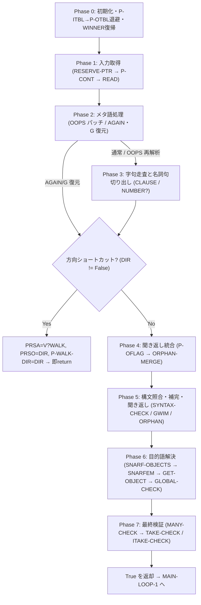
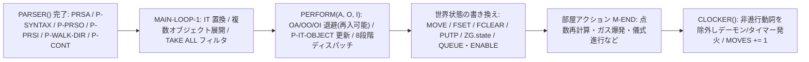
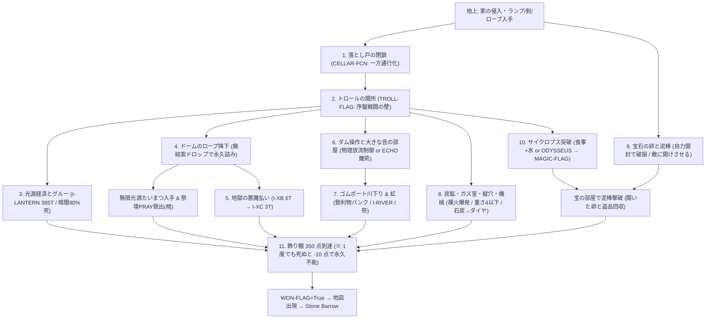

# Zork I (Python 版) の内部構造と因果解析

ZilPy が Zork I の ZIL ソース (`zork1/`) から生成した Python 版 (`out/zork1/`) を、構成要素・パーサーの内部処理・ゲーム世界への反映パイプライン・クリアを阻む因果的ターニングポイントの観点から詳細に解説します。

- **ネタバレ注意:** 仕掛けの解き方、不可逆な詰み条件、エンディング条件まで記載しています。
- **解析手順の再現性:** 本ドキュメントを作成した解析計画と手順は、プロジェクトルートの `GameArchitecture.md`（および基礎棚卸し手順の `infocomGame.md`）にまとめています。
- **元の ZIL の位置:** `gparser.zil:109` のように記載します。生成コードの各定義直前の `# zil:` 注記と `out/zork1/zilmap.json` から対応を引けます。
- **ライセンス表記:** 解析対象の Zork I 原作 ZIL ソース (`zork1/`) および ZilPy 生成 Python コード (`out/zork1/`) は **MIT License (`Copyright (c) 2025 Microsoft`)** のもとで公開されています（詳細は `zork1/LICENSE` および `out/zork1/LICENSE` を参照）。本ドキュメントで引用するコード断片・テキストも同ライセンスに従います。

---

## 1. 全体像

### 1.1 規模

| 項目 | 数 |
|---|---|
| モジュール (ZIL ファイル) | 10 |
| ルーチン | 445 |
| 部屋 | 110 |
| オブジェクト (部屋以外) | 140 |
| 構文 (`SYNTAX`) | 267 (動詞の語 135 個、アクション 148 個) |
| 割り込みのルーチン | 16 |
| グローバル変数・定数 | 259 (ゲームの状態 95、定数 106、パーサーの作業用 58) |
| 満点 | 350 点 |

ルーチンを役割で分けると、次のようになります (`tools/analyze_game.py` による自動分類)。

| 役割 | 数 | 例 |
|---|---|---|
| 動詞のアクション (`V-*`) | 149 | `V-TAKE`、`V-WALK`、`V-SCORE` |
| 事前アクション (`PRE-*`) | 12 | `PRE-TAKE`、`PRE-PUT` |
| オブジェクトのアクション | 85 | `TROLL-FCN`、`LANTERN`、`EGG-OBJECT` |
| 部屋のアクション | 33 | `LIVING-ROOM-FCN`、`LLD-ROOM` |
| 割り込み (`I-*`) | 16 | `I-THIEF`、`I-FIGHT`、`I-LANTERN` |
| パーサー | 42 | `PARSER`、`SYNTAX-CHECK`、`GET-OBJECT` |
| メインループ | 5 | `MAIN-LOOP-1`、`PERFORM` |
| 時計 | 3 | `QUEUE`、`INT`、`CLOCKER` |
| そのほか (場面の処理・動詞の補助など) | 100 | `JIGS-UP`、`GOTO`、`ROBBER-FUNCTION` |

### 1.2 モジュールと読み込みの順

メインの `zork1.py` が、ZIL の `INSERT-FILE` の順にモジュールを `from ... import *` で読み込みます。最後に `ZG._link()` で遅延宣言されたオブジェクト・テーブル・語彙を解決し、`ZG.GO()` でゲームを開始します。

| # | モジュール (元の ZIL) | 行数 | 中身 |
|---|---|---|---|
| 1 | `zork1.py` (`zork1.zil`) | 48 | 入口。`VERSION ZIP`、プロパティの既定値 (`SIZE` 5、`CAPACITY` 0、`VALUE` 0、`TVALUE` 0)、読み込みの順 |
| 2 | `gmacros.py` (`gmacros.zil`) | 274 | マクロ (`TELL`・`VERB?`・`PROB` など)。マクロから作った関数 `PROB-1`・`PROB-2`・`DISABLE` と、`PICK-ONE`・`RANDOM-ELEMENT` |
| 3 | `gsyntax.py` (`gsyntax.zil`) | 969 | 語彙と構文 (`BUZZ`・`SYNONYM`・`SYNTAX` 267 個)。Zork 三部作で共通のもの |
| 4 | `_1dungeon.py` (`1dungeon.zil`) | 2,804 | 世界: オブジェクト 122 個と部屋 110 個、出口、`GO` (始まりの処理) |
| 5 | `gglobals.py` (`gglobals.zil`) | 329 | どこからでも見える共通のオブジェクト 18 個 (`GROUND`・`HANDS`・`GRUE` など) と `NOT-HERE-OBJECT-F` |
| 6 | `gclock.py` (`gclock.zil`) | 94 | 時計と割り込み (`QUEUE`・`INT`・`CLOCKER`) |
| 7 | `gmain.py` (`gmain.zil`) | 295 | メインループと、アクションを呼び分ける `PERFORM` |
| 8 | `gparser.py` (`gparser.zil`) | 1,746 | パーサー (ルーチン 42 個) |
| 9 | `gverbs.py` (`gverbs.zil`) | 2,257 | 動詞の標準の動き (ルーチン 189 個) |
| 10 | `_1actions.py` (`1actions.zil`) | 4,289 | Zork I に固有の場面・人物・仕掛け (ルーチン 186 個) |

`g` で始まるファイルは Zork 三部作 (I・II・III) で共通の土台、`1` で始まるファイル (`1dungeon`・`1actions`) が Zork I 固有の部分です。

### 1.3 生成コードの読み方

| 生成コード | 元の ZIL | 意味 |
|---|---|---|
| `ZG.NAME` | `,NAME` (グローバル)・ルーチン・オブジェクト | 全ファイルで共有する名前は、ランタイムの `ZG` (`GameContext`) の属性になる |
| `NAME` (`ZG.` なし) | `.NAME` | ルーチンのローカル変数。ランタイムの名前と衝突するものは `_l` が付く (`OBJ_l` など) |
| `@ZG.routine('V-TAKE')` + `def V_TAKE():` | `<ROUTINE V-TAKE ...>` | ルーチン。ZIL の名前でも登録される |
| `ZG.world.declare_object('LAMP', 'LAMP', lambda: {...})` | `<OBJECT LAMP ...>`・`<ROOM ...>` | オブジェクトと部屋。中身はリンク時／初回参照時に評価する |
| `ZG.state._declare('SCORE', lambda: 0)` (`ZilGlobal.py`) | `<GLOBAL SCORE 0>` | グローバル変数。元のモジュールにはコメントで残る |
| `SYNTAX('TAKE', 'OBJECT', ..., '=', 'V-TAKE', 'PRE-TAKE')` | `<SYNTAX TAKE OBJECT ... = V-TAKE PRE-TAKE>` | 構文の宣言 |
| `VERB_p('TAKE')` | `<VERB? TAKE>` | 現在の `PRSA` が指定アクションかを判定する組み込み関数 |
| `TELL('...', CR)` | `<TELL "..." CR>` | テキスト出力 |
| `return 2` | `<RFATAL>` | 「この先の処理をやめる」(`M-FATAL`) |
| `# macro: <PROB 30> (...) -> expanded` | マクロの呼び出し | その場で展開したマクロの注記 |

ゲームの状態は `ZG` (`GameContext`) が保持し、グローバル変数は 3 種類に分類されます。

| 種類 | 数 | 中身 |
|---|---|---|
| `state` | 95 | ゲームの状態。セーブの対象 (`SCORE`・`TROLL_FLAG` など) |
| `const` | 106 | 定数 (`CONSTANT` とトップレベルの `SETG`) |
| `scratch` | 58 | パーサーの作業用 (`P-*`、`PRSA`/`PRSO`/`PRSI`、`HERE`/`WINNER` 等) |

---

## 2. 起動とメインループ

### 2.1 起動 (`GO`、`1dungeon.zil:2637`)

`GO` はゲームの始まりに 1 回だけ次の初期化を行います。

1. 割り込みを仕掛ける。
   - 毎ターン動くデーモン (`-1`): `I-FIGHT` (戦闘)・`I-SWORD` (剣の光)・`I-THIEF` (泥棒)
   - 時間を数えるタイマー: `I-CANDLES` (40)・`I-LANTERN` (200)。登録のみで無効状態から始まり、明かりを点けたときに `ENABLE` される
2. ゴムボート (`INFLATED-BOAT`) の乗り物タイプを `NONLANDBIT` に設定し、戦闘結果テーブル (`DEF1-RES` など) を組み立てる。
3. 現在地 `HERE` を `WEST-OF-HOUSE` (家の西) にし、代名詞「それ」(`P-IT-OBJECT`) を郵便受け (`MAILBOX`) に初期化する。
4. 初回なら版表示 (`V-VERSION`) を出力し、プレイヤー (`ADVENTURER`) を配置して `V-LOOK` で部屋を説明したあと、`MAIN-LOOP` に入る。

### 2.2 メインループの構造 (`MAIN-LOOP` / `MAIN-LOOP-1`、`gmain.zil:34-172`)

`MAIN-LOOP` は `MAIN-LOOP-1()` を無限ループで呼び続けます。1 ターンの大枠は次のとおりです（パーサーからの受け渡しと反映の詳細は 4 章で詳述します）。

1. `P-WON = PARSER()` で 1 コマンドを解析する。失敗 (`False`) なら `P-CONT = False` にしてそのターンを終了する（時計は進まない）。
2. `P-PRSI` / `P-PRSO` 内の代名詞 `IT` を、接触可能な `P-IT-OBJECT` に置換する。
3. 方向移動 (`PRSA == V?WALK` かつ `P-WALK-DIR != 0`)・目的語 0 個・目的語 1 個以上の 3 パターンに分岐し、`PERFORM` を呼び出す。複数目的語の場合は 1 オブジェクトずつループ実行する。
4. `PERFORM` が `M-FATAL` (`2`) を返していなければ、現在地 `LOC(WINNER)` の部屋アクションを `M-END` で呼ぶ。`M-FATAL` なら残りの連続コマンド (`P-CONT`) を破棄する。
5. `P-WON` が真であり、かつメタ動詞 (`TELL`, `BRIEF`, `SUPER-BRIEF`, `VERBOSE`, `SAVE`, `VERSION`, `QUIT`, `RESTART`, `SCORE`, `SCRIPT`, `UNSCRIPT`, `RESTORE`) でなければ `CLOCKER()` を実行し、割り込み処理とターン数 (`MOVES`) の加算を行う。

---

## 3. パーサーの詳細処理 (`gparser.py`)

パーサーはプレイヤーが入力した自然言語の 1 行を、ゲームエンジンが実行可能な **(アクション `PRSA`, 直接目的語列 `P-PRSO`, 間接目的語列 `P-PRSI`)** の組に変換するサブシステムです。42 個のルーチンからなり、中核の `PARSER` (`gparser.zil:109`, Python 版 `gparser.zil:109-380`) が全体を統括します。

### 3.1 内部データ構造とメモリ配置

Z-machine 互換のテーブル構造がそのまま Python ランタイム (`Table`) に写像されています。

| テーブル / 変数 | サイズ・構造 | 役割 |
|---|---|---|
| `P-INBUF` / `OOPS-INBUF` | 120 バイト (`BYTE`, `LENGTH`) | `READ` が書き込む生の入力文字列バッファと、`OOPS`/`AGAIN` 用の退避コピー |
| `P-LEXV` / `AGAIN-LEXV` / `RESERVE-LEXV` | 最大 59 語 (`LEXV`)。先頭 2 バイトが `[最大語数, 実語数(P-LEXWORDS=1)]`、以降 1 語 4 バイト (`P-WORDLEN=4`, `P-LEXELEN=2` ワード) | トークン列。各エントリは `[辞書語ポインタ(2B), 文字長(1B), INBUF開始位置(1B)]` |
| `OOPS-TABLE` | 4 ワード (`O-PTR=0`, `O-START=1`, `O-LENGTH=2`, `O-END=3`) | 未知語の位置・文頭位置・未解析バイト長・`OOPS-INBUF` の追記先位置 |
| `P-ITBL` / `P-OTBL` | 10 ワード (`P-ITBLLEN=9`) | 解析中の文構造表（および前ターン／聞き返し用の退避表）。下記スロット構成を参照 |
| `P-VTBL` / `P-OVTBL` | 4 ワード / 3 要素 | 入力された動詞トークンの `[辞書語, 0, 文字長, INBUF位置]` を保持（エラー表示・聞き返し表示用） |
| `P-OCLAUSE` / `P-CCTBL` | 100 ワード / 4 ワード (`CC-SBPTR`..`CC-DEPTR`) | 聞き返し (`ORPHAN`) の際に名詞句トークンを退避・複製するバッファと、コピー元/先の範囲ポインタ |
| `P-PRSO` / `P-PRSI` / `P-BUTS` / `P-MERGE` | 各 50 ワード。先頭ワード (`P-MATCHLEN=0`) に要素数、1 番目以降にオブジェクト | 解決済みの直接目的語・間接目的語・除外対象 (`BUT`/`EXCEPT`)・作業用マージ表 |
| `SIBREAKS` | `'.,"'` | 空白なしでも独立トークンとして切り出す区切り文字 (`period`, `comma`, `quote`) |

`P-ITBL`（および `P-OTBL`）の 10 スロットのレイアウトは次のとおりです (`gparser.zil:90`)。

| インデックス | 定数名 | 格納内容 |
|---|---|---|
| 0 | `P-VERB` | 動詞のアクション番号 (`ACT?*`) |
| 1 | `P-VERBN` | `P-VTBL` へのポインタ (暗黙の `TELL` 時は `0`) |
| 2 / 3 | `P-PREP1` / `P-PREP1N` | 第 1 名詞句の前置詞番号 / 前置詞の辞書語 |
| 4 / 5 | `P-PREP2` / `P-PREP2N` | 第 2 名詞句の前置詞番号 / 前置詞の辞書語 |
| 6 / 7 | `P-NC1` / `P-NC1L` | 第 1 名詞句の開始ポインタ / 終了ポインタ (`P-LEXV` または `P-OCLAUSE` 内) |
| 8 / 9 | `P-NC2` / `P-NC2L` | 第 2 名詞句の開始ポインタ / 終了ポインタ |

### 3.2 辞書の品詞エンコーディングと `WT?` (`gparser.zil:430`)

辞書の各語は、バイトオフセット `P-PSOFF` (`4`) に **品詞ビットマスク** を持ち、オフセット `P-P1OFF` (`5`) と `6` の 2 バイトに **品詞ごとの値（動詞番号・前置詞番号・形容詞番号・方向番号など）** を最大 2 つまで格納します。

- 品詞ビット: `PS?VERB`・`PS?OBJECT`・`PS?ADJECTIVE`・`PS?PREPOSITION`・`PS?DIRECTION`・`PS?BUZZ-WORD`
- `P-PSOFF` バイトの下位 2 ビット (`P-P1BITS = 3`) は、「最初の値スロット (`P-P1OFF`) がどの品詞の値か」を示します。
- `WT?(PTR, BIT, B1=5)` は `BTST(GETB(PTR, P-PSOFF), BIT)` で品詞の有無を調べ、`B1 > 4`（第 3 引数省略時）なら真偽を返し、`B1 <= 4`（`P1_VERB` 等を指定）なら `TYP & 3 == B1` ならオフセット 5、異なればオフセット 6 の値バイトを返します。これにより、`LIGHT`（動詞かつ名詞かつ形容詞）のような多品詞語を 1 エントリで高速に判別します。

### 3.3 `PARSER` の 7 段階処理パイプライン



#### Phase 0: 初期化と前回状態の退避 (`gparser.zil:110-130`)
- `P-OFLAG`（聞き返し待ちフラグ）が偽のときだけ、`P-ITBL` の全 10 ワードを `P-OTBL` に退避し、`P-ITBL` を 0 クリアします。
- `P-PRSO`・`P-PRSI`・`P-BUTS` の要素数 (`P-MATCHLEN`) を 0 に初期化します。
- `QUOTE-FLAG` が偽かつ `WINNER != PLAYER` なら、NPC への命令が終わったとみなして `WINNER = PLAYER`、`HERE = META-LOC(PLAYER)`、`LIT = LIT?(HERE)` に戻します。

#### Phase 1: 入力ソースの選択 (`gparser.zil:131-155`)
入力は次の 3 系統の優先順位で取得されます。
1. **`RESERVE-PTR`**: 前回 `AGAIN, <次のコマンド>` のように `AGAIN` の後ろに続きがあった場合、`RESERVE-LEXV` を `P-LEXV` に戻して続きのポインタから再開します。
2. **`P-CONT`**: 前回 `.`・`THEN`・`"` で区切られた複数コマンドの残りがある場合、`READ` を呼ばず `P-CONT` から続きを解析します。
3. **新規 `READ`**: 上記がなければ `WINNER = PLAYER`・`QUOTE-FLAG = False` に戻し、`HERE`（乗り物の中でなければ `LOC(WINNER)`）と `LIT` を更新し、`>` を表示して `READ(P-INBUF, P-LEXV)` を呼びます。語数 (`P-LEXWORDS`) が 0 なら「I beg your pardon?」を返して失敗します。

#### Phase 2: メタ語 `OOPS` と `AGAIN`/`G` (`gparser.zil:156-364`)
- **`OOPS <語>`**: 直前の解析で未知語があった場合 (`OOPS-TABLE[O-PTR]` が非偽)、`AGAIN-LEXV` の該当スロットを新しい辞書語で上書きし、`INBUF-ADD` で新しい語の文字列を `OOPS-INBUF` の末尾に追記します。そのうえで `AGAIN-LEXV` → `P-LEXV`、`OOPS-INBUF` → `P-INBUF` と復元し、`PTR = O-START` に戻して Phase 3 をやり直します。
- **`AGAIN` / `G`**: 直前コマンドが成功 (`P-WON`) かつ聞き返し中でない (`not P-OFLAG`) 場合、後続に `.`/`,`/`THEN`/`AND` 経由の別コマンドがあれば `RESERVE-LEXV` + `RESERVE-PTR` に退避します。そして `P-OTBL` を `P-ITBL` にコピーし、`DIR = AGAIN-DIR` を復元して **Phase 3 を丸ごとスキップ** します。

#### Phase 3: 字句走査と名詞句切り出し (`gparser.zil:233-364`, `CLAUSE`:548-613, `NUMBER?`:617-650)
まず現在の `P-LEXV` と `P-INBUF` を `AGAIN-LEXV` / `OOPS-INBUF` にバックアップし、左から 1 語ずつ走査します。

1. **未知語と数値 (`NUMBER?`)**: `P-LEXV` の辞書ポインタが 0 のとき `NUMBER?(PTR)` を試みます。ASCII の数字 (`0`-`9`) とコロン (`:` = 58) を読み取り、1000 以下の整数または `HH:MM` 時刻（8 時未満は午後扱い `+12`）として解釈できれば `P-NUMBER` に値を入れ、`P-LEXV` の語を `WORD('intnum')` に書き換えます。失敗なら `UNKNOWN-WORD(PTR)` が `O-PTR` を記録してエラー終了します。
2. **NPC への話しかけ構文の正規化**:
   - `TELL <NPC> TO <命令>` の `TO` を `WORD('quote')` に置換します。
   - 動詞がまだ出ていない状態で `<NPC>, <命令>` または `<NPC> THEN <命令>` のように `THEN` が出現すると（直前語が文頭/ピリオドでなければ）、`P-ITBL[P-VERB] = ACT?TELL`, `P-VERBN = 0` を補い、`WRD` を `WORD('quote')` に置換します。
3. **文の区切り (`THEN`, `.`, `"`)**: `quote` なら `QUOTE-FLAG` を反転し、残余語があれば `P-CONT = PTR + P-LEXELEN` に保存、残余語数を `P-LEXV[P-LEXWORDS]` に書き戻して走査ループを抜けます。
4. **方向ショートカット**: 語が `PS_DIRECTION` であり、動詞が未出または `ACT?WALK` のとき（かつ文末・区切り直前などの条件を満たすとき）、`DIR = VAL` を設定します。直後が `,` または `AND` なら `P-LEXV` 上で `THEN` に書き換え、`N, E` のような連続移動を可能にします。ループ脱出後、`DIR` が真なら **Phase 4〜7 を一切通らず** `PRSA = V?WALK`, `PRSO = DIR`, `P-WALK-DIR = DIR`, `AGAIN-DIR = DIR` を設定して即座に返ります。
5. **動詞**: 最初に出現した `PS_VERB` を `P-ITBL[P-VERB]` に記録し、生トークン情報を `P-VTBL` に保存します。
6. **名詞句の切り出し (`CLAUSE`)**: 前置詞・`ALL`・`ONE`・形容詞・名詞のいずれかが来ると `P-NCN` をインクリメント（最大 2 つ。3 つ目で「too many nouns」）して `CLAUSE(PTR, VAL, WRD)` を呼びます。
   - 前置詞があれば `P-PREP1/2` と `P-PREP1N/2N` に記録し、先頭の冠詞 (`THE`/`A`/`AN`) はポインタを 4 バイト進めて読み飛ばします。
   - `AND`/`,`、`BUT`/`EXCEPT`、`ALL OF`/`ONE OF`、`名詞 OF 名詞`、および **形容詞かつ名詞の語**（例: `BRASS` の直後に `LANTERN` がある場合は形容詞扱い）を処理しながら名詞句の終端 (`P-NC1L` / `P-NC2L`) を確定します。
   - **重要テクニック**: `AND`/`,` の直後に `PS_DIRECTION` や `PS_VERB` が来た場合（例: `TAKE LAMP AND GO NORTH`）、`CLAUSE` はポインタを戻して `P-LEXV` の `AND` を `WORD('then')` に書き換え、2 つの文に自動分割します (`gparser.zil:497-502`)。
7. **文末前置詞 (`P-END-ON-PREP`)**: `LOOK IN` や `PUT LAMP ON` のように前置詞で文が終わった場合は `P-END-ON-PREP = True` を立てて `P-PREP1` に記録し、後の `GWIM` / `ORPHAN` での表示に活かします。

#### Phase 4: 聞き返し応答の統合 (`ORPHAN-MERGE`、`gparser.zil:543`)
前ターンで `P-OFLAG` が立っていた場合、今回の入力（省略された目的語や、曖昧解消のための形容詞/名詞）を `P-OTBL` と合成します。
- **欠落目的語の補完**: `P-OTBL[P-NC1] == 1` または `[P-NC2] == 1`（`ORPHAN` が立てた番兵値 `1`）に対し、今回の第 1 名詞句（前置詞が一致または省略されている場合）を埋め込みます。
- **曖昧解消 (`P-ACLAUSE`)**: 「Which lamp do you mean?」への返答（例: `BRASS` や `BROKEN ONE`）では、新しい形容詞を検出すると `ACLAUSE-WIN` → `CLAUSE-COPY` で `P-OCLAUSE` に `P-ANAM`（元の名詞）の直前へ形容詞を挿入し、別の名詞なら `NCLAUSE-WIN` で名詞句ごと差し替えます。
- 統合に成功すると `P-OTBL` → `P-ITBL` にコピーして `P-MERGED = True` とします。別コマンドを打ち直した場合（別動詞など）は統合せず今回の `P-ITBL` をそのまま使います。

#### Phase 5: 構文照合・GWIM・聞き返し (`SYNTAX-CHECK` / `GWIM` / `ORPHAN`、`gparser.zil:707-927`)
`VERBS` テーブルから `SYN = GET(VERBS, 255 - VERB)` を引き、先頭バイトの件数分、**1 構文 8 バイト (`P-SYNLEN = 8`)** のエントリを順次照合します。

| オフセット | 定数名 | 内容 |
|---|---|---|
| 0 | `P-SBITS` | 下位 2 ビット (`P-SONUMS=3`) が必要な目的語数 (0〜2) |
| 1 / 2 | `P-SPREP1` / `P-SPREP2` | 第 1 / 第 2 前置詞番号 (なしは 0) |
| 3 / 4 | `P-SFWIM1` / `P-SFWIM2` | `GWIM` 補完時に要求するオブジェクトフラグ (`FIND` 指定) |
| 5 / 6 | `P-SLOC1` / `P-SLOC2` | 探索場所・所持要件ビット (`SH/SC/SIR/SOG/STAKE/SMANY/SHAVE`) |
| 7 | `P-SACTION` | 確定するアクション番号 (`V?*`) |

照合の結果は 3 通りに分岐します。
1. **完全一致**: 目的語数 `P-NCN` と前置詞 1・2 が一致したら `SYNTAX-FOUND(SYN)` で `P-SYNTAX = SYN`, `PRSA = GETB(SYN, P-SACTION)` を確定します。
2. **目的語 1 個不足 (`DRIVE1` / `DRIVE2`) → `GWIM` 補完**: 候補構文を `DRIVE1`（第 1 目的語不足）または `DRIVE2`（第 2 目的語不足）に記憶しておき、全構文走査後に `GWIM(SFWIM, SLOC, SPREP)` を呼びます。`GWIM` は `P-GWIMBIT = SFWIM` を設定して `GET-OBJECT(P-MERGE, False)` を実行し、**該当オブジェクトがちょうど 1 個だけ見つかったとき**に `(with the sword)` のように表示して `P-PRSO` または `P-PRSI` へ自動充填します。
3. **補完不能 → `ORPHAN`**: `GWIM` が 0 個または複数個だった場合（かつ `WINNER == PLAYER`、`ACT?FIND` 以外）、`ORPHAN(DRIVE1, DRIVE2)` が `P-ITBL` と既存名詞句を `P-OTBL` / `P-OCLAUSE` に退避し、欠落スロットに番兵 `1` を入れます。「What do you want to attack the troll with?」と出力し、`P-OFLAG = True` で `False` を返します（時計は進みません）。

#### Phase 6: 目的語の解決 (`SNARF-OBJECTS` / `SNARFEM` / `GET-OBJECT` / `GLOBAL-CHECK`、`gparser.zil:928-1243`)
構文が確定すると、`SNARF-OBJECTS` が **第 2 名詞句 (`P-NC2` → `P-PRSI`)、続いて第 1 名詞句 (`P-NC1` → `P-PRSO`)** の順に `SNARFEM` を呼び、最後に `P-BUTS` があれば `BUT-MERGE` で差集合を取ります。

- **`SNARFEM`**: トークン範囲 `[PTR, EPTR)` を走査し、`ALL` (`P-ALL=1`)、`ONE`/`A` (`P-ONE=2`)、`OF` (`P-INHIBIT=4`)、形容詞 (`P-ADJ`/`P-ADJN`)、名詞 (`P-NAM`/`P-ONEOBJ`) を抽出します。`BUT`/`EXCEPT` が出たら出力先を `P-BUTS` に切り替え、`AND`/`,` または終端で `GET-OBJECT` を呼びます。
- **`GET-OBJECT` の 2 パス探索とフォールバック**:
  1. **広域ローカル探索 (`P-SLOCBITS = -1`)**: `P-ALL` でなければ、まず構文の場所制約を無視して全ローカル範囲を探します。明るければ (`LIT`)、`PLAYER` の `TRANSBIT` を一時的に外して `DO-SL(HERE, SOG, SIR)` を実行し（持ち物が二重検索されるのを防ぐ）、次に `DO-SL(PLAYER, SH, SC)` を実行します。
  2. **木構造探索 (`SEARCH-LIST`) と照合 (`THIS-IT?`)**: `FIRST?`/`NEXT?` で子を辿り、`OPENBIT` または `TRANSBIT` な入れ物の中へ再帰します（`P-SRCTOP` / `P-SRCBOT` / `P-SRCALL` と `SURFACEBIT`/`SEARCHBIT` で深さを制御）。各オブジェクトは `THIS-IT?` で **① `INVISIBLE` でない、② `SYNONYM` が `P-NAM` と一致、③ `ADJECTIVE` が `P-ADJ` と一致、④ `P-GWIMBIT` のフラグを持つ** の 4 条件で判定されます。
  3. **構文ビットによる曖昧解消 (第 2 パス)**: 広域探索で 2 個以上見つかった場合、構文本来の `XBITS` (`SH=128` HELD, `SC=64` CARRIED, `SIR=32` IN-ROOM, `SOG=16` ON-GROUND) に `P-SLOCBITS` を絞り直して再探索します（例: 持っているランプと床のランプがあるとき `DROP LAMP` は `HELD` 優先で一意に決まります）。それでも複数残れば `WHICH-PRINT` で「Which ... do you mean?」と聞き返し、`P-ACLAUSE`/`P-ANAM`/`ORPHAN`/`P-OFLAG=True` を設定して中断します。
  4. **グローバル探索 (`GLOBAL-CHECK`)**: ローカルで 0 個なら `GCHECK = True` で再ループし、次の 4 段階で探します。
     - 部屋の `GLOBAL` プロパティ (`LOCAL-GLOBALS` 内の共有風景オブジェクト)
     - 部屋の `PSEUDO` プロパティ（一致したら単一の `PSEUDO-OBJECT` の `ACTION` と `SYNONYM` を **その場で動的に書き換えて** 返す）
     - `GLOBAL-OBJECTS` (`GROUND`・`HANDS`・`ME`・`IT`・`INTNUM`・`GRUE` 等)
     - それでも 0 個かつ動詞が `LOOK-INSIDE`/`SEARCH`/`EXAMINE` の場合は `ROOMS` 全体
  5. **未発見時の処理**: `GLOBAL-CHECK` でも 0 個なら、`LIT` または `TELL` のときは **`NOT-HERE-OBJECT`** を仮オブジェクトとして詰め、元の語を `P-XNAM`/`P-XADJ`/`P-XADJN` に保存して続行します（後段の `PERFORM` でエラー表示させるため）。暗闇なら「It's too dark to see!」で即失敗します。

#### Phase 7: 複数チェックと暗黙取得 (`MANY-CHECK` / `TAKE-CHECK` / `ITAKE-CHECK`、`gparser.zil:1244-1314`)
- **`MANY-CHECK`**: `P-PRSO` / `P-PRSI` の要素数が 2 以上なのに、対応する `P-SLOC1` / `P-SLOC2` に `SMANY` (`4`) ビットがない場合、「You can't use multiple (in)direct objects with "..."」で弾きます。
- **`TAKE-CHECK` → `ITAKE-CHECK`**: `P-SLOC1` / `P-SLOC2` に `SHAVE` (`2`) または `STAKE` (`8`) が立っていて、対象が `HELD?` でなく `HANDS`/`ME` でもない場合:
  - `TRYTAKEBIT` が付いていれば自動取得を拒否します。
  - `STAKE` があり `WINNER == ADVENTURER` なら、`ITAKE(False)` を呼んで **パーサーの段階で自動的に拾い**、`(Taken)` と表示します。
  - それでも所持しておらず `SHAVE` がある場合は「You don't have the ...」で解析失敗とし、`PERFORM` へ進ませません（時計も進みません）。

### 3.4 明るさ (`LIT?`) と接触可能性 (`ACCESSIBLE?`・`META-LOC`)

- **`LIT?(RM, RMBIT=True)` (`gparser.zil:1333`)**: `ALWAYS-LIT`（幽霊状態）なら即 `True`。部屋自体に `ONBIT` があれば `True`。そうでなければ、`P-GWIMBIT = ONBIT`・`P-SLOCBITS = -1` を設定して **パーサーの `DO-SL` をそのまま再利用** し、`WINNER`・`PLAYER`・`RM` の可視範囲内に `ONBIT` を持つオブジェクト（点いたランプ・たいまつ・ろうそく・マッチ）が 1 つでもあれば `True` を返します。
- **`ACCESSIBLE?(OBJ)` (`gparser.zil:1372`)**: `IT` 置換やアクション内で「触れるか」を判定します。`INVISIBLE` でなく、`GLOBAL-OBJECTS`・現在部屋の `LOCAL-GLOBALS`・`WINNER`/`HERE` 直下、または `OPENBIT` な入れ物の連鎖の中にあれば `True` です。

### 3.5 例外: パーサーを乗っ取る部屋 (`LOUD-ROOM-FCN`)

Zork I で唯一、通常のパーサー循環をバイパスする箇所が **大きな音の部屋 (`LOUD-ROOM-FCN`, `1actions.zil:1660`)** です。ダムが止まっておらず `LOUD-FLAG` も偽の状態で入室すると、`M-ENTER` の中で **独自の `while True:` + `READ(P-INBUF, P-LEXV)` ループ** に入ります。ここでは `PARSER` も `PERFORM` も `CLOCKER` も呼ばれず、`P-LEXV` の先頭語だけを直接検査して `W`/`E`/`U`/`SAVE`/`RESTORE`/`QUIT`/`ECHO` 以外をすべて `V-ECHO` で反響させます。

---

## 4. パーサーの結果がゲーム世界に反映されるまで

パーサーが `True` を返した時点では、まだ「どのアクションを、どのオブジェクト群に対して行うか」が決まっただけです（例外は `ITAKE-CHECK` による暗黙の `ITAKE`）。ここからの **ゲーム世界への反映パイプライン** は `MAIN-LOOP-1` → `PERFORM` → 各種アクション → `M-END` → `CLOCKER` の 5 段階で進みます。



### 4.1 `MAIN-LOOP-1` での前処理とループ展開 (`gmain.zil:42-172`)

1. **代名詞 `IT` の解決**: `P-IT-OBJECT` が設定済みかつ `ACCESSIBLE?` なら、`P-PRSI`、次いで `P-PRSO` の中にある `IT` を実体オブジェクトに書き換えます。
2. **実行モードの分岐**:
   - **方向移動**: `PRSA == V?WALK` かつ `P-WALK-DIR != 0` なら `PERFORM(V?WALK, PRSO)` を 1 回呼びます。
   - **目的語 0 個 (`NUM == 0`)**: 構文が必要とする目的語数 `(P-SBITS & P-SONUMS)` が 0 なら `PERFORM(PRSA)` を呼びます。そうでなければ暗闇エラーまたは参照不明エラーを出します。
   - **目的語 1 個以上 (`NUM >= 1`)**: `P-PRSO` または `P-PRSI` のうち要素数が 2 以上の側（最大 1 側）を走査します。複数対象 (`NUM > 1`) のときは `P-MULT = True` を立て、各要素の前に `lamp: ` のようにオブジェクト名を出力します。
     - **`TAKE ALL` の安全フィルタ (`gmain.zil:121-144`)**: `ALL` 指定の `TAKE` では、`NOT-HERE-OBJECT` を数えて最後にまとめて報告し、指定容器の外にある物・部屋や表面以外にある物・`TAKEBIT`/`TRYTAKEBIT` を持たない風景オブジェクトを静かにスキップします。
3. **`M-FATAL` (`2`) による即時中断**: いずれかの `PERFORM` が `2`（例: 死亡、NPC への不正話しかけ）を返すと、残りの複数オブジェクトループを `break` し、部屋 `M-END` も飛ばして `P-CONT = False` とし、後続の連続コマンドをすべて破棄します。

### 4.2 `PERFORM` の 8 段階ディスパッチと再入可能性 (`gmain.zil:235-288`)

`PERFORM(A, O=False, I=False)` は、呼び出し前の `(PRSA, PRSO, PRSI)` をローカル変数 `(OA, OO, OI)` に退避し、終了時に必ず復元します。この **再入可能設計** により、たとえば `TRAP-DOOR-FCN` が `RAISE` を受けたときに `PERFORM(V?OPEN, TRAP-DOOR)` へ委譲しても、外側のコンテキストが壊れません。また、`PRSO` が真で `V?WALK` 以外のとき `P-IT-OBJECT = PRSO` を更新し、次ターンの `IT` が直前の対象を指すようにします。

ディスパッチは次の **厳密な優先順位（個別から汎用へ）** で進み、いずれかが非偽（`True` または `M-FATAL`）を返した時点で打ち切ります。

| 優先 | 呼ばれるルーチン | 典型的な役割・例 |
|---|---|---|
| 0 | `NOT-HERE-OBJECT-F` (`PRSO` または `PRSI` が `NOT-HERE-OBJECT` のとき) | 「You can't see any ... here!」を出力し `P-CONT` を消去 |
| 1 | `GETP(WINNER, 'ACTION')` (動作主のアクション) | 幽霊状態の行動制限 (`DEAD-FUNCTION`)、NPC に命令したときの応答 (`CYCLOPS-FCN`, `TROLL-FCN`) |
| 2 | `GETP(LOC(WINNER), 'ACTION')` を `M-BEG` で呼ぶ | 部屋固有の割り込み・前提更新 (`LLD-ROOM` の悪魔払い、`NO-OBJS` の所持重量検査) |
| 3 | `GET(PREACTIONS, A)` (構文に紐づく事前アクション `PRE-*`) | 動詞横断の前条件検査 (`PRE-TAKE` の既所持/容量チェック、`PRE-PUT` の開扉チェック) |
| 4 | `GETP(PRSI, 'ACTION')` (間接目的語のアクション) | 道具側の特殊挙動 (`ROPE-FUNCTION` の `TIE-UP`、`SWORD`・`SCREWDRIVER` 等) |
| 5 | `GETP(LOC(PRSO), 'CONTFCN')` (直接目的語が入っている容器の関数) | 容器に特殊な出し入れ制約がある場合 |
| 6 | `GETP(PRSO, 'ACTION')` (直接目的語のアクション) | オブジェクト固有の仕掛け (`EGG-OBJECT`、`TROLL-FCN`、`RBOAT-FUNCTION`、`BOLT-F` 等) |
| 7 | `GET(ACTIONS, A)` (動詞の標準アクション `V-*`) | 上記すべてが `False` を返したときの既定動作 (`V-TAKE`、`V-OPEN`、`V-ATTACK` 等) |

### 4.3 世界状態の書き換えと `M-END` / `CLOCKER` への波及

ディスパッチされたルーチンは、以下のランタイム操作を通じてゲーム世界に副作用を与えます。

- **オブジェクト木の変更**: `MOVE(OBJ, DEST)` / `REMOVE(OBJ)`（所持、容器への出し入れ、部屋移動、アイテム破壊）
- **属性・プロパティ変更**: `FSET` / `FCLEAR`（`OPENBIT`・`ONBIT`・`FIGHTBIT`・`INVISIBLE` 等）、`PUTP`（`LDESC`・`STRENGTH`・`VALUE` 等）
- **状態変数 (`ZG.state`)**: `TROLL-FLAG`・`MAGIC-FLAG`・`GATES-OPEN`・`WON-FLAG`・`SCORE` 等
- **時間軸の予約**: `QUEUE` / `ENABLE` / `DISABLE`（電池消費・水位変化・悪魔払いタイマー等）

アクション完了後、現在地 `LOC(WINNER)` の部屋アクションが **`M-END`** で呼ばれます。ここは「行動の結果として部屋単位で起きる事後現象」の場であり、`LIVING-ROOM-FCN`（飾り棚の点数再集計 `OTVAL-FROB`）、`BOOM-ROOM`（ガス室での裸火爆発）、`LLD-ROOM`（鐘の後に点いたろうそくを持っていると儀式第 2 段階 `XC` へ移行）、`LOUD-ROOM-FCN`（放流中の轟音による強制退去）などが動作します。

最後に、メタ動詞 12 種（`TELL`, `BRIEF`, `SUPER-BRIEF`, `VERBOSE`, `SAVE`, `VERSION`, `QUIT`, `RESTART`, `SCORE`, `SCRIPT`, `UNSCRIPT`, `RESTORE`）以外であれば **`CLOCKER()`** が走り、世界側の能動イベント（`I-FIGHT` 敵の反撃、`I-THIEF` 泥棒の徘徊・窃盗、`I-SWORD` 剣の青光、`I-LANTERN` 電池消費、`I-RIVER` 川の流下など）が進行して `MOVES` が 1 増えます。

### 4.4 具体的な実行トレース 3 例

#### トレース 1: `attack troll`（GWIM 補完 → 戦闘 → 状態変化 → 割り込み）
1. **`PARSER`**: `attack` (`P-VERB=ACT?ATTACK`)、`troll` (`P-NC1`) を読み取る (`P-NCN=1`)。
2. **`SYNTAX-CHECK`**: `ATTACK OBJECT WITH OBJECT` 構文に対し第 2 目的語が不足 (`DRIVE2`)。`GWIM(WEAPONBIT, ...)` が所持中の剣 (`SWORD`) を一意に発見し、`(with the sword)` を表示して `P-PRSI=[1, SWORD]` を充填、`PRSA=V?ATTACK`。
3. **`SNARF-OBJECTS`**: `P-PRSO=[1, TROLL]` を確定。`MANY-CHECK`・`TAKE-CHECK` 通過。
4. **`MAIN-LOOP-1` → `PERFORM(V?ATTACK, TROLL, SWORD)`**:
   - `TROLL-FCN` は `MODE=False` の `ATTACK` を処理せず `False` を返す → 最終段の `V-ATTACK` → `HERO-BLOW` が実行される。
   - 乱数表で `KILLED` が出ると、`TROLL` が `REMOVE` され、`TROLL-FCN(F-DEAD)` が斧を床に落として **`TROLL-FLAG = True`** に設定する（以後トロールの部屋の東西出口 `CEXIT` が開通）。
5. **`M-END` → `CLOCKER`**: `I-FIGHT`（生存敵なし）、`I-SWORD`（近隣敵消滅で剣の光が消える）、`I-THIEF`（泥棒が 1 部屋移動）、`MOVES += 1`。

#### トレース 2: `cyclops, odysseus`（NPC 話しかけ → 2 ターン分の無消費連鎖）
1. **1 巡目の `PARSER`**: `cyclops`（名詞）の直後の `,`（`CLAUSE` 経由で `THEN` 相当）を見て、`P-VERB=ACT?TELL`, `P-NC1=cyclops`, `P-CONT=odysseus`, `QUOTE-FLAG=True` に変換。
2. **`PERFORM(V?TELL, CYCLOPS)`**: `V-TELL` (`gverbs.zil:1389`) が `ACTORBIT` と `P-CONT` を確認し、**`WINNER = CYCLOPS`**, `HERE = LOC(CYCLOPS)` に切り替える。
3. **`MAIN-LOOP-1`**: `VERB?('TELL')` なので **`CLOCKER()` をスキップ** してすぐ次のループへ。
4. **2 巡目の `PARSER`**: `QUOTE-FLAG=True` なので `WINNER` を `PLAYER` に戻さず、`P-CONT` から `odysseus` を解析 (`PRSA=V?ODYSSEUS`)。
5. **`PERFORM(V?ODYSSEUS)`**: 優先度 1 の `Actor` (`CYCLOPS-FCN`) が呼ばれ、`WINNER == CYCLOPS` かつ `VERB?('ODYSSEUS')` を検知して `WINNER = ADVENTURER` に戻し、`PERFORM(V?ODYSSEUS)` を再入呼び出し。`V-ODYSSEUS` が **`MAGIC-FLAG = True`**・`CYCLOPS-FLAG = True`・`CYCLOPS` 消去・`I-CYCLOPS` 無効化を実行し、居間への隠し通路が開通する。

#### トレース 3: `put all but lamp in case`（除外集合・暗黙取得・複数実行・クリア発火）
1. **`PARSER`**: `P-NC1 = [all, but, lamp]`, `P-NC2 = [case]`。`SYNTAX-CHECK` で `PUT OBJECT (HELD MANY HAVE) IN OBJECT = V-PUT PRE-PUT` に一致。
2. **`SNARF-OBJECTS`**: 先に `P-NC2` を `TROPHY-CASE` に解決。次に `P-NC1` の `SNARFEM` が `P-ALL` で所持品を集め、`BUT` 以降で `LAMP` を `P-BUTS` に集め、`BUT-MERGE` で `LAMP` を除く全所持品リストを `P-PRSO` に生成。
3. **`MAIN-LOOP-1`**: `P-MULT = True` で各宝を `<宝名>: ` 付きで順に `PERFORM(V?PUT, <宝>, TROPHY-CASE)` へ渡す。
4. **`LIVING-ROOM-FCN(M-END)`**: ループ終了後、`M-END` が `OTVAL-FROB(TROPHY-CASE)` で飾り棚の `TVALUE` を再集計して `SCORE-UPD` を呼ぶ。合計が **ちょうど 350 点** に達すると、`WON-FLAG = True`・`MAP` の `INVISIBLE` 解除・ささやきメッセージが発火する。

---

## 5. 語彙と構文 (`gsyntax.py`)

### 5.1 語彙

| 種類 | 中身 |
|---|---|
| 方向 (`DIRECTIONS`) | `NORTH`・`EAST`・`WEST`・`SOUTH`・`NE`・`NW`・`SE`・`SW`・`UP`・`DOWN`・`IN`・`OUT`・`LAND` (13) |
| 方向の略語 (`SYNONYM`) | `N`・`S`・`E`・`W`・`U`・`D`・`NORTHWEST` など |
| 前置詞の言い換え | `WITH` = `USING`・`THROUGH`・`THRU`、`IN` = `INSIDE`・`INTO`、`ON` = `ONTO`、`UNDER` = `UNDERNEATH`・`BENEATH`・`BELOW` |
| 意味のない語 (`BUZZ`) | `A`・`AN`・`THE`・`IS`・`AND`・`OF`・`THEN`・`ALL`・`ONE`・`BUT`・`EXCEPT`・`.`・`,`・`"`・`YES`・`NO`・`Y`・`HERE` と `AGAIN`・`G`・`OOPS` |

オブジェクトの名前の語は、各オブジェクトの `SYNONYM` (名詞) と `ADJECTIVE` (形容詞) から辞書に登録されます。

### 5.2 構文

構文は 267 個です。動詞の語は 135 個で、アクションは 148 個あります。50 個の構文が事前アクション (`PRE-*`) を持ちます。1 つの動詞が多くの形を持つことがあります (`LOOK` 12 形、`WALK` 11 形、`CLIMB`・`TAKE` 8 形、`PUT`・`THROW` 7 形)。

```python
# zil: gsyntax.zil  <SYNTAX PUT OBJECT (HELD MANY HAVE) IN OBJECT = V-PUT PRE-PUT>
SYNTAX('PUT', 'OBJECT', ('HELD', 'MANY', 'HAVE'), 'IN', 'OBJECT', '=', 'V-PUT', 'PRE-PUT')
SYNTAX('PUT', 'OBJECT', ('HELD', 'MANY', 'HAVE'), 'ON', 'OBJECT', '=', 'V-PUT-ON', 'PRE-PUT')
SYNTAX('PUT', 'DOWN', 'OBJECT', ('HELD', 'MANY'), '=', 'V-DROP', 'PRE-DROP')
```

各 `OBJECT` の後ろの指定は、パーサーの `P-SFWIM1/2`・`P-SLOC1/2` にエンコードされます。

| 指定 | 意味 | ビット定数 |
|---|---|---|
| `(FIND フラグ)` | 目的語が省かれたとき、このフラグを持つ物を補う (`GWIM`) | `P-SFWIM1/2` |
| `HELD`・`CARRIED` | 持っている物（直下／容器内）から探す | `SH=128`・`SC=64` |
| `IN-ROOM`・`ON-GROUND` | 部屋にある物（容器内／直下）から探す | `SIR=32`・`SOG=16` |
| `TAKE` | 持っていなければパーサー段階で自動取得 (`ITAKE-CHECK`) | `STAKE=8` |
| `MANY` | 複数 (`ALL` など) を許す (`MANY-CHECK`) | `SMANY=4` |
| `HAVE` | 持っていなければならない (`ITAKE-CHECK`) | `SHAVE=2` |

ゲーム外の命令 (`SAVE`・`RESTORE`・`RESTART`・`QUIT`・`SCORE`・`VERBOSE`・`BRIEF`・`SUPERBRIEF`・`DIAGNOSE`・`INVENTORY`・`SCRIPT`・`VERSION` など) も同じ `SYNTAX` で定義されています。

---

## 6. 動詞 (`gverbs.py`)

`gverbs.py` には、動詞のアクション 149 個のうち大部分と、その補助ルーチンが入っています。オブジェクトや部屋が処理しなかったときの標準の動きです。

### 6.1 主な補助ルーチン

| ルーチン | ZIL | 役割 |
|---|---|---|
| `V-WALK` | `gverbs.zil:1521` | 移動。部屋の出口の種類で分岐する (下の表) |
| `GOTO` | `gverbs.zil:2045` | 部屋に入る。乗り物の扱い、暗闇のグルー、部屋の `M-ENTER`、入室点数 (`SCORE-OBJ`)、部屋の説明 |
| `DESCRIBE-ROOM`・`DESCRIBE-OBJECTS` | `gverbs.zil:1635`・`1681` | 部屋と中の物の説明。`VERBOSE`・`BRIEF`・`SUPERBRIEF` と初訪問 (`TOUCHBIT`) で長さを変える |
| `ITAKE`・`IDROP` | `gverbs.zil:1900` | 拾う・置くの本体。重さ (`WEIGHT`・`LOAD-ALLOWED` 100) を調べる。持ち物が 7 個 (`FUMBLE-NUMBER`) を超えると確率で「You're holding too many things already!」と断る |
| `SCORE-UPD`・`SCORE-OBJ` | `gverbs.zil:1851`・`1867` | 点数加算と 350 点クリア判定 (12 章) |
| `FINISH` | `gverbs.zil:33` | 終了。点数を表示し、`RESTART`・`RESTORE`・`QUIT` を聞く |
| `PRINT-CONTENTS`・`PRINT-CONT` | | 入れ物の中身の一覧表示 |

### 6.2 移動と出口

部屋のプロパティの方向 (`NORTH` など) が出口です。Z-machine の形式どおり、プロパティ長で 5 種類を区別します。

| 出口の種類 | 生成コードの形 | 意味 |
|---|---|---|
| `UEXIT` (無条件) | `'WEST': ('TO', ZG.FOREST_1)` | いつでも通れる |
| `NEXIT` (通れない) | `'EAST': "The door is boarded and you can't remove the boards."` | メッセージを出すだけ |
| `CEXIT` (条件付き) | `'SW': ('TO', ZG.STONE_BARROW, 'IF', 'WON_FLAG')` | グローバル変数が真のときだけ通れる。`'ELSE', '...'` で失敗文を指定 |
| `DEXIT` (扉) | `'WEST': ('TO', ZG.KITCHEN, 'IF', 'KITCHEN_WINDOW', 'IS', 'OPEN')` | 扉 (や窓) が `OPENBIT` のときだけ通れる |
| `FEXIT` (ルーチン) | `'DOWN': ('PER', ZG.TRAP_DOOR_EXIT)` | ルーチンが動的に行き先部屋を返す (`GRATING-EXIT`・`TRAP-DOOR-EXIT`・`UP-CHIMNEY-FUNCTION`・`MAZE-DIODES`) |

暗闇の危険は 2 か所にあります。
- 出口のない方向へ暗闇で動こうとすると、80% の確率でグルーに食べられます (`V-WALK`)。
- 暗い部屋から暗い部屋へ移っても、80% の確率でグルーに食べられます (`GOTO`)。

---

## 7. 世界: 部屋 (`_1dungeon.py`)

### 7.1 区画

部屋は 110 個です。原作のソースは `SUBTITLE` で 14 区画に分かれています。

| 区画 (原作の SUBTITLE) | 部屋 | 主な部屋 |
|---|---|---|
| 森と家の外 (FOREST AND OUTSIDE OF HOUSE) | 13 | West of House、North/South of House、Behind House、Forest、Forest Path、Up a Tree、Clearing、Stone Barrow |
| 家 (HOUSE) | 3 | Kitchen、Attic、Living Room |
| 地下室とその近く (CELLAR AND VICINITY) | 5 | Cellar、The Troll Room、East of Chasm、Gallery、Studio |
| 迷路 (MAZE) | 20 | Maze (15 部屋)、Dead End (4 部屋)、Grating Room |
| サイクロプスと隠れ家 (CYCLOPS AND HIDEAWAY) | 3 | Cyclops Room、Strange Passage、Treasure Room |
| 貯水池 (RESERVOIR AREA) | 5 | Reservoir South/North、Reservoir、Stream View、Stream |
| 鏡の部屋の近く (MIRROR ROOMS AND VICINITY) | 9 | Mirror Room (2 部屋)、Cave、Cold Passage、Narrow/Winding/Twisting Passage、Atlantis Room |
| 円形の部屋の近く (ROUND ROOM AND VICINITY) | 7 | East-West Passage、Round Room、Deep Canyon、Damp Cave、Loud Room、North-South Passage、Chasm |
| 地獄 (HADES ET AL) | 2 | Entrance to Hades、Land of the Dead |
| ドーム・神殿・エジプト (DOME, TEMPLE, EGYPT) | 6 | Engravings Cave、Egyptian Room、Dome Room、Torch Room、Temple、Altar |
| 治水ダム 3 号 (FLOOD CONTROL DAM #3) | 3 | Dam、Dam Lobby、Maintenance Room |
| 川 (RIVER AREA) | 17 | Dam Base、Frigid River (5 部屋)、White Cliffs Beach、Sandy Beach、Sandy Cave、Aragain Falls、On the Rainbow、End of Rainbow、Canyon Bottom、Rocky Ledge、Canyon View |
| 炭鉱の周り (COAL MINE AREA) | 12 | Mine Entrance、Squeaky Room、Bat Room、Shaft Room、Smelly Room、Gas Room、Ladder Top/Bottom、Timber Room、Drafty Room、Machine Room |
| 炭鉱 (COAL MINE) | 5 | Coal Mine (4 部屋)、Slide Room |

### 7.2 部屋のプロパティとフラグ

```python
# zil: 1dungeon.zil:1239  <ROOM WEST-OF-HOUSE>
ZG.world.declare_object('WEST_OF_HOUSE', 'WEST-OF-HOUSE', lambda: {
    'LOC': ZG.ROOMS,                                   # 部屋は ROOMS の中に置く
    'DESC': 'West of House',                           # 部屋の名前
    'NORTH': ('TO', ZG.NORTH_OF_HOUSE),                # 出口
    'EAST': "The door is boarded and you can't remove the boards.",
    'SW': ('TO', ZG.STONE_BARROW, 'IF', 'WON_FLAG'),   # 全部の宝を集めると通れる
    'ACTION': ZG.WEST_HOUSE,                           # 部屋のアクション
    'FLAGS': ('RLANDBIT', 'ONBIT', 'SACREDBIT'),
    'GLOBAL': (ZG.WHITE_HOUSE, ZG.BOARD, ZG.FOREST),   # この部屋から見える共有の物
})
```

| フラグ | 部屋の数 | 意味 |
|---|---|---|
| `RLANDBIT` | 103 | 陸の部屋 (歩いて入れる) |
| `SACREDBIT` | 37 | 泥棒が入らない |
| `ONBIT` | 33 | もともと明るい (地上の部屋など) |
| `MAZEBIT` | 19 | 迷路。何度来ても初めてのように説明する |
| `NONLANDBIT` | 7 | 水の上。ボートでしか入れない |

部屋の説明は `LDESC` か部屋アクションの `M-LOOK` が出します。部屋アクションは次の引数で呼ばれます。

| 引数 | 呼ばれる時 |
|---|---|
| `M-LOOK` | 部屋を説明するとき (居間は絨毯と落とし戸の状態で説明を変える) |
| `M-FLASH` | 短い説明でも必ず出す部分 |
| `M-ENTER` | 部屋に入ったとき (宝の部屋に入ると泥棒が駆けつける、大きな音の部屋は入力ループを乗っ取る) |
| `M-BEG` | その部屋でのコマンドの最初 (`PERFORM` の優先度 2) |
| `M-END` | その部屋でのコマンドの最後 (居間で宝を飾ると点数を数え直す、ガス室で火があれば爆発) |

---

## 8. 世界: オブジェクト

### 8.1 プロパティ

オブジェクトは 140 個です (`_1dungeon.py` に 122 個、`gglobals.py` に 18 個)。

```python
# zil: 1dungeon.zil:927  <OBJECT MAP>
ZG.world.declare_object('MAP', 'MAP', lambda: {
    'LOC': ZG.TROPHY_CASE,                         # 最初の置き場所
    'SYNONYM': ('PARCHMENT', 'MAP'),               # 名詞
    'ADJECTIVE': ('ANTIQUE', 'OLD', 'ANCIENT'),    # 形容詞
    'DESC': 'ancient map',                         # 短い名前
    'FLAGS': ('INVISIBLE', 'READBIT', 'TAKEBIT'),  # 最初は見えない
    'FDESC': 'In the trophy case is an ancient parchment which appears to be a map.',
    'SIZE': 2,
    'TEXT': 'The map shows a forest with three clearings. ...',
})
```

| プロパティ | 意味 |
|---|---|
| `LOC` | 最初の置き場所 (部屋・入れ物・人物) |
| `DESC`・`LDESC`・`FDESC` | 名前、置いてあるときの説明、触る前の説明 |
| `SYNONYM`・`ADJECTIVE` | パーサーが使う名前の語 |
| `ACTION` | オブジェクトのアクション (85 個) |
| `SIZE`・`CAPACITY` | 重さ、入れ物の容量 |
| `VALUE`・`TVALUE` | 拾ったときの点、飾り棚に入れたときの点 (12 章) |
| `TEXT` | 読んだときの文 |
| `STRENGTH` | 人物の強さ (戦闘) |

### 8.2 フラグ

| フラグ | 数 | 意味 |
|---|---|---|
| `TAKEBIT` | 60 | 拾える |
| `NDESCBIT` | 59 | 部屋の説明に出さない (景色の一部など) |
| `TRYTAKEBIT` | 31 | 取ろうとするとオブジェクトが応える。パーサーが自動では拾わない |
| `CONTBIT`・`OPENBIT` | 20・13 | 入れ物、開いている |
| `BURNBIT`・`FLAMEBIT` | 12・2 | 燃える、火がついている |
| `READBIT` | 11 | 読める |
| `INVISIBLE` | 10 | 見えない (宝の地図・虹の金の壺など、後で現れる物) |
| `TOOLBIT`・`WEAPONBIT` | 9・6 | 道具、武器 |
| `ACTORBIT` | 7 | 人物 (トロール・泥棒・サイクロプスなど) |
| `SEARCHBIT`・`SURFACEBIT`・`TRANSBIT` | 7・5・5 | 中まで探す、上に物を置ける、透明 |
| `DOORBIT` | 6 | 扉 |
| `LIGHTBIT` | 3 | 明かり (ランプ・たいまつ・ろうそく) |
| `VEHBIT` | 1 | 乗り物 (ゴムボート) |

### 8.3 特別な置き場所

| 置き場所 | 中身 |
|---|---|
| `GLOBAL-OBJECTS` | どこからでも見える物 (15 個): 地面・手・肺・自分 (`ME`)・グルー・壁・花崗岩の壁・歯・船乗り・祝福・道・ゾークミッドと、パーサー用の `IT`・`INTNUM`・`LOCAL-GLOBALS` |
| `LOCAL-GLOBALS` | 部屋の `GLOBAL` に並べた部屋でだけ見える物 (20 個): 白い家・森・木・板・板を打ちつけた窓・台所の窓・煙突・階段・はしご・滑り台・割れ目・格子・死体・虹・川・水・崖・白い崖・歌鳥と、`PSEUDO-OBJECT` |
| 置き場所なし | 後で作られる物 (ダイヤモンド・真鍮の飾り玉・がらくた等。仕掛けで `MOVE` される) |

---

## 9. 時間と割り込み (`gclock.py`)

### 9.1 しくみ

割り込みは `C-TABLE` (180 バイト。1 項目 6 バイト) に並べた「有効か (`C-ENABLED?`)・残りターン数 (`C-TICK`)・ルーチン (`C-RTN`)」の組です。

| ルーチン | ZIL | 役割 |
|---|---|---|
| `QUEUE(ルーチン, ターン)` | `gclock.zil:21` | 割り込みを登録し、残りのターン数を設定する。`-1` は毎ターン |
| `INT(ルーチン)` | `gclock.zil:26` | 表の中の項目を返す (なければ作る) |
| `ENABLE`・`DISABLE` | (マクロ) | 有効・無効にする (`C-ENABLED?` の欄を 1・0 にする) |
| `CLOCKER` | `gclock.zil:43` | 毎ターン、有効な項目の残りを 1 減らし、残りが 1 以下ならルーチンを呼ぶ。最後に手数 `MOVES` を 1 増やす |

`-1` で登録したものは減り続けても 1 以下なので毎ターン呼ばれます (デーモン)。正の数で登録したものはそのターン後に 1 回呼ばれます。続けたいときはルーチン内でもう一度 `QUEUE` します (ランプの電池など)。

### 9.2 Zork I の割り込み (16 個)

| 割り込み | 仕掛けるところ | 役割 |
|---|---|---|
| `I-FIGHT` | `GO` (毎ターン) | 同じ部屋の敵が攻撃してくる (10 章) |
| `I-THIEF` | `GO` (毎ターン) | 泥棒が歩き回り、物を盗む (10 章) |
| `I-SWORD` | `GO`・剣を拾ったとき (毎ターン) | 近くに敵がいると剣が光る。隣の部屋なら「faint blue glow」、同じ部屋なら「very brightly」 |
| `I-LANTERN` | ランプを点けたとき | 電池の減り。200・100・70・15 ターンで警告し最後に消える (合計 385 ターン) |
| `I-CANDLES` | ろうそくを点けたとき | ろうそくの減り。40・20・10・5 ターン (合計 75 ターン) |
| `I-MATCH` | マッチを擦ったとき (2 ターン) | マッチが消える |
| `I-CURE` | 戦闘で傷を負ったとき (30 ターンごと) | 傷が 1 段階ずつ治り、運べる重さも戻る |
| `I-CYCLOPS` | サイクロプスの部屋で (毎ターン) | サイクロプスの怒り (`CYCLOWRATH`) が増え、5 を超えると食べられる |
| `I-XB`・`I-XC`・`I-XBH` | 地獄の入口で鐘を鳴らしたとき (6・3・20 ターン) | 悪魔払いの儀式の制限時間と、熱い鐘が冷める時間 |
| `I-RFILL`・`I-REMPTY` | ダムのボルトを回したとき (8 ターン) | 貯水池の水位。水が引くとトランクが現れ、歩いて渡れる |
| `I-MAINT-ROOM` | 整備室の青いボタン (毎ターン) | 水漏れで水位が上がり、14 で部屋が水で埋まる |
| `I-RIVER` | ボートで川に出たとき | 川の流れでボートが下流へ運ばれる (部屋ごとに 4〜1 ターン)。滝の先は死 |
| `I-FOREST-ROOM` | 森に入ったとき (毎ターン) | 15% の確率で遠くで歌鳥がさえずる |

---

## 10. 登場人物と戦闘

### 10.1 敵 (`VILLAINS`)

戦う相手は `VILLAINS` の表に並び、人物 (`V-VILLAIN`)・よく効く武器 (`V-BEST`)・その有利さ (`V-BEST-ADV`)・気絶から覚める確率 (`V-PROB`)・攻撃文テーブル (`V-MSGS`) を持ちます。

| 人物 | よく効く武器 | 攻撃の文 | アクション |
|---|---|---|---|
| トロール (`TROLL`) | 剣 (`SWORD`) | `TROLL-MELEE` | `TROLL-FCN` (`1actions.zil:640`) |
| 泥棒 (`THIEF`) | ナイフ (`KNIFE`) | `THIEF-MELEE` | `ROBBER-FUNCTION` (`1actions.zil:1947`) |
| サイクロプス (`CYCLOPS`) | なし | `CYCLOPS-MELEE` | `CYCLOPS-FCN` (`1actions.zil:1515`) |

### 10.2 戦闘のしくみ (`1actions.zil:3331` から)

- `I-FIGHT` は毎ターン同じ部屋にいて `FIGHTBIT` を持つ敵を探し、`DO-FIGHT` → `VILLAIN-BLOW` で反撃します。気絶した敵は確率で目覚めます (`AWAKEN`)。
- プレイヤーの攻撃は `HERO-BLOW` です。
- プレイヤーの強さ (`FIGHT-STRENGTH`) は点数に応じて 2〜7 (`2 + SCORE / (350 / 5)`) で、そこに傷 (`STRENGTH` の負値) を足します。
- 攻撃結果は守備側の強さ (1 / 2 / 3 以上) でテーブル組 (`DEF1-RES`・`DEF2-RES`・`DEF3-RES`) を選び、攻撃側との強さ差で選んだ表から乱数で決定します (`MISSED`・`STAGGER`・`LIGHT-WOUND`・`SERIOUS-WOUND`・`UNCONSCIOUS`・`KILLED`・`LOSE-WEAPON`)。
- 傷は `I-CURE` が 30 ターンごとに 1 段階ずつ治します。

### 10.3 泥棒 (`I-THIEF`、`1actions.zil:3890`)

- 姿を消して (`INVISIBLE`)、`SACREDBIT` のない陸の部屋を巡回します。
- プレイヤーが訪れた部屋 (`TOUCHBIT`) では宝を 75% の確率で盗み (`ROB`)、迷路等のアイテムも動かします (`STEAL-JUNK`・`ROB-MAZE`)。
- プレイヤーと同じ部屋に来ると姿を現し、持ち物を盗むか戦闘します (`THIEF-VS-ADVENTURER`)。
- 隠れ家 (宝の部屋) に戻ると盗んだ宝を置きます (`DEPOSIT-BOOTY`, `1actions.zil:1897`)。このとき宝石の卵 (`EGG`) を持っていれば **`EGG-SOLVE = True` かつ `OPENBIT`** にしてくれます。
- プレイヤーが宝の部屋に入ると泥棒が駆けつけて戦闘になり (`TREASURE-ROOM-FCN`)、倒すと盗まれた宝がすべて手に入ります。

### 10.4 そのほかの人物・生き物

| 人物 | 仕掛け |
|---|---|
| トロール | トロールの部屋の通路をふさぐ。倒すか気絶させると (`TROLL-FLAG`) 先へ進める。武器を渡すと 20% で食べて死ぬ。非武器を渡すと食べて永久消滅させる |
| サイクロプス | 唐辛子入り昼食を与えると喉が渇き、水を与えると眠る (`CYCLOPS-FLAG`)。「ODYSSEUS」と言うと東の壁を壊して逃げ出し (`V-ODYSSEUS`)、`MAGIC-FLAG` が真になって居間への直通通路が開く |
| コウモリ | コウモリの部屋に入ったときニンニクがないと別室へ運ばれる (`BATS-ROOM`・`FLY-ME`) |
| 悪霊 (`GHOSTS`) | 地獄の入口をふさぐ。悪魔払いの儀式で消える (`LLD-FLAG`) |
| グルー | 暗闇の死。姿は見えない (`GRUE-FUNCTION`) |
| 歌鳥 | 森でさえずる (`I-FOREST-ROOM`)。ぜんまいのカナリアを森で巻くと真鍮の飾り玉を落とす |

---

## 11. 主な仕掛け

| 区画 | 仕掛け | 関係するルーチン・変数 |
|---|---|---|
| 家 | 台所の窓を開けて侵入。居間の絨毯をどかすと落とし戸があり地下へ降りられる。初めて降りると戸が閉まり上からかんぬきが掛かる | `KITCHEN-WINDOW-F`・`RUG-FCN`・`TRAP-DOOR-FCN`・`CELLAR-FCN`・`RUG-MOVED` |
| 森 | 木に登ると鳥の巣に宝石の卵。森の空き地の落ち葉の下に格子 | `TREE-ROOM`・`EGG-OBJECT`・`LEAF-PILE`・`GRATE-FUNCTION` |
| 迷路 | 似た部屋が 15 個。格子の鍵 (骸骨の近く)。泥棒が迷路の物を動かすことがある | `MAZE-DIODES`・`ROB-MAZE`・`GRUNLOCK` |
| ダム | 整備室の黄色いボタンで水門ボルトが回せるようになり、レンチで開閉。青いボタンは水漏れ (パテで止める) | `BUTTON-F`・`BOLT-F`・`I-RFILL`・`I-REMPTY`・`LEAK-FUNCTION`・`PUTTY-FCN`・`GATE-FLAG`・`GATES-OPEN`・`LOW-TIDE` |
| 大きな音の部屋 | 放流中は轟音で追い出される。水を止めるか「ECHO」で静かになる (`LOUD-FLAG`) | `LOUD-ROOM-FCN` |
| 鏡の部屋 | 鏡をこすると 2 つの鏡の部屋の中身と自分が入れ替わる | `MIRROR-MIRROR`・`MIRROR-MUNG` |
| ドーム | 手すりにロープを結んで下へ降りる (無結索ドロップは下層へ落下) | `ROPE-FUNCTION`・`DOME-ROOM-FCN`・`DOME-FLAG` |
| 地獄 | 鐘を鳴らし (`I-XB` 6 ターン以内) → 点いたろうそくを持ち (`I-XC` 3 ターン以内) → 黒い本を読む | `LLD-ROOM`・`BELL-F`・`HOT-BELL-F`・`CANDLES-FCN`・`BLACK-BOOK`・`XB`・`XC`・`LLD-FLAG` |
| 炭鉱 | ガス室に裸火を持ち込むと爆発。籠 (`BASKET`) で縦穴の下へ物を送る。重さ 5 以上の物を持つと通れない隙間 | `BOOM-ROOM`・`BASKET-F`・`NO-OBJS`・`EMPTY-HANDED`・`CAGE-TOP`・`BATS-ROOM` |
| 機械の部屋 | 石炭を入れ、蓋を閉めてドライバーでスイッチを回すとダイヤモンド (他はがらくた化) | `MACHINE-F`・`MSWITCH-FUNCTION` |
| 川 | ゴムボートを空気入れで膨らませて川下り。鋭利物所持でパンク (パテで修理可)。滝の手前で上陸しないと死 | `IBOAT-FUNCTION`・`RBOAT-FUNCTION`・`DBOAT-FUNCTION`・`I-RIVER`・`RIVER-SPEEDS` |
| 虹 | 滝か虹の端で笏 (`SCEPTRE`) を振ると虹が固まり金の壺が現れる。虹の上で振ると墜落死 | `SCEPTRE-FUNCTION`・`RAINBOW-FCN`・`RAINBOW-FLAG` |
| 宝の部屋 | 泥棒の隠れ家。泥棒を倒すと盗まれた宝と開いた卵が手に入る | `TREASURE-ROOM-FCN`・`DEPOSIT-BOOTY` |

---

## 12. 点数・死・ゲームの終わり

### 12.1 点数 (満点 350)

点数は 4 つの方法で入ります。

| 方法 | ルーチン | 点 |
|---|---|---|
| 初めて拾う (オブジェクトの `VALUE`) | `ITAKE` → `SCORE-OBJ` | 宝 19 個で 143 |
| 初めて入る (部屋の `VALUE`) | `GOTO` → `SCORE-OBJ` | Kitchen 10、Cellar 25、Treasure Room 25、East-West Passage 5 (合計 65) |
| 居間の飾り棚に入れる (`TVALUE`) | `LIVING-ROOM-FCN` の `M-END` → `OTVAL-FROB` | 飾り棚の中の宝の `TVALUE` の合計 (最大 129) |
| 縦穴の下に明かりを持って着く | `NO-OBJS` | 13 (`LIGHT-SHAFT`) |

- 拾う点と入る点は 1 回だけです (`SCORE-OBJ` が `VALUE` を 0 にする)。
- 飾り棚の点は中身が変わるたびに全額再計算され、取り出すと減ります。
- 卵とカナリアを壊すと (`BROKEN-EGG` の `TVALUE` 2、`BROKEN-CANARY` の 1) 満点に届きません。無傷で集めると `143 + 65 + 129 + 13 = 350` 点です。
- 称号 (`V-SCORE`): Beginner / Amateur Adventurer (26〜) / Novice Adventurer (51〜) / Junior Adventurer (101〜) / Adventurer (201〜) / Master (301〜) / Wizard (331〜) / Master Adventurer (350)。

### 12.2 死 (`JIGS-UP`、`1actions.zil:4046`)

1. **`SCORE-UPD(-10)` で 10 点減点** され、「You have died」と表示されます。
2. 3 回目の死 (`not (DEATHS < 2)`) で即ゲームオーバー (`FINISH`)。
3. 神殿の祭壇 (`SOUTH-TEMPLE`) を訪問済みなら幽霊 (`DEAD = True`, `ALWAYS-LIT = True`, `WINNER` の `ACTION = DEAD-FUNCTION`) になって地獄の入口へ送られ、祭壇で `PRAY` すると森で蘇生します。未訪問なら直接森 (`FOREST-1`) で蘇生します。
4. 持ち物は `RANDOMIZE-OBJECTS` で散らばり（ランプは居間、棺はエジプトの部屋、宝は地下の暗い部屋、その他は地上）、時間割り込みは `KILL-INTERRUPTS` で停止します。

### 12.3 ゲームの終わり

1. `SCORE == 350` かつ `not WON-FLAG` の瞬間、`SCORE-UPD` (`gverbs.zil:1851`) が `WON-FLAG = True` とし、飾り棚の `MAP` の `INVISIBLE` を解除して「Look to your treasures for the final secret.」とささやきます。
2. 地図が示す「家の西から南西 (Stone Barrow)」の条件付き出口 (`IF WON-FLAG`) が開通します。
3. 石の塚に入ると `STONE-BARROW-FCN` が Zork II への続編を告げ、`FINISH` でクリアとなります。

---

## 13. クリアへの因果的ターニングポイントと登場人物の視点

Zork I を実際に攻略して 350 点クリア（Stone Barrow 到達）を目指すと、単なる「部屋の探索」ではなく、**状態フラグ・資源消費・不可逆な失敗条件が絡み合う因果的なターニングポイント（障壁）** がいくつも立ちはだかります。ここでは Python ソースコードで確認された具体的な障壁構造と、もしプレイヤーが物語の中の登場人物（一人の冒険者）だったとしたらそれがどう見えるか――**物理的必然なのか、神話的・儀式的必然なのか、あるいは不条理なのか**――を整理します。



### 13.1 主要な因果的ターニングポイント一覧

#### ① 落とし戸の閉鎖と帰還路の制約 (`CELLAR-FCN` / `UP-CHIMNEY-FUNCTION`)
- **コード上の障壁**: 地下室 (`CELLAR`) に初めて降りた瞬間、`M-ENTER` が `TRAP-DOOR` を閉じ、上からかんぬきを掛けてしまいます。以後、地上へ戻るには「スタジオの煙突を登る（`UP-CHIMNEY-FUNCTION`: **ランプを含めて所持品 2 個以内**の厳格な制約）」「迷路から格子の鍵で開ける」「サイクロプスの壁破壊 (`MAGIC-FLAG`)」「祭壇で `PRAY`」「川下りから虹・峡谷経由」のいずれかを開拓する必要があります。
- **登場人物からの視点（必然＋不穏）**: 誰かが上からかんぬきを掛けた音が響く――「すでにこの地下には何者かがいる」という緊張感と、狭い煙突に大荷物を持ち込めないという**極めて妥当な物理的必然**です。ただし「ランプを必ず持っていなければ登れない」という条件は、暗闇の地下を生き延びるための設計者の親切（フェイルセーフ）が物理制約の衣をまとったものでもあります。

#### ② トロールの関所と低レベル戦闘の壁 (`TROLL-FCN` / `FIGHT-STRENGTH`)
- **コード上の障壁**: 地下の主要エリアの大半はトロールの部屋の先にあり、`TROLL-FLAG` を真にしない限り先へ進めません。しかも序盤の `FIGHT-STRENGTH` は最低値の 2 (`2 + SCORE / 70`) であり、乱数次第では一撃で重傷・死亡します。また、トロールに武器以外のアイテム（宝やランプ等）を渡すと `REMOVE-CAREFULLY` で**食べて永久消滅**させます。
- **登場人物からの視点（粗暴な必然と不条理）**: 狭い通路の門番を剣で倒すのはファンタジーの王道（必然）ですが、交渉のつもりで贈り物をしたら鍵アイテムまで丸呑みされて二度と戻らないのは、冒険者から見れば理不尽な罠（不条理）です。

#### ③ 光源経済と「無限光源（たいまつ）の罠」 (`I-LANTERN` / `BOOM-ROOM`)
- **コード上の障壁**: 真鍮のランプは合計 385 ターンで電池切れになり、暗闇で動くと 80% の確率でグルーに食べられます。一方、ドームの先で手に入るたいまつ (`TORCH`) は消えない無限光源ですが、炭鉱のガス室 (`GAS-ROOM`) へ火気（たいまつ・点いたろうそく・マッチ）を持ち込むと `BOOM-ROOM(M-END)` で即爆死します。
- **登場人物からの視点（厳密な物理的必然）**: 電池残量に怯えながら探索し、ようやく手に入れた永遠の炎が、炭鉱のメタンガスには致命的である――このトレードオフは**完璧な物理的必然**であり、冒険者が「場所に応じて電動ランプと炎を使い分ける」というリアルな知恵を要求されます。

#### ④ 泥棒と宝石の卵――「宿敵に仕事を任せる」逆説 (`EGG-OBJECT` / `BAD-EGG` / `DEPOSIT-BOOTY`)
- **コード上の障壁**: 木の上の宝石の卵 (`EGG`) は、プレイヤーがどんな道具で開けようとしても `BAD-EGG` で壊れ、中のカナリアごと `TVALUE` が下がって **350 点が永久に不可能** になります。無傷で開けられるのは泥棒だけであり、泥棒が卵を盗んで宝の部屋で `DEPOSIT-BOOTY` を実行したときにのみ `EGG-SOLVE = True` かつ `OPENBIT` になります。その後、宝の部屋で泥棒を倒して初めて無傷のカナリアを入手できます。
- **登場人物からの視点（深い皮肉と不条理）**: 冒険者から見れば「自分の宝を盗み、命を狙ってくる宿敵に、わざわざ最も繊細な宝を奪わせ（あるいは与え）、彼が隠れ家で綺麗に開けてくれるのを待ってから彼を殺して奪い返す」という異常な因果関係です。「無骨な冒険者には精密な細工を開ける技術がなく、凄腕の盗賊にしか開けられない」という設定上の必然（技量差）はあるものの、ゲーム内の情報だけでこの手順に到達するのは難しく、物語体験としては**皮肉と不条理の極み**に映ります。

#### ⑤ サイクロプスと「ODYSSEUS」 (`CYCLOPS-FCN` / `V-ODYSSEUS` / `MAGIC-FLAG`)
- **コード上の障壁**: 毎ターン怒り (`CYCLOWRATH`) が増え 5 を超えると食べられるサイクロプスに対し、解は 2 つあります。①唐辛子入り昼食＋水で眠らせる (`CYCLOPS-FLAG`)、②「ODYSSEUS」と唱えて壁を破壊させ逃走させる (`MAGIC-FLAG` + `CYCLOPS-FLAG`)。後者だけが居間への直通ショートカットを開きます。
- **登場人物からの視点（物理的必然 vs 神話的・メタ的魔術）**: 空腹の巨人に辛い食事と水を与えて眠らせるのは現実的な機転（必然）ですが、突然ギリシャ神話の英雄の名を叫ぶと怪物が壁を突き破って逃走するのは、地下帝国（Great Underground Empire）の内在論理を超えた**メタ的・神話的な飛躍**です。

#### ⑥ 大きな音の部屋――パーサー乗っ取りによる「思考停止」の体現 (`LOUD-ROOM-FCN`)
- **コード上の障壁**: ダム放流中は `M-END` で強制退去させられ、通常時は `M-ENTER` がパーサー自体を乗っ取り、ほとんどすべての入力を反響 (`V-ECHO`) させてしまいます。脱出・解決は①ダムを閉めて貯水池を空にする（物理的必然）、②「ECHO」と唱えて部屋の音響を変える（`LOUD-FLAG`、言語的魔術）の 2 通り。
- **登場人物からの視点（UI と物語の一致）**: 轟音のせいで「考えることすらできない」という地の文を、**通常パーサーの停止というシステム挙動そのもの**で体現しています。ダムの水音を止めるのは見事な工学的必然である一方、「ECHO」の一言で音響が変わるのは言葉遊びの魔術です。

#### ⑦ 地獄の入口の悪魔払い (`LLD-ROOM` / `I-XB`・`I-XC`・`I-XBH`)
- **コード上の障壁**: 銀の鐘を鳴らすと鐘が赤熱して落ち、持っていたろうそくも落ちて消えます。そこから `I-XB`（6 ターン）以内にろうそくを拾ってマッチで再点火し、`M-END` で `XC` が立ったら `I-XC`（3 ターン）以内に黒い本を読まなければなりません。失敗すると鐘が冷めるまで `I-XBH`（20 ターン）待ちとなります。
- **登場人物からの視点（儀式的必然とパニックの再現）**: 悪霊を前に鐘が焼け落ち火が消えるパニックの中で、数呼吸のうちに火を灯し経典を唱えきる――これはオカルト儀式としての**強い緊張感と必然性**があり、タイマー割り込みが物語の切迫感をそのまま生み出しています。

#### ⑧ 炭鉱の縦穴・狭い隙間・石炭変換機械 (`BASKET-F` / `NO-OBJS` / `MSWITCH-FUNCTION`)
- **コード上の障壁**: 材木の部屋から先の隙間は `NO-OBJS(M-BEG)` が所持品すべての重さ (`WEIGHT <= 4`) を検査するため、ランプも石炭も持って通れません。上層の昇降籠 (`BASKET`) に物を入れて下ろし、自分は手ぶらで降りて回収します（明かりを持って下層に立つと `LIGHT-SHAFT` の 13 点が入る）。さらに機械に石炭を入れて蓋を閉めドライバーで回すとダイヤモンドになりますが、**他の物を入れれば容赦なくがらくた (`GUNK`) に粉砕**されます。
- **登場人物からの視点（合理的パズルと錬金術的飛躍）**: 狭い坑道に荷物を運ぶために昇降籠を使うのは納得感の高い物理的必然ですが、石炭が数秒でカット済みダイヤモンドに変わる機械は、Zork 特有の「古代帝国の超技術／ユーモア」としての飛躍です。

#### ⑨ ゴムボートの鋭利物チェックと虹 (`RBOAT-FUNCTION` / `I-RIVER` / `SCEPTRE-FUNCTION`)
- **コード上の障壁**: 剣・ナイフ・斧・短剣・笏 (`SCEPTRE`) を直接持ったままボートに乗るとパンクします（整備室のパテで修理可）。また川に出ると `I-RIVER` が自動で下流へ流し、滝の手前で上陸しないと墜落死します。さらに滝や虹の端で笏を振ると「階段と手すり付きの歩ける虹」が実体化しますが、虹の上で振ると消えて墜落死します。
- **登場人物からの視点（現実的注意とおとぎ話の共存）**: ゴムボートに刃物を持ち込めば穴が開くのは日常の物理法則（必然）ですが、その直後に笏を振って虹の階段を歩くのは純粋なおとぎ話です。

#### ⑩ 「死の蘇生」という最も静かで残酷な不条理 (`JIGS-UP` × `SCORE-UPD`)
- **コード上の障壁**: 本解析でコードから確認された最大の罠が **`JIGS-UP` の `-10` 点ペナルティ** です。Zork I の獲得可能点数の総和は厳密に `143 + 65 + 129 + 13 = 350` 点であり、余剰点は 1 点もありません。一方、エンディング条件 (`SCORE-UPD`) は `SCORE == 350` を要求します。つまり、**1 回でも死ぬとゲームは親切に森や地獄の入口で蘇生させてくれるにもかかわらず、最大到達点が 340 点に下がるため、二度と 350 点のクリア（`WON-FLAG`・地図出現・Stone Barrow）に到達できない** のです。同様に、ドーム部屋でロープを結ばず落とす (`ROPE-FUNCTION`)、卵を自分で開ける (`BAD-EGG`)、トロールに宝を食べさせる、機械で重要品を粉砕する、といった操作も **警告なしにクリア不能（ソフトロック）を確定** させます。
- **登場人物からの視点（構造的不条理）**: 物語の登場人物にとって、これほど不条理なことはありません。命を落としても不思議な力で生き返り、散らばった宝をすべて探し出して居間の飾り棚を満杯にしたのに、過去の「一度の死」の記憶（-10 点）だけが理由で、宝の地図は永遠に現れず、家の西の石の塚への道も開かないのです。これは物語世界の因果ではなく、1980 年代の「セーブ＆ロード前提のスコア設計」が生んだ**純粋なシステム的不条理**と言えます。

### 13.2 総括: Zork I の三層因果構造

Zork I の世界を登場人物の目線から振り返ると、そこには **3 つの異なる因果律** が継ぎ目なく同居しています。

1. **物理的・工学的必然の層**: ガス室と裸火、ゴムボートと刃物、狭い隙間と昇降籠、ダムの水門と轟音、電池残量と暗闇。これらは現実世界の常識がそのまま通じる領域です。
2. **神話的・儀式的・言語的必然の層**: 悪魔払いの鐘・ろうそく・経典、虹を固める笏、サイクロプスへの「ODYSSEUS」、音の部屋への「ECHO」。これらは物語世界の約束事や言葉の力を信じることで開ける領域です。
3. **システム的・皮肉的不条理の層**: 1 度の死による永久満点不能、宿敵に卵を盗ませて開けさせる手順、無警告の不可逆ソフトロック群。これらは「世界」ではなく「ゲームプログラムの仕様」が物語に割り込んでくる領域です。

そして **パーサー (`gparser.py`)** は、プレイヤーがこの三層の境界を手探りするための唯一の窓です。言葉が通じた瞬間に世界が書き換わり（`PERFORM` → `ZG.state` → `CLOCKER`）、言葉が通じない瞬間に壁の所在が露わになる――Zork I の面白さと苛烈さは、まさにこの言語インターフェースと三層因果のせめぎ合いに宿っています。

---

## 14. 冒険者の視点: 初回情報のみの「最も知的・理想的な行動」vs「クリアに必要な行動」

Zork I の主人公は、白い家の前に立つ無名の「冒険者 (`ADVENTURER`)」です。攻略知識ゼロで**初回起動時にゲームから与えられる情報だけ**（郵便受けのリーフレット「冒険・危険・狡猾さのゲーム」、空き家と空の飾り棚、地下に広がる大地下帝国の廃墟と住人たち）を手がかりにした場合、最も知的で慎重かつ理想的に振る舞う冒険者が取る行動と、コード上で 350 点クリアのために実際に要求される行動の間には、鮮烈なギャップがあります。

| 局面 | 初回情報のみでの「最も知的・理想的な冒険者の行動」 | クリアに実際に必要な行動（コード上の制約） | ギャップの本質 |
|---|---|---|---|
| **① 宝石の卵の扱い** | 精巧な留め金を見て「道具 (`TOOLBIT`) を使えば傷つけず開けられるかもしれない」と試みる。あるいは大切な宝なので、泥棒に奪われないよう最優先で居間の飾り棚に隠す。 | プレイヤーがどんな道具で開けても `BAD-EGG` で破損し、満点不能になる。**あえて宿敵である泥棒に卵を盗ませ（あるいは渡し）、彼の隠れ家で `DEPOSIT-BOOTY` により開けさせてから、宝の部屋で泥棒を殺して回収する**必要がある。 | **最強の皮肉**: 慎重な冒険者ほど「泥棒から卵を守る」か「道具で丁寧に開ける」ため、どちらも正解ルートから外れる。 |
| **② 死からの蘇生** | 戦闘や罠で 1 度死んでも、ゲームが「もう一度チャンスをあげよう」と親切に森で蘇生させてくれるので、散らばった荷物を集め直して冒険を続行する。 | `JIGS-UP` が **`SCORE-UPD(-10)`** を実行するため、総獲得可能点が 350 から 340 に減り、**`SCORE == 350` (`WON-FLAG`) に二度と到達できない**。クリアには「1 回でも死んだら必ず直前のセーブからやり直す」ことが必須。 | **静かなシステム的罠**: 蘇生メッセージは再挑戦を励ますのに、システム内部ではその瞬間にクリア不能が確定している。 |
| **③ 無限光源（たいまつ）と炭鉱** | 電池残量のあるランプを節約するため、神殿で手に入れた消えないたいまつ (`TORCH`) を主力光源にして未知の炭鉱エリアへ進む。 | 炭鉱のガス室 (`GAS-ROOM`) へ裸火（たいまつ・ろうそく・マッチ）を持ち込むと `BOOM-ROOM(M-END)` で即爆死する。**炭鉱では電池式の真鍮ランプのみを使い、炎系は外に置いていく**必要がある。 | **物理的必然の罠**: 優秀な装備を得た直後の過信を、現実の物理法則（メタンガス×裸火）で撃ち抜く設計。 |
| **④ 祭壇の穴と黄金の棺** | 黄金の棺 (`COFFIN`) を神殿から持ち帰ろうとするが、祭壇の床の小さな穴は「棺を持って降りる祈り（見込み）はない (`You haven't a prayer...`)」と拒まれるため、別の物理的な出口を探す。 | 英語の慣用句を文字通りに受け取り、**棺を抱えたまま祭壇 (`SOUTH-TEMPLE`) で `PRAY` する**ことで森へテレポートする (`SOUTH-TEMPLE-FCN` / `V-PRAY`)。 | **言語的ダジャレと儀式的飛躍**: 物理的な搬出経路を探す合理主義者ほど足止めされ、言葉遊びを真に受ける者が突破する。 |
| **⑤ サイクロプスの突破** | 巨人に勝てないと悟ったら、昼食と水で眠らせて安全に通り抜ける（ここまでは知的・理想的）。 | 眠らせるだけでも宝の部屋へは行けるが、居間への直通ショートカット (`MAGIC-FLAG`) を開くには、**ギリシャ神話の知識を持ち出して `ODYSSEUS` と叫ぶ**必要がある (`V-ODYSSEUS`)。 | **メタ知識の介入**: 世界内の物理・論理だけでは到達できない外部神話の引用。 |
| **⑥ 大きな音の部屋とダム** | 轟音で思考が遮断されたら、まず音源であるダム (`FLOOD CONTROL DAM #3`) を調べて水門を閉じ、水を抜いて静かにする（工学的最適解）。 | ダム制御でも解決できるが、部屋の中で **`ECHO`** と一言唱えるだけでも音響が変わって即座に解決し (`LOUD-FLAG`)、白金の延べ棒が取れる。 | **物理的必然と言語魔術の二重解**: 最も誠実な探索者はダムの大工事を行い、機転を利かせた者は 1 ターンで突破する。 |
| **⑦ ドームでのロープと荷物管理** | 重い荷物を整理するため、手すりの前でいったんロープを床に置いて (`DROP ROPE`) から状況を観察する。 | `DOME-ROOM` で結ばずに `DROP` すると、ロープは一方通行の下層 (`TORCH-ROOM`) へ落下し (`ROPE-FUNCTION`)、**神殿・エジプト・地獄・たいまつの全領域が永久に到達不能**になる。 | **無警告の不可逆ソフトロック**: 日常的な「荷物を床に置く」動作が致命的な詰みに直結する。 |

### 初見の「理想的な冒険者」が直面する逆説
Zork I で最も知的に振る舞う冒険者は、**「物理法則を尊重し、敵から宝を守り、与えられた蘇生チャンスを活かして粘り強く探索する」** 人物です。しかし Zork I は、そうした誠実さだけでは 350 点に届かないように作られています。現実の物理因果（ガス爆発・パンク・昇降籠）に厳密に従いつつも、ある瞬間には**言葉遊び (`PRAY` / `ECHO`)、神話引用 (`ODYSSEUS`)、そして宿敵を利用する狡猾さ（卵を泥棒に託す）**へ思考を切り替えねばなりません。リーフレット冒頭にある *"adventure, danger, and **low cunning**"*（冒険と危険、そして**したたかな狡猾さ**）という言葉は、まさにこのゲームの本質を予告しているのです。

---

## 15. このゲームで行われていた具体的な行為と人間・叙事詩ドラマ

Zork I には長いカットシーンや会話劇はありませんが、オブジェクトの碑文・ガイドブック・部屋配置・エンディング (`GUIDE`, `ENGRAVINGS`, `PRAYER`, `BOAT-LABEL`, `MAP`, `STONE-BARROW-FCN`) を繋ぎ合わせると、**「滅びた誇大妄想的帝国の遺産」** と **「二人の略奪者（冒険者と泥棒）の静かな対決」** という鮮やかなドラマが浮かび上がります。

### 15.1 過去軸: 大地下帝国 (Great Underground Empire) で行われていた行為
- **浪費王フラットヘッドと巨大公共事業**: ダムのガイドブック (`GUIDE`) が語る通り、大地下帝国暦 783 年、暴君「浪費王ディムウィット・フラットヘッド (`Lord Dimwit Flathead the Excessive`)」は 3,700 万ゾークミッドと 2,345 人の官僚・数十万人の手続き係を投じて **治水ダム 3 号 (`Flood Control Dam #3`)** を建設し、極寒川 (`Frigid River`) を堰き止めた。他にもフロボッツ魔法ボート社 (`Frobozz Magic Boat Company`、保証期間 76 ミリ秒) や石炭をダイヤに変える機械など、壮大さと滑稽な官僚主義が同居する文明が地下に栄えていた。
- **古代ゾーカーたちの信仰と断絶**: 彫刻の洞窟 (`ENGRAVINGS`) や北の神殿 (`PRAYER`) に残る古代ゾーカーの碑文は、後の時代の人々によって「冒涜的」として削り取られている。その奥には「希望を捨てよ」と刻まれた地獄の入口 (`ENTRANCE-TO-HADES`) があり、かつての帝国の繁栄の下に、死者の国と忘れられた宗教儀礼が眠っている。
- **帝国の崩壊と残された財宝**: 帝国が滅びたあと、広大な地下施設は放置され、迷路や炭鉱や神殿の奥に 19 個の財宝が散らばったまま取り残された。地上の森の空き地に建つ「白い家」は、板を打ちつけられた無人の廃屋でありながら、居間の絨毯の下に地下帝国への落とし戸と、**空の飾り棚 (`TROPHY-CASE`)** を秘めていた。

### 15.2 現在軸: 冒険者と泥棒――「合わせ鏡の二人の略奪者」
ゲーム開始後、無人の地下帝国で進行しているのは、単なるモンスター退治ではありません。
- **泥棒 (`THIEF`) は主人公の暗い鏡像である**: 地下を彷徨う泥棒は、プレイヤーと同じように部屋から部屋へ歩き回り (`I-THIEF`)、宝を集め、自分の隠れ家 (`TREASURE-ROOM`) にコレクションを蓄えている。違いは「主人公は無骨な冒険者だが、泥棒は精巧な宝石の卵すら傷つけずに開けられる熟練の職人である」という一点にある。
- **落とし戸を閉めた「誰か」**: 地下室へ降りた瞬間、上から落とし戸を閉めてかんぬきを掛けた何者かの存在 (`CELLAR-FCN`) が、この地下世界が「ただの無人遺跡ではない」ことを突きつける。
- **略奪から「試練」への転換**: 冒険者は当初、単なる宝探しとして 19 個の財宝を白い家の飾り棚へ運び込む。だが最後の 1 個を納めて 350 点に達した瞬間、どこからともなくささやき声が響き、飾り棚の中に **古代の地図 (`MAP`)** が実体化し、家の西から南西の **石の塚 (`Stone Barrow`)** への道が開く (`SCORE-UPD` → `WON-FLAG`)。
  ここで初めて、白い家と飾り棚は「強欲な冒険者の倉庫」ではなく、**大地下帝国の真の奥地（Zork II のフロボッツの魔法使いの領域、そして Zork III のダンジョンマスターの後継者試練）へ進む資格を持つ者を選別する「第一の門」** であったことが明かされるのです。

---

## 16. この解説の作り方

この解説は、プロジェクトルートの `GameArchitecture.md`（Stage 1〜5 の深掘り解析計画）および `infocomGame.md`（基礎棚卸し手順）に沿って作成しました。

1. `python tools/analyze_game.py out/zork1 -o <作業用のファイル>` で、モジュール・構文・アクション・部屋・オブジェクト・置き場所の木・割り込み・グローバル変数・ルーチンの全数一覧を生成する。
2. `gparser.py`・`gmain.py` の全行を読み、パーサーのデータ構造・7 段階パイプライン・`MAIN-LOOP-1` と `PERFORM` のディスパッチ・`CLOCKER` への波及をトレースする。
3. `python tools/analyze_game.py out/zork1 --show <ルーチン名>` で主要仕掛け・死 (`JIGS-UP`)・点数 (`SCORE-UPD`)・不可逆操作の条件式をコード上で直接検証し、因果的ターニングポイント・初見の理想行動とのギャップ・大地下帝国のドラマを整理する。

生成コードについて分かった固有事項:
- `PERFORM`・`D-APPLY`・`DD-APPLY` は原作でトップレベルの `PROG` の中に定義されているため、生成コード (`gmain.py:207`) でも `while True:` の中に配置されています。
- `LUCKY` は `gverbs.zil` と `1actions.zil` の両方で定義されています。後に読む `1actions.zil` の値 (`T`) が採用され、変換時に警告が出ます。
