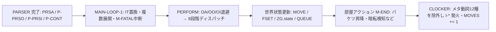
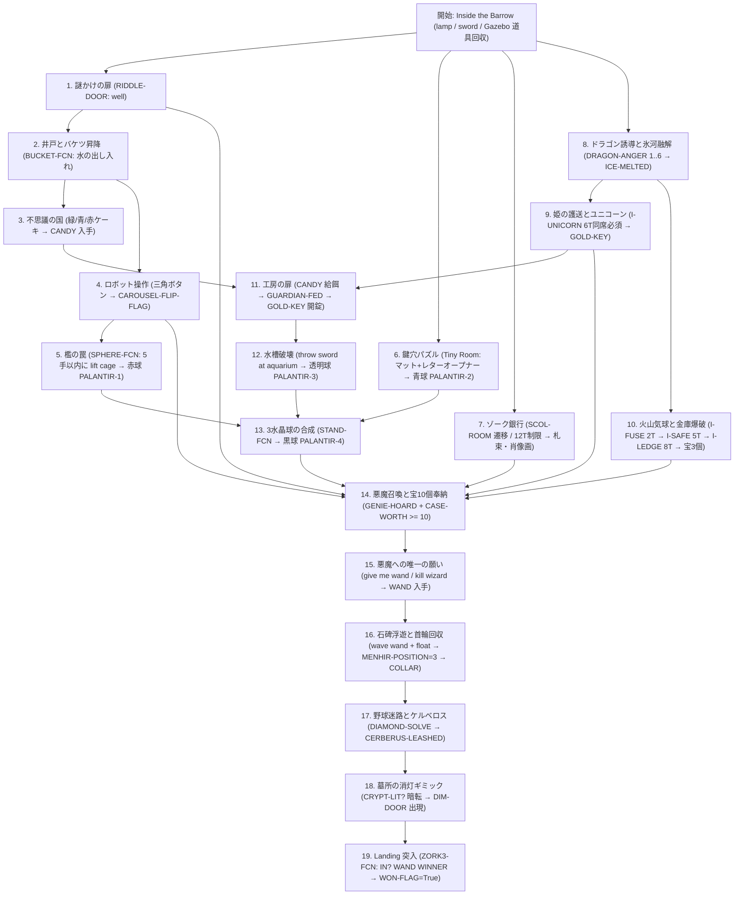

# Zork II (Python 版) の内部構造と因果解析

ZilPy が Zork II: The Wizard of Frobozz (Release 88 / 840726) の ZIL ソース (`zork2/`) から生成した Python 版 (`out/zork2/`) を、構成要素・パーサー内部処理・ゲーム世界への反映パイプライン・固有サブシステム・クリアを阻む因果的ターニングポイント・物語と叙事詩ドラマの観点から詳細に解説します。

- **ネタバレ注意:** 仕掛けの解法、不可逆ソフトロック条件、エンディング条件まで記載しています。
- **解析手順の再現性:** 本ドキュメントはプロジェクトルートの `GameArchitecture.md` の手順に従い、`tools/analyze_game.py out/zork2` の棚卸し結果および生成 Python コードの実読解に基づいています。
- **元の ZIL の位置:** `2actions.zil:3455` のように記載します。生成コード各定義直前の `# zil:` 注記と対応します。
- **ライセンス表記:** 解析対象の Zork II 原作 ZIL ソース (`zork2/`) および ZilPy 生成 Python コード (`out/zork2/`) は **MIT License (`Copyright (c) 2025 Microsoft`)** のもとで公開されています（詳細は `zork2/LICENSE` および `out/zork2/LICENSE` を参照）。本ドキュメントで引用するコード断片・テキストも同ライセンスに従います。

---

## 1. 全体像

### 1.1 規模

`tools/analyze_game.py out/zork2` による静的棚卸し結果は以下のとおりです。

| 項目 | 数 |
|---|---|
| モジュール (ZIL ファイル) | 10 |
| ルーチン | 443 |
| 部屋 | 86 |
| オブジェクト (部屋以外) | 165 (`_2dungeon` 147、`gglobals` 18) |
| 構文 (`SYNTAX`) | 269 (動詞の語 135 個) |
| 割り込みのルーチン (`I-*`) | 23 (`QUEUE` 箇所 38) |
| グローバル変数・定数 (`ZilGlobal.py`) | 261 (`state` 107、`const` 96、`scratch` 58) |
| `VALUE` の合計 (拾う・入る点) | 365 (22 個) |
| `TVALUE` の合計 (置く点) | 0 (0 個) |
| 満点 (`V-SCORE`) | 400 点 |

ルーチンの役割別内訳 (`tools/analyze_game.py` 自動分類):

| 役割 | 数 | 例 |
|---|---|---|
| 動詞のアクション (`V-*`) | 149 | `V-TAKE`、`V-WALK`、`V-INCANT`、`V-ENCHANT`、`V-SCORE` |
| オブジェクトのアクション | 95 | `WIZARD-FCN`、`GENIE-FCN`、`BALLOON-FCN`、`ROBOT-FCN`、`DRAGON-FCN` |
| そのほか (場面の処理) | 49 | `MAGIC-ACTOR`、`RISE-AND-SHINE`、`SCOL-THROUGH`、`JIGS-UP` |
| そのほか (パーサー) | 42 | `PARSER`、`SYNTAX-CHECK`、`GET-OBJECT`、`LIT?` |
| そのほか (動詞の補助) | 30 | `GOTO`、`ITAKE`、`SCORE-UPD`、`DESCRIBE-ROOM` |
| 割り込み (`I-*`) | 23 | `I-WIZARD`、`I-BALLOON`、`I-DRAGON`、`I-PRINCESS`、`I-CURTAIN` |
| 部屋のアクション | 23 | `CAROUSEL-ROOM-FCN`、`DIAMOND-MOTION`、`CRYPT-ROOM-FCN`、`ZORK3-FCN` |
| 事前アクション (`PRE-*`) | 12 | `PRE-TAKE`、`PRE-PUT`、`PRE-BURN`、`PRE-GIVE` |
| そのほか (世界の定義) | 5 | `GO`、`LT-CRACK-PSEUDO`、`ALICE-HOLE` |
| そのほか (メインループ) | 5 | `MAIN-LOOP`、`MAIN-LOOP-1`、`PERFORM`、`D-APPLY`、`DD-APPLY` |
| そのほか (マクロ) | 3 | `ZPROB`、`RANDOM-ELEMENT`、`PICK-ONE` |
| そのほか (時計) | 3 | `QUEUE`、`INT`、`CLOCKER` |
| マクロから作った関数 | 2 | `PROB`、`DISABLE` |
| そのほか (共通のオブジェクト) | 2 | `NOT-HERE-PRINT`、`NULL-F` |

Zork I (部屋 110 / オブジェクト 140 / 割り込み 16 / 戦闘システムあり) と比較すると、Zork II は部屋数を 86 に絞る代わりに **オブジェクト数 165・割り込み 23 種** へと密度を高め、ランダム戦闘システムを廃して **パズル・時限ギミック・NPC 命令・魔法割り込み** に特化した設計になっています。また、`TVALUE`（飾り棚に置く点）が 0 になり、宝物を手に入れるだけで点が入る代わりに、**悪魔への 10 個奉納（1 個 2 点＝計 20 点）** が終盤の集積システムを担います。

### 1.2 モジュールと読み込みの順

メインの `zork2.py` が ZIL の `INSERT-FILE` 順に 10 モジュールを読み込み、最後に `ZG._link()` で遅延宣言を解決して `ZG.GO()` を実行します（合計 13,133 行）。

| # | モジュール (元の ZIL) | 行数 | ルーチン | 部屋 | オブジェクト | 構文 | 役割 |
|---|---|---:|---:|---:|---:|---:|---|
| 1 | `zork2.py` (`zork2.zil`) | 48 | 0 | 0 | 0 | 0 | エントリポイント。`ZORK-NUMBER = 2`、プロパティ既定値、読み込み順 |
| 2 | `gmacros.py` (`gmacros.zil`) | 273 | 5 | 0 | 0 | 0 | 共通マクロと `PROB`・`ZPROB`・`PICK-ONE`・`RANDOM-ELEMENT`・`DISABLE` |
| 3 | `gsyntax.py` (`gsyntax.zil`) | 993 | 0 | 0 | 0 | 269 | 語彙 (`DIRECTIONS` 14 語、`BUZZ`、`SYNONYM`) と構文 269 個 |
| 4 | `_2dungeon.py` (`2dungeon.zil`) | 2,838 | 13 | 86 | 147 | 0 | Zork II の世界定義（7 区画 86 部屋・147 オブジェクト・`GO`） |
| 5 | `gglobals.py` (`gglobals.zil`) | 362 | 10 | 0 | 18 | 0 | 共通オブジェクト 18 個 (`ME`・`GRUE`・`IT`・`NOT-HERE-OBJECT` 等) |
| 6 | `gclock.py` (`gclock.zil`) | 94 | 3 | 0 | 0 | 0 | 時計・割り込みエンジン (`QUEUE`・`INT`・`CLOCKER`) |
| 7 | `gmain.py` (`gmain.zil`) | 295 | 5 | 0 | 0 | 0 | メインループ (`MAIN-LOOP-1`) と 8 段階ディスパッチャ (`PERFORM`) |
| 8 | `gparser.py` (`gparser.zil`) | 1,786 | 42 | 0 | 0 | 0 | Z-machine 互換パーサー（42 ルーチン） |
| 9 | `gverbs.py` (`gverbs.zil`) | 2,382 | 189 | 0 | 0 | 0 | 標準動詞アクション（`V-INCANT`・`V-ENCHANT`・`V-DISENCHANT` 含む） |
| 10 | `_2actions.py` (`2actions.zil`) | 4,062 | 176 | 0 | 0 | 0 | Zork II 固有の魔法使い・悪魔・気球・銀行・ドラゴン・迷路等の全ロジック |

7 区画の部屋数内訳（合計 86）: `ROOMS` 6、`GARDEN AREA` 20、`DIAMOND MAZE` 14、`WIZARD'S WORKSHOP` 22、`ALICE IN WONDERLAND` 18、`PALANTIR ROOMS` 2、`BANK OBJECTS` 4（死後の 4 水晶球空間 `DEAD-PALANTIR-1..4`）。

---

## 2. 起動・メインループ・パーサーの詳細処理と世界への反映

### 2.1 起動 (`GO`, `2dungeon.zil:7`, `2dungeon.zil:7`)

`GO()` はゲーム開始時に以下の初期化を実行します。

1. `P-LEXV[0] = 59`（最大語数）を設定。
2. 割り込みを登録:
   - `ENABLE(QUEUE(I-WIZARD, 4))` — 魔法使いの巡回タイマー（初回 4 ターン後、以後 4 ターン周期で有効）。
   - `QUEUE(I-LANTERN, 200)` — ランプ電池タイマー（登録のみで無効状態、点灯時に `ENABLE`）。
   - なお `I-SWORD` (`-1`, 毎ターン) は `GO` ではなく剣を拾ったとき (`SWORD-FCN`) に初めて有効化されます。
3. コンパイラで静的設定できないプロパティを動的設定:
   - `BALLOON`・`BUCKET` の `VTYPE` に `NONLANDBIT` を設定。
   - 銀行の 4 面の壁オブジェクト (`SEWL`, `SWWL`, `SSWL`, `SNWL`) の `SIZE` プロパティに方向 (`EAST`/`WEST`/`SOUTH`/`NORTH`) を格納。
4. `LIT = True`, `WINNER = PLAYER = ADVENTURER`, `HERE = INSIDE-BARROW`, `P-IT-OBJECT = False` に設定し、初回のみ `V-VERSION()` を表示して `MOVE(WINNER, HERE)` → `V-LOOK()` → `MAIN-LOOP()` へ移行します。

### 2.2 パーサーの詳細処理 (`gparser.py`) と Zork II 固有の設計

Zork II の `gparser.py` (1,786 行・42 ルーチン) は Zork I と同一世代の Z-machine 互換パーサー基盤を共有しており、以下の 7 段階パイプラインで自然言語入力を `(PRSA, P-SYNTAX, P-PRSO, P-PRSI)` に変換します。

- **Phase 0 (初期化・退避)**: `P-OFLAG` が偽なら `P-ITBL` (10 ワード) を `P-OTBL` に退避し、`P-PRSO`/`P-PRSI`/`P-BUTS` を初期化。`QUOTE-FLAG` が偽かつ `WINNER != PLAYER` なら操作主体を `PLAYER` に復帰。
- **Phase 1 (入力取得)**: `RESERVE-PTR` → `P-CONT`（複数文・NPC 命令の残り）→ 新規 `READ(P-INBUF, P-LEXV)` の優先順位で取得。
- **Phase 2 (メタ語処理)**: `OOPS <語>` は `OOPS-TABLE[O-PTR]` の未知語を `AGAIN-LEXV` / `OOPS-INBUF` 上でインプレース修正して再解析。`AGAIN` / `G` は `P-OTBL` と `AGAIN-DIR` を復元して Phase 3 をバイパス。
- **Phase 3 (字句走査・`CLAUSE`・`NUMBER?`)**: 未知語に対する `NUMBER?` 解釈、`TELL <NPC> TO <命令>` や `<NPC>, <命令>` の `ACT?TELL` + `QUOTE-FLAG` 正規化、`.` / `THEN` / `"` での文分割 (`P-CONT`)、方向語単独時の `V?WALK` ショートカット、`AND` + 動詞/方向の自動 `THEN` 書き換えを実施。
- **Phase 4 (`ORPHAN-MERGE`)**: 聞き返し待ち (`P-OFLAG`) の応答を `P-OTBL` と合成（欠落目的語の番兵 `1` の埋込、曖昧解消時の `ACLAUSE-WIN` / `NCLAUSE-WIN`）。
- **Phase 5 (`SYNTAX-CHECK` / `GWIM` / `ORPHAN`)**: `VERBS` テーブルから 1 構文 8 バイト (`P-SYNLEN = 8`) を照合。目的語が 1 個不足すれば `GWIM` で `FIND` フラグに一致する唯一のオブジェクトを自動補完し、特定不能なら `ORPHAN` で聞き返しへ移行（時計は進まない）。
- **Phase 6 (`SNARF-OBJECTS` / `GET-OBJECT` / `GLOBAL-CHECK`)**: 第 2 名詞句 (`P-PRSI`) → 第 1 名詞句 (`P-PRSO`) の順に解決。`GET-OBJECT` は広域ローカル探索 (`P-SLOCBITS = -1`) → 構文ビット絞り込み (`XBITS`) → `GLOBAL-CHECK`（`LOCAL-GLOBALS` → `PSEUDO` 動的書換 → `GLOBAL-OBJECTS` → `ROOMS`）→ 未発見時の `NOT-HERE-OBJECT` 充填という多段フォールバックを実行。
- **Phase 7 (`MANY-CHECK` / `TAKE-CHECK` / `ITAKE-CHECK`)**: `SMANY` 未許可の複数目的語を弾き、`STAKE` ならパーサー段階で自動 `ITAKE`、`SHAVE` 未所持ならエラー終了。

**Zork II 特有のパーサー・語彙上の特徴（実コード確認済み）:**

1. **パーサーを乗っ取る例外部屋は存在しない**: `out/zork2/*.py` 全体で `READ(` を直接呼ぶ箇所は `gparser.zil:153`（通常入力）、`gverbs.zil:42`（`FINISH` 終了プロンプト）、`gverbs.zil:1918`（`YES?` 確認）の 3 箇所のみです。Zork I の `LOUD-ROOM-FCN` のような独自入力ループによるパーサー乗っ取りはありません。
2. **17 個の呪文語が `BUZZ` 語として辞書登録されている (`gsyntax.py`)**: `FEEBLE`, `FUMBLE`, `FEAR`, `FILCH`, `FREEZE`, `FALL`, `FRY`, `FLUORESCE`, `FERMENT`, `FIERCE`, `FLOAT`, `FIREPROOF`, `FENCE`, `FUDGE`, `FANTASIZE`, `FROTZ`, `OZMOO` がすべて `BUZZ` 語です。これにより `say "float"` や `say then float` を入力した際、辞書未登録エラー (`UNKNOWN-WORD`) を起こさずに `P-LEXV` の `P-CONT` 位置へトークンを残し、`V-SAY` (`gverbs.zil:1211`) → `V-INCANT` (`gverbs.zil:769`) が `GET(P-LEXV, P-CONT)` で呪文語を直接読み取れるようになっています（なお `FROTZ` と `OZMOO` はイースターエッグ）。
3. **謎かけの回答 (`RIDDLE-ROOM-FCN`) も `P-CONT` を直接参照**: `RIDDLE-ROOM-FCN(M-BEG)` は `VERB?('ANSWER', 'SAY')` のとき `GET(P-LEXV, P-CONT) == WORD('well')` または `GET(P-LEXV, P-CONT + 2) == WORD('well')` を直接検査します。`well` は `WELL` オブジェクトの `SYNONYM` として辞書登録されているため認識されます。
4. **方向語に `CROSS` を追加 (計 14 方向)**: Zork I の 13 方向に `CROSS` が加わり、橋や浅瀬での `cross` 移動を方向プロパティとして直接記述しています。

### 2.3 メインループ (`MAIN-LOOP-1`)・`PERFORM`・`CLOCKER` の世界反映パイプライン

- **`MAIN-LOOP-1` (`gmain.zil:38-172`)**: `PARSER()` 成功後、接触可能な `P-IT-OBJECT` で `IT` を置換し、方向移動・0 目的語・1〜複数目的語に分岐して `PERFORM` を実行します。`M-FATAL` (`2`) が返るとループを中断して `P-CONT = False` とし、後続の連続コマンドを破棄します。最後に `P-WON` が真かつメタ動詞 12 種（`TELL`, `BRIEF`, `SUPER-BRIEF`, `VERBOSE`, `SAVE`, `VERSION`, `QUIT`, `RESTART`, `SCORE`, `SCRIPT`, `UNSCRIPT`, `RESTORE`）以外なら `CLOCKER()` を呼びます。
- **`PERFORM(A, O, I)` (`gmain.zil:235-288`)**: `(PRSA, PRSO, PRSI)` を退避・復元する再入可能設計で、以下の厳密な優先順位で最初に非偽を返したハンドラで打ち切ります。
  0. `NOT-HERE-OBJECT-F`（`PRSO`/`PRSI` に未発見語がある場合）
  1. **動作主 `GETP(WINNER, 'ACTION')`**: Zork II では **ここが極めて重要** です。通常は `ADVENTURER` の `ACTION` は `0` ですが、魔法使いの呪文を受けると `PUTP(ADVENTURER, 'ACTION', MAGIC-ACTOR)` が設定され、プレイヤーの全コマンドが最優先で `MAGIC-ACTOR` に横取りされます。また NPC 命令時は `ROBOT-FCN` / `GENIE-FCN` / `WIZARD-FCN` がここで動きます。
  2. 現在部屋の `ACTION(M-BEG)`（`CAROUSEL-ROOM-FCN`、`DIAMOND-MOTION`、`RIDDLE-ROOM-FCN`、`BALLOON-FCN` 等）
  3. 構文の事前アクション `PRE-*`（`PRE-TAKE`, `PRE-PUT`, `PRE-BURN`, `PRE-GIVE` 等）
  4. 間接目的語 `GETP(PRSI, 'ACTION')`
  5. 直接目的語の容器 `GETP(LOC(PRSO), 'CONTFCN')`（`BUCKET-CONT` など）
  6. 直接目的語 `GETP(PRSO, 'ACTION')`
  7. 動詞標準アクション `V-*`
- **`CLOCKER()` (`gclock.zil:43-60`)**: `C-TABLE`（180 バイト、1 エントリ 6 バイト `[C-ENABLED?, C-TICK, C-RTN]`）を走査し、有効なエントリの `C-TICK` を 1 減算して `<= 1` なら `C-RTN` を実行、最後に `MOVES += 1` します（`-1` 登録は毎ターン発火のデーモン）。`V-WAIT` は内部で `CLOCKER()` を 3 回回します。

### 2.4 具体的コマンドのエンドツーエンド実行トレース 3 例

#### トレース 1: ウィザードの呪文割り込み → `MAGIC-ACTOR` による行動乗っ取り
1. **前ターンの `CLOCKER()` → `I-WIZARD` (`2actions.zil:3455`)**: 4 ターンごとの抽選 (`PROB(10)`) に当たり、魔法使いが出現。所持水晶球数 `PCNT` に応じた確率 `80 - 20 * PCNT`% で呪文詠唱に成功すると、たとえば `SPELL? = S-FALL` (`6`) を設定し、**`PUTP(ADVENTURER, 'ACTION', MAGIC-ACTOR)`** を実行して解除タイマー `QUEUE(I-WIZARD, 5 + RANDOM(30 - 5 * PCNT))` を仕込む。
2. **次ターン、プレイヤーが橋の上 (`STONE-BRIDGE`) で `s` を入力**:
   - `PARSER` の Phase 3 が方向ショートカットで `PRSA = V?WALK, PRSO = SOUTH, P-WALK-DIR = SOUTH` を即返却。
   - `MAIN-LOOP-1` → `PERFORM(V?WALK, SOUTH)`。
   - **優先度 1 (`Actor`)** で `GETP(ADVENTURER, 'ACTION')` すなわち `MAGIC-ACTOR()` (`2actions.zil:2065`) が部屋や `V-WALK` より先に呼ばれる。
   - `SPELL? == S-FALL` かつ `VERB?('WALK')` かつ現在部屋に `DOWN` 出口 (`GETPT(HERE, 'DOWN')`) があるため発火。部屋の `GLOBAL` に `BRIDGE` が含まれる (`ZMEMQB(BRIDGE, V, ...)`) ため即座に `JIGS-UP(...)` を呼び、`M-FATAL` (`2`) を返却。
   - `MAIN-LOOP-1` は `M-FATAL` を受けて `M-END` と `P-CONT` を破棄し、プレイヤーは死後の赤い霧の部屋 (`DEAD-PALANTIR-1`) へ送られる。

#### トレース 2: `tell demon to give me wand`（NPC 命令・無消費連鎖・ウィザード無力化）
1. **1 巡目の `PARSER`**: `tell` (`ACT?TELL`), `demon` (`P-NC1`), `to` → Phase 3 が `WORD('quote')` に置換し `QUOTE-FLAG = True`、`P-CONT` を `give me wand` の先頭に設定。`SYNTAX-CHECK` → `PRSA = V?TELL`, `P-PRSO = [GENIE]`。
2. **`PERFORM(V?TELL, GENIE)`**: `V-TELL` (`gverbs.zil:1433`) が `GENIE` の `ACTORBIT` と `P-CONT` を確認し、**`WINNER = GENIE`, `HERE = LOC(GENIE)`** に切替。
3. **`MAIN-LOOP-1`**: `VERB?('TELL')` はメタ動詞リストに含まれるため **`CLOCKER()` をスキップ** して即座に 2 巡目へ。
4. **2 巡目の `PARSER`**: `QUOTE-FLAG == True` のため `WINNER` を `GENIE` のまま維持し、`P-CONT` から `give me wand` を解析。構文 `GIVE OBJECT (ACTORBIT) OBJECT = V-SGIVE PRE-SGIVE` に一致し、`PRSA = V?SGIVE, PRSO = ME, PRSI = WAND`。
5. **`PERFORM(V?SGIVE, ME, WAND)`**:
   - 優先度 1 (`Actor`) で `GENIE-FCN` が呼ばれるが、`VERB?('SGIVE')` に対しては `False` を返す (`2actions.zil:3187`)。
   - 優先度 3 (`PRE-SGIVE`) → 優先度 7 (`V-SGIVE`) が `PERFORM(V?GIVE, WAND, ME)` を **再入呼び出し**（目的語を入れ替え）。
   - 再入後の優先度 1 (`GENIE-FCN`) が `GENIE-READY? == True`・`VERB?('GIVE')`・`PRSI == ME`・`PRSO == WAND` に一致！ 悪魔がウィザードの手から杖を奪って床に置き (`REMOVE(WIZARD)`, `GENIE-LEAVES(False)`, `FCLEAR(WAND, NDESCBIT)`, `MOVE(WAND, HERE)`)、ウィザードは恐怖で逃走する。
6. **終了処理**: `M-END` → `CLOCKER()` で 1 ターン経過し、次ターンの Phase 0 で `WINNER` が `PLAYER` に復帰。

#### トレース 3: 銀行の光のカーテンと壁抜け（`enter curtain` → `enter south wall`）
1. **前提**: `OFFICE` から北 (`n`) へ歩いて `DEPOSITORY` に入ると、`DEPOSITORY-FCN(M-ENTER)` (`2actions.zil:1359`) が `SCOL-ROOM = LKP(PRSO, SCOL-ROOMS)` を実行し、`PRSO = NORTH` に対応する **`SCOL-ROOM = SMALL-ROOM`** を記憶する。
2. **`enter curtain` 入力**: `PARSER` が `V-THROUGH`, `PRSO = CURTAIN` を確定。`V-THROUGH` → `SCOL-GO(False)` (`2actions.zil:1400`) が `SCOL-ACTIVE = SMALL-ROOM` を立て、`SCOL-THROUGH(12, SMALL-ROOM)` が **12 ターンタイマー `ENABLE(QUEUE(I-CURTAIN, 12))`** を仕込んで `GOTO(SMALL-ROOM)` を実行。
3. **`enter south wall` 入力**: `SMALL-ROOM` の `GLOBAL` にある `SSWL` (`SCOLWALL`) に対し `V-THROUGH` が走り、`GET-WALL(SMALL-ROOM)` が壁の向き `SOUTH` (`SSWL`) と一致することを確認。`SCOL-ACTIVE` が有効（12 ターン以内）なため `DEPOSITORY` へ帰還する。このとき `DEPOSITORY-FCN(M-ENTER)` が `SCOL-ROOM` を **`VAULT`（金庫室）** へ更新するため、次の `enter curtain` で初めて金庫室へ侵入できる。

---

## 3. Zork II 固有の主要サブシステム

### 3.1 フロボッツの魔法使い (`I-WIZARD` / `WIZARD-FCN` / `MAGIC-ACTOR`) と杖 (`WAND-FCN`)

- **出現と詠唱確率 (`I-WIZARD`, `2actions.zil:3455`, `2actions.zil:3455`)**:
  - 4 ターンごとに `PROB(10)` で出現。`GENIE` が `PENTAGRAM-ROOM` に召喚されると即座に `PENTAGRAM-ROOM` へ駆けつけ、`DISABLE(I-WIZARD)` で以後巡回しなくなります。
  - プレイヤーが **黒い水晶球 (`PALANTIR-4`) を所持** していると、見た瞬間に怯えて逃走します。
  - 通常時は 20% で何もせず去り、残りは `CAST-PROB = 80 - 20 * PCNT`%（`PCNT` は所持中の赤・青・透明水晶球の数 0〜3）で 12 種の F 呪文からランダムに 1 つを掛けます。持続時間は `5 + RANDOM(30 - 5 * PCNT)` ターン（水晶球を持つほど短く、詠唱確率も下がる）。
  - 75% で呪文名を宣言し、25% は聞き取れません。
- **12 種の F 呪文と実装先**:
  - `MAGIC-ACTOR`（`ADVENTURER.ACTION`）で処理: `S-FALL` (6: 下出口のある部屋で橋なら即死・他は 25% 転落死、乗物搭乗不可)、`S-FLOAT` (9: 歩行・床アイテム取得不可、`I-WIZARD` 解除時に `WELL-TOP` や空中/岩棚なら墜落死)、`S-FREEZE` (5: `WAIT`/`DIAGNOSE` 以外完全封鎖)、`S-FENCE` (11: 歩行不可)、`S-FIERCE` (8: 同室に生き物がいると強制攻撃 `FORCE-FIGHT`)、`S-FERMENT` (7: 移動が `RANDOM-WALK` 化)、`S-FEAR` (3: 生き物がいると恐怖で `RANDOM-WALK` 逃走)。
  - 発動時 / 状態変数で処理: `S-FEEBLE` (1: `LOAD-ALLOWED = 50`)、`S-FUMBLE` (2: `FUMBLE-NUMBER = 3`, `FUMBLE-PROB = 25`、先頭所持品を落下)、`S-FILCH` (4: `ROB(WINNER, WIZARD-CASE)` で宝物を陳列棚へ窃盗)、`S-FIREPROOF` (10: ドラゴンの炎を無効化、`I-DRAGON` 内で参照)、`S-FANTASIZE` (12: 幻覚メッセージ表示)。
- **救済措置 (`Fluoresce!`)**: ランプが電池切れ (`RMUNGBIT`) で暗闇に陥り、かつ `SCORE > 200` のとき（悪魔召喚前）、`I-WIZARD` は呪文を掛ける代わりに `Fluoresce!` を唱えて `ALWAYS-LIT = True`（永久明かり）にしてくれます (`2actions.zil:3488`)。
- **プレイヤーによる杖の使用 (`WAND-FCN`, `2actions.zil:3751` → `V-INCANT` → `V-ENCHANT` / `I-SPELL`)**:
  - `wave wand at <対象>` で `WAND-ON = PRSI` を設定し 2 ターン有効タイマー `I-WAND` を起動。次ターンに `say then <呪文>` で `V-INCANT` が `I-SPELL` (`10 + RANDOM(10)` ターン) を仕掛け `V-ENCHANT` を実行します。
  - 再チャージ中（`SPELL-USED` / `SPELL-VICTIM` が真）に振ると **5% で暴発して即死**（カエルに変えられ杖が爆発）。自分や杖自身に向けると安全インターロックで阻止されます。
  - 実効呪文は `float`（石碑 `MENHIR` を浮かせて `MENHIR-POSITION = 3` にする）、`fluoresce`（永久光源化）、`filch`（`TAKEBIT` 物や `WIZARD-CASE` の中身を引き寄せる）、`fry`、`fudge`（チョコレートの香り）。

### 3.2 悪魔 (`GENIE-FCN`)・3 水晶球の合成 (`STAND-FCN`)・10 個の宝の奉納

- **水晶球の合成 (`STAND-FCN`, `2actions.zil:3055`)**: 工房の作業台 (`WORKBENCH`) の 3 つの台座に `PALANTIR-1` (赤 → `STAND-1`), `PALANTIR-2` (青 → `STAND-2`), `PALANTIR-3` (透明 → `STAND-3`) をすべて置くと、3 球が煙となって消え、黒曜石の台座 (`STAND-4`) と **黒い水晶球 (`PALANTIR-4`)** が出現します（取得 +30 点）。
- **悪魔の召喚 (`PENTAGRAM-FCN`, `2actions.zil:3375`)**: `PALANTIR-4` を五芒星 (`PENTAGRAM`) に置くと `GENIE` が召喚されます。
- **報酬判定 (`GENIE-FCN`, `2actions.zil:3177` & `CASE-WORTH`, `2actions.zil:3367`)**:
  - 悪魔に `VALUE` プロパティを持つ宝物（`SWORD` 除く）を渡すたびに `GENIE-HOARD += 1`・`SCORE-UPD(2)` が加算されます。
  - 報酬達成条件は **`(GENIE-HOARD + CASE-WORTH()) >= 10`** (`TREASURES-MAX = 10`)。つまり魔法使いに `Filch` で盗まれたり死亡時に飛ばされたりして `WIZARD-CASE` に入った宝も「10 個の頭数」には数えられますが、手渡しボーナス（1 個 2 点）は得られず 400 点満点に届きません。
  - ゲーム内に存在する奉納可能な宝は `PEARL`, `VIOLIN`, `PORTRAIT`, `BILLS`, `STATUETTE`, `GOLD-KEY`, `RUBY`, `COIN`, `STAMP`, `CROWN` の **ちょうど 10 個** です。
- **悪魔への 1 回限りの命令**: `GENIE-READY?` が真になると 1 回だけ命令を実行して退場します。
  - **`tell demon to give me wand`** または **`tell demon to attack/kill wizard`**: 魔法使いを退場/消滅させ、`WAND` を床に落とす（**唯一のクリア可能解**）。
  - **`tell demon to take wand`**: 悪魔が杖を自分に向けて `"Free!"` と唱え、杖ごと永久消滅する（**ソフトロック**）。
  - `move menhir` / `give me menhir` / `attack cerberus`（ケルベロスには噛まれて逃げ帰る）等の罠コマンドも実装されています。

### 3.3 カルーセル室・ロボット・不思議の国エリア

- **カルーセル室 (`CAROUSEL-ROOM-FCN`, `2actions.zil:54`)**: `CAROUSEL-FLIP-FLAG` が偽の間、`M-BEG` が `WALK` を横取りし、`WEST` (Room 8) は 100%、その他の方角も 80% で `EIGHT-DIRECTIONS`（西を除く 7 方向）へランダム振り替えします。
- **井戸とバケツ (`BUCKET-FCN`, `2actions.zil:834`)**:
  - プレイヤーが乗った状態で水を入れると `M-END` で `WELL-TOP` へ上昇 (+10 点)、水をティーポットへ汲み出すか 100 ターン (`I-BUCKET`) で蒸発すると下降します。
  - **罠 (`M-BEG`)**: バケツに乗らず外から水を入れるとバケツだけが `WELL-TOP` へ上がってしまい、戻せなくなります。
- **ケーキと池 (`EATME-FCN` / `CAKE-FCN`, `2actions.zil:886-1000`)**: `Tea Room` の 4 種のケーキ（緑: 縮小し `POSTS-ROOM` へ、青: `POSTS-ROOM` で食べると復元・他室なら圧死、赤: 池に投げると蒸発し `CANDY` 出現・食べると死、橙: 食べても投げても爆死 `ICEBOOM`）。不思議の国の外へ持ち出すと `CAKE-CRUMBLE` で崩れます。
- **ロボット・3 ボタン・檻の罠 (`ROBOT-FCN` / `BUTTONS` / `SPHERE-FCN`, `2actions.zil:1159-1306`)**:
  - 機械室の 3 ボタンをプレイヤー自身が押すと即感電死。ロボットに `TRIANGULAR-BUTTON` を押させると `CAROUSEL-FLIP-FLAG = True` となりカルーセル室が停止し、鉄箱 (`IRON-BOX` / `VIOLIN`) が出現。同時に `MAGNET-ROOM` (`Low Room`) の出口がランダム化されます。
  - `SQUARE-BUTTON` を押すと `CAROUSEL-ZOOM-FLAG = True` になり、以後 `Low Room` へ入ると感電死します（`ROUND-BUTTON` で解除可能）。
  - `Dingy Closet` で `PALANTIR-1` (赤球) に触ると天井から鉄檻 (`CAGE`) が落ち毒ガス (`I-SPHERE`, 6 ターン) が発生。同室のロボットに `lift cage` を命じれば檻を破壊して `CAGE-SOLVE-FLAG = True` となります。**ロボットに赤球を取らせるとロボットが檻に潰されて死亡し、赤球も `INVISIBLE` 化して永久詰み** になります。

### 3.4 火山・熱気球・金庫爆破・火山の小人

- **気球の昇降 (`BALLOON-FCN` / `RISE-AND-SHINE` / `DECLINE-AND-FALL`, `2actions.zil:117-329`)**:
  - 受け皿 (`RECEPTACLE`) に可燃物を入れて点火 (`BALLOON-BURN`) すると `BINF-FLAG = PRSO` が立ち、`I-BURNUP`（`SIZE * 20` ターン、新聞は `SIZE 5` = 100 ターン）と 3 ターン周期の `I-BALLOON` が起動します。
  - 蓋が開いて燃焼中なら上昇 (`VOLCANO-BOTTOM` → `VAIR-1` → `VAIR-2` [Narrow Ledge 隣接] → `VAIR-3` → `VAIR-4` [Wide Ledge 隣接])、蓋を閉じるか燃え尽きると下降します。
  - **`VAIR-4` でさらに上昇すると火口外へ流されフラットヘッド山脈に激突死** (`RISE-AND-SHINE`)。また `VAIR-1` へ無燃焼 (`not BINF-FLAG`) で落下すると気球が大破 (`DEAD-BALLOON`) します。
  - 岩棚 (`LEDGE-1` / `LEDGE-2`) で `tie wire to hook` (`BTIE-FLAG = True`) せずに降りると、3 ターン後に気球が勝手に浮上し、10 ターン後に火山の小人 (`I-GNOME`) が出現して宝物 1 個と引き換えに脱出通路 (`GNOME-DOOR-FLAG`) を開けます。
- **金庫爆破の 3 段タイマー (`I-FUSE` → `I-SAFE` → `I-LEDGE`, `2actions.zil:424-498`)**:
  - `BRICK`（実はプラスチック爆弾）に `FUSE`（黒い紐）を差し、`Dusty Room` (`SAFE-ROOM`) の穴 (`SLOT`) に入れて点火すると、`I-FUSE` (2 ターン) で爆発し `SAFE` が開く (`SAFE-FLAG = True`)。同室に居れば即死。
  - 爆発と同時に `I-SAFE` (**5 ターン後**) が起動し、`SAFE-ROOM` が 5,000 トンの岩で崩落 (`MUNG-ROOM`)。さらに `I-SAFE` 完了時に `I-LEDGE` (**8 ターン後**、爆発から計 13 ターン後) が起動し、`LEDGE-2` 自体が崩落します。気球を繋いだまま岩棚に居ると気球ごと墜落死します。

### 3.5 ゾーク銀行の安全室（壁抜け）・チューリッヒの小人

- **警報出口 (`BKLEAVEE` / `BKLEAVEW`, `2actions.zil:1322-1328`)**: `DEPOSITORY` から東西の窓口へ出ようとするとき、`HELD?(BILLS)` または `HELD?(PORTRAIT)` が真だと警報が鳴り見えない力に阻まれます。
- **光のカーテンと状態機械 (`DEPOSITORY-FCN` / `SCOL-*` / `I-CURTAIN`, `2actions.zil:1359-1441`)**:
  - `DEPOSITORY` に入室した際の移動方向 `PRSO` を `SCOL-ROOMS` 表で引き、`SCOL-ROOM` を更新します（東→`VIEWING-EAST`、西→`VIEWING-WEST`、北→`SMALL-ROOM`、南壁経由の帰還→`VAULT`）。
  - 光のカーテン (`CURTAIN`) を抜けると `SCOL-THROUGH(12, SCOL-ROOM)` で 12 ターンの `I-CURTAIN` タイマーが開始。
  - `VAULT` に居る状態で 12 ターン経過すると **防犯システムに即殺** されます。
  - `SMALL-ROOM` で 12 ターン経過すると「Curtain Door Closed」となり、3 ターン後 (`I-ZGNOME`) にチューリッヒの小人 (`GNOME-OF-ZURICH`) が出現し、宝物 1 個を奪うまで閉じ込められます。

### 3.6 ドラゴン・氷河・姫とユニコーン・庭園

- **ドラゴンの怒り制御 (`DRAGON-FCN` / `I-DRAGON`, `2actions.zil:2389-2557`)**:
  - 剣で攻撃すると `DRAGON-ANGER += 4`、毎ターン `I-DRAGON` 末尾で `-2`。ターン処理時に **`DRAGON-ANGER > 6`** だと炎で即死（`S-FIREPROOF` 中は耐える）、`0` になると興味を失って `DRAGON-ROOM` へ帰還します。
  - 怒りが 1〜6 の間はプレイヤーを追尾します（ただしドラゴン不在の `DRAGON-ROOM` へ戻ろうとすると反転して即殺）。
  - `GLACIER-ROOM`（氷の間）へ誘導すると、氷河に映った自分の姿を敵と誤認して火を吹き、溶けた奔流を飲み込んで自滅します (`ICE-MELTED = True`, +5 点)。
- **姫の自動移動と金の鍵 (`I-PRINCESS` / `I-UNICORN`, `2actions.zil:2770-2843`)**:
  - `Dragon's Lair` で宝箱を開けると姫が目覚め、1〜2 ターンごと（75% で 1 ターン、25% で 2 ターン）に固定ルート（`PRDIRS`）を辿って `GAZEBO-ROOM` へ向かいます。
  - `GAZEBO-ROOM` 到着時に **`ENABLE(QUEUE(I-UNICORN, 6))`** を仕込みます。**6 ターン後にプレイヤーが `GAZEBO-ROOM` か `GARDEN-NORTH` に居れば** ユニコーンが現れて `GOLD-KEY` (+15 点) と `ROSE` を受け取れますが、**居なければ姫は `REMOVE` され金の鍵は永久に失われます**。
- **庭園のトピアリー (`I-GARDEN`, `2actions.zil:2565`)**: `TOPIARY-ROOM` に長居すると `TOPIARY-MOVED` (12%) → `TOPIARY-NEAR` (8%) → 襲撃死 (4%) の 3 段階で刈込の動物に殺されます。

### 3.7 謎かけ・鍵穴パズル・野球ダイヤモンド迷路・ケルベロス・墓所（および存在しない要素の確認）

- **謎かけの扉 (`RIDDLE-ROOM-FCN`, `2actions.zil:2007`)**: スフィンクスではなく石の扉 (`RIDDLE-DOOR`) が謎かけを出します。`say then well` で開扉 (+5 点)。なお Zork II のコード内に「スフィンクス (`SPHINX`)」や「オッド・ジョブ (`ODD-JOB`)」というオブジェクトは存在しません。前者の役割は `RIDDLE-ROOM`、後者の雑用代行の役割は `ROBOT` / `GNOME` / `GENIE` が担っています。
- **鍵穴の扉 (`PDOOR-FCN` / `PKH-FCN` / `PLACE-MAT-FCN`, `2actions.zil:1612-1875`)**: `Tiny Room` の扉の下に `PLACE-MAT` を敷き、蓋を開けて `LETTER-OPENER` で向こう側の鍵 (`KEY`) を押し落とし、マットを引き抜いて回収・開錠すると `Dreary Room` の青い水晶球 (`PALANTIR-2`) を入手できます。
- **工房の扉とトカゲ (`WIZ-DOOR-FCN` / `DOOR-KEEPER-FCN`, `2actions.zil:2966`)**: 飴 (`CANDY`) を食べさせて `GUARDIAN-FED = True` にする前に金の鍵で開けようとすると噛みつかれ、**5% の確率で金の鍵を永久に飲み込まれます (`REMOVE(GOLD-KEY)`)**。
- **水槽の海蛇 (`AQUARIUM-FCN`, `2actions.zil:3103`)**: `throw sword at aquarium`（遠距離投擲）なら安全に割れて `PALANTIR-3` (透明球) が手に入りますが、`break/mung aquarium with sword`（近接破壊）だと飛び出した海蛇に噛み殺されます。
- **野球ダイヤモンド迷路 (`DIAMOND-MOTION`, `2actions.zil:2204`)**: 9 部屋 (`DIAMOND-1..9`) が野球のダイヤモンドを模しており、床の菱形窓 (`DWINDOW`) の明るさ（`dark` → `flickering dimly` → `dimly glowing` → `glowing` → `glowing brightly`）が塁の進行度 (`DIAMOND-COUNT` 0〜4) を示します。`flickering dimly` から `SE` → `NE` → `NW` → `SW` (`DIDIRS`) とホームベースまで 1 周すると `DIAMOND-SOLVE = True` (+5 点) となり、中央 (`DIAMOND-5`) の床下に階段が開きます。
- **ケルベロスと墓所・エンディング (`CERBERUS-FCN` / `CRYPT-ROOM-FCN` / `ZORK3-FCN`)**:
  - 杖の `float` 呪文で石碑 (`MENHIR`) を浮かせて犬小屋 (`KENNEL`) から巨大な首輪 (`COLLAR`) を入手し、3 つ首の犬 (`CERBERUS`) に着けると大人しくなり東へ通れます (`CERBERUS-LEASHED = True`)。
  - `CRYPT-ROOM` では `M-END` が「明るい状態から暗い状態へ変化した瞬間 (`CLIT? and not CRYPT-LIT?`)」を検知し、`DIM-DOOR-APPEARS()` で南壁の `"F"` の隠し扉 (`DIM-DOOR`) を出現させます。
  - 南の `ZORK3` (`Landing`) に入ると、`ZORK3-FCN(M-LOOK)` (`2actions.zil:715`) が **`IN?(WAND, WINNER)`** を判定。杖を持っていれば緑の魔力線を突破して `WON-FLAG = True` → `FINISH()`（Zork III へ続くクリア）、持っていなければ即死します。

### 3.8 死と蘇生 (`JIGS-UP` / `DEAD-PALANTIR`) と得点 (`V-SCORE`)

- **死亡処理 (`JIGS-UP`, `2actions.zil:3959`)**: `-10` 点減点、`DEAD = True`、`DEATHS += 1`。`RANDOMIZE-OBJECTS()` でランプは `INSIDE-BARROW`、金の鍵・飴・3 水晶球は `CAROUSEL-ROOM`、銀行の札束と肖像画はその場、その他の宝 (`STAGGERED` フラグ付き) は `WIZARD-CASE`、その他は `GAZEBO-ROOM` へ飛ばされ、プレイヤーは `DEAD-PALANTIR-1`（赤い霧の部屋）へ送られます。
- **4 水晶球の死後空間 (`DEAD-PALANTIR`, `2actions.zil:1694`)**: 赤→青→白の霧を西へ抜けると黒の霧 (`DEAD-PALANTIR-4`) に到達します。ここで **すでに悪魔を召喚済み (`IN?(GENIE, PENTAGRAM-ROOM)`) なら即ゲームオーバー (`FINISH`)**。未召喚かつ `DEATHS < 3` なら、黒い球に囚われた悪魔が「自由を得る助けになるかもしれない」とプレイヤーを `INSIDE-BARROW` へ蘇生させます。
- **400 点満点の内訳**:
  - 宝物 17 個の初取得 (`VALUE`): 330 点
  - 部屋の初訪問 (`VALUE` 5 箇所): `WELL-TOP` 10 + `WIZARDS-WORKSHOP` 10 + `CERBERUS-ROOM` 10 + `CRYPT-ANTEROOM` 3 + `CRYPT-ROOM` 2 = 35 点（`VALUE` 小計 365 点、22 個）
  - イベント加点: 謎かけ 5 + 氷河融解 5 + 迷路解決 5 + 悪魔への宝 10 個手渡し (2 × 10 = 20) = 35 点
  - 合計: `330 + 35 + 35 = 400` 点（ランク: 400=Master Adventurer / 361+=Wizard / 321+=Master / 241+=Adventurer / 161+=Junior / 81+=Novice / 41+=Amateur / 0〜40=Beginner）。なお **クリア自体に 400 点は不要**（`ZORK3-FCN` は `IN?(WAND, WINNER)` のみを検査）ですが、`V-SCORE` は 400 点で `not WON-FLAG` のとき `", but somehow you don't feel done"` と表示します。

---

## 4. クリアへの因果的ターニングポイントと障壁

### 4.1 進行ゲートと不可逆ソフトロック一覧（実コード検証済み）

| # | 障壁 / ソフトロック | 該当ルーチン・条件式 | 不可逆性・影響 |
|---|---|---|---|
| 1 | **姫とユニコーンの 6 ターン期限** | `I-UNICORN` (`2actions.zil:2822`): `not (HERE in (GAZEBO-ROOM, GARDEN-NORTH))` で `REMOVE(PRINCESS)` | **完全ソフトロック**。`GOLD-KEY` が永久消失し工房へ入れない。魔法使いの `Freeze` やカルーセル未停止による遅延が致命傷になる |
| 2 | **悪魔への誤った願い事** | `GENIE-FCN` (`2actions.zil:3207`): `take wand` は `REMOVE(WAND)`、`move menhir` 等は `GENIE-LEAVES()` で悪魔退場 | **完全ソフトロック**。願いは 1 回限りで、`WAND` を得られないと `ZORK3-FCN` で必ず即死する |
| 3 | **飴 (`CANDY`) の消費・喪失** | `WIZ-DOOR-FCN` (`2actions.zil:2966`): `not GUARDIAN-FED` のまま開錠すると 5% で `REMOVE(GOLD-KEY)`。飴を食べると消滅 | **完全ソフトロック**。トカゲを眠らせないと安全に開錠できず、鍵を食われれば詰み |
| 4 | **ロボットに赤球を取らせる / ロボット破壊** | `SPHERE-FCN` (`2actions.zil:1211`): `WINNER != ADVENTURER` で `REMOVE(ROBOT)` + `FSET(PALANTIR-1, INVISIBLE)` | **完全ソフトロック**。赤球とロボットを同時に失い、黒球の合成が不可能になる |
| 5 | **バケツの外から水を注ぐ** | `BUCKET-FCN` (`2actions.zil:840`): `not IN?(WINNER, BUCKET)` で `MOVE(BUCKET, WELL-TOP)` | **完全ソフトロック**。バケツが井戸の上へ去り、不思議の国へ行けず `CANDY`・`PALANTIR-1`・カルーセル停止が不能 |
| 6 | **気球の喪失・燃料/マッチ枯渇** | `RISE-AND-SHINE` (`VAIR-4` 超過で `REMOVE(BALLOON)`) / `DECLINE-AND-FALL` (無燃焼着陸で `DEAD-BALLOON`) / `MATCH-COUNT` (5 本) | **事実上ソフトロック**。火山の宝 3 個（`COIN`, `STAMP`, `CROWN`）が回収不能になり、悪魔への 10 個奉納に届かなくなる |
| 7 | **金庫爆破の崩落・所持数オーバー** | `I-FUSE` (2T) → `I-SAFE` (5T) → `I-LEDGE` (8T)。`ITAKE` は 8 個目以降 `FUMBLE-PROB` (8%) × 所持数で失敗 | 爆発後に `wait` や取得失敗で 5 ターンを超過すると `SAFE-ROOM` 崩落で圧死し、金庫室も永久閉鎖 (`MUNG-ROOM`) |
| 8 | **悪魔召喚後の死亡** | `DEAD-PALANTIR` (`2actions.zil:1725`): `IN?(GENIE, PENTAGRAM-ROOM)` なら `FINISH()` | **即ゲームオーバー**。黒い球の主が抜けた後の死は蘇生不可 |
| 9 | **宝物の小人への贈与 / `Filch` 窃盗** | `GNOME-FCN` / `ZGNOME-FCN` で `REMOVE(PRSO)`。`GENIE-FCN`: `GENIE-HOARD + CASE-WORTH() >= 10` | 小人に 1 個でも宝を渡すと総数が 9 個以下になり **完全ソフトロック**。`Filch` で陳列棚へ盗まれた分は頭数に入るが 400 点不可（杖取得後に `filch` 呪文で奪還可能） |
| 10 | **魔法使いの致死呪文** | `MAGIC-ACTOR` (`S-FALL` 橋上即死)、`I-WIZARD` (`S-FLOAT` 解除時に `WELL-TOP` / 火山空中で墜落死) | ランダム出現による不可避死のリスク。死亡で `-10` 点となり 400 点満点が永久に不可能になる |

---

## 5. 冒険者の視点: 初回情報のみの「最も知的・理想的な行動」vs「クリアに必要な行動」

もしプレイヤーが攻略知識ゼロの一人の「冒険者」として、ゲーム内の描写・文書・物理常識だけを手掛かりに最も知的かつ誠実に行動した場合、実際のクリア要件との間には鋭いギャップが生じます。

| 局面 | 初回情報のみの「最も知的・理想的な行動」 | クリアに必要な実際の行動 | ギャップの性質 |
|---|---|---|---|
| **① ドラゴンの撃破** | 伝説の赤いドラゴンを前に、エルフの剣で正面から戦うか、あるいは刺激せずやり過ごす（あるいは魔法の武器を探してから挑む）。 | 剣で 2 回突いては 1 歩下がり、怒り値を 1〜6 に保ちながら氷河の部屋まで「お散歩」させ、鏡像に火を吹かせて水蒸気爆発で自滅させる。 | **物理的必然＋ゲーム的数値管理**（氷の反射は機知に富むが、`ANGER > 6` 即死・`-2/T` の厳密な歩調管理は初見では死んで覚えるしかない） |
| **② 姫の救出** | 囚われていた姫を助け、無事に外まで送り届けるために `follow princess` で後ろから丁寧にエスコートする。 | `follow` は 1 手遅れるだけで見失うため信用せず、姫を置き去りにして別ルートから東屋 (`Gazebo`) へ先回りし、6 ターン期限内に待機する。 | **システム的不条理**（良心的な同行コマンドが実装上不安定で、先回りしないとクリア必須の金の鍵が永久消失する） |
| **③ 水槽の海蛇** | 水槽の底に透明な水晶球が見える。剣で水槽を叩き割る (`break aquarium with sword`) か、何かで海蛇を追い払う。 | 近接破壊 (`MUNG`) は即死。わざわざ距離を取って **`throw sword at aquarium`** と剣を投げつけなければならない。 | **物理的必然の極端な構文依存**（距離を取る発想は合理的だが、`break` と `throw` の二択で即死判定が分かれる） |
| **④ 銀行の金庫** | 銀行のパンフレットから「壁を通り抜ける魔法」を察知し、正攻法で窓口や管理者の許可を探す、あるいは宝を取ってそのまま窓口から出る。 | 窓口の警報を回避するため、**手ぶらで一度外に出て「西向きに Depository へ入り直す」** ことで光のカーテンの転移先を Viewing Room へ書き換えて密輸する。 | **魔術的必然（状態機械パズル）**（入室方向で出口が変わるという抽象規則を実験で逆算する必要があり、直感より論理パズル寄り） |
| **⑤ 機械室と檻の罠** | ロボットは壊れやすそうなので、危険なボタンは自分で慎重に確認し、逆に危険そうな赤い水晶球はロボットに取らせる。 | ボタンは感電死するのでロボットに押させ、**赤い水晶球はあえて自分自身で掴んで毒ガス檻に閉じ込められ**、ロボットに外から檻を破壊させる。 | **逆説的な役割分担（不条理寄り）**（ロボットに球を取らせるとロボット死亡＋球消失で即詰み。自分が罠に飛び込むのが正解という逆転構造） |
| **⑥ 悪魔との契約** | 邪悪な悪魔に地下帝国の宝を 10 個も貢ぐのは倫理的にも危険。あるいは報酬を払ったら「悪魔よ、杖を取れ (`take wand`)」と命じる。 | 10 個すべての宝を悪魔に献上し、しかも **`give me wand`**（または `kill wizard`）と厳密に言い分けなければ、悪魔に杖ごと逃げられて詰む。 | **魔術的・契約的必然**（悪魔の「文字通りの契約解釈」は伝承として見事だが、10 個全回収のハードルと一発詰みの厳しさが際立つ） |
| **⑦ 野球ダイヤモンド迷路** | 地下帝国の神秘的なガラスの迷路として、幾何学的な法則や方位磁針を頼りに進む。 | アメリカの野球（ベースボール）のダイヤモンドに見立て、床の光の強さ（1塁〜ホーム）を見て `SE → NE → NW → SW` と反時計回りに 1 周する。 | **メタ的・システム的不条理**（地下帝国の世界観とは無関係な野球メタファー。ヒントは `BASES` テーブルの名称とバット `BAT` のみ） |
| **⑧ 墓所の隠し扉** | 暗闇はグルーの巣窟であり、ランプを消すのは自殺行為。明るく照らしたまま壁を調べて隠し扉を探す。 | 墓所で **あえてランプを消して真っ暗にする** ことで、南壁に淡く光る `"F"` の輪郭を視認する。 | **物理的必然（光学ギミック）**（暗闇＝死のルールを逆手に取った秀逸な仕掛けだが、初見ではランプ消灯に強い心理的抵抗がある） |

**総括**: Zork I が「物理的必然（ガス室・ダム・煙突）と少数の皮肉（泥棒と卵）」の均衡だったのに対し、Zork II は **「ルールの裏をかく実験（銀行の状態遷移・墓所の消灯・ドラゴンの鏡像）」** と **「初見では予測困難な一発詰み（姫の 6 ターン・ロボットの檻・バケツの空昇降・悪魔の語句トラップ）」** が混在しています。結果として、最も知的で慎重な冒険者ほど「姫に同行して鍵を失う」「ロボットに危険物を取らせて詰む」「ランプを消せず墓所で行き詰まる」という罠に陥りやすい構造になっています。

---

## 6. このゲームで行われていた具体的な行為と人間・叙事詩ドラマ

コード内のテキスト・オブジェクト描写・状態遷移を繋ぎ合わせると、Zork II は単なるパズル集ではなく、**「滅びた地下帝国の黄昏と、老いぼれた狂気の魔術師の没落、そして冒険者が新たな支配者へ変貌する物語」** として浮かび上がります。

### 6.1 地下帝国 (Great Underground Empire) の栄華と虚無

- **フラットヘッド王朝の末路**: 終盤の墓所 (`CRYPT-ROOM`) に並ぶのは、かつて地下帝国を統べた 12 人のフラットヘッド王たちの生首です。墓碑銘 (`CRYPT`) にはこう刻まれています――*"Here lie the Flatheads, whose heads were placed on poles by the Keeper of the Dungeon for amazing untastefulness."*（驚くべき悪趣味ゆえに、ダンジョンの番人によって杭に晒されたフラットヘッド一族ここに眠る）。
- **帝国企業の残骸**: ゾーク銀行 (`Bank of Zork`) には会長 J. Pierpont Flathead の肖像画と膨大なゾークミッド紙幣が残され、火山には *Frobozz Magic Cave Company*（親方 M. Agrippa 名義）の「地盤が弱いので爆破厳禁」という警告カード (`CARD`)、機械室には GUE Tech 出身の *Frobozz Magic Robot Company* 製ロボットが放置されています。帝国はすでに滅び、魔法工学の遺物と官僚的な警告文だけが地下で虚しく動き続けています。

### 6.2 フロボッツの魔法使い――「恐るべき支配者」から「老いた道化」へ

タイトルに冠された「フロボッツの魔法使い (`Wizard of Frobozz`)」は、実コードを読むと恐ろしい魔王というより、**かつての栄光を失い、狂気と老耄のはざまで足掻く悲喜劇的な老人** として描かれています。

- **通販の学位と記念品 (`TROPHY-ROOM` / `DEGREE`)**: 彼の自慢の陳列室には、GUE Tech の魔術博士号 (D.T.) が飾られていますが、よく読むと **「マッチ箱の表紙を送って取得した (`sending in a matchbook cover`)」** 通信販売の学位です。周囲には使い古しの杖、刃こぼれした過去の冒険者たちの剣、アルコール漬けの失敗作ホムンクルスが並び、彼が長年この地下で孤独に実験と防衛を繰り返してきたことが伺えます。
- **現実感の喪失 (`WIZARD-QUARTERS-FCN` / `WIZQDESCS`)**: 魔法使いの寝室は、入るたびに描写が 8 通り（修道院風の質素な部屋、アラビアンナイトのハーレム、ルイ 14 世様式、ヤシの木のハンモック、雲でできた部屋、宇宙船の操縦席、1950 年代アメリカ郊外の二段ベッド部屋、骨と毛皮の洞窟）にランダム変化します。彼の精神と魔力がもはや一貫した現実を保てていないことの象徴です。
- **憎めない老いぼれとしての側面 (`I-WIZARD`)**: 呪文を唱えようとして袖から青い煙を出して失敗したり、恥ずかしそうに消えたりする一方、プレイヤーが 200 点以上稼いだ状態でランプが切れて暗闇に閉じ込められると、わざわざ現れて *"Dear me, you seem to have gotten into quite a pickle."* と笑いながら **`Fluoresce!`** で永久の明かりを与えてくれます。彼にとって冒険者は「憎むべき侵入者」であると同時に、長い孤独を紛らわせる唯一の「遊び相手」でもあったのです。

### 6.3 悪魔の長期計画と「宝を貢いで師を討つ」皮肉な構図

なぜ冒険者は、魔法使いを直接倒すのではなく「10 個の宝を集めて悪魔に捧げ、悪魔に杖を奪わせる」という回りくどい行為を強いられるのか――その答えは **死後の世界 (`DEAD-PALANTIR-4`, `2actions.zil:1725`)** に隠されています。

- **黒い水晶球の囚人**: 魔法使いが 3 つの水晶球の奥底（黒い水晶球）に封じ込めていた悪魔 (`GENIE`) は、冒険者が死んで水晶球の迷宮を彷徨うたび、こう語りかけて蘇生させます――*"Perhaps you may be of some use to me in gaining my freedom from this place. Return to your foolish quest! I shall not destroy you this time. Mayhap you will repay this favor in kind someday."*（私をこの牢獄から解放する役に立つかもしれぬ。愚かな探索へ戻れ。いつかこの恩を返してもらうぞ）。
- **利害の一致と解放**: つまり冒険者が 3 つの水晶球を集めて黒球を合成し、五芒星に悪魔を呼び出した瞬間、**悪魔の計画は成就** します。駆けつけた魔法使いが `"Frobizz! Frobozzle! Frobnoid!"` と必死に杖を振っても、悪魔は *"You no longer control the Black Crystal, hedge-wizard! Your wand is powerless! Your doom is sealed!"*（黒水晶の支配権はもうお前にない、三流魔法使いめ！）と嘲笑します。
- **契約の冷徹さ**: 悪魔が 10 個の宝を要求するのは「労働組合 (`We demons have a strong union these days`) と契約条項」に基づく対価であり、同時に「冒険者がどれだけの執念と力を持つか」の試練でもあります。そして一度解放された悪魔はもう冒険者に用はなく、召喚後に死んだ冒険者を黒い球の外から見下ろして冷笑し、永遠に閉じ込めます。

### 6.4 Zork I から Zork III へ――冒険者の変貌

1. **Zork I からの接続 (`INSIDE-BARROW`)**: Zork I の 350 点エンディングで石の塚 (`Stone Barrow`) へ足を踏み入れた冒険者は、そのまま `INSIDE-BARROW` の内部から Zork II を開始します。手元には前作と同じ真鍮のランプとエルフの剣。東屋の新聞 (`NEWSPAPER`) は *"FAMED ADVENTURER TO EXPLORE GREAT UNDERGROUND EMPIRE"* と、前作の英雄としての名声を報じています。
2. **「略奪者」から「魔術の継承者」へ**: Zork I での行為は「宝を飾り棚へ集める」純粋なトレジャーハントでした。しかし Zork II では、集めた 10 個の宝はすべて悪魔への支払いに消え、最終的に冒険者の手元に残るのは **フロボッツの魔法使いの杖 (`WAND`)** だけです。
3. **Zork III への扉 (`ZORK3-FCN`, `2actions.zil:715`)**: 墓所の暗闇に浮かぶ `"F"` の隠し扉を抜け、階段の踊り場 (`Landing`) に立つと、そこには魔法使いの作業台と同じルーンと、強大な緑の魔力線がうねっています。杖を持たぬ者は魔力の番人に焼き殺されますが、杖を持つ冒険者の前では杖が魔力線と共鳴し、光とともに階段の下――赤く照らされた巨大な広間と不気味な石像が待つ領域へと転がり落ちます。*"With courage and cunning you have conquered the Wizard of Frobozz and become the master of his domain, but the final challenge awaits!"*――こうして冒険者は一介のトレジャーハンターから「魔法使いの領域の支配者」へと変貌し、最終章『Zork III: The Dungeon Master』の試練へと向かうのです。
