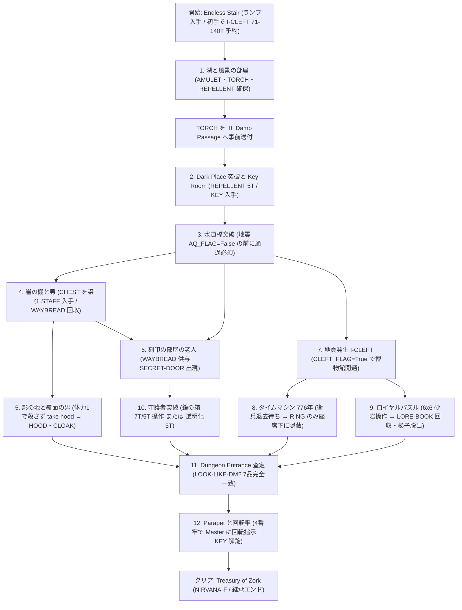

# Zork III (Python 版) の内部構造・冒険者視点・叙事詩ドラマ解析

ZilPy が Infocom の三部作完結編 *ZORK III: The Dungeon Master* (1982, Release 88 / 840726) の ZIL ソース (`zork3/`) から生成した Python 版 (`out/zork3/`) を、構成要素・パーサーとメインループの内部処理・固有サブシステム・クリアを阻む因果的障壁・冒険者視点のギャップ・三部作完結の叙事詩ドラマの観点から詳細に解説します。

- **ネタバレ注意:** 全パズルの解法、不可逆ソフトロック条件、覆面の男・老人・崖の男の正体、エンディングの結末まで記載しています。
- **解析手順の再現性:** 本ドキュメントの作成に用いた解析計画は、プロジェクトルートの `GameArchitecture.md`（および基礎棚卸し手順の `infocomGame.md`）にまとめています。
- **元の ZIL の位置:** `3actions.zil:1444` のように記載します。生成コードの各定義直前の `# zil:` 注記と `out/zork3/zilmap.json` から対応を引けます。
- **ライセンス表記:** 解析対象の Zork III 原作 ZIL ソース (`zork3/`) および ZilPy 生成 Python コード (`out/zork3/`) は **MIT License (`Copyright (c) 2025 Microsoft`)** のもとで公開されています（詳細は `zork3/LICENSE` および `out/zork3/LICENSE` を参照）。本ドキュメントで引用するコード断片・テキストも同ライセンスに従います。

---

## 1. 全体像

### 1.1 規模

| 項目 | 数 |
|---|---|
| モジュール (ZIL ファイル) | 10 |
| ルーチン | 473 |
| 部屋 | 89 |
| オブジェクト (部屋以外) | 139 |
| 構文 (`SYNTAX`) | 267 (動詞の語 135 個) |
| 割り込みのルーチン (`I-*`) | 24 (`QUEUE` 呼び出し 60 箇所) |
| グローバル変数・定数 | 287 (`state` 139 / `const` 87 / `scratch` 61) |
| `VALUE` / `TVALUE` の合計 | 0 (0 個) / 0 (0 個) |
| 満点 (`SCORE_MAX`) | **7 点**（財宝の換金ではなく「後継者としての資質 (`potential`)」） |

ルーチンを役割で分類すると次のとおりです (`tools/analyze_game.py` の自動分類)。

| 役割 | 数 | 例 |
|---|---|---|
| 動詞のアクション (`V-*`) | 149 | `V-TAKE`、`V-WALK`、`V-SAY`、`V-SCORE`、`V-DIAGNOSE` |
| オブジェクトのアクション | 96 | `TIME-MACHINE-F`、`SHADOW-F`、`DUNGEON-MASTER-F`、`CPWALL-OBJECT` |
| そのほか (場面の処理) | 62 | `TGOTO`、`MIRMOVE`、`CELL-MOVE`、`SHADOW-ATTACK`、`JIGS-UP` |
| そのほか (パーサー) | 42 | `PARSER`、`SYNTAX-CHECK`、`GET-OBJECT`、`NUMBER?` |
| 部屋のアクション | 42 | `CP-ROOM`、`MAGIC-MIRROR`、`GUARDIANS`、`OLD-TECH-MUSEUM-F`、`NIRVANA-F` |
| そのほか (動詞の補助) | 30 | `GOTO`、`ITAKE`、`DESCRIBE-ROOM`、`SCORE-UPD` |
| 割り込み (`I-*`) | 24 | `I-CLEFT`、`I-VIEW-CHANGE`、`I-SHADOW-REPLY`、`I-MAN-APPEARS`、`I-SNAP` |
| 事前アクション (`PRE-*`) | 12 | `PRE-TAKE`、`PRE-PUT`、`PRE-BURN`、`PRE-TURN` |
| そのほか (メインループ) | 5 | `MAIN-LOOP`、`MAIN-LOOP-1`、`PERFORM`、`D-APPLY`、`DD-APPLY` |
| そのほか (マクロ / マクロ由来関数) | 5 | `ZPROB`、`PICK-ONE`、`RANDOM-ELEMENT`、`PROB`、`DISABLE` |
| そのほか (時計) | 3 | `QUEUE`、`INT`、`CLOCKER` |
| そのほか (共通のオブジェクト) | 2 | `NOT-HERE-PRINT`、`NULL-F` |
| そのほか (世界の定義) | 1 | `GO` |

### 1.2 モジュールと読み込みの順

メインの `zork3.py` が、ZIL の `INSERT-FILE` の順に 10 モジュールを `from ... import *` で読み込み、最後に `ZG._link()` で遅延宣言を解決して `ZG.GO()` を起動します。

| # | モジュール (元の ZIL) | 行数 | ルーチン | 部屋 | オブジェクト | 構文 | 中身 |
|---|---|---:|---:|---:|---:|---:|---|
| 1 | `zork3.py` (`zork3.zil`) | 46 | 0 | 0 | 0 | 0 | 入口。`ZORK_NUMBER = 3`、プロパティ既定値、読み込み順 |
| 2 | `gsyntax.py` (`gsyntax.zil`) | 985 | 0 | 0 | 0 | 267 | 語彙と構文 (`BUZZ`・`SYNONYM`・`SYNTAX` 267 個。`FROTZ`・`OZMOO` を `BUZZ` に含む) |
| 3 | `gmacros.py` (`gmacros.zil`) | 273 | 5 | 0 | 0 | 0 | マクロ展開と補助関数 (`PROB`・`ZPROB`・`PICK-ONE`・`DISABLE` 等) |
| 4 | `gclock.py` (`gclock.zil`) | 94 | 3 | 0 | 0 | 0 | 時計と割り込み (`QUEUE`・`INT`・`CLOCKER`) |
| 5 | `gmain.py` (`gmain.zil`) | 297 | 5 | 0 | 0 | 0 | メインループ (`MAIN-LOOP-1` に地震予約 `I-CLEFT` を含む) と `PERFORM` |
| 6 | `gparser.py` (`gparser.zil`) | 1,790 | 42 | 0 | 0 | 0 | パーサー (`NUMBER?`、NPC 命令の `quote` 化、`OOPS`/`AGAIN` 含む) |
| 7 | `_3dungeon.py` (`3dungeon.zil`) | 1,101 | 1 | 35 | 58 | 0 | 終盤〜ロイヤルパズル区画の部屋・オブジェクト定義と起動処理 `GO` |
| 8 | `gglobals.py` (`gglobals.zil`) | 370 | 10 | 0 | 18 | 0 | どこからでも見える共通オブジェクト (`SAILOR`・`GRUE`・`STAIRS`・`ZORKMID` 等) |
| 9 | `gverbs.py` (`gverbs.zil`) | 2,279 | 189 | 0 | 0 | 0 | 動詞の標準動作 (`V-SAY` の `FROTZ OZMOO` ワープ処理を含む) |
| 10 | `_3actions.py` (`3actions.zil`) | 5,701 | 218 | 54 | 63 | 0 | Zork III 固有の残り 54 部屋・63 オブジェクトと全サブシステム・ドラマ処理 |

Zork I (`_1dungeon.py` に全部屋を配置) と異なり、Zork III では**世界の定義が `_3dungeon.py` (35 部屋・58 オブジェクト) と `_3actions.py` (54 部屋・63 オブジェクト) に二分**されています。`_3actions.py` だけで 5,701 行（全体の約 44%）を占めます。

### 1.3 点数体系――なぜ「7 点満点」なのか

Zork III では、Zork I（350 点）・Zork II（400 点）を支えた「宝の `VALUE` / `TVALUE`」が**完全に廃止 (`0` 個)** されています。`V-SCORE` (`3actions.zil:2068`, `3actions.zil:2068`) の出力もスコアではなく **`Your potential is N of a possible 7, in M moves.`** と表示されます。

コード全体で `ZG.SCORE` が加算される箇所は次の **7 箇所のみ** です（すべて `_3actions.py` 内で直接 `+ 1` または `+ VIEW_POINT`）。

| # | 加算箇所 (生成コード / ZIL) | ルーチン・フラグ | 獲得条件 |
|---:|---|---|---|
| 1 | `3actions.zil:4527` (`3actions.zil:4523`) | `ON-LAKE-F` (`LAKE_POINT`) | 湖 (`ON-LAKE`) に初めて入る |
| 2 | `3actions.zil:4643` (`3actions.zil:4641`) | `VIEWING-TABLE-F` (`VIEW_POINT`) | 風景の部屋 (`VIEW-ROOM`) のテーブルに初めて触る |
| 3 | `3actions.zil:4146` (`3actions.zil:4134`) | `CLIFF-LEDGE-F` (`MAN_POINT`) | 崖の棚 (`CLIFF-LEDGE`) に初めて降りる |
| 4 | `3actions.zil:3623` (`3actions.zil:3620`) | `SHADOW-ARRIVAL` (`SHADOW_POINT_1`) | 影の地に覆面の男が初めて現れる |
| 5 | `3actions.zil:3421` (`3actions.zil:3400`) | `SHADOW-F` (`SHADOW_POINT_2`) | 覆面の男を剣で初めて攻撃する |
| 6 | `3actions.zil:2638` (`3actions.zil:2635`) | `TM-BUTTON-F` (`TM_POINT`) | タイムマシンのダイヤルを `776` (`YEAR_BUILT`) にしてボタンを押す |
| 7 | `3actions.zil:376` (`3actions.zil:354`) | `CPWALL-OBJECT` (`CPPUSH_FLAG`) | ロイヤルパズルで初めて砂岩の壁を押す |

さらに重要な設計差として、以下の 2 点が挙げられます。
- **死亡時の減点がない**: Zork I の `JIGS-UP` は `-10` 点で満点クリアを永久不能にしましたが、Zork III の `JIGS-UP` (`3actions.zil:1991`) は点数を引きません。
- **エンディングの必須条件ではない**: クリア判定 (`DUNGEON-DOOR-F` → `LOOK-LIKE-DM?` → `NIRVANA-F`) は `SCORE == 7` を検査しません。ただし 7 品を集める正規攻略を辿れば、これら 7 つの試練すべてに踏み込むため自然に 7/7 となります。点数は「富の蓄積」から「後継者としての資質 (`potential`) の可視化」へと意味が転換されています。

---

## 2. 起動・メインループ・パーサーの詳細処理と世界への反映

### 2.1 起動 (`GO`, `3dungeon.zil:921`, `3dungeon.zil:921`)

`GO` は起動時に次の初期化を行います。

1. **割り込み登録**: `QUEUE(I_LANTERN, 200)`（未有効化、ランプ点灯時に `ENABLE`）、`ENABLE(QUEUE(I_VIEW_CHANGE, 4))`（風景の部屋のインジケータは開始直後から 4 ターンごとに `I → II → III → IV → I` と回転）。
2. **ロイヤルパズルの仮想配置**: コンパイラで初期化できないテーブル `CPOBJS` に、マス 22 (`index = 8 * 21`) の `LORE-BOOK` とマス 33 (`index = 8 * 32`) の `CP-SLOT` を手作業で書き込む。
3. **初期位置と夢のプロローグ**: `MLOC = MRB`（鏡の箱の初期位置）、`HERE = ZORK2-STAIR`（果てしない階段）、`WINNER = PLAYER = ADVENTURER`、`LIT = True` を設定。初回のみ「大階段を転がり落ち、石像・湖・銀髪の老人が『最後の試練に到達した。自らをふさわしいと感じたとき私を探せ』と告げる夢」を表示し、`V-VERSION` → `V-LOOK` → `MAIN-LOOP` へ入ります。

> [!NOTE]
> `GO` の中には `# ;<ENABLE <QUEUE I-CLEFT <+ 70 <RANDOM 70>>>>` というコメントアウトが残っています。地震 (`I-CLEFT`) の予約は `GO` ではなく、**`MAIN-LOOP-1` (`gmain.zil:165-167`) の初回ターン末尾**で `not ZG.CLEFT_QUEUED_p` を判定して実行されます。これにより、起動直後のプロローグ中ではなく「最初のコマンド入力後」から 71〜140 ターン後に地震が発生します。

### 2.2 メインループ (`MAIN-LOOP-1`)・`PERFORM`・`CLOCKER`

`gmain.py` と `gclock.py` は Zork 三部作共通のイベント駆動ループですが、Zork III 特有の挙動を含めて 1 ターンの処理順は次のとおりです。

1. **構文解析 (`PARSER`, `gparser.py`)**: 入力行を `(PRSA, P-PRSO, P-PRSI)` に変換。失敗 (`P-WON = False`) なら `P-CONT = False` としてターンを終えます（時計は進みません）。
2. **代名詞 `IT` 置換と複数目的語展開 (`MAIN-LOOP-1`, `gmain.zil:38-163`)**:
   - `P-IT-OBJECT` が接触可能 (`ACCESSIBLE?`) なら `P-PRSI`/`P-PRSO` 中の `IT` を置換します。
   - 方向移動 (`PRSA == V?WALK` かつ `P-WALK-DIR != 0`)・目的語 0 個・目的語 1 個以上に分岐し、複数目的語 (`all` 等) は 1 個ずつ `PERFORM` を呼び出します。
3. **7 段階ディスパッチ (`PERFORM`, `gmain.zil:235-288`)**:
   - `Not Here` (`NOT-HERE-OBJECT-F`) → `Actor` (`WINNER` の `ACTION`) → `Room (M-BEG)` → `Preaction` (`PRE-*`) → `PRSI` (`ACTION`) → `Container` (`LOC(PRSO)` の `CONTFCN`) → `PRSO` (`ACTION`) → `Verb` (`V-*`) の優先順で呼び出し、真が返った時点で終了します。
   - NPC に命令している間 (`WINNER == DUNGEON-MASTER`) は、2 番目の `Actor` 段で `DUNGEON-MASTER-F` が真っ先に呼ばれ、命令の可否や返答を制御します。
4. **部屋の後処理 (`M-END`) と地震の初回予約 (`gmain.zil:151-167`)**:
   - `PERFORM` が `M-FATAL` (`2`) を返さなければ `LOC(WINNER)` の部屋アクションを `M-END` で呼びます（覆面の男の出現・776 年の Flathead 盗み聞き・`NIRVANA-F` のエンディング発動はすべて `M-END` で起きます）。
   - `not CLEFT_QUEUED_p` なら `ENABLE(QUEUE(I_CLEFT, 70 + RANDOM(70)))` をセットします。
5. **時計と割り込み (`CLOCKER`, `gclock.zil:43-60`)**:
   - メタ動詞 (`TELL`, `BRIEF`, `SAVE`, `SCORE`, `RESTORE` 等) でなければ `CLOCKER()` を実行します。
   - `C-TABLE` の有効エントリを走査し、`C-TICK` をデクリメントして `<= 1` になったルーチンを実行（`-1` のデーモンは毎回 `<= 1` になるため毎ターン発火）、最後に `MOVES += 1` します。

### 2.3 パーサー (`gparser.py`) の詳細処理と Zork III 固有の落とし穴

`gparser.py` (42 ルーチン、1,790 行) は Zork I と同一世代の 7 段階パイプライン（退避・入力取得・`OOPS`/`AGAIN`・字句走査と `CLAUSE`/`NUMBER?`・聞き返し統合・`SYNTAX-CHECK`/`GWIM`/`ORPHAN`・`SNARF-OBJECTS`/`GET-OBJECT`・`MANY-CHECK`/`TAKE-CHECK`）で動きます。Zork III のプレイに直結するパーサー挙動は次の 3 点です。

1. **数値トークン `NUMBER?` (`gparser.zil:518-541`)**: 辞書にない語がすべて数字なら `P-NUMBER` に整数値を格納し、`P-LEXV` 上の語を `WORD('intnum')` に書き換えます。タイムマシンの年号 (`776` / `948`) や牢のダイヤル (`1`〜`8`) はすべて `PRSI == INTNUM` かつ `P-NUMBER` で参照されます。
2. **NPC 命令と `QUOTE-FLAG` の落とし穴**:
   - Phase 3 で `TELL <NPC> TO <命令>` の `TO` は `WORD('quote')` に置換され、`P-CONT` に残余命令が保存されます。1 ターン目に `V-TELL` が `WINNER = PRSO` (`DUNGEON-MASTER`) に切り替えて `CLOCK_WAIT = True` にし、次の `MAIN-LOOP-1` 呼び出しで `P-CONT` から `<命令>` が `WINNER = DUNGEON-MASTER` のまま実行されます。
   - 一方、`master, stay` や `tell master "..."` の形は Zork III の構文・語彙定義（`MASTER` へのカンマ区切りや引用符処理）と噛み合わずエラーになるケースがあるため、確実な構文は `tell master to <命令>` です。
3. **合言葉 `FROTZ OZMOO` と `V-SAY` (`gverbs.zil:1211`)**:
   - `gsyntax.py` で `FROTZ` と `OZMOO` は **`BUZZ`（無視語）** として登録されています。
   - `V-SAY` は `P-LEXV` の `P-CONT` 位置にある生トークンを `GET(P_LEXV, P_CONT) == WORD('frotz')` かつ `GET(P_LEXV, P_CONT + 2) == WORD('ozmoo')` で直接検査します。そのため `say "frotz ozmoo"` が環境や引用符処理で噛み合わない場合でも、`say then frotz ozmoo` と書けば `THEN` で `P-CONT` が `frotz` を指し、確実にワープが発動します。

### 2.4 エンドツーエンド実行トレース 3 例

#### 例 1: ダンジョンマスターへの指示 (`tell master to turn dial to 1`)

1. **第 1 パス (`tell master to`)**:
   - `PARSER` Phase 3 が `TO` を `WORD('quote')` に置換し、`P-CONT` に `turn dial to 1` の開始位置を保存。`PRSA = V?TELL`, `PRSO = DUNGEON-MASTER`。
   - `PERFORM` → `V-TELL` (`gverbs.py`) が `WINNER = DUNGEON-MASTER`、`HERE = LOC(DUNGEON-MASTER)`（`PARAPET`）、`QUOTE-FLAG = True` に切り替え、`MAIN-LOOP-1` は `TELL` がメタ動詞扱いのため `CLOCKER()` をスキップ。
2. **第 2 パス (`turn dial to 1`)**:
   - `PARSER` Phase 1 が `P-CONT` から読み込み、`NUMBER?` が `1` を `INTNUM` (`P-NUMBER = 1`) に変換。`PRSA = V?TURN`, `PRSO = SUNDIAL`, `PRSI = INTNUM`。
   - `PERFORM`:
     1. `Actor` 段: `DUNGEON-MASTER-F` が `WINNER == DUNGEON-MASTER` かつ `VERB?('TURN')` に一致。`"If you wish," he replies.` を出力して **`False` を返す**（処理を続行させる）。
     2. `PRSO` 段: `DIAL` (`3actions.zil:1601`) が `P-NUMBER` (`1`) を検証し、`ZG.PNUMB = 1` を設定して `True` を返す（`WINNER != PLAYER` なのでプレイヤー向けメッセージは省略）。
   - `CLOCKER()` が 1 ターン進み、次ターン開始時の `PARSER` Phase 0 で `WINNER` が `PLAYER` に復帰します。

#### 例 2: ロイヤルパズルのブロック移動 (`push south wall`)

1. `PARSER`: `PRSA = V?PUSH`, `PRSO = CPSWL`（南の壁、`CP` 部屋のグローバルオブジェクト）。
2. `PERFORM` → `PRSO` 段で `CPWALL-OBJECT` (`3actions.zil:354`) を呼び出し。
3. 盤面検証: `CPNEXT(CPHERE, CPSWL)` で隣接マス `NXT` を取得。`GET(CPTABLE, NXT)` が `-1` / `-2` / `-3`（砂岩）であり、さらにその奥 `NNXT = CPNEXT(NXT, CPSWL)` が `0`（空き）であることを確認。
4. 状態更新:
   - 初回 (`not CPPUSH_FLAG`) なら `ZG.SCORE += 1`、`CPPUSH_FLAG = True`、3×3 グリッド凡例を表示。
   - `PUT(CPTABLE, NXT, 0)`、`PUT(CPTABLE, NNXT, WL)` で盤面を書き換え。
   - 押し先 `NNXT` のマスにアイテムがあれば `CPOBJS` から取り出して `CP-OUT`（側室）へ強制退避させ、`You hear a soft "snap"...` と表示。
   - もし `NNXT == 1` なら `CPBLOCK_FLAG = True`（天井の入口穴が塞がる）。
5. 移動と再描画: `CPGOTO(NXT)` が旧マスの床アイテムを `CPOBJS` へ退避し、`CPHERE = NXT` にして新マスのアイテムを `CP` へ展開、最後に `PERFORM(V?LOOK)` → `CP-ROOM(M-LOOK)` → `CPWHERE()` で 3×3 グリッドを描画します。

#### 例 3: タイムマシン起動 (`push button` at Jewel Room, `TM_YEAR = 776`)

1. `PARSER`: `PRSA = V?PUSH`, `PRSO = TM-BUTTON`。
2. `PERFORM` → `PRSO` 段で `TM-BUTTON-F` (`3actions.zil:2635`)。
   - `TM_YEAR == YEAR_BUILT (776)` かつ `not TM_POINT` なので `ZG.SCORE += 1`、`TM_POINT = True`。
   - `not MACHINE_DAMAGED` かつ `IN?(WINNER, TIME-MACHINE)` を確認。`HERE == JEWEL-ROOM` かつ `TM_YEAR == 776 < YEAR_CAGED (777)` の分岐に入り、`TGOTO(OLD-JEWEL-ROOM)` を呼ぶ。
3. `TGOTO` (`3actions.zil:2734`):
   - `YEAR == YEAR_PRESENT (948)` からの出発なので `SNAP_LOC = HERE` を記録し、`ENABLE(QUEUE(I_SNAP, 40))`（40 ターン後に強制帰還）を予約。
   - `GUARDS_PRESENT = True`、`CLEFT_FLAG = False`、全扉の `OPENBIT` をクリア。
   - `YEAR = 776` に更新し、`MOVE-TM-OBJECTS()` でプレイヤーの持ち物を出発時代の部屋へ置き去りにする（`RING_CONCEALED` の指輪だけが時空を越えられる）。
   - `GOTO(OLD-JEWEL-ROOM, False)` を実行。部屋アクション `OLD-TECH-MUSEUM-F(M-ENTER)` が `ENABLE(QUEUE(I_GUARDS_LEAVE, 3 + RANDOM(12)))` を予約。
   - タイムマシン本体は `OLD-TECH-MUSEUM` へ移動するため、Jewel Room に着いたプレイヤーの目の前から黄金の機械が消える（`You notice that the golden machine has disappeared!`）。

---

## 3. Zork III 固有の主要サブシステム

### 3.1 ロイヤルパズル (`CPTABLE` / `CPOBJS`)

6×6 = 36 マスのスライディングブロック迷路を、**たった 1 つの部屋オブジェクト `CP` と 2 つの状態テーブル**で実現しています。

- **盤面テーブル `CPTABLE`** (`3actions.zil:176`, 要素 1〜36 が行優先の 6×6 マス):
  - `0`: 空き通路
  - `1`: 大理石の壁 (`MM`、動かせない)
  - `-1`: 通常の砂岩の壁 (`SS`、押せる)
  - `-2`: **西面に梯子が付いた砂岩**（初期位置マス 11。これをマス 2 まで運び、マス 1 で `up` すると脱出）
  - `-3`: 東面に梯子が付いた砂岩（初期位置マス 19。出口には使えないダミー／障害物）
- **仮想アイテム保持テーブル `CPOBJS`**: 1 マスあたり 8 ワード (`index = 8 * (cell - 1)` に個数、続く 7 スロットにオブジェクト) を割り当て、`CPGOTO` が移動のたびに `CP` の中身と `CPOBJS` をスワップします。
- **斜め移動の判定 (`CPEXIT`, `3actions.zil:241`)**: 方向オフセット `CPEXITS`（N:-6, S:+6, E:+1, W:-1, NE:-5, NW:-7, SE:+7, SW:+5）を用い、斜め移動は隣接する直交 2 マスの**どちらか一方が `0`（空き）** であれば通過可能です。
- **脱出スロットの罠 (`CP-SLOT-FCN`, `3actions.zil:568`)**: マス 33 のスロットに `LORE-BOOK` を入れると `CP_FLAG = True` で鋼鉄の扉が開きますが、本が `REMOVE` されて `"Royal Puzzle Exit Fee Paid / Item Confiscated"` と表示され、**クリア不能が確定**します。他の品を入れると `"Garbage In, Garbage Out"` と表示されて粉砕されます。

### 3.2 タイムマシンと時代移動 (`TIME-MACHINE-F` / `TGOTO`)

博物館一帯は **3 時代分の部屋セット**（現在 `948` 年: `MUSEUM-ENTRANCE` 等 / 閉鎖後の過去 `883〜947` 年: `MID-*` / 建設中の `776` 年: `OLD-*`）を持ち、`TM-DIAL-F` で設定した `TM_YEAR` に応じて切り替わります。

| `TM_YEAR` の範囲 | 結果 (`TM-BUTTON-F`, `3actions.zil:2635`) |
|---|---|
| `< 776` (`YEAR_BUILT`) | 博物館がまだ掘削されておらず岩に埋まり `REALLY-DEAD`（復活なし即死） |
| `776` (`YEAR_BUILT`) | Jewel Room / Tech Museum から飛べば建設中の `OLD-*` へ到着。Museum Entrance からは衛兵に殺される (`GUARDS-KILL`) |
| `777` (`YEAR_CAGED`) | Dimwit Flathead 卿の献納式の真っ只中に出現。`FLATHEAD-SENTENCE` で山頂の監獄へ終身刑（復活なし即死） |
| `778 〜 882` | 博物館開館中のため衛兵に発見され `GUARDS-KILL`（復活なし即死） |
| `883 〜 947` (`YEAR_CLOSED`〜) | `HAPPY-NEW-YEAR` → `MID-*`（帝国崩壊・閉鎖後の無人の博物館）へ移動 |
| `948` (`YEAR_PRESENT`) | 現代へ帰還（`CLEFT_FLAG = True` が復帰） |

**歴史改変の 3 分岐 (`TGOTO`, `3actions.zil:2749-2769`)**: `776` 年から未来へ帰還する瞬間、コードは以下の条件で歴史を書き換えます。
1. **完全犯罪 (`RING_STOLEN = True`)**: `RING_CONCEALED`（指輪を座席下に隠蔽）かつタイムマシンが `OLD-TECH-MUSEUM` にあり、かつ `SCEPTRE` と `JEWELLED-KNIFE` が `PEDESTAL` に残っている場合。Flathead 卿は指輪消失に怯えて残りの王冠宝石を別の場所（火山の金庫など、Zork I/II へ繋がる伏線！）へ移し、現代の檻と残りの宝石は消滅します。
2. **杜撰な強盗 (`CLUMSY_ROBBERY = True`)**: 機械を `OLD-TECH-MUSEUM` 以外に置いたまま、あるいは指輪を隠した状態で他条件を満たさずに帰還した場合。タイムマシンが本物だと露見して展示から撤去 (`REMOVE(TIME-MACHINE)`) され、二度と使えなくなります。
3. **未解決の怪事件 (`MYSTERY = True`)**: 指輪を隠していないが、台座の宝石を動かした場合。銘板に「宝石の位置がずれていた怪事件」が追記されます。

また `776` 年の滞在中 (`OLD-TECH-MUSEUM-F`) は `GUARDS_PRESENT` が真の間、**毎コマンド `M-BEG` で 3% の確率で `GUARD-CAUGHT`（復活なし即死）** が発生します。`M-ENTER` で予約される `I-GUARDS-LEAVE` (`3 + RANDOM(12)` ターン) を `wait`（1 コマンドで 3 ターン消費）でやり過ごす設計です。

### 3.3 地震 (`I-CLEFT`, `3actions.zil:2451`, `3actions.zil:2451`)

初回コマンド終了時に `70 + RANDOM(70)` ターン（71〜140 ターン目）で予約される単発イベントです。発火すると同時に **2 つの世界フラグを反転** させます。

- `CLEFT_FLAG = True`（かつ `CLEFT` の `INVISIBLE` 解除）: Great Door の錆びた鉄扉の脇に裂け目が開き、博物館エリアへ侵入可能になる。
- `AQ_FLAG = False`: 水道橋 (`AQ-2` ↔ `AQ-3`) の橋脚が崩落し、Key Room 側から Damp Passage への帰還路が永久に断たれる。

つまり地震は、序盤のタイムリミット（水道橋を渡りきる期限）であると同時に、中盤エリア（博物館）の開放トリガーでもあります。

### 3.4 覆面の男 (`SHADOW` / `CLOAKED-FIGURE`) との戦闘と和解

影の地 (`SHADOW-1`〜`SHADOW-8`, `SHADOW-ROOMS`) で明かり (`LIT`) を持って行動していると、`M-END` の 30% 判定で覆面の男が出現します (`SHADOW-ARRIVAL`)。この瞬間、Junction の岩に刺さって抜けなかった剣 (`SWORD`) が自ら手の中に飛び込んできます。

- **体力と戦闘 (`SHADOW-ATTACK` / `I-SHADOW-REPLY`)**: プレイヤー (`P_STRENGTH`) と覆面の男 (`S_STRENGTH`) はともに初期値 `5`。命中率は `(攻撃側体力 * 10 + 10)%`。両者とも `I-CURE` により 10 ターンごとに 1 回復します。
- **騎士道的な反撃制御**: プレイヤーが体力 1 まで追い詰められたとき、相手の 90% 側通常攻撃はプレイヤーを殺さず、**吹き飛ばした剣を拾って無言で手渡してくれます**（残る 10% の強打でのみ死亡）。
- **和解（フード剥ぎ）vs 殺害**:
  - `S_STRENGTH == 1` (`appears to be badly hurt and defenseless`) で `take hood` を実行すると (`HOOD-F`, `3actions.zil:3553`)、フードの下から**傷つき疲れた自分自身の顔**が現れ、微かな笑みを浮かべながら老人の顔へと変貌して消え、`HOOD` と `CLOAK` が残ります。
  - 体力 1 の相手にさらに追い打ちをかけて `S_STRENGTH <= 0` にすると `SHADOW-DIES` が発動。相手は悲しげな瞳を残して毒霧のように消滅 (`SHADOW_GONE = True`) し、`HOOD` と `CLOAK` は永久に手に入らなくなります。

### 3.5 風景の部屋 (`VIEW-ROOM`) と湖 (`ON-LAKE` / `IN-LAKE`)

- **風景の部屋のテーブル (`VIEWING-TABLE-F` / `I-VIEW-CHANGE` / `I-VIEW-SNAP`)**:
  - `ACTIVE_VIEW` が 4 ターンごとに `1 → 2 → 3 → 4 → 1` (`I`〜`IV`) と循環。
  - `touch table` (`RUB`) で初回のみ `+1` 点 (`VIEW_POINT`) を得て対象部屋へ瞬間移動し、`I-VIEW-SNAP`（3 ターン後＝移動先で 2 手行動した直後）で強制的に `VIEW-ROOM` へ戻されます。
  - `I`: Timber Room (Zork I の炭鉱) / `II`: Room 8 (Zork II、**Grue Repellent** あり) / `III`: **Damp Passage**（水道橋の着地点。ここに永久光源 `TORCH` を事前送付しておくのが要）/ `IV`: **Sacrificial Altar** (`ZORK-IV-F`, `M-ENTER` で即死)。
- **湖 (`GO-ON-LAKE` / `I-ON-LAKE` / `IN-LAKE-F`)**:
  - `enter lake` すると `WEARBIT` のない所持品がすべて湖底 (`IN-LAKE`) に落下します。このとき `LAMP` → `FRIED-LAMP`、`TORCH` → `FRIED-TORCH` に壊れ、`WAYBREAD` は溶けて消滅 (`REMOVE`) します。
  - 水中・水面合計 `LAKE_TIME == 8` で溺死（4・6 ターン目に警告）。水中 (`IN-LAKE`) は `I-IN-LAKE` により 3 ターンで強制浮上。水面では毎ターン 10% で怪鳥 `roc` が襲来（`I-ROC` 2 ターン後に捕食）、水中では毎ターン 4% で巨大魚に丸呑み、アイテム回収も 30% で取り落とします（`SHINY-OBJECT`＝`AMULET` は 50%）。

### 3.6 守護者 (`GUARDIANS`)・鏡の箱 (`IN-MIRROR`)・透明化 (`POTION-F`)

Hallway G (`MRG` / `MRGE` / `MRGW`) には Zork の守護者（2 体の石像）が立ち、`not INVIS` のまま歩いて入ると `GUARDIANS(M-ENTER)` で即死します。突破手段は 2 系統用意されています。

1. **鏡の箱ルート（正規・王道）**:
   - Beam Room (`MREYE`) の赤い光線を物品（`TORCH` 等）で遮り (`BEAM-STOPPED?`)、Button Room の赤いボタン (`MRSWITCH`) を押すと、`I-MRINT`（7 ターン）の間だけ Hallway B (`MRB`) の鏡の箱が開きます。
   - 箱の中 (`MAGIC-MIRROR`, `IN-MIRROR`) では、`SHORT-POLE` を上げた状態で `RED`/`YELLOW`（時計回り +45°）・`BLACK`/`WHITE`（反時計回り -45°）のパネルを押して `MDIR` を調整し、棒を下ろして `MAHOGANY-PANEL` を押すと北 (`MDIR == 0`) または南 (`MDIR == 180`) へ 1 部屋スライド (`MIRMOVE`) します。
   - **守護者通過時の即死条件 (`MIRMOVE` / `MPANELS` / `MENDS`)**: `MRG` に進入したとき「短い棒が上がっている (`POLEUP_FLAG != 0`)」「鏡が割れている (`not MR1_FLAG` or `not MR2_FLAG`)」「鏡の入口や松の板が開いている (`MIRROR_OPEN_FLAG` or `WOOD_OPEN_FLAG`)」、または `MRG` 内で回転・松の板開閉を行う、あるいは `MRD` で北向き (`MDIR == 0`) のまま松の板を開けると即死します。
2. **透明化ルート（代替・隠し）**:
   - Flathead Ocean (`FLATHEAD-OCEAN-F`) で毎ターン 20% で現れるバイキング船に対し、2 ターン以内 (`I-BOAT-DISAPPEAR`) に `hello sailor` (`SAILOR-FCN`) と呼びかけると `VIAL` を投げてもらえます。
   - 中の透明な薬 (`POTION-F`) を飲むと `INVIS = True` となり、`I-VISIBLE` の **3 ターン間だけ** `GUARDIANS` を素通りできます（3 ターン終了時に `MRG` 付近にいると即死）。

### 3.7 ダンジョンマスターの試練・回転牢・結末 (`DUNGEON-DOOR-F` / `CELL-MOVE` / `NIRVANA-F`)

- **衣装・持ち物検査 (`LOOK-LIKE-DM?`, `3actions.zil:1429`)**: Dungeon Entrance (`FRONT-DOOR`) で `knock on door` すると、**`CLOAK`・`HOOD`・`AMULET`・`STAFF`・`RING`・`LORE-BOOK`・`KEY` の 7 品すべてを所持**しているか検査されます。
  - 揃っていれば扉が開き、`IN_DUNGEON = True` で Narrow Corridor (`BEHIND-DOOR`) へ通され、以後は `I-FOLIN` でダンジョンマスターが後ろをついてきます。
  - 足りない場合は `DMISH()` が所持数 (0〜6) に応じた進捗メッセージを `DM_REASONS` から選び、「準備ができたら秘密の扉で `SAY "FROTZ OZMOO"` と言え」と告げて Button Room へ送り返します。
- **8 牢回転機構 (`CELL-MOVE`, `3actions.zil:1560`)**:
  - Parapet の日時計 (`SUNDIAL`) で番号 `PNUMB` (1〜8) を選び `DIAL-BUTTON` を押すと、現在正面にある牢番号 `LCELL` が `PNUMB` に切り替わります。
  - **4 番の牢だけ**南側に青銅の扉 (`BRONZE-DOOR`) が付いています（`PNUMB == 4` で可視化）。
  - プレイヤーは Parapet で `tell master to stay` と命じて待機させ、自分で `4` 番の牢を呼び出して中 (`CELL`) に入り、中から `tell master to turn dial to 1`（4 以外なら何でもよい）→ `tell master to push button` と指示します。
  - `IN?(PLAYER, CELL)` かつ `LCELL == 4` の状態で回転が起きると、プレイヤーは牢ごと `GOOD-CELL` へ移動し、青銅の扉が宝物庫 (`NIRVANA`) に面します。`KEY` で解錠して南へ入ると、`NIRVANA-F(M-END)` がエンディングを語り `FINISH()` でゲームクリアとなります。

---

## 4. クリアへの因果的ターニングポイントと障壁

### 4.1 時間制限・タイマー割り込み一覧

| 割り込み / 変数 | 期限 | 影響・失敗時の結果 |
|---|---|---|
| `I-CLEFT` | 初手から `71〜140` ターン | `AQ_FLAG = False` で水道橋崩壊、`CLEFT_FLAG = True` で博物館開通 |
| `I-LANTERN` | 合計 650 ターン（点灯中のみ） | 消灯（ただし `TORCH` が永久光源のため湖岸まで 4 手しか不要） |
| `I-ON-LAKE` / `I-IN-LAKE` / `I-ROC` | 水上・水中計 8T / 水中 3T / roc 2T | 溺死・強制浮上・怪鳥に捕食 |
| `I-VIEW-CHANGE` / `I-VIEW-SNAP` | 4T 周期 / 移動後 3T (実働 2 手) | 表示切替（`IV` は即死）/ 自動帰還 |
| `I-SPRAY` | 5 ターン（1 回使い切り） | Grue 忌避終了。Dark Place 突破前に切れると暗闇 80% 死 |
| `I-MAN-PRESENT` / `I-MAN-LIFT` | 出現後 10T / 帰還後 4T | 崖の男が去り `STAFF` 永久入手不能 |
| `I-OLD-MAN-SLEEPS` | 3 ターン | 老人が再入眠（起こし直し可能） |
| `I-SNAP` / `I-GUARDS-LEAVE` | 776 年滞在 40T / 衛兵 `4〜15`T | 40T で強制帰還 / 衛兵待機中は毎コマンド 3% で復活なし即死 |
| `I-MRINT` / `I-PININ` | 鏡の扉 7T / 松の板 5T | 扉が閉じる（再度開け直し可） |
| `I-BOAT-DISAPPEAR` / `I-VISIBLE` | 船 2T / 透明化 3T | 船は二度と来ない / `MRG` 内で切れると即死 |

### 4.2 不可逆ソフトロック（クリア不能）条件一覧

Zork III は 7 品すべてが `LOOK-LIKE-DM?` の必須条件であり、**1 品でも失うと警告なしにクリア不能**になります。

| 対象 / 場面 | コード上の条件式・フラグ・ルーチン | 起きること |
|---|---|---|
| 地震前の水道橋 | `I-CLEFT` で `AQ_FLAG = False` | Key Room 側に残る、または `REPELLENT` 消費後に取り残されると二度と帰還・再侵入できない |
| 湖への持ち込み | `GO-ON-LAKE`: `not FSET?(F, WEARBIT)` | `TORCH`・`LAMP` が壊れ、`WAYBREAD` が `REMOVE` されて秘密の扉が開けられなくなる |
| 崖の男と杖 | `I-MAN-PRESENT` (`MAN_WAITING > 10`) / `I-MAN-LIFT` (`LIFT_WAIT > 4`) / `MAN-F` (`ATTACK` with `SWORD`) / `STAFF-F` | 男に去られる、男を剣で斬る（`BROKEN-STAFF` 化）、杖を燃やす・崖から投げると `STAFF` が永久喪失 |
| 覆面の男の殺害 | `SHADOW-ATTACK` → `S_STRENGTH <= 0` → `SHADOW-DIES` (`SHADOW_GONE = True`) | 体力 1 でトドメを刺すと `HOOD` と `CLOAK` を残さず消滅 |
| 老人への攻撃 | `OLD-MAN-F`: `VERB?('ATTACK', 'MUNG')` → `OLD_MAN_GONE = True` | 老人が悲しんで消え、`SECRET-DOOR` の `INVISIBLE` が永久に解除されない |
| タイムマシンの破損・没収 | `TIME-MACHINE-F` (`MACHINE_DAMAGED = True`) / `TGOTO` (`CLUMSY_ROBBERY = True` → `REMOVE(TIME-MACHINE)`) | 階段や裂け目へ押して壊す、または 776 年から不正手順で帰還すると `RING` 入手不能 |
| ロイヤルパズル | `CP-SLOT-FCN` (`PRSO == LORE-BOOK` → `REMOVE`) / `CPWALL-OBJECT` (`NNXT == 1` → `CPBLOCK_FLAG = True`) / 盤面詰み | スロットに本を入れると没収。マス 1 に砂岩を押し込むと入口閉鎖。梯子付き砂岩 `-2` を隅に押し込むと脱出不能 |
| たいまつ消灯 | `TORCH-F` で消火 (`turn off torch`) | 再点火手段がなく永久光源を失う |
| 復活なしの即死 | `REALLY-DEAD`: `TM_YEAR < 776` / `GUARDS-KILL` / `FLATHEAD-SENTENCE` / `GUARD-CAUGHT` / `DUNGEON-MASTER-F` 攻撃 / 4 回目の `JIGS-UP` (`DEATHS > 3`) | 蘇生せず即 `QUIT()` |

---

## 5. 冒険者の視点: 初回情報のみの「最も知的・理想的な行動」vs「クリアに必要な行動」

Zork I・II の主人公は「財宝を飾り棚に集めて富と称号を得る略奪者・探索者」でした。しかし Zork III では冒頭の夢で「知恵と力はすでに証明されたが、それだけでは足りない」と告げられ、**後継者としての資質（慈悲・信頼・忍耐・機転）** が試されます。にもかかわらず、初回プレイで得られる情報だけから論理的・道徳的に最善と判断した行動と、実際にクリアするためにコードが要求する行動の間には、鮮烈なギャップがいくつも存在します。

| 場面 | 初回情報のみの「最も知的・理想的な行動」 | クリアに必要な実際の行動 | ギャップの本質 |
|---|---|---|---|
| **崖の棚と胡散臭い男** (`CLIFF-LEDGE`) | 不気味に笑いながら「まず宝箱をロープに結べ」と要求する見知らぬ男を警戒し、箱を独り占めする／引き上げられた後に財宝を取り返そうと戦う。 | 怪しい笑みを受け入れて**無条件に宝箱を差し出し**、彼が戻るのをじっと信じて待ち、財宝を全部持ち去る彼を止めず、底に残った地味な木の杖 (`STAFF`) だけで満足する。 | **強欲の放棄と「信頼」の試練**。Zork I の冒険者なら剣を抜く場面で、宝を譲り無価値に見える杖を受け取る者が勝つ。 |
| **影の地の覆面の男** (`SHADOW`) | 剣を振るって襲ってくる謎の暗殺者なのだから、命を守るために最後まで斬り伏せて倒す。 | 相手が瀕死 (`S_STRENGTH == 1`) になった瞬間に**剣を収め、殺さずにフードを脱がせる (`take hood`)**。 | **「慈悲」の試練と戦闘常識の反転**。RPG／Zork I の「敵は HP 0 まで殴る」習慣そのままに従うと即ソフトロックする。 |
| **刻印の部屋の眠る老人** (`OLD-MAN`) | 暗い地下道で寝ている怪しい老人をそっとしておく、あるいは貴重そうな携行食 (`WAYBREAD`) は自分の飢えに備えて温存する。 | わざわざ起こし、唯一の食料である `WAYBREAD` を惜しみなく分け与える。 | **「親切」の試練**。アイテム温存という合理的サバイバル判断が進行を止める。 |
| **776 年の王立博物館** (`OLD-JEWEL-ROOM`) | 歴史改変を避けて何も盗まない（倫理的）、あるいは逆に王冠宝石 3 点すべてを奪う（Zork I 的略奪）。 | **黄金の指輪だけ**を盗み、笏と短剣は台座に綺麗に残し、タイムマシンを技術博物館に戻した上で座席の下に隠して帰還する。 | **「完全犯罪」という異質な知略**。慈悲や親切を試す一方で、ここではタイムパラドックスを逆手に取った緻密な窃盗が要求される。 |
| **風景の部屋のテーブル** (`VIEW-ROOM`) | 未知の転送装置の仕組みを観察し、まずは安全な場所から順に試す。`TORCH` は暗い場所へ行くための命綱なので手放さない。 | 自分がまだ到達していない `III`（Damp Passage）に**あえて唯一の永久光源 `TORCH` を置き捨ててくる**（未来の自分のために先に送っておく）。 | **時間と空間の先行投資**。手元の安全を優先して `TORCH` を持ったまま湖へ入ると、水没して即座に壊れる。 |
| **ロイヤルパズルのスロット** (`CP-SLOT`) | 「脱出料金を入れれば鋼鉄の扉が開く」という明示的な装置に従い、パズル内で見つけた古い本を入れて脱出する。 | スロットの誘惑を無視し、37 手ものスライディングブロックを解いて梯子付き砂岩を入口真横まで運び、本を守り抜く。 | **「忍耐」の試練と安易な出口の罠**。ゲームが提示する分かりやすい解決策が最大のトラップになっている。 |
| **ダンジョンマスターとの対面** (`FRONT-DOOR`) | 自分自身の誇りある冒険者として扉を叩く。あるいは最強の装備（剣や財宝）を持って挑む。 | 剣を捨て、**ダンジョンマスターと寸分違わぬ 7 品の装束**（フード・マント・護符・指輪・杖・鍵・古書）を身に纏って扉を叩く。 | **個の解体と「鏡像」への同化**。自分が何者かを示すのではなく、先代と同じ姿になることでしか門は開かない。 |

### 考察: 「Zork I/II の成功体験」そのものを裏切る設計

Zork III の設計上の白眉は、**プレイヤーが前 2 作で培った「優秀な冒険者の常識」を意図的に裏切る構造**にあります。
- Zork I では「敵は殺す」「宝はすべて奪う」「食料は自分のために取る」「剣は常に握る」ことが正解でした。
- Zork III では、崖の男を斬れば杖が折れ、覆面の男を殺せば衣装が消え、宝石を欲張ればタイムマシンが消え、剣は最後に不要になります。
- 一方で、776 年の博物館での指輪窃盗や、風景の部屋でのたいまつ事前送付のように、純粋な道徳だけでは解けない「狡猾な機転」も同時に要求されます。ダンジョンマスターが求める後継者とは、単なる善人ではなく、**慈悲・信頼・忍耐・勇気・そして冷徹な知略を併せ持つ者**なのです。

---

## 6. このゲームで行われていた具体的な行為と人間・叙事詩ドラマ

コード内の描写テキスト・銘板・エンディングを繋ぎ合わせると、Zork III の背後には、華やかな宝探しとはまったく異なる**「滅びた帝国の黄昏と、老いた守護者の孤独な継承劇」**が浮かび上がります。

### 6.1 タイムマシンで目撃する「大地下帝国の栄光と狂気、そして終焉」

タイムマシンが切り取る 3 つの年代は、大地下帝国 (Great Underground Empire) の興亡そのものです。

- **776 GUE（建設中の狂気と絶頂）**: 扉の向こうから聞こえてくる Dimwit Flathead 卿の声 (`HEAR-FLATHEAD`, `3actions.zil:2882`) は、すでに狂気じみた誇大妄想に満ちています――「数千のゲートを持つ巨大なダムを作ろう。名前は **Flood Control Dam #3** だ！」「次は**火山をくり抜く**アイデアを聞かせよう」。さらにプレイヤーが `777` 年に迷い込むと、彼は「たった 1 人の侵入者のために山頂に巨大な要塞を建てよ」と命じます (`FLATHEAD-SENTENCE`)。Zork I で冒険者が歩いたあの巨大なダムや、Zork II の火山の金庫は、すべてこの愚王の過剰な浪費の産物だったのです。
- **883 GUE（帝国の崩壊と閉鎖）**: `YEAR_CLOSED = 883`。帝国は滅び、王立博物館は閉ざされ、動くはずのない「模型」と説明されていたタイムマシン (`TECH-PLAQUE-F`) だけが、時を超えて輝き続けます。
- **948 GUE（現在・廃墟の静寂）**: 閉鎖から 65 年。錆びついた鉄扉、崩れ落ちる水道橋、霧と影に覆われた平原。かつての栄華は瓦礫と化し、いまやこの地下には老いたダンジョンマスターと、彼の試練を受ける最後の冒険者しかいません。

### 6.2 すべての出会いは「老いたダンジョンマスターの変装」だった

冒険者が旅の途中で出会った 3 人の奇妙な人物は、実は**全員がダンジョンマスター自身の化身**でした。`DUNGEON-DOOR-F` (`3actions.zil:1444`) で 7 品を揃えて扉を開けた瞬間、その真実が明かされます。

> *"Yes!," he says, as if recalling some almost forgotten time, "we have met before, although I may not appear as I did then." You look closely into his deeply lined face and see the faces of the old man by the secret door, your "friend" at the cliff, and the hooded figure. "You have shown kindness to the old man, and compassion toward the hooded one. You displayed patience in the puzzle and trust at the cliff. You have demonstrated strength, ingenuity, and valor."*

- **秘密の扉の老人 (`OLD-MAN`)**: 衰弱した姿で、冒険者に「弱者への親切 (`kindness`)」があるかを試した。攻撃すれば「まだその時ではない (`Not yet`)」と悲しげに消える。
- **崖の「友人」 (`MAN`)**: いやらしく笑いながら宝箱を横取りする悪漢を演じ、「損得を超えた信頼 (`trust`)」があるかを試した。
- **影の地の覆面の男 (`SHADOW`)**: 冒険者自身と同じ剣を振るい、倒れた冒険者に剣を拾って渡すほどの騎士道を見せ、フードを剥がされた瞬間に**「傷ついた冒険者自身の顔」から「老いたダンジョンマスターの顔」へと溶け変わって微笑む** (`HOOD-F`)。それは「かつての自分自身」と「未来の冒険者の姿」を重ね合わせる、最も象徴的な試練でした。

### 6.3 なぜ 7 点満点なのか、そして「解放」と「継承」のビタースイートな結末

Zork III に財宝の点数が 1 点もない理由は明確です。滅びた帝国の金貨を集めることには、もはや何の意味もないからです。ダンジョンマスターが長い歳月を費やして待ち望んでいたのは、宝を奪い去る泥棒ではなく、**自らの重荷 (`burden`) を引き継ぎ、この迷宮の新たな主となってくれる後継者**でした。

そして 4 番の牢を回転させ、ついに Zork の宝物庫 (`Treasury of Zork`) へ足を踏み入れた瞬間、`NIRVANA-F` (`3actions.zil:1717`) が三部作の幕を閉じます。

> *"Now that you have solved all the mysteries of the Dungeon, it is time for you to assume your rightly earned place in the scheme of things. Long have I waited for one capable of releasing me from my burden!" He taps you lightly on the head with his staff, mumbling a few well-chosen spells, and you feel yourself changing, growing older and more stooped. For a moment there are two identical mages standing among the treasure, then your counterpart dissolves into a mist and disappears, a sardonic grin on his face.*
>
> *For a moment you are relieved, safe in the knowledge that you have at last completed your quest in ZORK. You begin to feel the vast powers and lore at your command and thirst for an opportunity to use them.*

宝を手に入れたはずの冒険者は、杖で頭を軽く叩かれた瞬間に**背中が丸まり、老いた魔術師へと変貌**します。宝物庫の中に 2 人の瓜二つの魔術師が向かい合い、先代は**皮肉な笑み (`a sardonic grin`)** を浮かべて霧のように消え去る――ようやく永遠の責務から解放された安堵と、「今度はお前が何世紀も待つ番だ」という微かな皮肉を残して。

残された新たなダンジョンマスターは、広大な力と知識が我が手にあることを感じ、**「それを使う機会に飢え始める (`thirst for an opportunity to use them`)」**。こうして、Zork I で白い家の前に立った一介の冒険者は、Zork II の魔術師との戦いを経て、Zork III の果てに**迷宮そのものを統べ、次の挑戦者を待ち続ける存在**へと円環を閉じるのです。

---

## 7. この解説の作り方

1. 構成要素の一覧（`tools/analyze_game.py out/zork3` の出力）および `out/zork3/ZilGlobal.py` から、モジュール行数・ルーチン分類・部屋/オブジェクト数・グローバル種別 (`139/87/61`)・全 7 箇所の `ZG.SCORE` 加算位置を機械的に検証。
2. `out/zork3/gmain.py` と `tools/analyze_game.py out/zork3 --show` により、`GO`・`MAIN-LOOP-1`・`PERFORM`・`CLOCKER`・`V-SCORE`・`JIGS-UP`・`V-SAY`・`CPTABLE`/`CPWALL-OBJECT`/`CPEXIT`/`CPGOTO`/`CP-SLOT-FCN`・`I-CLEFT`・`TIME-MACHINE-F`/`TM-DIAL-F`/`TM-BUTTON-F`/`TGOTO`/`TM-SEAT-F`/`OLD-TECH-MUSEUM-F`/`PLAQUE-F`/`HEAR-FLATHEAD`/`FLATHEAD-SENTENCE`・`SHADOW-F`/`SHADOW-ATTACK`/`I-SHADOW-REPLY`/`SHADOW-DIES`/`HOOD-F`/`SHADOW-ROOMS`/`SHADOW-ARRIVAL`・`VIEWING-TABLE-F`/`I-VIEW-CHANGE`/`I-VIEW-SNAP`/`ZORK-IV-F`/`GO-ON-LAKE`/`I-ON-LAKE`/`IN-LAKE-F`・`GUARDIANS`/`MAGIC-MIRROR`/`MPANELS`/`MENDS`/`MIRMOVE`/`POTION-F`/`I-VISIBLE`・`I-MAN-APPEARS`/`I-MAN-PRESENT`/`I-MAN-LIFT`/`MAN-F`/`OLD-MAN-F`/`LORE-BOOK-F`・`DUNGEON-MASTER-F`/`LOOK-LIKE-DM?`/`DUNGEON-DOOR-F`/`DMISH`/`CELL-MOVE`/`DIAL`/`DIALBUTTON`/`NIRVANA-F` の全実装を直接確認し、アーキテクチャ・因果障壁・冒険者視点・叙事詩ドラマを再構成。
